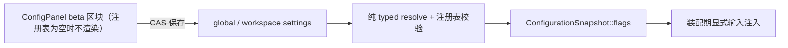

# Beta Flag 系统

> 状态：现行设计（已实现注册表、`config.betas` 配置面投影、装配期消费注入与
> ConfigPanel 管理区块）。
>
> 事实源：settings 类型 `peri-config/src/app.rs::BetasConfig`（bool 稀疏覆盖表）；配置权威、快照、
> CAS 与 explain 的通用规则见 [configuration-authority.md](configuration-authority.md)；
> 消费点 `mcp-packages/workspace/src/terminal.rs`（Bash）、
> `peri-middlewares/src/subagent/tool/`（Agent）；管理面板
> `peri-tui/src/kit/panels/config.rs`；注册表挂载点 `peri-acp-types`（与 MetaHarness
> 常量表同址）。定位信息以 `docs/code-index/` 为准。

## 定位

Flag 是受控的 beta 能力开关：能力已在代码中实现但不默认启用，用户在 settings 中
显式开启后，新建会话按该 flag 定义的策略运行。开启改变行为策略（缺省或强制）与
能力可见性，不引入第二实现，未配置用户的行为与 flag 引入前一致。

边界：

- **不是通用配置**：常态能力参数使用各自领域的 typed 字段，不用 flag 表达。
- **不是 MetaHarness**：MetaHarness 表达「关闭一只已默认装配的组件」，flag 表达
  「开启一只未默认启用的能力」；两者都服从配置权威面，但注册表与消费面独立。
- **不做远程下发、灰度放量、AB 实验与用户分群**：实验与观测属于 Langfuse 领域。
- **不承载安全与兼容语义**：权限、审批、凭据准入与数据格式兼容不得以 beta 开关
  形式存在——这些规则没有 beta 状态。
- **不做会话内热生效**：flag 值随装配冻结，见「消费契约」。

## 领域模型

三个概念各有一处权威：

| 概念 | 含义 | 权威 |
| --- | --- | --- |
| Flag 定义 | 稳定 id（kebab-case）与 canonical 描述 | ACP flag 注册表（`peri-acp-types::beta_flags::BETA_FLAGS`）；TUI 本地 beta 另由 `peri-config::betas` 声明 |
| Flag 覆盖 | settings `config.betas` 的稀疏 `id → bool` 表 | 用户 settings（global / workspace） |
| 有效值 | `覆盖.get(id).unwrap_or(false)` | resolve 投影 `BetaFlags` |

ACP flag 默认值恒为 false，注册表不得声明默认开启条目；TUI 本地 beta 的未配置语义按其
发布绑定，`history-window-v1` 未配置视为开启、`history-v2` 未配置视为关闭（见「TUI 本地 beta」）。
id 一经发布不得改名（settings 键、日志与面板身份），改名等同于「废除 + 引入」。面板操作产生的
覆盖是用户偏好数据，不因能力转正而被改写（残留键按未知键规则失效）。

## 注册表

ACP 注册表在 `peri-acp-types` 集中声明（与 MetaHarness 常量表同址），供配置校验、装配方
（peri-middlewares、peri-mcp-workspace）与 TUI 共同消费。条目字段：id、canonical
description。消费方以注册表常量（而非字符串字面量）引用 id。TUI 历史窗口的
`history-window-v1` 与 History V2 的 `history-v2` 不在 ACP 注册表，另见「TUI 本地 beta」。

生命周期：

- **引入**：能力已实现、默认关闭、描述明确、具备退出计划。
- **转正**：能力改为常态（默认行为或常态配置项），删除注册表条目。
- **废除**：删除条目。

转正与废除后，settings 中残留键按未知键规则处理。

## 配置面接入

settings 位置为 `config.betas`（`BetasConfig`，内部为 bool 稀疏覆盖表）。示例：

```json
{ "config": { "betas": { "history-window-v1": false } } }
```



| 规则 | 内容 |
| --- | --- |
| 合并 | global 与 workspace 逐 key 覆盖（workspace 同名键胜出），不做整体替换；workspace 显式 false 可关闭 global 的 true。差异提取与 MetaHarness 同款 |
| 校验 | 键必须在 ACP 注册表或 TUI 本地 beta 清单内（当前 `history-window-v1`、`history-v2`）；未知键在解析后从内存配置剔除并记录 warning（`validate_meta_harness` 同款语义），不进入快照、投影与面板；磁盘残留键在下一次经权威保存路径写回时清理 |
| 类型 | 值必须为 bool；非 bool 使该来源解析失败，不静默降级为 false 或 true |
| 投影 | `ConfigurationSnapshot` 新增 `BetaFlags` 投影（与 `resources()` 同级），由合并后 settings 派生；`is_enabled(id)` 对未覆盖或未知 id 返回 false |
| 解释 | `ConfigurationField::Betas`，DOMAINS 声明来源为 Global + Workspace |
| 保存 | 复用 `ConfigSource::save`（revision 核对、纯 resolve 校验、字节 CAS、发布）；不建立独立写路径 |
| ACP | `config.betas` 随既有 `update_config` 全量配置语义参与读写；不新增 `SessionConfigOption`，不改变全量替换语义 |

## 消费契约

**装配期读取一次、随装配冻结。**

- 消费方仅在装配期（会话工具池、middleware、能力装配）从快照投影读取 flag 值，
  作为显式装配输入注入产物；值在一个会话（含其 SubAgent 与工具环境）内不变。
- 禁止执行期回读：工具调用、hook 与 middleware 执行路径不得重读配置源、快照之外
  的 settings，或自行解析 flag 语义。
- 设置更新发布新快照后，仅此后新建的会话使用新值；进行中的会话保持冻结值，
  行为不漂移。
- 值送达使用显式装配输入：消费方经实例装配输入或 middleware 装配参数接收语义化
  布尔值；不引入全局单例读取或运行时查表。
- 快照缺失、未覆盖与未知 id 一律按 false 处理；配置面不可用不得导致能力意外开启。
- 装配时若有 flag 生效，记录 flag id 与来源层，供诊断。

## TUI 管理面

管理入口是 ConfigPanel（Ctrl+F / `/config`）：在既有配置行之后追加 **beta flag
区块**，按 ACP 注册表顺序为每个条目渲染一行 Toggle（id、描述、开启/关闭）。行模型从
静态表扩展为「基础行 + 注册表驱动行」，滚动沿用面板既有能力；注册表为空时不渲染
区块标题。

- 切换写当前生效层的 `config.betas[id]`，经 `save_effective`（CAS）持久化；保存
  失败回滚本次内存写入（视图保持持久化前的值）并提示错误。
- 面板显示**合并后的有效值**；未设置与显式 false 均显示为关闭。
- 区块标注**新会话生效**；已运行会话不受切换影响。
- 描述优先 i18n key `beta-desc-<id>`，缺失回退注册表 canonical 文本。
- BetasPanel（Ctrl+B / `/betas`）已退役：ACP flag 列表的单一权威是注册表，不保留第二入口；
  TUI 本地 beta 例外见下节。

## TUI 本地 beta：history-window-v1

`history-window-v1` 是 TUI 历史窗口的本地 beta，键定义在 `peri-config/src/betas.rs`。
**未配置视为开启**，只有用户显式配置 `false` 才关闭。它由 `is_known` 接受并
进入 `BetaFlags` 投影，但不在 `peri-acp-types::beta_flags::BETA_FLAGS`，因此 ConfigPanel 的
beta 区块不列出，需手动写入 settings：

```json
{ "config": { "betas": { "history-window-v1": false } } }
```

TUI 启动时（`peri-tui/src/kit/entry.rs`）读取一次快照 flags，调用
`kit/history_window::apply_history_window_beta` 写入 `HISTORY_WINDOW_V1` atom；设置变更需重启，
无热重载。该开关只决定 TUI 是否采用窗口模型，仍需服务端 `peri.historyWindowV1` 在 initialize
响应中明确回显 `true`（未回显一律 fail-closed）；两者之一为 false 时保留旧 `HISTORY_PAGING`
行为。Beta 面板未列出该键是当前限制；在把它纳入面板前，键的定义与消费仍以
`peri-config::betas` 和 TUI 启动路径为准。

## TUI 本地 beta：history-v2

`history-v2` 是 History V2（统一历史加载）的 TUI 本地 beta，键定义在
`peri-config/src/betas.rs`，**默认关闭**：未配置或显式 `false` 时 TUI 继续走 V1
（`history-window-v1` / 旧分页）；只有显式 `true` 才在 initialize 请求中声明
`_meta["peri.history"]`。该键同样不在 ACP 注册表，ConfigPanel 不列出，需手动写入 settings：

```json
{ "config": { "betas": { "history-v2": true } } }
```

TUI 启动时（`peri-tui/src/kit/entry.rs`）读取一次快照 flags，写入 `HISTORY_V2` atom，
无热重载。是否真正启用仍由服务端在 initialize 响应中明确回显 `peri.history` 决定：
beta 开启但服务端未选择 V2 时启动显式失败，不静默回退到标准全量回放。

**与 V1 互斥**：V2 激活后，客户端只声明 `peri.history`，不再声明 V1 私有能力；
`window_path_enabled()` 在 V2 激活时返回 false，V1 窗口队列、旧页分页与 gap seek
全部让位，两套窗口状态不得混用。beta 关闭时 V1 语义保持不变。

## ACP 注册表现状

当前 `peri-acp-types::beta_flags::BETA_FLAGS` 为空：首个 flag `full-async-tools` 已转正为
`Agent` 工具的常态语义并删除条目（v5 裁决）。执行模式契约见
[Session 异步任务](session-async-tasks.md) 的「Agent 委派模式」；旧会话冻结 blob 里残留的
`full-async-tools` 键按未知 id 忽略，不改变行为。新增 ACP flag 时在本注册表按发布顺序
追加；条目默认值仍恒为 false。

## 治理

- 注册表集中声明并随代码评审管理；禁止消费方散落字符串比较。
- flag 数量保持克制：beta 是临时状态，能力具备常态可用性后即转正或删除。
- 删除优于兼容：转正与废除时删除条目，不保留 deprecated 别名或兼容分支。

## 边界外

- 远程下发、灰度、AB 实验与用户分群。
- 安全策略与数据兼容语义的 beta 开关。
- 会话内热生效与运行期 flag 变更通知。
- 环境变量覆盖（若未来引入，必须经同一配置面与同一校验清单——ACP 注册表 + TUI 本地 beta——不建立第二解析）。
- 独立 ACP `SessionConfigOption` 暴露。
