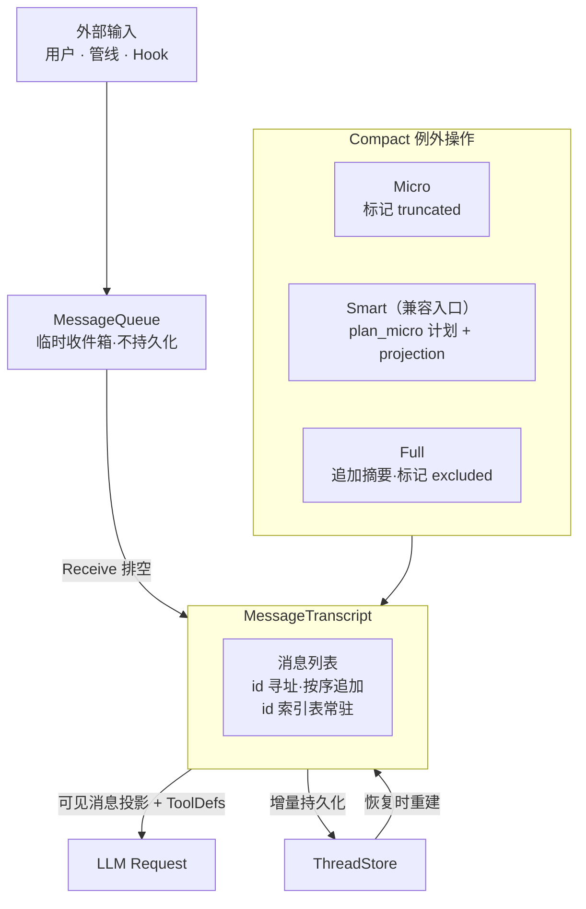

# 会话消息与 Transcript 架构设计

> BaseMessage、ContentBlock 枚举、MessageTranscript 与 staging 事务写
>
> 状态：现行内容模型；2026-10-07 已批准撤销持久执行恢复。MessageQueue 属于当前进程，canonical 历史继续持久化；会话隔离、类型化消费和历史加载边界由 [RCRA 权威](rcra-message-activation.md) 定义，剥离进度见 active spec。2026-10-17 增补有效上下文所有权、手动 Compact 有效集读取与 `peri.historyWindowV1` 窗口边界；窗口协议默认关闭，实施状态见 active spec。
>
> 运行时事实源为 `peri-agent/src/session/transcript.rs`、消息契约类型与相邻测试；有效上下文所有权与窗口事实源为 `peri-acp/src/host/{mod,prompt,history_window}.rs`、`peri-acp-types/src/history_window.rs` 与 `peri-tui/src/kit/history_window/`。

## 1. 设计原则

1. **永远 id 寻址**：每条消息拥有唯一 `MessageId`（UUID v7，时间有序）。所有外部操作——rewind、compact、持久化恢复——一律按 id 定位消息。禁止使用 Vec 下标定位——下标可因消息标记漂移而引入隐性错误。
2. **只追加优先**：正常 ReAct 循环中消息仅尾部追加，禁止 prepend 或中间插入。Compact 保留消息本体，通过标记改变模型视图，Full 另行追加摘要。
3. **修改即新消息**：消息内容不可原地修改。需要变更时，正常路径产生新消息（新 id）。Micro 持久化 projection directive，Full 标 `excluded`；标记不改变消息内容本身。（Smart Compact 为 planner 兼容入口，见 §2.6）
4. **Transcript 为运行时事实源**：运行时从 Transcript 构造消息视图；冷恢复从持久化 payload 与 flags 重建。已提交的 compact 结果跨 turn 保留，包括随后取消或失败的 turn。不持久化 MessageQueue——Queue 是临时收件箱。
5. **追加异步、提交有确认**：普通追加经异步 writer，compact lifecycle 与 turn 收尾必须检查持久化结果。writer 失败后停止使用热会话，保留已落盘内容，重新加载后才能继续；不以删除新增 ID 模拟事务回滚。
6. **标记代替删除**：Compact 不删除、不修改消息内容。Micro 标 `truncated`（LLM 请求时截断输出），Full 标 `excluded`（LLM 请求时跳过该消息）。（Smart Compact 已实现为 planner 兼容入口，见 §2.6）标记可撤销，消息本体不变。仅 rewind 允许真删除。

---

## 2. 总体架构

### 2.1 MessageId 寻址

每条消息拥有唯一 `MessageId`（UUID v7，按时间单调递增）。

- **唯一寻址方式**：所有操作一律通过 id 定位消息。Transcript 内部维护 id→消息的索引表，常驻内存。不存在通过 Vec 下标定位的路径——下标会因 Compact 移除消息而漂移，后果严重。
- **去重保证**：同一 Session 内 MessageId 绝不重复。持久化恢复时执行 id 碰撞检测——碰撞意味着数据损坏。
- **时间有序**：UUID v7 自带时间戳，天然按创建时间排序——Transcript 的消息列表与 id 排序一致。

### 2.2 Transcript 存储

核心容器为消息列表，顺序即对话时间线。尾部追加是唯一正常写入路径。内部通过 id 索引表支持 O(1) 按 id 查找。

- **BaseMessage**：统一消息类型。`content` 为 `MessageContent`（纯文本、ContentBlock 列表、Provider 原生格式）。`content_blocks()` 懒解析，Provider 按需选择最优格式。
- **ContentBlock**：七种变体——Text、Image、Document、ToolUse、ToolResult、Reasoning、Unknown。Transcript 存储完整 ContentBlock。
- **只追加规则**：
  - ✅ Reason 产出的 AI 消息、Act 产出的 ToolResult → 尾部追加
  - ✅ Info 类型消息（含 SystemReminder）经 MessageQueue 中转后尾部追加
  - ✅ `append_batch()` 批量追加——逐条触发独立 `PersistOp::Append`
  - ❌ 禁止 prepend 或中间插入——破坏 Prompt Cache 前缀
  - ❌ 禁止删除或修改——Compact 通过标记改变模型视图，不改变消息本体
- **代码位置**：`BaseMessage` / `ContentBlock` / `MessageContent` 定义于 `peri-agent/src/messages/`；`MessageTranscript` 定义于 `peri-agent/src/session/transcript.rs`；`MessageQueue` 定义于 `peri-agent/src/session/queue.rs`。Transcript 和 Queue 属于 session 模块，messages 模块仅含消息数据类型定义。
- **ancestor 边界**：SubAgent 引用父上下文时，将 payload 与 flags 一起冻结为版本化 `InheritedContext`，并在 `threads.inherited_context` 列一次性写入；恢复时先放 ancestor、再放 child own history。窗口 `inherited` 来源的 `frozenSnapshotId` 由子会话、字节数、条数、祖先与首尾消息 id 派生，父会话后续 append/compact/rewind 不改变该快照。祖先标记允许初始化恢复，普通标记 setter 与 compact lifecycle 拒绝改写祖先；本机 SQLite 提供 inherited 窗口读取，remote/emscripten adapter 未覆写该端口时返回 `Unsupported`。ACP `session/fork` 是独立会话复制：复制后的 payload 使用新 `MessageId` 并归新 thread 所有，因此属于可压缩 own region，而非共享 ancestor。
- **Staging 两阶段写入**：Reason 阶段产出的 AI 消息（含 tool_calls）不直接追加到 Transcript——先 Staging。Act 阶段收集所有 ToolResult 后，AI 消息 + ToolResult 作为一组原子提交到 Transcript。Staging 期间的消息 LLM 请求不可见。提交后触发持久化。若 Act 阶段异常终止（Cancel/Error），staging 消息丢弃——Transcript 回到本轮开始前的状态，不留半个 AI 消息。

### 2.3 MessageQueue

临时收件箱，独立于 Transcript，**不持久化**。冷重建会话时 Queue 从空开始；同一宿主会话跨 turn 共享队列实例。实现位于 `peri-acp-types/src/session/queue.rs`，Agent session 模块保留 re-export。

用户尚未获准消费的内容保存在 Agent `UserInputMailbox` 待发区，不能提前进入本消费 MQ。
只有指定发送或运行协调允许的内容才交接，Receive 领取与 Stop 精确撤出共享同一队列锁。
完整投递和恢复语义见[用户待发送队列](user-input-queue.md)。

#### MessageKind 三类消息

消息按 Kind 分为三类，控制循环唤醒和消费行为：

| Kind | 来源示例 | `drain_all` 行为 | 通知活跃等待者（不保证启动新 turn） |
|------|---------|----------------|------------|
| `Prompt` | 用户输入、外部主动请求 | 消费（写入 Transcript） | ✅ |
| `Defer` | SubAgent 完成、Cron 触发、延迟结果 | 消费（写入 Transcript，emit `SyntheticUserMessage`） | ✅ |
| `Info` | SystemReminder、Hook 注入 | 消费（写入 Transcript） | ❌ |

#### MessageSource 九种来源

每条 `QueuedMessage` 携带 `MessageSource` 标注来源，用于调试和事件追踪：`UserInput` / `SubAgentComplete` / `GoalSteering` / `CronTrigger` / `StopHookFeedback` / `ChannelMessage` / `SystemInjected` / `ToolFailureWarning` / `WorkflowComplete`。

#### 排空 API（RCRA 重构后）

- **`drain_all()`**（`peri-acp-types/src/session.rs:222`）：Receive 阶段一次性消费队列中全部消息（Prompt + Info + Defer），写入 Transcript。原 `drain_for_receive` / `drain_for_end` 双排空 API 已移除——RCRA 重构后 Receive 是唯一队列消费点，End 阶段不再单独消费 Defer（见 `peri-agent/src/agent/stages/receive.rs:12-16` 与 `agent/session/inbox.rs:11` 注释，二者仅剩注释提及）。
- **`has_wake_up()`**（`session.rs:231`）：Receive 消费后队列空且无工具调用时，退出判断前检查队列是否还有可唤醒消息（Prompt 或 Defer）——有则继续循环，无则退出（见 `stages/mod.rs:649`）。Info 永远不会单独唤醒循环——必须被 Prompt 带出。

### 2.4 持久化

ThreadStore 负责 Transcript 的完整持久化。`ThreadStore` trait 定义已下沉 `peri-acp-types/src/store/mod.rs`（`pub trait ThreadStore` :221），实现迁至 `peri-resources/src/sessions/`（`filesystem.rs` 的 `FilesystemThreadStore` / `sqlite_store.rs` 的 `SqliteThreadStore`），`thread/mod.rs` 仅 re-export。该 trait 是**迁移桥**：目标契约是 `peri-acp-types/src/session_resources.rs` 的 `SessionResources`（行为门面，数据与本机执行两面分离），历史纯变换（fork/投影/compaction/rewind）在 `peri-acp-types/src/store/history.rs`，消费侧迁移见 active spec 2026-09-26-session-store。

#### ThreadStore trait 核心方法概览

| 方法 | 职责 |
|------|------|
| `create_thread` / `delete_thread` | Thread 生命周期管理 |
| `append_messages` / `append_message` | 增量追加消息（append_message 默认复用 append_messages） |
| `load_messages` / `load_context` | 加载全部消息 / 含祖先链 + 缓存的完整上下文 |
| `store_inherited_context` / `load_inherited_context` | 子会话冻结继承 payload 与 flags；未知版本或损坏快照拒绝加载 |
| `load_meta` / `update_meta` / `update_title` | 元数据读写 |
| `list_threads` / `list_child_threads` / `list_session_threads` | Thread 列举与层级遍历 |
| `update_thread_status` | 状态管理 |
| `delete_messages` / `delete_messages_since` | 精确删除 / 按 id 后缀删除（rewind 用） |
| `update_message_flags` | 更新 compact 标记（truncated / excluded），默认 no-op |

- **触发时机**：消息追加到 Transcript 后异步触发持久化；compact lifecycle 先 flush 追加，再原子提交摘要与标记。turn 收尾检查 writer 结果。
- **增量持久化**：仅追加新消息；compact 标记变更 UPDATE、新增消息 INSERT。rewind 触发 DELETE。
- **Compact 标记**：Micro 标记 `truncated`、Full 标记 `excluded`。标记持久化同步（UPDATE 标记字段，不修改 content）。Full 追加新 Human 消息（INSERT）。Smart Compact 为 planner 兼容入口，标记与 Micro 一致（见 §2.6）。
- **失败恢复**：host 对可信的执行结果采纳 canonical payload 快照，不以 `ok` 决定是否更新历史。Host 只在 `SessionState.history_payloads` 持有**当前有效** payload，并以 `ContextOwnership::{Resident,HandedOff,ReloadRequired}` 表达执行期所有权；`SessionState.history` 消息投影已删除。`HandedOff` 的空集合表示正文已移交在途执行器，**不是空会话**；持久化结果不确定时清空热态、进入 `ReloadRequired` 并撤销窗口票据，下一次使用从存储冷恢复。`finish_prompt_turn` 只采纳结果快照，不因 turn 结束移除 session。writer 错误、compact 提交结果不确定或缺失执行结果会使热会话失效；冷加载恢复磁盘已提交的 payload 与 flags，不能把已提交摘要视为脏数据删除。失败的追加不自动补写。

### 2.5 Rewind

按 MessageId 将会话回滚到指定消息，撤销其后所有操作。

- **操作**：指定目标 id → Transcript 截断至该消息（含）→ id 索引表同步收缩 → 持久化层删除该 id 之后的所有记录 → MessageQueue 清空。
- **文件系统回滚**：rewind 到某消息时，该消息之后产生的临时文件（如输出落盘文件）同步清理。仅保留回滚点之前的文件系统状态。
- **恢复**：回滚后的会话从该点继续，ReAct 循环正常启动。

### 2.6 与 Compact 的交互

Compact 保留消息本体，通过标记改变可见性或模型投影；Micro directive 随 writer 持久化并在收尾检查，Full lifecycle 在存储确认成功后发布摘要与标记的内存状态。三种模式的策略：

| Compact 模式 | 重建策略 | 持久化影响 |
|-------------|---------|-----------|
| Micro | 保留全部消息，部分标 `truncated: true` | UPDATE 标记字段 |
| Full | 追加新摘要消息，旧消息标 `excluded: true` | INSERT 摘要 + UPDATE 旧消息标记 |
| Smart（已实现为兼容入口） | 经 `plan_micro` 生成计划后应用，未选中消息标 `truncated` + projection directive | UPDATE 标记 + INSERT projection directive |

- Micro 和 Full 两种已实现模式通过标记实现——Micro 标 `truncated`，Full 标 `excluded`。消息不删，标记可撤销。rewind 清标记恢复原状
- Reason 与 Compact 检查在内容未变时复用同一份模型视图（`peri-agent/src/agent/stages/model_view.rs`）：`MessageTranscript::view_revision()` 返回 `TranscriptRevision { instance, revision }`——任何改变模型可见内容的写入推进修订号（staging 不推进；`rebuild` 保留实例身份并强制前进，避免换出重建后被误判为同一内容），实例身份区分 `std::mem::take` 换出后的新 transcript。复用槽按迭代划定作用域（`run_react_loop` 每轮入口清空、取到请求快照后释放），不跨迭代常驻，也不缓存 token 估算（工具目录可能在检查点之间变化）。槽的存续遵守「同一时刻至多一份整份视图正文」：键不匹配时先丢弃旧项再渲染新视图；只有确实要构造 Full 摘要视图时才释放（`compact_v2::FullSummaryNotice` 在渲染前调用，Micro/Smart 未落地、shadow、空计划未达阈值等无变化路径保留缓存供 Reason 复用）；Reason 准备阶段持作用域守卫，hook 错误、提前取消与取快照失败等所有退出路径统一释放。回归入口 `agent::stages::model_view_tests`
- Smart Compact 已实现为 planner 兼容入口（`peri-agent/src/agent/compact_v2/smart.rs`）：不再走独立 LLM 筛选分支，而是通过 `plan_micro` 生成计划再应用（`set_flags_projection` 统一持久化 directive），并带 deprecation warning（"will be removed, converging to Micro"）；`compact_v2` 已目录化（原 `compact_v2.rs:57` stub 位置不复存在）
- Full 从完整可见模型历史（含 canonical reminder，恢复已提交 Micro 投影和历史工具结果）生成摘要，将新摘要和本次快照内 own region 的非 System 历史 excluded transitions 作为同一 lifecycle 提交。历史工具调用及结果留存在 transcript，不从计算实例本机回读 Workspace 文件。报告/通知不因 reminder 类型而豁免；原文留存，成功后退出活跃模型视图；未纳入快照的新结果继续等待 Receive。后续取消或失败不撤销已提交事务；恢复须保持摘要与 flags 配对（每条被归档条目在同一批里记下取代它的摘要 id，rewind 据此逐条判定排除是否仍有依据，见 `docs/design/micro-compact.md` §7.1）。提交前置 pending 状态，只有存储确认成功并应用内存后才标记 committed；取消或错误留下的不确定状态由自动 executor 与手动命令 interceptor 传播给 host，不能仅以普通 writer barrier 成功确认一致性。

### 2.7 与 v2 其他模块的关系

| 模块 | 关系 |
|------|------|
| **Session** | Transcript 是 Session 核心实体之一。Session 创建时 Transcript 为空，销毁时丢弃。CronOwner 由 AcpSession（session 级）持有，跨 turn 存活；SessionInbox 为 session 级 lazy-init，cron/channel 事件经 inbox 唤醒 executor，绕过 TUI 轮询 |
| **LLM 适配器** | Reason 过滤 excluded 并恢复已提交 projection 构造 ModelRequest，即使关闭自动 compact 也恢复投影。无 directive 时使用 canonical 可见消息，不在 Reason 规划新 Micro。Token 计数在 LLM adapter 层完成 |
| **ReAct 循环** | Receive 将 Queue 消息写入 Transcript。Act 将工具结果写入 Transcript |
| **AgentGroup** | Fork Agent 创建时 Transcript 全量 Copy |
| **Hook 系统** | Hook 不能直接写 Transcript——通过 MessageQueue 注入 |
| **事件流 / TUI** | `visible_messages()` 过滤 excluded 标记返回可见消息（LLM 请求构造用）；`visible_snapshot()` 返回 `Arc<Vec<BaseMessage>>` 快照，用于 TUI 事件传递（如 TurnCompleted 事件）。Transcript 变更产生事件，外部据此刷新 UI |

### 2.8 有效上下文所有权、手动 Compact 与历史窗口（2026-10-17）

本节描述已落地的所有权收敛与窗口边界。`PeriCaps::history_window_v1` 默认 false（只接受显式 `true`）；TUI 的 `HISTORY_WINDOW_V1` 窗口开关由 settings beta `history-window-v1`（默认 false）在启动时读取一次，设置变更需重启生效。TUI 的 initialize 以 `PeriCaps::all_enabled` 声明能力，因此其连接会协商为 true，但未打开开关时仍走旧 `HISTORY_PAGING` 路径。关闭时旧分页/渲染行为不变。窗口与段释放的 TUI 细节见 [TUI 与 ACP 数据流](tui-acp-data-flow.md)，wire 字段见 [peri-acp 协议](peri-acp-protocol.md)。

#### 2.8.1 执行期所有权

1. `SessionState` 只保存 `history_payloads`（当前有效 payload）与轻量 `context_ownership`，不再保存 `history: Vec<BaseMessage>` 投影；命令与展示所需的 `BaseMessage` 按需短暂派生。
2. `Resident`：Host 持有有效上下文，可读、可派生展示投影。`HandedOff`：正文随本轮执行移交给执行器，Host 不再持有副本；此时 `history_payloads` 为空，不能解释为空会话。`ReloadRequired`：持久化结果不确定或热态不可继续，下一次使用前必须从权威存储恢复。
3. 启动执行时 Host 取走 `history_payloads` 并标记 `HandedOff`；执行结束的 `finish_prompt_turn` 采纳 `PromptResult.persisted_payloads`（执行器返回的有效集合）并恢复 `Resident`。`SessionState` 不因 turn 结束被移除；取消、模型错误或 forwarder 失败仍可采纳可信快照。
4. `persistence_inconsistent` 或 writer 失败清空热态、标记 `ReloadRequired`、撤销当前窗口票据；不得按新增 id 伪造回滚，也不得让旧窗口继续读取不可信 tail。完整 canonical 历史（含 excluded 原文）只从存储按需读取。
5. 该所有权是内存生命周期约束，不是执行所有权或访问授权；跨实例执行协调仍归 `peri-sdk`，窗口票据也不是会话访问凭证。

#### 2.8.2 手动 `/compact` 只读有效集

1. `compact_pipeline` 以 `SessionResources::load_active_snapshot` 读取 own 有效 payload（存储侧 `excluded = 0` 过滤）与冻结 inherited 区，再用 `with_ancestor_payloads` / `with_own_payloads` 重建临时 transcript；已归档正文不参与解码，不进入摘要输入。
2. 身份校验按**有序消息投影**比较 inherited + own 的 id 序列，并拒绝 inherited 与 own 的 id 重叠。调用方仍带回完整历史（含已归档 id）时，多出的 id 只有在有界 `load_message_flags` 查询确认全部为 `excluded` 后才被忽略；未知 id 或 flags 读取失败保持拒绝，并返回 `compact persistence context mismatch`。
3. 有效集为空时用 flags 区分两种来源：全新 thread（历史尚未落库）与全部 own 条目已被之前的 Full 归档；后者返回 `no history to compact`，不读取任何归档正文。
4. 手动 Compact 的提交与自动 Full 共用 `commit_compaction_lifecycle`：存储确认后才收缩热态并发布摘要；提交失败或不确定沿用 `ReloadRequired`，不把已提交摘要当脏数据删除。**磁盘已提交前缀是身份与恢复的唯一权威**，热态不是第二份审计源。
5. 这是已获批的契约变更：手动 `/compact` 不再“恢复完整 payload”，而是“只读有效集 + 历史窗口按需读取”。生效条件是 `peri.historyWindowV1` 与 TUI 开关实际启用；默认关闭时保留旧行为。

#### 2.8.3 历史窗口与展示段

1. 窗口协议复用 `session/load`，请求带 `history: { kind: "open" | "page" | "seek", ... }`，正文分块走 `session/history/body`；它只读、不装配会话、不取执行锁、不广播命令，也不回退为完整 `session/load`。旧顶层 `cursor`/`limit` 分页保持独立语义。
2. 存储按有界 keyset 读取：先取候选行身份/长度，只为计划内正文取内容；超大条目只返回描述符，正文按 `offset`/`maxBytes` 分块读取。窗口读取 canonical 存储的请求区间（包含已归档 `excluded` 行，范围由锚点/方向/limit/tail 限定），但归档正文只在该区间被明确请求时读取，且读取结果不写回 Host 热态；有效上下文、手动 Compact 与恢复仍只读 `load_active_snapshot`（存储侧 `excluded = 0`）。
3. 服务端签发的 `snapshotToken`、`committedTail`、`readTicket` 与 `sessionGeneration`/`structureVersion` 共同固定一次浏览；`page`/`seek`/`body` 在进入存储前和返回前各校验一次 generation、structure、ticket epoch、snapshot 与 tail。新 `open` 成功才原子替换旧 ticket，失败保留旧窗口。rewind durable 成功恰好推进 `structureVersion + 1` 并撤销 ticket；失败不推进；持久化不确定 fail-closed。
4. TUI 的展示正文仍由 `BridgeState.committed` 唯一强持有；`HistoryWindow` 只保存持久身份、段/缺口、字节账目与 pin 原因。compact 提交确认后按 `committedTail` 封印 durable 段，保留视口与相邻段，其余段生成 `ReleasePlan`；统一释放事务同时清 `DisplayLedger`、`HistorySpans`/`ResidentIndex`、折叠历史、渲染缓存、`WINDOW_UNIT_KEYS`、焦点与未配对工具结果。释放不删除存储历史。
5. 释放先移除 `committed` 展示正文与派生缓存，再递增 `structural_epoch`；渲染侧处理后写回 `RENDER_ACHIEVED_EPOCH`，预算额度才从 `pending_release` 归还。连接断开或 headless 路径在 session close 时统一结算。
6. 能力/开关缺失、游标失效或提交通知丢失时，窗口进入 `Degraded`：停止淘汰、保留现有可读段与游标、按退避重试 `open`；不得自动退化为完整 `session/load`。

#### 2.8.4 对象级证据与已知边界

进度与验收记录见 active spec；本节只固定当前实现边界，避免把目标写成现状。

对象级释放不能以 `committed.len()`、`VIEW_MODELS.items.len()` 或 RSS 单独证明。当前验收使用以下证据：

1. `release_removes_committed_and_invalidates_holders_before_ack`：释放并收到渲染 ack 后，`Weak<TuiAssistantBubble>` 无法升级，`DisplayLedger`/折叠历史/渲染缓存/焦点/工具配对指纹均不含被淘汰身份。
2. `structural_epoch_drops_old_slot_lines_and_uses_8mib_to_6mib_budget` 与 `structural_epoch_with_empty_snapshot_reaches_zero_retained_bytes`：结构代次变化后旧 slot 行缓存被丢弃，`Transcript::retained_bytes() == 0`。
3. `pending_release_keeps_budget_conservative_until_ack`、`release_ack_is_idempotent_and_late_ack_does_not_double_credit`：渲染确认前不提前归还预算，重复/迟到 ack 幂等。
4. `stale_or_late_response_is_dropped_and_reservation_released`、`one_in_flight_and_one_pending_merge_are_enforced`：迟到页与并发页不合并，页预留归还。

已知边界（不得写成已完成）：

- 折叠组/子 Agent 组尚未真正惰性化。当前 `TuiCollapsedGroup.view_models` 通过 `im::Vector` 结构共享持有成员，构造不深复制正文；但释放时只做 `FoldedHistory::invalidate()` 与整组缓存失效，没有按段精准惰性物化/清理。
- 结构性失效目前清空全部渲染 slot，尚未按段精准清理。
- 旧 `HISTORY_PAGING` 路径仍使用轻量静态 `PENDING_TOOL_ENDS` 表，未完全迁移到 `ResidentIndex`；窗口路径与旧路径共享该表的清理入口。
- 超大条目详情与 inherited 详情已交付（`HistoryDetailPanel`、`session/history/body`、4 MiB 预算、UTF-8 跨块重组、关闭释放 chunks）。限制：鼠标单击只设焦点需再 Enter；UI 导出为剪贴板复制已加载正文（模型支持分块流式）；未做 JSON 字段级展示；inherited 段内部不插入独立占位行；TUI 仍接受旧顶层 `bodyDescriptors` 兼容输入，服务端已不再发送该形状。
- remote/emscripten adapter 未覆写窗口/继承读取端口，默认返回 `Unsupported`（出口 `-32603`），不能宣称这些后端已支持窗口。
- `readTicket` 是进程内不透明值与精确匹配，没有密码学签名；它绑定 connection/session/generation/structure/snapshot/source/tail/投影版本/时间/nonce，但不是访问授权。
- rewind 的持久化不确定仍由集中后的文本 marker 判定（`PERSISTENCE_UNCERTAIN_MARKER`），尚无 typed mutation outcome；`schema_test.rs` 的存量 1038 行超限不属本次变更。
- beta 设置面板仍只列 `BETA_FLAGS`；`history-window-v1` 需手动写入 settings，TUI 启动只读一次、无热重载。
