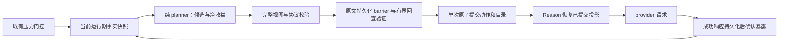

# Micro Compact：可回查的模型视图投影

> 状态：现行实现设计；尚未实现的内容策略与验收边界见末节。本文不代表真实 provider 发布验收已通过。
>
> 行为事实源：[Compact 引擎](../../peri-agent/src/agent/compact_v2/)、[投影契约](../../peri-acp-types/src/projection.rs)、[归档契约](../../peri-acp-types/src/context_archive.rs)。工程规则见 [ARC-COMPACT-001 与 ARC-MICRO-TOOL-INPUT-001](../standards/architecture-contracts.md)。

## 1. 职责和数据流

Micro 不调用摘要模型、不改写 canonical 消息。它在既有压力门控之后，计算下一次模型请求可使用的历史投影，并把动作与回查目录一起持久化。历史展示仍读取 canonical 内容；Micro 的省略不复用 Full 的 `excluded` 语义。

| 边界 | 入口 | 所有权 |
| --- | --- | --- |
| 触发与 Full 决策 | `stages/compact.rs`、`compact_v2/mod.rs` | 保留已有压力样本、取消和失败语义 |
| 运行期证据 | `compact_v2/exposure.rs`、`stages/micro_facts.rs`、`stages/{reason,act}.rs` | 有界暴露索引与终态证据；不恢复旧执行 |
| 规划 | `planner.rs`、`planner/{index,catalogs,planning}.rs` | 只读 transcript、配置、事实和 provider 能力；不做 I/O |
| 投影 | `projection.rs`、`projection_archive.rs` | 校验并渲染模型视图，不写 canonical 内容 |
| 提交 | `micro.rs`、`MessageTranscript::commit_compaction_lifecycle` | 原文确认、回查验证、事务确认后发布热态 |
| 回查 | `peri-agent::context_archive`、`peri-middlewares::mcp::context_archive` | 只读能力经 MCP 调用；不持有可写 transcript |
| 存储 | `peri-resources::sessions::{archive,sqlite_store,remote}` | 本地和远端共享有界读取语义；不改表结构 |

## 2. 触发与预算

自动门控保持 `P / C >= micro_compact_threshold`：`P` 是现有 `TokenTracker::estimated_context_tokens()`，`C` 是完整 `context_window`。默认 Micro 为 75%，Full 为 95%。分母不扣输出预留；零/未知窗口、环境覆盖、自动开关、shadow、cache-aware 延迟及同一 `pressure_sample_key` 去重沿用原路径。cache-aware 延迟只作用于尚未达到 Full 条件的请求，不得屏蔽已经成立的 Full 条件。

### 2.1 统一收益准入

所有自动 Micro 提交共用 `compact_v2/decision.rs` 一处决策，比例也只在那里定义一次：

| 符号 | 定义 |
| --- | --- |
| `C` | 完整 `context_window`，不扣输出预留 |
| `P` | 现有压力估计 |
| `M` | 最小 Micro 净收益，`u64::from(C).div_ceil(micro_min_gain_divisor)`（分母默认 10；程序内构造的 0 按 N=1 处理，外部反序列化拒绝 0）。默认分母下 200,000 → 20,000，200,001 → 20,001 |
| `G` | 同一冻结请求中，已提交模型视图到最终完整渲染候选视图的估算净减少量（`estimated_tokens_saved`，已计入收据、目录与 root 成本） |
| `R` | 既有 `pressure.target_reclaim_tokens()`（含 2% 下限，与 `M` 的默认 10% 门槛独立） |

| 条件 | 决策 |
| --- | --- |
| 手动 force | 手动 Full，不受 `M` 限制 |
| 自动关闭 / 驻留 Full | 沿用既有独立路径 |
| `C == 0` 或缺少上下文预算 | 不执行比例型自动 Micro；延后而非零门槛提交 |
| `P / C` 低于 Micro 阈值 | 跳过 |
| 未达 Full 条件，`G < M` 或候选为空 | 延后（Deferred），继续正常工作 |
| 未达 Full 条件，`G >= M` 且候选非空 | 提交一次 Micro |
| 达到 Full 条件，`G >= max(M, R)` 且候选非空 | 可提交一次 Micro |
| 达到 Full 条件，其余情况 | 直接 Full，本轮 Micro 不先提交 |
| shadow | 只报告拟采取决策，不提交 |

先决定最终策略，再执行一次提交。延后是正常结果：压缩写入为 0、归档正文验证为 0、不发送成功事件、不增加失败计数；若 `CompactStarted` 已发送，必须发配对的 `CompactEnded` 并携带原因（收益不足时含 `G`、`M`）。Micro 成功后不得 reset `TokenTracker` 来伪造预算恢复。

驻留字节预算是与 token 独立的前置门控：`CompactConfig::max_resident_history_bytes` 默认 128 MiB，只计 transcript 自有区与继承祖先区的 `reserved` 饱和和（`excluded_bytes` 是两者的子集，不重复计），不新增环境变量。自有区按 **Full 的实际归档谓词**拆成可回收 own（非 excluded、非 System、非 protected）与不可回收 own（System、受保护后台结果）；祖先区整体是不可回收继承残余。已 excluded 的非 System 条目会在 Full 提交后由 `shrink_after_full_commit` 释放，不作为稳定残余。三部分分别进入 `ResidentHistoryPressure` 访问器与日志。严格超过上限（恰好等于不触发；0 关闭）时，Compact 阶段在 token refresh **之前**读取快照，跳过模型视图物化、token Skip、已消费压力样本与 Micro planner，直接强制一次 Full。该路径不调用 `stages/micro_facts.rs::snapshot`，因此远程 archive metadata 探测失败不会把驻留 Full 提前变成 `micro_failure`。手动 force 优先；`auto_compact_enabled=false` 不因驻留触发；shadow 只记录拟执行的 Full、不提交。

每次**实际应用**的 Full（含 `InterruptedAfterCommit`；shadow、失败与未提交不算）都会记录 Full 后的驻留压力快照，并绑定记录时的 limit、transcript 实例身份、watermark 条目 id 与其内容指纹（kind + 正文长度 + 稳定哈希）。门控据此判断：快照总量按**当前** limit 仍超限时视为残余主导；但该状态并非只由继承区造成——limit 降低、受保护 own（System/protected）同样会造成。因此 snapshot 的 limit 与当前 limit 不一致、transcript 实例被替换、watermark 条目被替换（同 id 内容指纹变化）或删除（shrink/rewind）时快照失效，直接回到「总量超限且存在新工作」的普通门控；追加与非 watermark 条目替换不影响快照。残余主导成立时，下一次 Full 只有在**可回收 own 相对上次 Full 后的增长**严格超过完整 limit（`current.reclaimable_own > snapshot.reclaimable_own + limit`）**且**出现新工作时才允许；因此 Full 后摘要自身即使已大于极小 limit，连续追加小结果也不会重复 Full。一旦某次 Full 后总量回到预算内，门控自动恢复原逻辑。Full 成功后仍超限只记录 limit、可回收/不可回收 own、继承残余与总量并继续请求，不做硬准入或终止运行；Full 失败按既有失败语义显式传播。Compact 阶段与 Reason hooks 后补检共用同一门控与同一保护集合。

`max_resident_history_bytes = 0` 是已决策的“关闭门控”语义，不是“立即超限”：`ResidentHistoryPressure::is_enabled()` 要求 `limit_bytes > 0`，与 `ResidentHistoryPressure::DISABLED` 及既有调用方默认行为一致，测试与嵌入方可用 0 显式禁用而无需构造极大阈值。`context_budget` 缺失时 token 压力按 0 处理，驻留字节门控仍独立采集并可在超限时触发 resident Full；`compact_config` 缺失时无法判断阈值、开关与驻留上限，阶段明确跳过并记录，不伪造默认配置。

Reason 在 `before_model` 与工具目录发布后，仅在可见压力确有增长且达到现有 Full 阈值时补检一次；此外，hooks 前后 canonical revision 变化且驻留超限时也补检一次，不要求投影 token 增长。两条路径都不重复运行 hooks，也不新增低于 75% 的自动投影入口。手动 `/compact` 仍走 force/Full；关闭自动压缩不会撤销已提交投影。

| 数值 | 用途 |
| --- | --- |
| `max_resident_history_bytes`（默认 128 MiB） | 独立驻留门控；总量超限触发；残余主导时按可回收 own 相对上次 Full 的增长 > limit 且存在新工作才重试 |
| `ContextPressure::target_reclaim_tokens()` | 必要回收量，保留预留和 2% 窗口下限，供既有 Full 决策使用 |
| `min(45% × C, pressure.target_tokens())` | 触发后的尽力目标；达到目标停止更强整组省略，未达目标报告缺口，不作为触发或 Full 升级条件 |
| 最近已完成 Step | 默认保护最近 2 步，可由 `micro_compact_stale_steps` 配置；软预算 `min(8192, 10% × C)` |
| 历史收据与索引 | 预算 `min(2048, 2% × C)`；收据超预算时保留合并范围入口，通过分页发现目录 |

收益对比同一冻结请求的当前已提交视图与最终完整渲染的候选视图，计入参数、消息壳、收据、引用和固定前缀/工具成本。保留当前 token 估算器，二进制媒体不按 Base64 字符数计文本成本。已经隐藏的正文不重复计省；净收益不为正时计划为空。

达到 Full 条件且 `G < max(M, R)`（或候选为空）时直接进入既有 Full 路径，本轮不先提交 Micro。45% 未达标只报告原因，不能借此循环压缩或新增 Full 条件。估算与后续真实 provider usage 分开记录。

## 3. Step、交换与保护

`Step` 是一次模型响应及其工具批次，按可见 own 历史顺序计龄；它不以 Human 消息切段。`Exchange` 以当前会话作用域的调用 ID 关联调用与结果，跨用户插话查找。索引同时核对缓存 `tool_calls`、Blocks/Raw 的 ToolUse 与独立/嵌套 ToolResult；空 ID、重复 ID、表示冲突及结果先于调用显式失败。

整组省略要求同时具备：

1. **Closed**：明确执行终态，相关后台义务已结清；启动成功或 `is_error=false` 不足以证明任务完成。
2. **Exposed**：对应 canonical 内容实际进入过后续模型请求，响应成功且通过持久化确认；仅有年龄不算证据。
3. **可回查**：当前模型工具面可调用受信任的 ArchiveRead 能力，且目录所指原文通过有界读取与摘要校验。
4. **闭包安全**：当前 provider 能力允许同时移除全部调用、结果与签名依赖；混合消息内其他内容保留。

`RequestExposure` 从最终请求捕获与 canonical 内容相同的成员及指纹；`ExposureLedger` 只在成功响应持久化后确认。宿主会话持有有界账本并显式传给每个新 turn 的 Session / StageContext，因此普通跨轮继续与已提交 preview 的升级保留消费证据；遗忘只增加保护。冷恢复从空账本开始，不推测旧内容已消费，也不引入执行 journal。冷历史在成功请求中重新完整暴露后，可采用 canonical 中可信、无 task_id 的同步终态证据；Unknown、Running、未结后台任务与失败请求仍受保护。已经提交的投影直接按持久化指令恢复。

硬保护优先于预算：未结调用、未暴露结果、mailbox `ProtectedResults`、有效用户要求/回答、权限事实、仍生效的状态、System/冻结工具前缀、只读 ancestor，以及无法证明安全闭包的 provider 内容。`ProtectedResults` 仍以最终请求中的真实内容确认消费，收据不能替代其 delivery 身份。

## 4. 当前内容策略

策略由工具定义和 builtin 声明表提供，`ContextRetention` 默认 `PreviewOnly`。配置只能增加保护，不能授权删除未知副作用、用户答案或未结任务。`micro_excluded_tools` 默认空；显式配置仍可添加保护。

| 内容/策略 | 当前动作与边界 |
| --- | --- |
| `PreviewOnly`：未知工具、`Bash` | 已暴露且可回查后做不完整结果预览；不整组省略。`Bash` 的命令与输出是后续任务的主要执行证据，不能退化为只有执行状态 |
| `Recomputable` / `SideEffectReceipt` | 已知成功交换满足全部条件后整组省略；恢复读取历史 canonical 内容，不重新读取当前文件或执行工具 |
| 长结果 | 从 canonical 原文按字符边界取 head/tail，携带不完整提示与原文引用；短内容不因标记而膨胀 |
| 错误结果 | 更大的诊断预览与原文引用；不按相同前缀去重，不把错误组当成功组省略 |
| `Report` | 任务关闭且结果暴露后允许明确不完整的预览；自由正文不伪装为完整结论 |
| `Preserve` / `StateBearing` | 当前完整保留；目标、Todo、提问等不会仅因工具名重复而互相替代 |
| `ArchiveRead` | 新结果先保护；后续合格预览复用调用参数里的原源引用，不创建递归归档链 |
| 媒体 | 可恢复的 canonical Base64/Text 可按交换归档并分块回查；独立用户媒体当前保护；仅有外部 URL 的媒体不可据此强省略 |
| 签名/Raw/Unknown | 已知 provider 的完整安全闭包可整体移除；未知块及未识别依赖保留并报告 |
| 助手自由文本、canonical reminder | 当前保留；不以首尾截断伪造语义摘要 |

`Bash` 的 PreviewOnly 预览保留 head/tail、`[N 字符已省略]` 标注与 `archive_ref` 回查后缀；工具参数逐值保持 canonical，不因预览回写或截断。Read/Grep/Glob 的保留策略保持不变。预览仍可能隐藏输出中部的关键事实，需通过行为对照验收，不以静态测试通过代替质量结论。

当前 planner 生成 `CompactToolResult`、`OmitToolExchange`、`PreviewArchiveRead`。`ResultReceipt` 等可序列化形状不等于 planner 已覆盖所有内容策略。旧 `CompactToolInput` 只为解码历史保留，当前不生成、不应用参数截断。

仍出现在 provider 请求中的 `ToolCallRequest.arguments` 与 `ToolUse.input` 必须逐值等于 canonical 原值。整组省略同时处理缓存调用、Blocks/Raw 调用、独立/嵌套结果和必要推理依赖；不能删除混合消息里的用户内容、助手结论或其他未结调用。最终配对检查直接拒绝非法变换，不由 pairing repair 补造结果掩盖问题。

历史收据是派生的 Assistant 数据消息，明确标注为历史事实及非执行/授权，使用基于引用和版本的独立虚拟 ID，不复用结果 ID 或 `delivery_id`。收据只写已有的工具、调用、路径、执行状态/退出码等事实，不编造版本、hash 或完成状态。原始日志不会借收据提升为 System/用户指令。

### 4.1 收据与归档入口的位置

派生消息在渲染期按 canonical 位置插入，不再统一追加到请求末尾；不新增持久化格式，也不升级 `PROJECTION_POLICY_VERSION`，v2/v3 旧投影渲染共用同一规则。

| 场景 | 位置约束 |
| --- | --- |
| 完整归档的步骤 | 放在该步骤调用与全部结果处理完毕之后 |
| A/B 同批调用只归档 A | 收据必须越过仍保留的 B 调用及其结果，不得插入二者之间 |
| 混合 inline 结果 | 不移动同一条消息中的真实用户内容；收据放在该消息之后 |
| `ResultReceipt` | 保持消息内原位替换语义 |
| 收据超预算合并 | 可以只保留范围入口，但入口位置不变 |
| `ArchiveRoot` | `last_anchor` 可见时放在其后；已被 Full 排除时放在仍持有该 root directive 的摘要/条目之后 |

同一插入点上的多个收据按 anchor 的 canonical 顺序稳定排列；root 排在同位置的收据之后。插入后仍须通过配对与协议闭包校验；若某候选无法同时满足历史顺序与协议闭包，放弃该候选，不用 pairing repair 补造结果。派生收据不写入 canonical transcript，也不作为用户可见对话消息。

## 5. 持久化与恢复

投影持久化仍使用 `messages.projection` JSON，无新增表或列。载荷格式 `format_version=1`；当前 policy 为 3，已知 policy 2 只恢复原有安全工具结果动作，输入动作继续忽略。未知格式/策略、成员身份错配或损坏投影返回错误，不把整份 canonical 历史重新展开后继续发送。

| 元数据 | 保存位置与作用 |
| --- | --- |
| `entries` | 各消息的渲染动作，不复制正文 |
| `archive_catalog` | 仅保存于组锚点：源会话、成员身份/类型、canonical 字节数与内容/分块摘要、事实收据、依赖 |
| `archive_group` | 成员到唯一目录的链接，不复制成员表 |
| `archive_roots` | 首末目录锚点、来源和固定已提交尾界；当前有效锚点或 Full 摘要承载 |
| `archive_receipt_budget_tokens` | 冷恢复复用当次目录/收据预算 |
| `superseded_by` | Full 摘要替代关系，与渲染动作分开 |

一次 Micro 先等待 canonical writer barrier，随后 `ContextArchiveReader::verify_catalogs` 在整个计划中固定一次已提交尾界，按有界批次读取并核对每个成员的实际字节、分块与完整摘要；远端每批合并为一次读取事务，最多32块、128 KiB且仅一批在飞。还须证明最大回查响应预算可容纳固定元数据与非空原文片段。目录身份一经发布不得覆盖。全部成员动作、目录、组链接与根入口交给同一次 `CompactionChange`，确认成功后才更新热态和视图 revision。明确未提交时保持旧热态；提交结果未知时沿用 `ReloadRequired`。不逐条发布半组投影，不仅凭 writer 入队报告成功。

Reason 只恢复已提交指令，不重做规划或读取所有归档正文。最终权限过滤的工具目录必须仍有直接可调用的 ArchiveRead，并探测有界存储端口；缺少权限或端口不可用时明确停止，恢复权限后可使用原投影与引用续聊。该校验也适用于低于自动触发阈值的请求，且先于任何补充 Full 摘要请求。视图缓存仍以 transcript revision 与 provider 能力为键；切换 provider 会重新渲染并校验闭包。候选规划建立一次调用索引，局部计算候选收益，最后统一完整渲染复核，不逐候选克隆整个历史。

## 6. ReadContextArchive

模型工具只接受 `archive_ref`、可选 `cursor`、可选 `budget_tokens`，不接受任意 session ID。可信 `ToolContext` 绑定当前会话和 `SessionResources`；引用只是定位符，不是授权凭证。

调用经进程内 MCP `tools/call` 到 `ContextArchiveMcpServer`，服务端仅持有 `ContextArchiveReadPort`。当前每次调用建立临时连接并在取消/完成后关闭与等待任务；不共享可写 transcript，也不调用旧工具。它遵循 MCP middleware 和会话工具过滤后的可见性；没有可调用回查能力时，新归档候选保持保护。

| 约束 | 实现 |
| --- | --- |
| 身份 | `pa1:c` 引用绑定来源、目录锚点、SHA-256 摘要及可选成员；`pa1:r` 绑定目录范围、固定尾界及范围摘要；不依赖进程缓存 |
| 授权 | 当前会话自己的来源，或当前子会话冻结 inherited flags 中明确授权的 archive root；父会话后来追加的数据不自动加入授权 |
| 元数据 | 按锚点读取，或按存储顺序固定范围分页；每页扫描/返回均有界，不先取整历史再过滤 |
| 原文 | canonical 存储字节分块；返回原消息身份、内容摘要、不同块类型集合、偏移/总字节数、片段、完整性与游标；逐块顺序与详情保留于原文字节 |
| 预算 | 默认 2048 tokens，允许 256–4096；先按实际序列化元数据/游标扣费，再填入片段并计JSON转义，完整返回受 `budget × 4` 字节限制；旧目录的重复块类型只在响应中归一化，不改变引用摘要；源块最多 4096 字节 |
| 附件 | 返回历史存储的 Base64/Text 内容；UTF-8 边界片段必要时使用显式 hex 编码；不从当前 URL/文件补齐 |
| 错误 | 不存在、无权限、摘要不匹配、Unsupported、暂不可读/非法请求均明确失败；不返回成功空占位或执行兜底 |

SQLite 与远端 Turso adapter 使用同一有界读取规则。未实现这些端口的 adapter 默认 `Unsupported`，不回退 `load_session_snapshot` 或整历史读取。完整 projection directive（含 entries、目录、组链接和根）共用 64 KiB 元数据预算；规划先校验，Micro、Full 与 fork 在写入前再次校验。目录按源消息缓存；每次强闭包最多 32 个交换，同一 inline 结果消息每次最多 32 个预览，超限内容保留并报告原因。

## 7. Full、继承、fork 与 rewind

Full 从与 Reason 相同的已提交模型视图生成摘要；摘要生成与取消/失败预算遵守 [ARC-COMPACT-001](../standards/architecture-contracts.md)。未消费后台结果依旧受 [异步任务设计](session-async-tasks.md) 保护，摘要模型不承担消费确认。

Full 清除被取代的渲染动作，同时保留旧锚点的目录及组链接。原锚点即使变成 excluded，授权的点查仍可访问。目录根按来源合并范围，随新摘要与 excluded transitions 同事务提交，不复制所有旧成员 ID。renderer 从摘要元数据确定性渲染入口，摘要正文无需复述任何引用。

子会话继承的是冻结 payload/flags，不能修改 ancestor。独立 fork 经 `SessionResources::load_fork_snapshot` 合并冻结 inherited 与 own 历史；父 Full 后只剩根入口时，按冻结 roots 的授权范围与尾界分块补齐目录成员，并验证目录身份及内容摘要。补齐正文标记 `recovery_only` 并保持 excluded：授权成员可能只含一个结果，或包含多工具 AI 批次的一部分结果，因此这些副本仅供归档回查，不作为可执行历史参与 fork 协议闭合检查；普通历史的闭合检查保持不变。删除摘要的 rewind 与再次 Full、refork 均不能激活这些副本。来源缺失、内容变化或依赖超出冻结授权时拒绝复制，不纳入父会话后来追加的内容。随后重映射消息、目录成员/锚点、依赖、来源与根边界，按目标载荷重新计算内容摘要。canonical 工具参数中已经存在的旧字面引用不被伪改；未经授权的旧源引用明确拒绝，目标目录提供新的可发现入口。

rewind 在同一事务中检查保留前缀、组成员、目录锚点与替代依赖；必要成员或依据消失时撤销整组省略及失效入口，完整目录保持原身份。固定尾界或锚点已删除的旧游标明确失效。显式 rewind 导致原文重新可见属于历史变换，不是低于门槛的新自动压缩。

## 8. 观测、测试与能力边界

规划日志记录触发压力/比例、`C/P/M/R/G`、决策与原因、同快照 before/after 与增量估算、保护原因、剩余内容分类、缺口、候选/预览/收据/零收益数量、扫描消息数和 policy；提交日志补充规划/原文验证/提交耗时、变更条数与写入次数。真实输入 usage 仍由后续 `LlmCallEnd` 按 request ID 报告；估算不能当作实测节省或修改 tracker 的预算恢复证据。客户端 Compact 事件继续使用既有估算字段，没有新增独立诊断协议；延后时 `CompactEnded` 携带结构化原因与 `G/M`，但不增加失败计数。

验证应走真实 planner → commit → restore → renderer，并在 provider adapter 捕获最终 wire。以下是可重复验证入口，不代表这些测试已在任意环境运行通过：

| 行为 | 测试入口 |
| --- | --- |
| 75%/95%、配置、shadow、去重/补检 | `compact_v2/{config,trigger}_test.rs`、`stages/{stages,compact,compact_retry}_test.rs` |
| 默认 10% 门槛、G/M 边界、Deferred、Smart 归一、Bash PreviewOnly | `compact_v2/gain_gate_test.rs`、`stages/compact_test.rs` |
| Step、混合调用、暴露与净收益 | `compact_v2/{planner,exposure,projection_render,projection_restore}_test.rs`、`stages/micro_exposure_test.rs` |
| 收据/归档入口位置、预算合并、Full 后 root、冷恢复与 provider 切换 | `compact_v2/projection_position_test.rs`、`compact_v2/projection_borrowed_test.rs` |
| 批次提交、失败与冷恢复视图 | `compact_v2/micro_test.rs`、`session/transcript_persistence_test.rs` |
| 两次 Micro + 两次 Full、无 ID 摘要、实际新进程读取 | `compact_v2/archive_lifecycle_test.rs` |
| 原文分页、继承权限、摘要冲突、媒体、fork/rewind | `peri-agent/src/context_archive_test.rs`、`peri-acp-types/src/store/history_archive_test.rs` |
| 子会话 Full 后独立 fork 的冻结归档授权 | `peri-acp/src/dispatch/session_fork_archive_test.rs` |
| 远端有界读取与真实 MCP 调用 | `peri-resources/src/sessions/remote/session_archive_test.rs`、`peri-middlewares/src/mcp/context_archive_test.rs` |
| 最终 provider 请求（顺序、配对、收据位置） | `peri-agent/tests/micro_compact_wire_test.rs` |

运行命令沿用 [测试标准](../standards/testing.md) 和 `scripts/cargo-rmcp-patched.sh`；测试断言是契约证据，运行结果应在交付/验收记录提供，设计文档不保存某次勾选状态。模拟 provider wire 不能替代真实 provider 发布验收，本文没有声明调用过付费模型。

当前实现的明确边界：

1. 结果先做有回查保证的预览；当前候选视图仍超过 45% 尽力目标时，才继续对合格交换做更强省略。硬保护占用过大时报告缺口。
2. 错误不按前缀去重；尚无错误完整语义指纹/解决关系。领域状态、进度/确认与 canonical reminder 缺少生产者提供的完整替代证据时继续保护，不依赖文本或工具名猜测替代关系，也不建立第二套状态 reducer。
3. 独立用户图片/文档仍受保护；附件回查恢复 canonical 数据，不自动将重组附件转换为新的 vision 输入。外部 URL 不能代表历史媒体读取保证；未知 provider 块也保留。
4. ArchiveRead 可复用原引用预览；尚无按源范围消除重复请求的独立机制。超过全局收据预算时提供目录入口，必要保护内容和冻结底座不会为满足预算被删。
5. 目录/成员上限、不同来源数量及签名协议能力会限制可回收量。超大单条未消费内容或固定底座超过窗口时，沿用现有 Full/明确失败路径。
6. 默认 10% 门槛是提交门槛，不是删除目标：候选不足时允许没有 Micro，不能扩大省略范围凑门槛。preview→整组省略等小增量升级通常低于门槛而延后，这是预期行为。
7. 合成样本测量只能证明实现边界，不能替代真实 provider 负载与反复回查的验收；行为以第 8 节测试入口和真实 wire 证据为准。
