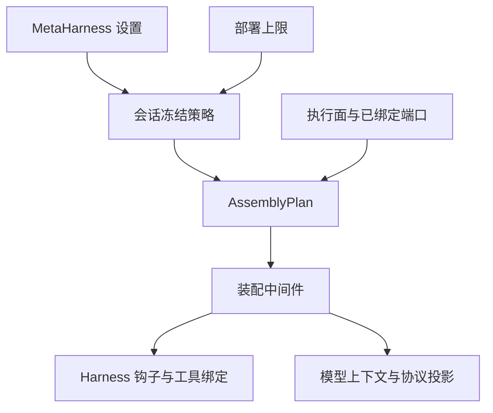
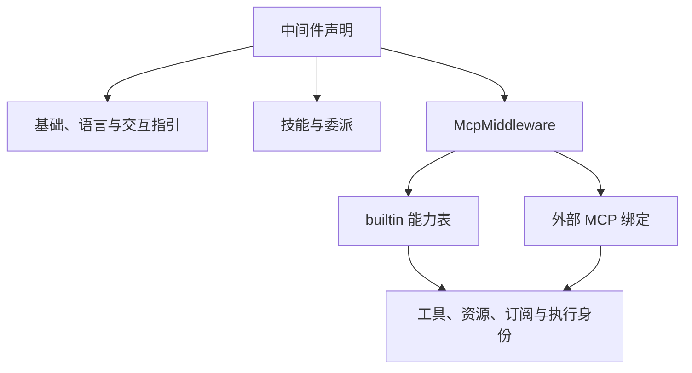
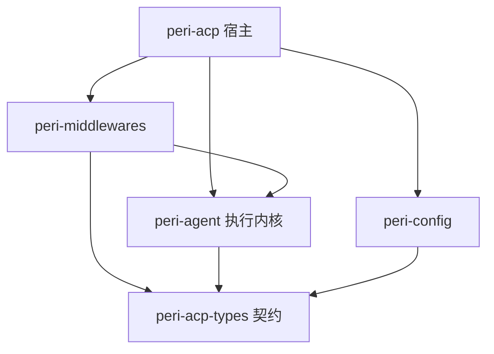

# Middleware 系统设计

> 状态：现行设计
>
> 能力身份、链序及执行面由 `peri-acp-types/src/meta_harness/owners.rs` 声明，装配实现为
> `peri-middlewares/src/assembly.rs`；强制顺序契约见 ARC-MIDDLEWARE-001。

## 1. 设计原则

1. **切面即中间件**：一个切面就是一个中间件。每个切面封装一个独立的外部能力——hook 实现 + 工具声明 + System Prompt 贡献的自包含单元。不再有「中间件容器套切面」的嵌套结构。
2. **单一职责**：每个切面只做一件事。后台任务的统一操作入口见 [Session 异步任务架构](session-async-tasks.md)。
3. **声明式注册**：切面通过声明方式注册 hooks、tools、依赖关系。声明在编译期可检查完整性。
4. **固定顺序，不可重排**：切面在链中的排列顺序是契约。同一 hook 点上多个切面按声明顺序执行。[TRAP]
5. **State 为唯一共享上下文**：切面间不直接通信——所有状态变更通过 State 传递。

---

## 2. 总体架构

运行时使用会话准入时选定的配置与部署能力。Harness 负责循环、取消、资源释放和模型调用。主链装配器按 `ChainSlot::ALL` 的声明顺序安装中间件。Hook 槽按非空组展开，Compact 由执行内核驱动。



冻结渲染发生在完整运行链构建之前。它用同一份计划调用各 owner 的段落构造器。子链与 workflow 也从冻结策略生成受限计划，并根据实际工具、broker 和模式继续收窄。基于已保存身份恢复子 Agent 的规则见 [System Prompt 设计](system-prompt.md)。

### 2.1 切面（中间件）——能力的封装单元

一个切面是单一能力的声明。它即是一个中间件：

| 声明项 | 说明 |
|--------|------|
| **Hook 挂载** | 声明在哪些生命周期点执行逻辑。hook 事实源为 `peri-agent/src/middleware/trait.rs`，执行顺序由 `peri-agent/src/middleware/chain.rs` 与 stages 中的 runner 锁定；设计文档不复制动态 hook inventory |
| **工具声明** | 声明提供哪些工具，Executor 统一收集注册 |
| **System Prompt 贡献** | 声明需要追加到 System Prompt 的文本片段 |
| **条件守卫** | 声明注册条件（如「仅当权限模式非 Bypass 时注册」） |

切面可以不挂载任何 hook——纯工具提供者（如 `HumanInTheLoopMiddleware`，只声明 `AskUserQuestion` 工具与 `12_ask_user` 段落）零 hook。

### 2.2 执行模型

链是扁平的——直接遍历切面：

```
Hook 触发（如 before_model）
  → 遍历链中的切面（声明顺序）
    → 执行切面在该 hook 上的挂载逻辑
```

- 遇错即停——后续切面跳过，错误向上传播
- 批量处理（before_tools_batch）：切面声明支持批量模式时 Engine 自动批量化，否则退化为逐条调用；批量返回值必须与输入等长，长度不符时链 fail closed（把本次仍未拒绝的调用置为 `MiddlewareError` 并停止后续切面）

### 2.3 工具收集

Executor 遍历链中所有切面的 `collect_tools` 声明，统一收集：

```
for aspect in chain:
  for tool in aspect.collect_tools(cwd):
    collect(tool)
```

- 工具工厂接收 cwd 参数动态创建
- `collect_tools` 阶段按 production chain 顺序收集；每个 fresh stage 的
  `build_session_tool_view` 将其合并进 session-local `BTreeMap`，同名 middleware
  工具按已有绑定优先，名字或 alias 冲突时记录诊断，宿主级 `shared_tools` 不被改写
- `AskUserQuestion` 与其他 middleware 工具一致，由
  `HumanInTheLoopMiddleware::collect_tools()` 提供；关闭该 middleware 后即从
  当前 session-local 工具视图消失

---

## 3. 切面注册表

下表按注册顺序列出 owner 的职责。配置键、作用域、工具身份、段落位置均从 `declare_owners!` 派生。Agent 工厂通过 `production_blueprint()` 提供这份顺序。相同 owner 重复出现在输入蓝本时显式报错，先于端口绑定和构造。

> 注：Compact 不在中间件链中，由 `peri-agent::agent::stages::compact` 在 ReAct 循环内处理。详见 §6。

| # | 中间件 | 挂载 Hook | 提供工具 | Prompt 贡献 | 条件 |
|---|------|----------|---------|------------|------|
| 1 | DefaultSystemPromptMiddleware | — | — | 基础 prompt sections | — |
| 2 | LangMiddleware | — | — | language section | — |
| 3 | AgentsMdMiddleware | before_agent | — | CLAUDE.md contribution（正文来自 `peri-instruction://workspace/{main\|local}` 冻结快照；纯 adapter、零 FS） | — |
| 4 | PluginMiddleware | before_agent | — | — | — |
| 5 | SkillsMiddleware | before_agent | SkillTool / DiscoverSkillsTool | 13_skills + 可见目录摘要 | — |
| 6 | SkillPreloadMiddleware | before_agent, before_input | — | — | — |
| 7 | AtMentionMiddleware | before_input | — | — | — |
| 8 | ImageMiddleware | before_input | — | — | — |
| 9 | GitAttributionMiddleware | before_agent, before_tool, after_tool | — | 提交署名说明 | — |
| 10 | TodoMiddleware | after_agent | TodoWrite | — | — |
| 11 | HookMiddleware | before_agent, before_tool, after_tool, after_tools_batch, after_agent | — | — | 非空 hook groups；可展开多实例 |
| 12 | PermissionMiddleware | before_tools_batch, before_tool | — | 10_hitl section | — |
| 13 | HumanInTheLoopMiddleware | — | AskUserQuestion | 12_ask_user section | — |
| 14 | SubAgentMiddleware | before_agent, before_reason_catalog | Agent（+AgentResult） | 11_subagent section | — |
| 15 | McpMiddleware | before_agent, before_model, before_reason_catalog, before_react_start | MCP 工具（动态）；builtin 实例的 direct 工具 | — | mcp_pool 非空 |
| 16 | `SearchMiddleware` 槽位（类型 `ToolSearchMiddleware`，关闭键 `ToolSearch`） | before_agent, before_reason_catalog | ToolSearch/ToolInvoke | deferred inventory + direct declarations contribution | 默认装配 |
| 17 | GoalMiddleware | after_agent | Goal（deferred） | — | goal_controller 非空 |

**脚注**：
- **#4 plugin**：`PluginMiddleware` 在 `before_agent` hook 中执行插件兼容性校验（name/version/manifest 字段完整性）。
- **#9 git_attribution**：`before_tool` 暂存 Write/Edit 旧文件内容，`after_tool` 计算贡献字符数；`prompt_contribution()` 声明 Co-Authored-By 指令。
- **#12/#13**：审批与提问是独立能力。`PermissionMiddleware` 负责审批；`HumanInTheLoopMiddleware::collect_tools()` 使用原始 broker 提供 `AskUserQuestion`。
- **#14 subagent**：`SubAgentMiddleware` 提供 `Agent`，TaskManager 可用时额外提供 `AgentResult`；后台任务生命周期遵循 [Session 异步任务架构](session-async-tasks.md)。
- **#17 goal**：`GoalTool` 是 deferred tool，仅通过 `ToolSearch` → `ToolInvoke` 访问；`after_agent` 注入 steering 并触发自驱续跑。
- **builtin MCP 实例不是链槽位**：Web 搜索 / 抓取、artifact 上传、cron 调度、monitor 输出监控、7 个文件/终端工具与 workflow 编排由 `mcp` 槽位（#15）客户端侧的同进程 builtin MCP 实例（`web` / `artifact` / `cron` / `monitor` / `workspace` / `workflow`）提供；实例、原始工具名与逐工具 direct 的单一事实源是 `peri-acp-types/src/builtin_mcp.rs::BUILTIN_MCP_INSTANCES`。关闭键为 v5 能力名（旧 `*Middleware` 键保留为确定性映射 adapter，M4 删除），机制见 [meta-harness.md](meta-harness.md)。v5 默认装配把 builtin 能力收敛为单出口 `peri`：`mcp` 槽位客户端消费一个 builtin server，由 capability router 分派；六实例仅在 `PERI_MCP_BUILTIN=legacy` 回滚路径保留（M4 截止），见 [MCP v5 单出口目标设计](mcp-v5-single-exit.md)。

---

### 能力归属与部署边界



| 控制项 | 真正的执行或投影入口 | 关闭后的可观察结果 |
| --- | --- | --- |
| workspace | MCP bridge、工作区资源和订阅 | 本地文件和终端绑定、该来源的资源面撤下。同名外部来源保留自身身份。 |
| web / artifact | 直连 web 及上传工具 | 模型、子 Agent 和 workflow 的对应 builtin 绑定消失。 |
| cron / monitor | 延迟工具、后台任务与默认订阅 | 关闭能力移出目录和执行解析，关联定时器或订阅按部署与会话状态收口。 |
| workflow | MCP 编排入口和运行时适配器 | 后续工具发现及分派不能通过关闭的声明启动 workflow。 |
| McpMiddleware | 模型目录、派生工具、会话空闲时的 canonical invocation 和 Apps relay | 关闭后不分派该会话的 MCP 工具调用。工作区准入和连接就绪有独立宿主职责。 |
| BuiltInSubagents | SubAgent 定义来源选择 | 只撤下内置定义。项目和插件定义仍遵守各自的来源与加载规则。 |

`BUILTIN_V5_CAPABILITIES` 持有 builtin 的开关、依赖、模型名、原始执行名及资源声明。直接绑定和延迟解析均按绑定来源过滤；兼容展示名不授予执行权。每个会话对共享目录建立自己的视图。

## 4. 顺序约束

链中切面的排列顺序即依赖关系。不需要单独的 `requires` 字段——排在前面的先执行，排在后面的依赖前面的产出：

- `AgentsMdMiddleware` 排在 `PermissionMiddleware` 之前——先注入上下文，再审批
- `PermissionMiddleware` 排在 `SubAgentMiddleware` 之前——其 `before_tools_batch` 在 Agent 工具实际执行前完成审批
- 信息注入切面（AgentsMd、Skills）排在 `GoalMiddleware` 之前——goal 追踪需要上下文已就绪
- 工具提供切面（Todo、Mcp 等）排在 `ToolSearchMiddleware` 之前——工具索引需完整工具列表

顺序即契约。新增切面时按依赖关系插入对应位置。

---

## 5. System Prompt 贡献

切面通过声明替代 prepend_message 模式：

- 切面声明 `prompt_contribution()` 文本片段（返回 `Option<String>`）
- frozen/base system prompt 在 session snapshot 中保持不变
- 主 Agent 的 `AgentModelBridge` 在每个 `ModelRequest` 构造时，从与
  `StageContext` 共享的同一 `Arc<MiddlewareChain>` 同步收集一次当前贡献
- 逐请求贡献位于外部指令之后、环境段之前。模型桥统一添加分隔符与缓存边界，详见 [System Prompt 设计](system-prompt.md)。
- `before_agent` 先于首个 Reason，因此 ToolSearch 的首轮 cache 已就绪；
  provider 返回 owned `String`，不会持有锁跨越模型 await
- 不再进入 `state.messages`

**当前贡献者列表**（`prompt_contribution()` 返回 `Some` 的中间件）：
| 中间件 | 贡献内容 |
|--------|---------|
| AgentsMdMiddleware (#3) | CLAUDE.md 摘要 |
| SkillsMiddleware (#5) | Skills 摘要 |
| GitAttributionMiddleware (#9) | Co-Authored-By 指令 |
| ToolSearchMiddleware (#16) | 当前 deferred inventory 与 direct-tool declarations |

---

## 6. 代码依赖

图中箭头从使用方指向依赖。宿主注入具体装配器。配置校验、Agent 工厂和中间件实现共享纯契约，执行内核只通过 trait 调用装配器与工具。



## 7. 与其他模块的关系

| 模块 | 关系 |
|------|------|
| **Session** | `session/new` 时决定切面注册集合，链按此构建 |
| **ReAct 循环** | hook 点嵌入 ReAct 循环固定检查点 |
| **System Prompt** | 切面通过声明贡献，不通过 prepend_message |
| **工具系统** | 切面声明 tools，Executor 统一收集 |
| **Compact** | 不在中间件链中。自动 compact 由 `peri-agent::agent::stages::compact` 在 RCRA 循环中处理；当前策略与回收目标以 `docs/design/micro-compact.md` 和 `ContextPressure::target_reclaim_tokens()` 为事实源 |
| **Plugin** | `PluginMiddleware`（#4）是基础中间件，在 `before_agent` hook 中执行插件兼容性校验。插件扩展的 Skills 经宿主装配把插件根（带 `plugin_name`）并入 `WorkspaceResourcesInput`，由 workspace 资源面提供（`SkillsMiddleware` 不持有插件根）；Hooks 通过 `HookMiddleware`（#11，可多实例）注入 |
