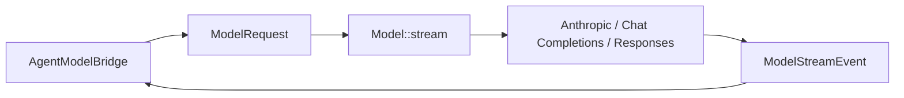

# Model Adapter 架构设计

> 状态：现行设计
>
> Provider 协议类型与执行行为以 `peri-model/src/`、
> `docs/code-index/peri-model.md` 和相邻契约测试为准。

## 1. 设计边界

`peri-model` 只负责 provider 无关的模型协议、HTTP/SSE transport、重试、响应解码与
有界观测投影。Agent 业务语义、Transcript、工具调度与客户端事件不进入该 crate。

Agent 侧 `AgentModelBridge` 是 `peri-model` 与 ReAct 的边界：它把
`BaseMessage`/tool definitions/system prompt 转成 `ModelRequest`，再把
`ModelStreamEvent` 转成 Agent 的 `Reasoning` 与 v2 观察/渲染事件。

## 2. 统一协议

公共协议事实源位于 `peri-model/src/protocol/`：

- `ModelMessage`、`ContentBlock`、`ToolCall`、`ToolResult` 描述输入输出内容；
- `ModelRequest` 与 `ModelResponse` 描述一次调用；
- `ModelStreamEvent` 包含 TextDelta、ReasoningDelta、ToolCallDelta、Usage、
  Completed、Interrupted；
- `Model` trait 的统一执行入口是 `stream()`；`prepare_stream()` 在 durable checkpoint
  场景冻结完整请求（默认拒绝不支持的 provider），`complete()` 只是聚合同一 stream，
  不是第二条非流式 transport；
- `output_token_limit()` 与 `context_window()` 返回装配处解析的只读上限，调用方不得代为
  填入常量或从请求反推；
- 成功流以单个 `Completed(ModelResponse)` 收尾；可见增量后的失败以 `Interrupted`
  交付。EOF、协议错误或取消不能伪造 Completed。

新增公共协议类型必须经 `protocol/mod.rs` 与 `lib.rs` 统一 re-export。Provider 私有
字段留在 adapter 内，不能泄漏给 Agent 迫使上层按 provider 分支。

## 3. Provider Adapter

Anthropic、OpenAI-compatible（Chat Completions）与 Responses adapter 实现三项核心职责：

1. `prepare_request`：构造 provider-native 请求观测投影；
2. `stream`：经公共 HTTP/SSE runtime 发起请求并返回统一事件流；
3. 请求/响应映射：在统一 `ContentBlock` 与 provider wire JSON 之间无损转换。

映射必须保持 assistant tool call 与 tool result 配对、reasoning/signature、usage 与
stop reason 语义。新增 `ContentBlock` 变体时，需要同步两端请求映射、响应映射和
文本提取逻辑；不支持的内容必须显式拒绝或按 adapter 契约降维，不能静默丢失。

System Prompt 的 cached/uncached seam 由
`peri_model::prompt_cache::SYSTEM_PROMPT_DYNAMIC_BOUNDARY` 传递。支持显式 cache
breakpoint 的 adapter 消费该 seam；其他 adapter 只做字节守恒剥离。详见
[System Prompt 设计](system-prompt.md)与 ARC-SERIAL-001。

### Responses 与认证

`openai_responses` 是独立 wire adapter，由配置 `type: "openai_responses"` 显式选择。
API Key 与 ChatGPT plan 共用请求编码、流解码和公共 runtime，通过 `ResponsesProfile`
描述能力差异，凭据获取通过宿主注入的 `RequestAuth` 完成。模型层不读文件、环境变量，
也不启动另一套 Agent。原有 `openai` 配置继续使用 Chat Completions。

| Profile | 认证和路由 | 请求约束 |
| --- | --- | --- |
| Platform | 配置 API Key；显式 Responses endpoint | `store: false`、`stream: true`；可配置输出上限 |
| ChatGptPlan | Sign in with ChatGPT 授权；固定公共 `/v1/responses` | 全历史 `input`，system 转 developer；省略不支持的输出上限等参数；function 工具放在 `peri` namespace |

两种 profile 都不发送 `previous_response_id` 或 `conversation`：请求固定 `store: false`，
服务端不保证响应可被后续请求取回，重放也不能依赖某个 endpoint、model 或 credential
保存的会话；续聊由 `ProviderState` 中的有序原生 items 加完整 `input` 完成。

订阅的登录、刷新、状态与登出属于 `mcp-packages/credentials` 的宿主控制面；不进入
模型工具目录。凭据按账户保存，刷新串行化并原子替换。配置只持有凭据引用，不将
access/refresh token 写入请求 checkpoint。401 刷新只允许原预算内重新发送冻结请求；
认证或配额失败不能切换到 API Key。此入口不读取或借用 Codex 的本地登录文件。

Responses 输出用普通内容块供显示和工具调度，同时以 `ProviderState` 保存有序原生
output items。重放时使用原生 items 替代其普通内容投影，保留 `call_id`、item ID、
namespace、phase 和 encrypted reasoning；两份投影不得重复发送。状态绑定 endpoint、
model、profile 和 credential reference。切换绑定时先验证原生状态与普通内容投影
一致，再只发送普通历史内容，旧 encrypted reasoning 不得跨域发送；被编辑而不一致
的历史明确拒绝。

`ProviderState` 随 transcript 序列化，但不显示为正文。Micro Compact 不拆开携带原生
状态的完整交换；Full Compact 生成新的纯文本摘要，不能把旧状态附到新摘要。恢复、
fork 与 rewind 使用同一校验边界。无法解释的可执行 output item 必须显式失败，不能
静默跳过或交给工具执行器。

## 4. 流、取消与重试

`ModelStream` 持有 parent cancellation token 的 child token。取消本流只能停止本次
模型调用，不能反向取消父级 session。Completed 后流终止；流提前结束返回稳定协议
错误。

重试由 `peri-model/src/runtime/retry.rs` 统一执行：

- 首个可见增量前，按 `RetryableErrorClasses` 判定传输、HTTP 和协议错误是否进入退避；
- 已发出可见 delta 后，失败以 `Interrupted` 交付，不重放同一请求；Agent 保存部分正文，
  经队列有界续跑，预算与取消遵循 ARC-OUTPUT-COMPLETION-001；
- provider 明确终止的 `ProviderTerminal` 不重试；即使已有可见内容，Agent 也在保存
  部分正文后返回失败，不入队自动续跑，不执行半成品工具调用，不调用成功 hook；
- SSE parser 与 decoder 保持事件顺序：后续坏帧不能丢弃此前完整增量，完成后的尾帧
  不再消费。OpenAI-compatible 的 `[DONE]` 还须有有效 `finish_reason`，流内 error
  不得忽略或转为正常完成；
- Responses 的 `response.completed` 提供正常完成证据；`response.incomplete` 仅在
  `incomplete_details.reason=max_output_tokens` 时按 ARC-OUTPUT-COMPLETION-001 安全归一化：
  已完成 items、部分正文与严格 usage 得以保留，未完成 reasoning/function_call 不回灌或执行；
  有完整工具时沿用 `ToolUse`，否则以 `MaxTokens` 进入现有有界续跑，不代表任务成功。
  `[DONE]`、EOF、`response.failed`、其他或缺失 reason 的 incomplete 不能伪造完成证据。
  配额耗尽和不支持的能力仍为明确失败终态；
- retry observer 保留失败分类、时序、实际错误内容与原因链，不能在重试或中断转换时丢弃底层原因；
- jitter、最大尝试次数与错误分类由 `ModelRuntimeConfig` 提供，Agent 不复制重试器。

## 5. 观测与诊断

Debug、错误、tracing 与 Langfuse input 不做内容脱敏。`PreparedModelRequest::observe`
保留键、路径、URL/query 与原始值，仍遵循观测级别和长度限制（超限值替换为截断标记
并记录 truncated path）；截断不能伪装为完整观测。HTTP/provider 失败保留有界实际正文，
传输失败保留原因链；既有诊断投影须传递实际错误而非只保留分类。运行输出与合成测试数据
遵循 ARC-SECRET-001。

Provider 配置由 ACP 装配面构造并注入，不由 `peri-model` 读取环境变量。URL 必须限制
到 adapter 支持的 scheme；不能因 userinfo/query 的内容形状而拒绝诊断或持久请求。

## 6. 新增 Provider 检查清单

1. 实现 `Model::capabilities`、`prepare_request`、`stream`；需要 durable checkpoint 时同时实现 `prepare_stream`。
2. 覆盖全部 `ContentBlock`、tool call/result、usage 与 stop reason 映射。
3. 使用公共 HTTP/SSE、取消与 retry runtime，不创建平行 transport。
4. 消费或安全剥离 system prompt cache 控制字，wire 上不得泄漏。
5. 提供 config/error/observation 保真、错误原因链与长度边界测试。
6. 在 `peri-acp/src/provider/mod.rs` 的 provider 工厂与 `peri-config/src/provider.rs`
   显式注册；未知 provider 类型不得由通配分支意外吞掉。
7. 运行 provider 相邻测试、`cargo test -p peri-model --lib`，并检查
   ARC-EVENT-001 与 ARC-SERIAL-001 的跨层影响。
