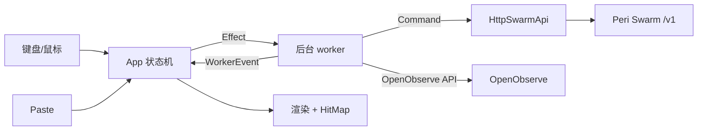

# Peri Swarm Dashboard 设计

> 状态：**现行设计**。`peri-swarm/dashboard` 已实现单网关 HTTP 客户端的引导、会话日志、
> 会话详情与动作、创建/编辑和设置，以及直连 OpenObserve 的 Core metrics、Agent metrics、
> Request log 与只读 Query 页面。侧栏 13 项（Monitor 6 / Resources 4 / Platform 3）；
> Sandbox metrics 与资源类页面仍是带能力说明的有意空页。观测数据由网关 OTel 导出到
> OpenObserve，dashboard 用专用 admin 账号直连查询。门禁结果与未验证项见 §14。本文只
> 描述稳定结构与契约，不把单元测试当作端到端验收。

`peri-swarm-dashboard` 是 Peri Swarm 网关的终端管理面。它只作为 HTTP 客户端工作，不依赖
`peri-swarm` 业务 crate，也不与网关共享 DTO 类型：所有 wire 类型都是本地投影，契约以
[Peri Swarm 本地开发宿主](peri-swarm.md) 为准。运行与配置操作见
[peri-swarm/dashboard README](../../peri-swarm/dashboard/README.md)。

## 1. 范围与边界

已实现：

- 首次运行的凭据引导，以及已有配置的自动连接。
- 单网关外壳：头部健康/刷新、侧栏导航、错误横幅、页脚提示、窄终端菜单。
- Session log：轮询、状态过滤、客户端搜索、增量加载、详情跳转；收到的列表在本地按
  `last_active_at` 降序（同值按 `created_at` 降序，稳定）排序，最近活跃在前。
- Session detail：Timeline / Turns / Info、审批、发消息、取消 turn、编辑、删除。
- 创建 session 与会话编辑表单。
- Settings：连接事实、测试连接、编辑凭据、退出登录、退出应用。
- Observability 配置：Settings 的只读状态、`Configure observability` 子页、
  `Test`/`Save`/`Cancel`，保存后立即采用新连接。
- Core metrics：OpenObserve PromQL 视图，requests/min、5xx 错误率、p95 延迟、总请求数与
  PromQL 评估区间；15 秒轮询。
- Agent metrics：网关 `GET /v1/agents/metrics` 的按会话 token 聚合；15 秒轮询，
  `limit=500`、每页 10 条。
- Request log：OpenObserve SQL 查询 `peri_swarm_logs`；15 秒轮询，服务端分页每页 10 条。
- Query：手动的只读 SQL 页面，SELECT-only 校验，20 行/页、最多 100 行。
- Getting started 帮助覆盖层。

空页（全部可进入，只说明“为什么为空”和网关实际支持什么）：
Sandbox metrics、Agents、Artifacts、Vaults、MCP、Automations、Nodes。Sandbox metrics 是
有意空页：网关只报告会话上的 sandbox 类型/id，没有 CPU、内存或资源级指标。没有 Overview
页面，也不在侧栏出现；没有 SSE，也没有 demo/mock 数据。

非目标见 §13。

## 2. 进程与数据流



- UI 线程持有终端与 [`App`](../../peri-swarm/dashboard/src/app.rs)，用 50ms 事件轮询与
  250ms tick 驱动重绘；终端生命周期（alt screen、raw mode、鼠标捕获、bracketed paste、
  panic hook、恢复）在
  [`main.rs`](../../peri-swarm/dashboard/src/main.rs) 中集中管理。
- 后台 OS 线程拥有 Tokio current-thread runtime 和两个 HTTP 客户端：网关客户端用于会话
  与 Agent metrics，OpenObserve 客户端只用于 Core metrics、Request log 与 Query。命令/事件
  经 channel 往返；每个命令携带 UI epoch，晚到响应在 epoch 不符时丢弃。
- 渲染的同一遍会产出 [`HitMap`](../../peri-swarm/dashboard/src/ui/hit.rs)：每个可点击
  矩形、滚轮区域和滚动条都记录当帧坐标。鼠标路由只读这张表，不重新计算几何。

## 3. 能力地图

### 3.1 页面

| 分组 | 页面 | 状态 | 说明 |
| --- | --- | --- | --- |
| Monitor | Core metrics | 已实现 | 数据源是 OpenObserve metrics 流；v1.2.0 只接受 PromQL，页面在客户端按累计样本增量计算窗口值 |
| Monitor | Agent metrics | 已实现 | 数据源是网关 `GET /v1/agents/metrics` 的按会话 token 聚合，不依赖 OpenObserve |
| Monitor | Sandbox metrics | 空页 | 没有资源级指标；网关只报告会话上的 sandbox 类型/id，没有 CPU/内存/资源指标 |
| Monitor | Session log | 已实现 | 默认页；列表按最近活跃排序、过滤、搜索、增量加载、详情 |
| Monitor | Request log | 已实现 | 数据源是 OpenObserve SQL 查询 `peri_swarm_logs`；15 秒轮询，服务端分页 |
| Monitor | Query | 已实现 | 手动只读 SQL；SELECT-only 校验，20 行/页、最多 100 行，不轮询 |
| Resources | Agents | 空页 | 不把 agent 作为独立资源管理 |
| Resources | Artifacts | 空页 | 本构建未实现；网关无 artifact 端点 |
| Resources | Vaults | 空页 | 网关 API 未暴露 |
| Resources | MCP | 空页 | 本构建未实现；网关无 MCP 管理端点 |
| Platform | Automations | 空页 | 本构建未实现；网关无自动化端点 |
| Platform | Nodes | 空页 | 单网关；不做多节点聚合 |
| Platform | Settings | 已实现 | 连接事实、本地操作与 Observability 配置 |
| Bottom | Show getting started | 覆盖层 | 凭据、打开会话、发送/审批、退出、鼠标键盘 |
| Bottom | Sign out | 确认框 | 确认后删除配置并回到 Onboarding |

### 3.2 会话操作

| 操作 | 入口 | 语义 |
| --- | --- | --- |
| 打开详情 | 点击行 / 内容区 Enter | 按 session id 打开独立详情页 |
| 发送消息 | 详情页 composer / `Ctrl-Enter` / `Send` | `POST .../events`，受理后轮询 |
| 审批 | 详情页 Approve / Deny | 仅 `mcp_approval_request` 可回答；其他类型只读 |
| 取消 turn | 详情页 `Cancel turn` + 确认 | `agent.session.input.cancel` |
| 创建 | Session log `New session` | 表单提交后打开新会话详情 |
| 编辑 | 详情页 `Edit` | 只提交 model/metadata/prompt cache |
| 删除 | 详情页 `Delete` + 确认 | `DELETE`；409 时提示先取消运行中的 turn |

所有写操作在成功后重新拉取快照/列表；不乐观伪造服务端状态。

## 4. 认证、配置与首启

### 4.1 文件

| 项目 | 值 |
| --- | --- |
| 路径 | `~/.config/peri-swarm-dashboard/config.toml`（`dirs::home_dir()`） |
| 目录模式 | `0700` |
| 文件模式 | `0600`，同目录临时文件 + 原子 rename |
| TOML 键 | `base_url`、`api_key`；可选 `[observability]`（`base_url`、`org`、`user`、`password`） |
| 权限漂移 | 加载时只产生警告横幅，不自动 chmod |
| 损坏配置 | 进入 Onboarding 并显示读取错误，不自动覆盖 |

### 4.2 Base URL 规范化

去首尾空白、去尾斜杠、允许空 path 或 `/v1`（随后去掉 `/v1`），只接受 `http`/`https`；
拒绝 userinfo、query、fragment 和其他 path。非 loopback 的明文 `http://` 显示
“API key will be sent in cleartext”警告，但不阻止保存。没有不安全 TLS 选项。

### 4.3 首启与重新认证

1. 无配置文件 → Onboarding，预填 `http://127.0.0.1:8080`。
2. `Connect` 先 `GET /healthz`（无 Bearer），再带 Bearer `GET
   /v1/agents/sessions?limit=1`。
3. 两步都成功才保存 `0600` 配置并进入 Session log；任何失败都停留在 Onboarding，
   显示具体阶段错误且不写文件。
4. 已有合法配置 → 直接进入 Session log 并开始健康/列表轮询。
5. Settings → `Edit credentials` 是独立子页：Base URL 预填，API Key 留空表示保留旧值；
   验证并保存成功后才替换旧配置。
6. `Test connection` 只验证，不保存、不替换客户端。
7. `Sign out` 需确认；只有配置文件实际删除后才回到 Onboarding。删除失败保留当前状态和
   客户端并显示错误。

401 的处理独立于配置：暂停认证轮询，显示持久横幅
（`401` + 网关 message + `Retry` / `Settings`），从不自动清除配置；重新认证成功后恢复
轮询。`/healthz` 不携带 Bearer，因此 health 成功不能覆盖 401 横幅。

### 4.4 Observability 配置

- `[observability]` 是可选表；缺失时旧配置照常加载，`deny_unknown_fields` 仍然生效。
- `Config::new`（网关凭据）签名不变；OpenObserve 连接用 `with_observability()` 附加，
  `observability()` 读取。旧的 `base_url`/`api_key` 编辑路径会保留已保存的该表。
- 校验：只接受 `http`/`https`，拒绝 userinfo、query、fragment；允许路径前缀并去掉尾
  斜杠；`org`、`user`、`password` 非空。密码不 trim；错误消息不回显任何字段值。
- `Debug` 对 API key 和 OpenObserve 密码都脱敏；保存沿用 `0600`/`0700` 与原子 rename。
- Settings 只读展示 `not configured`/`configured`、URL、org、user；配置子页提供
  `Test`/`Save`/`Cancel`。密码输入遮蔽，保存后不回显；留空表示沿用已保存密码。
- `Test` 走 worker 的 `TestObservability` 命令与事件，调用
  `GET /api/{org}/streams`；任意 2xx 都视为连接成功，响应没有 stream 列表时显示成功但不
  显示数量。`Save` 只做本地校验并写配置，不依赖网络；写盘成功后 worker 通过
  `AdoptObservability` 立即采用新连接，无需重启或重新进入页面。
- 未配置 `[observability]` 时 Core metrics、Request log 与 Query 显示
  “Observability is not configured.” 和跳转 Settings 的按钮；Agent metrics 不依赖该配置。

## 5. 网关契约

### 5.1 端点

所有会话端点都以配置的 origin 为根，HTTP 客户端禁用自动重定向。路径前缀固定为
`/v1/agents/sessions`。

| 操作 | 请求 |
| --- | --- |
| 健康 | `GET /healthz`（无 Bearer） |
| 列表 | `GET /v1/agents/sessions?limit=N&order=desc` |
| 详情 | `GET /v1/agents/sessions/{id}` |
| Turns | `GET /v1/agents/sessions/{id}/turns?limit=50&order=desc[&after=]` |
| Agent metrics | `GET /v1/agents/metrics?start_time=<us>&end_time=<us>&limit=N` |
| Items | `GET /v1/agents/sessions/{id}/items?limit=50&order=desc[&after=]` |
| 创建 | `POST /v1/agents/sessions` |
| 更新 | `POST /v1/agents/sessions/{id}` |
| 删除 | `DELETE /v1/agents/sessions/{id}` |
| 输入事件 | `POST /v1/agents/sessions/{id}/events` |

请求头与限制：

- 所有会话请求带 `Authorization: Bearer <key>`；`/healthz` 不带。
- 所有请求带 `x-peri-swarm-expect: 1`；响应 `x-peri-swarm-contract` 应为 `1`，不匹配时
  显示持久警告横幅但允许只读使用，写操作仍会上送并显示网关错误。
- 写操作带 `Idempotency-Key: <uuid v7>`；同一提交的重试复用同一个键，不自动重试。
- 请求超时 10 秒；`limit` 必须在 `1..=500`。

响应使用本地 DTO 投影（`id`、`logical_id`、`status`、`state`、`agent.model`、
`required_actions`、`metadata`、`environment`、`sandbox`、`vault_ids`、`usage`、`error`
等），`has_more` / `hasMore`、`nextCursor` / `next_cursor` 均接受。错误信封为
`{"error":{"code","message","details"}}`。

`/v1/agents/metrics` 的时间窗是 Unix 微秒，默认最近 24 小时、上限 31 天。`usage` 口径
与网关一致：`input_tokens` 已扣除 cache 读/写，`total_tokens` 为四项之和，`turns`/`calls`
只统计带观测的 turn/调用；没有任何 usage 事实的会话不出现在 `sessions` 中，页面显示空态
而不是 0。`totals` 覆盖整窗，`truncated: true` 表示扫描达到上限、只覆盖最新行。

列表响应可能按 `logical_id desc` 排序，但 `logicalId` 是调用方任意字符串，不代表时间
顺序。Dashboard 在 `SessionLogState::apply_page` 保存响应前做稳定降序排序：主键
`last_active_at`，次级 `created_at`；两者都相同时保留网关返回顺序，不引入 id tie-break。

#### OpenObserve 端点（dashboard 直连）

Core metrics、Request log 与 Query 不经过网关，由 worker 使用已保存的 `[observability]`
配置直连 OpenObserve，统一使用 Basic auth、10 秒超时和 `redirect: none`：

| 用途 | 请求 |
| --- | --- |
| 连接测试 | `GET /api/{org}/streams`；任意 2xx 视为成功 |
| Request log / Query | `POST /api/{org}/_search`，body 为 `{query:{sql,start_time,end_time,from,size}}` |
| Core metrics | `GET /api/{org}/prometheus/api/v1/query_range?query=<promql>&start=<s>&end=<s>&step=<s>` |

查询语义：

- `_search` 的 `start_time`/`end_time` 是 Unix **微秒**；PromQL 的 `start`/`end`/`step`
  是 Unix **秒**。Core metrics 的窗口结束时间取当前时间，起点按 15m/1h/24h 回退。
- OpenObserve v1.2.0 的 metrics 流**不接受 SQL**：对 metrics 流调用 `_search` 返回
  `400`（`Search stream not found`）。Core metrics 只能走 PromQL；日志等非 metrics
  stream 的查询走 SQL，Query 页对任意 stream 发送单条 SELECT。
- 该版本的 PromQL 不支持 `rate()`、`increase()` 与 `delta()`（返回空矩阵）。Core metrics
  读取 PromQL `query_range` 的 step 评估样本，并在客户端把相邻样本的正向增量相加；进程
  重启不会产生负流量。采样起点之前的首个增量无法归因，页面展示 PromQL 评估区间（不等同
  于原始 OTel 观测点范围）。
- Core metrics 查询 `peri_swarm_http_server_requests`（counter）与
  `peri_swarm_http_server_duration_bucket`（histogram）；错误率只统计 `status=~"5.."`。
  p95 用 `le` 桶增量插值，落入 `+Inf` 桶或没有观测时返回 `None`，页面显示 `—`。
- `_search` 的 `total` 在带 `OFFSET` 时只是当前页返回的行数，不是全局匹配数；Request log
  每页请求 11 行（判断是否有下一页），只显示 10 行和 `Page N`，不显示总数。
- Query 使用同一 `_search`，`from`/`size` 分页，每页 20 行、最多 100 行（5 页）；`Next`
  只在当前页满 20 行且未到上限时启用。结果列优先使用响应 `columns`（字符串或
  `{name}` 对象），否则取行 JSON 键的并集；`null` 显示 `—`，嵌套值显示紧凑 JSON，单格
  超过 96 字符截断；放不下的列被裁剪并显示 `Showing N of M columns.`。
- Request log 的 `_timestamp` 是 Unix 微秒，SQL 固定按 `_timestamp DESC` 排序；时间、
  method、route、status、duration、session 任一缺失时显示 `—`。SQL 使用 `SELECT *`：
  流 schema 直到出现会话路由请求才包含 `session_id`，固定列会触发
  `unknown field 'session_id'`；客户端解析时只取已知字段。

### 5.2 更新契约（`agent.model`，无 instructions）

网关 `SessionUpdateParams` 使用 `deny_unknown_fields`，只接受：

- `agent.model`（嵌套在 `agent` 下）
- `metadata`
- `prompt_cache_options`
- `review`

因此编辑表单只发送 `agent.model`、`metadata`、`prompt_cache_options`。**更新请求不发送
instructions**；编辑页的 instructions 只读，并在页面上说明原因。`api::update_session_body`
在本地拒绝空 model，也不会构造顶层 `instructions`。创建请求仍可发送顶层
`instructions`（创建与更新是不同的 wire 形状）。

语义：`metadata: {}` 清空 metadata；高级 JSON 的 `null` 清空 prompt cache；空白字段则
省略。创建请求省略空字段，发送 `stream: false`，不发送首条消息。

### 5.3 错误映射

| 状态 | 界面处理 |
| --- | --- |
| 400/405/413/415 | 显示 code/message；字段错误靠近表单 |
| 401 | 暂停轮询 + 持久横幅 + Settings 重新认证 |
| 404 | 显示网关 code/message（会话可能已不存在）；列表刷新后若 id 消失则清除选择 |
| 409 | 创建时显示 logical id 冲突；删除/更新时说明运行中的 turn 并提示取消 |
| 422 | 显示网关校验错误 |
| 502 | 说明网关无法到达宿主 |
| 3xx | 不跟随重定向；显示为错误 |
| 其他 5xx / 网络 / 解码 | 横幅或表单内错误 |

错误消息只包含网关 code/message 和本地描述，不包含请求头、URL 凭据或 API key。

## 6. Observability 数据链路

### 6.1 网关导出（OTel）

- 标准 OTel 环境变量驱动：`OTEL_EXPORTER_OTLP_ENDPOINT`（也接受按信号的
  `OTEL_EXPORTER_OTLP_{TRACES,METRICS,LOGS}_ENDPOINT` 与对应 `_HEADERS`）、
  `OTEL_SERVICE_NAME`、`OTEL_RESOURCE_ATTRIBUTES`、`OTEL_TRACES_SAMPLER`/
  `OTEL_TRACES_SAMPLER_ARG`、`OTEL_SDK_DISABLED`、`OTEL_BSP_SCHEDULE_DELAY`、
  `OTEL_BLRP_SCHEDULE_DELAY`、`OTEL_METRIC_EXPORT_INTERVAL`。
- 未设置 endpoint 或设置 `OTEL_SDK_DISABLED=true` 时是 no-op：不构建 provider、不建立
  连接、不启动后台任务，也不报错。
- 三类信号都走 OTLP/HTTP：traces、metrics、logs。`service.name` 默认 `peri-swarm`；
  `service.instance.id` 固定为 `HOSTNAME:pid`，不使用两个副本共享的 machine-id。
- Provider 是进程局部的，不安装 OTel global tracer/meter。`main` 持有 guard 到 `run()`
  返回并关闭两个 store 之后；Drop 时在独立线程 flush，主线程最多等 5 秒。当前
  current-thread runtime 下该上限不完全可靠。
- HTTP middleware 不读取、不缓冲请求体，SSE 响应保持原 body；`/healthz` 完全跳过；
  `/events` 只记录请求计数与一条访问日志，不计入延迟直方图。
- 指标名：`peri_swarm.http.server.requests`（counter，属性 method/route/status）与
  `peri_swarm.http.server.duration`（histogram，单位秒）。
- 访问日志字段只有 method、route、status、duration_ms、session_id（仅当路径段是纯标识符）
  与 request_id（网关生成）。不记录 header、query、body、`Authorization`、`Cookie` 或
  幂等键。

### 6.2 OpenObserve 流与查询限制

- 网关把三类信号写入 OpenObserve。Compose 部署通过
  `OTEL_EXPORTER_OTLP_LOGS_HEADERS: stream-name=peri_swarm_logs` 把日志固定到
  `peri_swarm_logs` stream；metrics 进入 OpenObserve 的 Prometheus 兼容 metrics 流，
  traces 进入 trace 流。
- v1.2.0 的 metrics 流不接受 SQL，因此 Core metrics 只走 PromQL；
  `rate()`/`increase()`/`delta()` 返回空矩阵，窗口值由客户端按累计样本的正向增量计算。
  `_search` 与 PromQL 的时间单位、分页和 `total` 语义见 §5.1。
- p95 是 histogram 桶内插值近似值；OTel SDK 默认桶较粗。落到 `+Inf` 桶或窗口内没有
  观测时显示 `—`，不虚构有限值或 0。
- 没有历史指标持久化：Core metrics 的数字来自 OpenObserve 当前保存的样本；OpenObserve
  数据被清空后页面显示空态。

### 6.3 部署与运维

- `openobserve` 是单节点 `openobserve/openobserve`，版本由 `OPENOBSERVE_TAG` 固定，默认
  `v1.2.0`；数据保存在命名卷 `openobserve-data`。
- 默认只发布 `127.0.0.1:5080`（`OPENOBSERVE_PUBLISH_HOST` / `OPENOBSERVE_PORT`），
  `restart: unless-stopped`，启用 `no-new-privileges`。镜像内没有 shell/curl/wget/nc/
  busybox，healthcheck 使用 `/openobserve node metrics`。
- `openobserve-init` 是一次性 `curlimages/curl:8.11.1` 容器，在 OpenObserve healthy 后
  幂等创建 `peri-swarm-ingest`（OTLP 写入）与 `peri-swarm-dashboard`（dashboard 查询）
  两个 admin 账号。它不会轮换已存在账号的密码。
- 网关没有硬 `depends_on` OpenObserve：OpenObserve OOM 或重启不阻塞网关启动与请求服务，
  只影响遥测导出和观测页。
- 未配置保留策略；`openobserve-data` 会随写入增长，部署方应按 stream 配置 retention。
  `docker compose down -v` 会清空该卷。
- OpenObserve 使用 AGPL-3.0；分发修改版或作为网络服务提供前确认许可证义务。

### 6.4 直连与安全边界

- dashboard 使用专用 admin 账号直连 OpenObserve。OSS v1.2.0 的 create-user API 只接受
  admin/service account：viewer/editor/user 返回 `400 Custom roles not allowed`；viewer
  的 POST 200 不持久；ingestion token 只允许写入，查询返回 401；没有只读 API key 或
  只读端点。
- 因此 dashboard 账号可写。Core metrics 的 PromQL、Request log 与 Query 的 SELECT-only
  校验都是防误操作，**不是安全边界**。
- 安全性依赖 OpenObserve 只在 loopback/内网可达、使用专用账号（不要用 root）、
  `config.toml` 的 `0600` 权限以及密码轮换。凭据泄露等于写权限。

### 6.5 故障表现

- 未配置 `[observability]`：Core metrics、Request log 与 Query 显示
  “Observability is not configured.” + Settings 按钮，不发请求；Agent metrics 仍工作。
- OpenObserve 不可达、超时或返回非 2xx：Core metrics 与 Request log 保留上次成功数据并
  标记 `stale`，按退避重试；Agent metrics 走网关，失败时同样保留上次成功数据并标 stale。
- Query 不轮询：失败会清空结果并显示错误，下一次 `Run`/`Prev`/`Next` 才重试，不伪造
  旧结果。
- OTel endpoint 不可达：导出失败只影响遥测，网关请求路径继续工作；shutdown flush 有
  5 秒上限。

## 7. 轮询、退避与 401

| 视图 | 周期 |
| --- | --- |
| Session log（≤100 条） | 3s |
| Session log（101–300 条） | 5s |
| Session log（>300 条） | 10s |
| Session detail（`in_progress` / `requires_action`） | 2s |
| Session detail（其他状态） | 5s |
| Core metrics | 15s |
| Agent metrics | 15s |
| Request log | 15s |
| Query | 不轮询 |
| 健康检查 | 10s，独立于列表轮询 |

- 每个视图维护 generation 与 in-flight 标记：同一类请求不重叠；页面/过滤/窗口/页码变化
  会使旧 generation 失效，晚到响应被丢弃。
- Core metrics、Agent metrics 与 Request log 只在页面可见且没有错误横幅、确认框等覆盖层
  时轮询；离开页面即暂停。Query 只在 `Run`、`Ctrl-Enter`、`Prev`/`Next` 时请求。
- Core metrics、Agent metrics 与 Request log 失败按 3 → 6 → 12 → 24 → 30 秒退避，成功即
  重置；失败期间保留最后一次成功数据并标注 `stale`。Query 没有自动退避或重试，失败后
  保留错误直到下一次手动请求。
- 错误横幅或确认框打开时，列表/详情/观测页轮询暂停；关闭后恢复。健康检查在 Onboarding、
  Edit credentials 子页和退出确认期间不轮询。
- 401 会暂停认证轮询并作废在途请求；恢复后重新拉取。配置从不因 401 被自动修改或
  删除。
- 没有 SSE。Timeline 的“新条目”来自轮询合并，不是事件流；观测页也不消费 SSE。

## 8. 鼠标

鼠标是主输入。所有可点击区域都来自**最近一帧**渲染产出的 `HitMap`；覆盖层存在时
`Layer::Base` 区域不参与命中，因此点击不会穿透到背景。

| 区域 | 行为 |
| --- | --- |
| 侧栏页面/分组下条目 | 切换到该页；分组标题不可点 |
| `☰`（宽度 <80） | 打开窄终端菜单覆盖层 |
| 列表行 | 打开会话详情 |
| 状态 chips、搜索框 | 设置过滤；搜索框聚焦并按列宽映射光标 |
| 工具栏/表单/详情按钮 | 执行对应动作（Refresh、Create、Send、Back 等） |
| 观测页窗口 chips | 切换 15m / 1h / 24h 并重新加载；Query 只换窗口，不自动运行 |
| 观测页 `Refresh` / `Settings` | 立即刷新当前页；未配置时跳转 Settings |
| Agent metrics / Request log 分页器 | `‹ Prev` / `Next ›` 翻页；Agent metrics 是客户端分页，Request log 是服务端分页 |
| Query 工具栏与结果分页器 | `Run` 运行当前 SQL；`‹ Prev` / `Next ›` 翻页，`Run` 总是回到第 1 页 |
| Query SQL 编辑器 | 聚焦文本区；点击位置换算为光标，`Enter` 插入换行 |
| Session log 分页器 | 点击页码切换显示页；`‹ Prev`/`Next ›` 前后翻页，末页的 `Next ›` 先取更多会话；页码带预留固定宽度，翻页时 `Next ›` 不移动 |
| 详情标签 | 切换 Timeline / Turns / Info |
| 审批 Approve / Deny | 提交该请求的审批答复 |
| Timeline 工具块 | 展开/折叠；Markdown 消息可直接阅读 |
| 文本字段、composer | 聚焦；点击位置换算为光标（含边框内缩与宽度映射） |
| 滚动条 | 点击轨道跳转、拖拽 thumb |
| 滚轮 | 指针在侧栏滚侧栏，在内容区滚当前页 |
| 帮助/菜单/错误动作覆盖层外部 | 关闭该覆盖层；确认框不响应背景点击 |

删除会话、取消 turn、退出登录均为确认覆盖层；确认框会捕获全部点击。

## 9. 键盘

路由优先级：覆盖层 > 聚焦文本字段 > 内容列表/表格 > 侧栏。文本字段获得焦点时，除
`Ctrl-C` 外不触发全局快捷键。

| 键 | 行为 |
| --- | --- |
| `Ctrl-C` | 任意位置退出 |
| `q` | 无文本字段且无覆盖层时退出 |
| `Tab` / `Shift-Tab` | 在侧栏、内容、动作、字段之间移动焦点 |
| 方向键 | 侧栏/列表/动作移动；详情页内容区左右切标签；非详情内容区 `←` 回到侧栏 |
| `PgUp` / `PgDn` | Session log 切换显示页；Agent metrics、Request log、Query 翻结果页；文本字段取得焦点时不拦截 |
| `Enter` | 激活当前项/按钮；列表内打开选中会话 |
| `Esc` | 返回/关闭覆盖层；列表有过滤时先清空过滤 |
| `/` | 聚焦 Session log 搜索 |
| `r` | 刷新健康与当前页面；观测指标页立即重新查询；Query 不因 `r` 运行 |
| `n` | 打开 New session（主页面） |
| `1` / `2` / `3` | 在 Core metrics、Agent metrics、Request log、Query 切换 15m / 1h / 24h |
| `Ctrl-Enter` | 从 composer（详情）、表单或 Query SQL 编辑器提交/运行 |
| `m` | 打开/关闭窄终端菜单 |
| `h` / `?` | 打开 Getting started |
| `e` | 有错误横幅时打开错误动作 |

## 10. 布局断点与命中

| 终端宽度 | 侧栏 | 会话列表列 |
| --- | --- | --- |
| `>=120` | 26 列固定 | 全部列（Session、Status、Approvals、Last active、Metadata summary） |
| `90..=119` | 24 列 | Session、Status、Approvals、Last active（隐藏 Metadata summary） |
| `80..=89` | 22 列 | Session、Status、Last active（+ Approvals） |
| `<80` | 隐藏，`☰` 打开菜单覆盖层 | 内容区全宽 |
| `<50x12` | 不绘制外壳 | 显示 “Terminal too small” + `Ctrl-C quit`，不 panic |

- 头部一行显示标题、Base URL、健康点/状态和最后刷新时间；错误/合同/权限警告横幅占
  头部下一行；页脚显示当前焦点提示与加载范围。
- 侧栏行数超过可视高度时滚动；底部 “Show getting started” / “Sign out” 固定不参与
  滚动。
- 页面内容在离屏 buffer 中按行渲染，再按滚轮偏移 blit 到外壳；滚动条 thumb 和命中
  使用同一次 `VerticalBar` 计算。
- Agent metrics 表格按终端宽度裁剪列：`>=108` 显示 Model/Input/Output/Cache，`>=92`
  显示 Input/Output/Cache，`>=76` 显示 Last active，`>=64` 显示 Turns；Session 与 Total
  始终显示，放不下的列不绘制。
- Request log 始终显示 Time/Method/Route/Status；`>=72` 增加 Duration，`>=98` 增加
  Session。Query 结果按每列约 20 列宽计算可见列数，放不下的列裁剪并显示
  `Showing N of M columns.`。

## 11. 安全

- API key 不打印、不回显、不写入日志、错误消息或 `Debug` 输出；`Config` 与 HTTP 客户端
  都有自定义 redaction。
- OpenObserve 是第二套凭据，同样存于 `0600` 配置、`Debug`/错误脱敏、输入遮蔽、保存后
  不回显；客户端禁用重定向、10 秒超时，错误只含状态与脱敏后的短消息。
- **OpenObserve OSS v1.2.0 没有 viewer/editor 角色**。dashboard 只能使用专用 admin
  账号（不要用 root）直连；该账号可写。客户端只发 `SELECT` 是防误操作，**不是安全
  边界**。必须让 OpenObserve 仅在内网/loopback 可达，并保护、轮换该密码。
- Query 页复用同一账号发送任意 `SELECT`。本地校验只拒绝空语句、超长、NUL、非 SELECT
  和多语句；它不限制可读 stream，也不构成安全边界。Core metrics 的 PromQL 同样只读但不
  隔离权限。
- 网关导出的访问日志只含 method、route、status、duration_ms、session_id 与 request_id，
  不含 header、query、body、`Authorization`、`Cookie` 或幂等键；OTLP 端点与 header 值
  在 `Debug` 中脱敏。
- 配置文件 `0600`、目录 `0700`、原子写入；权限过宽只警告。
- 禁用重定向，Authorization 只发往配置的 origin；`/healthz` 不带 Bearer。
- TLS 使用 rustls 证书校验，没有 insecure 选项。
- 请求有 10s 超时；写操作带幂等键但不自动重试。
- 退出登录只有删除文件成功后才报告成功。
- 仓库、测试 fixture、文档和提交信息中不出现密钥；live 测试只从环境变量读取。

## 12. 组件复用

复用 `peri-tui-components`：

| 组件 | 用途 |
| --- | --- |
| `markdown` | Timeline 中的用户/助手消息 |
| `markdown::table` | Timeline 表格按主题绘制行 |
| `textarea`（`TextAreaState` / `render_multiline_with_cursor`） | composer、instructions、高级 JSON、Query SQL 编辑器的编辑、光标与选区 |
| `input`（`TextField`） | 单行输入、掩码、选区与水平窗口 |
| `button`（`Button`） | 按钮色调与统一绘制；按 tone 选 chrome |
| `tabs::tab_layout` | 详情页标签的可见文字与命中几何 |
| `pagination`（`pagination_layout` / `render_pagination`） | Session log 分页器的固定宽度页码带、省略号、逐控件矩形与绘制；控件宽度取最大页码位数，页码带按最宽窗口预留 |
| `spinner` | 加载帧与宿主动作文案的组合 |
| `scrollbar::VerticalBar` | thumb 几何、轨道点击与拖拽，绘制与命中同源 |
| `text` | 宽度安全截断 |
| `peri-theme` | 与 TUI 一致的深色主题样式 |

按钮视觉由 tone 单一决定：`Primary` 使用 `ButtonChrome::Filled`，画成反色填充块；
`Secondary` 与 `Danger` 使用 `ButtonChrome::Plain`，只画标签文字（危险操作保留错误色）。
筛选 chips 同样只画文字，选中项用背景色表示。默认界面不再出现 `[ label ]` 形式的
方括号按钮。

本地实现及原因：

- 侧栏、列表表格和详情时间线使用本地渲染：它们需要随断点变化的列集合、按 `turn_id`
  分组和同一帧 `HitMap`；`list` 的固定 row-metric 视口无法覆盖可变高度的 Markdown/工具块
  时间线。
- 覆盖层用本地 `dialogs` + `Layer`：需要“打开时捕获全部点击、背景不接收”的语义，
  `overlay::OverlayFrame` 只负责边框/title 几何，不提供输入捕获。
- 不使用 `list_nav` 的动作分类 / `panel_mouse`：侧栏导航、页面表格和详情标签的激活语义
  不同，且外壳是全屏三栏而不是 TUI 面板覆盖层；逐帧 HitMap 已统一命中来源。仅复用
  `list_nav` 的数值辅助（`cycle_next` / `cycle_previous` / `clamp_selection`）。
- Core metrics、Agent metrics、Request log 与 Query 的表格和分页器是本地实现：Agent
  metrics 是客户端分片，Request log 与 Query 是服务端 `OFFSET` 分页，`pagination` 的
  页码集合语义不适用；窗口 chips 与 `Run` 复用 `button` 的 tone/绘制。

## 13. 非目标

- Overview 页面、跨节点的派生资源视图。
- 资源级 Sandbox 指标（CPU/内存/资源）；网关只报告 sandbox 类型/id。
- 写 SQL、非 `SELECT` 语句或通用的 OpenObserve API 代理；Query 只提供单条只读 SQL。
- SSE、实时事件推送、demo/mock 模式。
- 多 profile、凭据库、i18n 切换、剪贴板、不安全 TLS。
- 创建时发送首条消息。
- 通过编辑表单更新 tools/environment/instructions。
- Agents、Artifacts、Vaults、MCP、Automations、Nodes 的资源管理；跨节点/多副本聚合。
- 生产 TLS 终止、多租户隔离或规模承诺。

## 14. 验证与缺口

### 14.1 本分支阶段门禁

`feat/peri-swarm-observability` 各阶段实现后执行了以下门禁。以下是阶段记录；本轮文档改动
（stage 6b）只运行文末的 `git diff --check` 与 `git status`，没有重跑这些测试。

- **阶段 1**（导航与空页）：dashboard 217 passed / 0 failed / 1 ignored
  （`tests/live_gateway.rs`）；`fmt` 通过。
- **阶段 2**（usage 持久化与 Agent metrics）：`fmt` 与
  `clippy --locked -p peri-swarm --all-targets -- -D warnings` 通过；
  `test --locked -p peri-swarm` 为 460 unit + 127 integration passed，29 ignored
  （21 需 `PERI_TEST_POSTGRES_URL`，8 为外部/Rivet）。
- **阶段 3**（OTel）：`fmt`/clippy 通过；480 unit + 128 integration（合计 608 passed），
  29 ignored；OTLP stub 收到 traces、metrics、logs 三类信号；未发现 Authorization、Cookie、
  body 或 query 泄漏；SSE 响应未被包裹。
- **阶段 4**（OpenObserve 部署）：隔离 compose project 的 `compose config --quiet` 通过；
  `openobserve` healthy；`openobserve-init` 幂等；错误 root 密码返回 401 且容器非零退出；
  OTLP logs 写入返回 200 且可搜索；dashboard 账号写入探针返回 200；`down -v` 清理成功。
  该阶段只启动 `openobserve` 与 `openobserve-init`，未跑完整栈。
- **阶段 5a**（观测配置）：dashboard 240 passed / 0 failed / 1 ignored；`fmt`/clippy 通过。
- **阶段 5b**（Core/Agent/Request 页面）：dashboard 290 passed / 0 failed / 1 ignored；
  `fmt`/clippy 通过；真实 OpenObserve 探针结论见 §14.2。
- **阶段 6a**（Query 页）：dashboard 333 passed / 0 failed / 1 ignored；`fmt`/clippy 通过。

对应的主要命令：

```bash
./scripts/cargo-rmcp-patched.sh fmt --check
./scripts/cargo-rmcp-patched.sh clippy --locked -p peri-swarm --all-targets -- -D warnings
./scripts/cargo-rmcp-patched.sh test --locked -p peri-swarm
./scripts/cargo-rmcp-patched.sh clippy --locked -p peri-swarm-dashboard --all-targets -- -D warnings
./scripts/cargo-rmcp-patched.sh test --locked -p peri-swarm-dashboard
```

### 14.2 真实 OpenObserve 与部署探针

在隔离 compose project 中只启动 `openobserve` 与 `openobserve-init` 后观察到：

- `openobserve` 变为 healthy，`openobserve-init` 以 `Exited (0)` 结束；重复运行仍幂等。
- 错误 root 密码调用 user API 返回 401，初始化容器以非零状态退出。
- 用 ingest 账号向 `peri_swarm_logs` 写入 OTLP/HTTP 日志返回 200，且可用 dashboard 账号
  搜到该条日志。
- create-user 对 viewer/editor/user 返回 `400 Custom roles not allowed`；viewer 的 POST
  200 不持久；ingestion token 只能写，用于查询返回 401；没有只读 API key 或只读端点。
- 对 metrics 流执行 `_search` 返回 `400`；PromQL `query_range` 可用；`rate()`、
  `increase()` 与 `delta()` 返回空矩阵。
- dashboard 专用账号的写入探针返回 200，确认该账号可写。

未验证：完整 Compose 栈、默认 5080 端口下的真实访问、保留策略的实际生效。

### 14.3 明确缺口

- Postgres usage SQL 未对真实数据库运行；`usage_update` 合并进 root turn 的边角未单测。
- Agent metrics 未对真实网关做端到端页面验证；Query 未对真实 OpenObserve 做端到端页面验证。
- 完整 Compose 栈未在观测阶段启动；默认 5080 与保留策略未验证。
- 观测页没有真实 TTY 人工走查；渲染只在 TestBackend 的 60/100/140 列下覆盖，没有像素快照。
- 两个副本的 `service.instance.id` 未在真实 Compose 双副本下核对。
- OTel Drop 时的 5 秒 shutdown 上限在 current-thread runtime 下不完全可靠。
- p95 是 histogram 桶内插值近似值；OTel 默认桶较粗，不能当作精确分位数。
- OpenObserve dashboard 账号可写；SELECT-only 校验不是安全边界，凭据泄露等于写权限。
- `openobserve-init` 不轮换已存在账号的密码；OpenObserve 默认保留策略未配置。

### 14.4 历史记录：组件复用、分页器与本地排序（2026-11-27）

该阶段（组件复用、分页器与本地排序）的实际执行如下：

```bash
./scripts/cargo-rmcp-patched.sh fmt --check
./scripts/cargo-rmcp-patched.sh clippy -p peri-tui-components -p peri-swarm-dashboard --all-targets -- -D warnings
./scripts/cargo-rmcp-patched.sh test -p peri-tui-components
./scripts/cargo-rmcp-patched.sh test -p peri-swarm-dashboard
./scripts/cargo-rmcp-patched.sh build -p peri-swarm-dashboard
bash scripts/check-layer-imports.sh
python3 scripts/check-feature-catalog.py
bash scripts/check-file-size.sh
git diff --check
git status --short Cargo.lock
```

结果：`peri-tui-components` 548 个库测试（`pagination` 21 个）与 74 个 storybook 测试通过；
dashboard 217 个单元/命中/渲染 smoke 测试通过、0 失败、1 ignored（`live_gateway`）；
fmt/clippy/build/diff 通过，`Cargo.lock` 未变化。`bash scripts/check-file-size.sh` 在本机
`PATH` 缺少 `rg` 时无法启动；注入 VS Code 自带的 ripgrep 后执行，退出 1 的 63 个超限
文件全部是仓库既有文件，没有该阶段新增/修改文件超过 1000 行（最大 901 行）。分页器与
本地排序另做了本地 120 条 stub 的 pty 走查（见下）；该阶段未重跑真实网关冒烟。

行为变化：

- 分页控件宽度固定：每个页码控件占 `digits`（最大页码的十进制位数）列，标签居中；
  省略号占 1 列。对给定 `page_count` 预留最宽窗口的列数（≤7 页全部显示；8 页为
  7 个数字 + 1 个省略号；≥9 页为 7 个数字 + 2 个省略号，含单元间 1 列间距），实际
  窗口在预留区内居中，因此 `Prev`、页码带和 `Next ›` 的列在翻页时不变。
- 窄行仍回退为 `‹ Prev 5/20 Next ›`，当前页数字右对齐补齐到 `digits`，同一
  `page_count` 下指示器宽度恒定；更窄时按原规则裁剪并保持 `rect` 与绘制文字一致。
- `PaginationLayout.width` 表示整行实际占用的列数（从 `Prev` 左边到 `Next` 右边，
  含预留空白）。
- Session log 在 `apply_page` 收到数据后、保存前按 `last_active_at` 降序、`created_at`
  降序稳定排序；时间完全相同保留网关返回顺序，不增加 id tie-break。页脚文案改为
  `Newest activity first · N loaded`。

真实网关只读冒烟（2026-11-27）：对本地 Compose 网关 `http://127.0.0.1:8080`，从
`deploy/.env` 读取凭据且全程不打印 key，运行
`cargo test -p peri-swarm-dashboard --test live_gateway -- --ignored`。
`health_then_list_sessions` 通过（1 passed / 0 failed）：`GET /healthz` 返回 `ok`，
携带 Bearer 的 `GET /v1/agents/sessions?limit=1` 成功，`x-peri-swarm-contract` 为 `1`。
该冒烟未执行任何写操作，也未覆盖真实 401/409/502 信封。

人工 TUI 端到端走查（2026-11-27）：在真实 pty（tmux 140×40，独立
`HOME=/tmp/peri-dash-e2e`）上连接同一 Compose 网关：

- 首启 onboarding：Base URL 预填；API key 粘贴后显示为掩码，抓屏未出现明文；提交后经
  healthz + 鉴权列表校验，配置文件权限正确（目录 `0700`、文件 `0600`），进入 dashboard。
- 列表与设置：显示 `● healthy`、真实 8 条会话与状态 chips；侧栏 Settings 的
  `Test connection`（填充块）返回 “Connection OK in 4 ms”。
- 鼠标与键盘：侧栏切换、会话行打开详情、Timeline/Turns/Info 标签均在可见标签内点击
  生效；键盘 Left/Right 仍可循环切换。详情页渲染真实 Markdown 转录、工具块与推理。
- 写路径：经 `Create`（填充块）在真实网关创建会话 `e2e-check-2711`；进入详情后用编辑
  表单把 model 改为 `stub-model` 并生效；`Delete`（纯文字）打开确认覆盖层，面板外点击
  被吞掉，`Delete session`（纯文字，危险色）删除成功并刷新列表。走查后再次查询列表确认
  该会话已不存在（8 条，`e2e-check-2711` 计数 0）。
- 走查发现并修复一个真实缺陷：详情页标签的点击区域相对绘制文字整体左移，越靠后的标签
  偏移越大（`Info` 偏移 5 列，实际不可点击）。修复为与 `Tabs` 渲染一致的左内边距 1 列、
  相邻标签间距 5 列，并新增回归测试 `tab_hit_regions_cover_the_drawn_labels`；修复后在
  真实终端按可见标签首列点击 Info/Turns/Timeline 均切换成功。
- 按钮外观复核（重建后，tmux 140×40 / 79×24）：Session log 的 `New session` 为反色填充
  块，`Refresh` 与筛选 chips 为纯文字；Settings 的 `Test connection`、
  详情页 `Edit`/`Send` 为填充块，`Back`/`Refresh`/`Delete` 为纯文字。抓屏中不再出现
  `[ ... ]` 方括号按钮；点击填充块最后一列仍能命中。
- 固定宽度分页器与本地排序 pty 走查（重建后，tmux 140×40）：数据源为本机
  `127.0.0.1:18082` 的临时只读 stub（120 条会话，按 `limit` 返回，`limit < 120` 时
  `has_more = true`，数据按最旧→最新返回），未使用网关凭据。Dashboard 把收到的 120 条
  按最近活跃倒序：第 1 页 `sess-120..111`，第 12 页 `sess-010..001`。12 页时页脚显示
  `‹ Prev 1 … 10 11 12 Next ›`，用 `PgDn`/`PgUp` 走完全部 12 页，`Next ›` 始终在同一列
  （第 61 列），当前页为 2 列宽的 accent 填充块；在第 5 页点 `Next ›` 只发一次
  `limit=100`，落到第 6 页；在第 10 页点 `Next ›` 只发一次 `limit=150`，落到第 11 页
  并显示 12 页；末页 `Next ›` 为暗色，点击后只有既有的轮询请求。切换 status chip 与
  输入搜索都回到第 1 页，清空搜索后第 1 页仍为 `sess-120`。

以上分页器走查使用本地 stub，未连接真实网关。

该阶段缺口：

- 自动 live smoke 只覆盖只读 health + 列表；写路径仅有上述一次人工 create/edit/delete
  记录，未人工走查发送消息、审批与退出登录，真实 401/409/502 错误信封仍未验证。
- 没有像素快照；渲染测试只证明不 panic、关键控件存在、命中区域与状态变化一致。
- 未验证 500 条上限下的实际滚动/渲染性能，也未验证长时间轮询的稳定性。
- 分页器位于可滚动内容内：终端高度不足时（如 79×24）需要滚动到表格底部才能看到。
- 未做 release 构建与发布产物验证。
- `check-file-size.sh` 退出 1 仅因为仓库既有超限文件（63 个）；该阶段新增/修改文件均低于
  1000 行（最大 901 行），未计入该结果。
