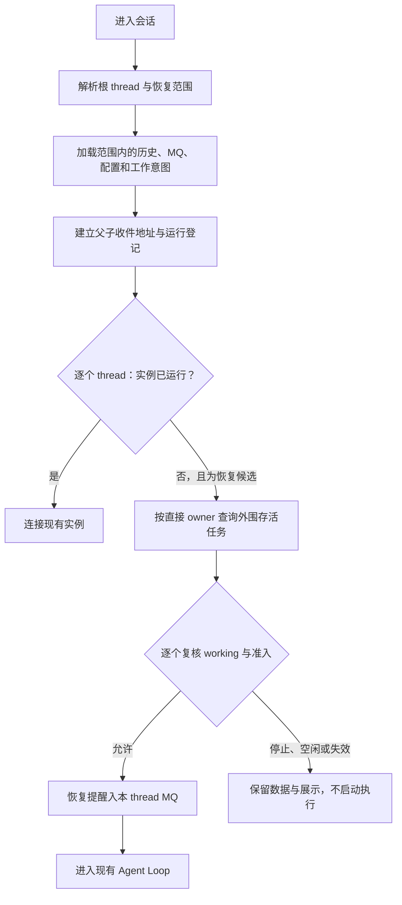

# Peri Durable：进入会话时恢复

- 状态：**已批准目标设计**；实现状态以代码和验收为准。
- 范围：主会话与异步子 Agent 的按需续跑、MQ 恢复、context 占用展示、外围存活任务发现。
- 仓库文档位置：`docs/design/session-durability.md`。
- 前置设计：[Thread MQ](https://chatgpt.com/library?file_id=libfile_522d76ed8ac88191ac4ad25bd0909ca5&account_id=personal)。先完成 MQ 重构，再落实本文。
- MQ 文档中留待后续决定的结果处理恢复范围，以本文第 7 节为准：本版本不持久化逐条处理记录。

## 1. 恢复契约

1. Peri 启动、会话列表、历史分页和只读查询不启动恢复执行。只有进入某个会话，才判断其根 thread 范围内的恢复需求。
2. 以已有 `thread_id`、`parent_thread_id` 和持久工作意图选择恢复对象。根 thread 只确定范围，不是所有结果的统一收件人。
3. 主会话及其范围内需要继续工作的 async Agent 使用原 thread 恢复历史、MQ 和配置，再注入恢复提醒并继续执行。
4. sync Agent 不自动续跑；按中断语义结束遗留执行，保留显式 resume 能力。已经实际转为后台继续执行的委派按 async 处理；仅停驻资源等待显式 resume 的 child 不自动复活。
5. TaskManager、运行锁、取消令牌、订阅和当前执行身份在本进程重新建立。稳定恢复身份是 thread，不要求复原旧内存 `task_id`、request ID 或回调闭包。
6. 读取已提交事实后开始新的运行，不重放旧工具调用、发送命令或停机期间的外围事件。
7. MQ 只保存待发送消息；历史消息仍归 `messages`。不新增异步任务绑定表或逐条结果处理标记。

本设计恢复线程树内的工作与当前运行登记。旧进程任意自定义闭包的恢复不属于承诺范围；正常装配仍遵循现有会话绑定、配置回调优先级和直接接收会话规则。

本文的「恢复」是按持久事实建立新运行，与 [项目说明](../../AGENTS.md) 和 [RCRA 消息设计](rcra-message-activation.md) 的「不恢复旧执行」一致：不续接旧进程的模型请求、工具调用、审批、回调或执行身份，也不重放停机期间的外围事件；只有 `work_state=working` 的 thread 会被重新准入，`idle`／`stopped` 不自动续跑。

原投递目标必须能由现有持久关系与配置、经既有装配规则重新确定。无法确定时，该 child 报告恢复失败，不猜测接收人或回退到 root；不新增绑定表。当前收件人是不能从历史父链推导的必要配置，保存在既有 `threads.config.completion_target`；spawn／显式 resume 在接纳工作前保存。缺失、为空或自定义回调没有声明目标时，冷恢复明确失败，用户可显式 resume 重新建立路由。

## 2. SQLite：会话表只新增两列

```sql
ALTER TABLE threads
ADD COLUMN context_usage_tokens INTEGER
CHECK (
    context_usage_tokens IS NULL
    OR context_usage_tokens >= 0
);

ALTER TABLE threads
ADD COLUMN work_state TEXT NOT NULL DEFAULT 'idle'
CHECK (work_state IN ('idle', 'working', 'stopped'));
```

| 字段 | 保存内容 |
| --- | --- |
| `threads.context_usage_tokens` | 最近一次有效上下文占用的 token 数；`NULL` 表示未知，不是零占用。 |
| `threads.work_state` | durable 工作意图；`working` 允许进入会话后自动续跑，`idle` 不自动续跑，`stopped` 保留显式停止意图。 |

既有 `id`、`parent_thread_id`、`cancel_policy`、`agent_status`、`config`、frozen/inherited context 继续使用。MQ 表结构由 Thread MQ 文档维护，不在这里再建立一份消息存储。

不创建 `agent_task_bindings`，不增加 `messages.awaiting_response`，不新增 pending-result ID 集合、命令表、执行阶段表或恢复检查点。

### 2.1 `work_state` 与实时状态

`work_state` 表示中断后的续跑意图，不承担 TUI loading 或 TaskManager 实时状态的职责。运行中是否忙碌、是否正在等待，由现有运行态表达。

| 操作 | `work_state` 的目标值 |
| --- | --- |
| 主会话执行获得准入 | `working` |
| async child 开始执行，或 sync 委派实际转为后台继续执行 | `working` |
| sync child 开始执行，本次执行不纳入自动恢复 | `idle`；现有 `agent_status`／运行事件仍正常表达它正在工作 |
| Receive 将输入移交历史 | 保持当前继续工作意图，不因 MQ 行消失而写 `idle` |
| 正常完成、明确失败、或交还控制等待显式 resume | `idle`，并维护既有终态 |
| 用户 Stop | 受现有取消策略影响的对象写 `stopped` |
| 用户明确继续或发起允许解除停止的新执行 | 在获得准入时写 `working`；sync child 仍按上面的规则 |
| 进程异常退出 | 不写终态，保留最后提交的值 |

sync 无须新增持久 run-mode 字段。自动恢复只选择 `working`；业务入口负责写对续跑意图，不从 `cancel_policy` 猜同步／异步模式。

旧数据的新增列初始化为 `idle` 和 `NULL`。旧 `agent_status = 'active'` 不构成自动恢复资格，不批量唤醒历史会话。

### 2.2 Context 占用

- 保存现有占用计算产生的有效 token 数，不保存累计计费输入量或完整 TokenTracker。
- 进入会话时先显示已保存值；百分比使用当前有效配置中的 context window 计算。
- 占用变化后更新这一列，语义是最后提交的展示快照，不承诺逐个流式 token 落库。
- Compact、rewind 或模型配置变化使旧值失效时，更新新有效值；暂时无法获得有效值则写 `NULL`。
- 新执行的预算判断基于重建的有效上下文和现有预算逻辑，不能把旧展示快照当作本次模型请求的精确 usage。

## 3. 唯一恢复时机与范围

| 事件 | 恢复执行 |
| --- | --- |
| Peri 进程启动 | 否 |
| 会话列表、历史分页、只读元数据查询 | 否 |
| 进入主会话 A | 检查 A 所在根 thread 的范围 |
| 进入同一根下可执行的子会话 | 解析同一根范围，复用其运行协调 |
| 再次进入已运行的 A | 连接当前实例，不重复启动或重复注入恢复提醒 |
| 切换到 B | 检查 B，不顺手停止、重启或恢复 A 的其他工作 |
| 本进程尚未进入的会话收到消息 | 可以持久接纳 MQ，不因此冷启动 Agent |

进入是业务上的会话激活动作，不能把所有名为 load 的读取方法都当成恢复入口。历史展示加载必须与可执行会话进入分开。

先沿已有父链找到根，并校验缺失节点、循环和环境绑定。之后只读取这个根的 thread 子树。SQL 选择形态如下：

```sql
WITH RECURSIVE thread_scope(id) AS (
    SELECT id
    FROM threads
    WHERE id = :root_thread_id

    UNION

    SELECT child.id
    FROM threads AS child
    JOIN thread_scope AS parent
      ON child.parent_thread_id = parent.id
)
SELECT t.id, t.parent_thread_id, t.work_state, t.context_usage_tokens
FROM threads AS t
JOIN thread_scope AS scope ON scope.id = t.id
WHERE t.work_state = 'working';
```

这条查询确定候选，不直接授权启动。主会话不是 `working` 时，仍检查同范围内各 child 的自身状态；为 child 重建必要的父级收件地址，不意味着启动父级模型。

只读 Store、不可执行环境或损坏关系不能放行执行；已能读取的历史与占用仍可展示，恢复错误显式报告。会话装配与历史回放成功后，恢复准备失败按「部分成功」返回：`session/load|resume` 仍为 Ok，结果写入 `_meta.peri.recovery`；使会话不可执行的失败（`Corrupt` / `ReadOnly` / `NotFound`）另以 `-32017` 拒绝 prompt。只读/不可执行 Store 的 `session/load|resume` 装配失败时改为**视图态**：`SessionState` 无执行环境、不注册可执行 MCP/TaskManager，历史与占用照常回放，`_meta.peri.recovery` 报 `failed` + `executionBlocked=true`，所有执行入口（用户 prompt、scheduled、continuation 与 idle 注入）统一返回 `-32017`；视图态不写库，关闭后释放；已有 live 会话不降级，视图态可重复 load。

## 4. 恢复流程



1. 同一根范围内的重复进入请求合并；与正常启动、Stop、关闭、显式 resume 共用现有运行协调。
2. 加载所需 thread 的有效历史、frozen/inherited context、MQ 与配置，不重新冻结已有上下文。
3. 先建立收件地址与父子关系，再放行 child。嵌套 `A → B → C` 的消息保持对应会话归属，不能统一送到 A。
4. 对候选 async child 建立当前进程的 TaskManager 登记，保留原 child thread。不会新建一个替代 child，也不会重复执行旧的 Agent 工具调用。
5. 按各 thread 的直接 owner 查询外围任务现状并建立当前监听。结果供恢复提醒及任务展示使用，不复制为 Peri 的外围任务状态表。
6. 异步准备结束后，重新读取工作意图并检查当前实例与执行资格。快照之后发生的 Stop、关闭和手动 resume 必须生效。
7. 向本次实际需要续跑的 thread MQ 注入可信恢复提醒，再由现有 Receive 与 Loop 继续。提醒不是新的用户委派，不自动启动 `idle` 或 `stopped` 会话；`agent_status` 已终态（`done`/`cancelled`/`error`）的 thread 一律按不续跑处理，残留的 `working` 不是待继续的证据。

恢复协调、正在准备的集合和重复进入合并仅存在于本进程。重复进入不能创建第二个 worker，也不能把旧准备结果发布到新的会话生命周期。

根 thread 已经运行，不代表可以跳过其他 child 的检查。上图逐个处理范围内的 thread；已有实例复用原历史投影、收件地址与登记，不能用磁盘快照覆盖它。

### 4.1 恢复提醒

提醒说明发生过进程中断、现在从已提交历史继续，以及直接归属该 thread 的存活 Agent／Shell 任务。任务列表由当前事实生成，不读取停机期间事件日志。

示例正文：

```text
会话从中断后的已提交历史继续。旧工具调用不会自动重放。
本会话当前存活的任务：
- Agent child-a1：working，已建立本次运行登记。
- Shell shell-42：running，由 Workspace 查询确认。
未取得结果的外部调用保持未知，请依据当前任务状态继续处理。
```

通过现有可信 SystemReminder 入口创建，经过 MQ 持久接纳和 Receive 移交；不把此示例文本本身当成权限凭证。UI、模型与诊断分别遵循既有受众与区域过滤。

提醒绑定本次有效执行。MQ 中针对旧运行的控制消息沿 Thread MQ 的失效绑定规则结算，不把所有旧消息统一改绑到新运行。

### 4.2 Rust 恢复入口

在现有会话生命周期服务中提供统一业务入口，接口契约如下；它不是第二套 Store，也不向调用方开放任意状态写入：

```rust
#[async_trait::async_trait]
pub trait SessionRecovery: Send + Sync {
    async fn enter(
        &self,
        thread_id: &ThreadId,
    ) -> Result<RecoveryReport, RecoveryError>;
}
```

`RecoveryReport` 返回本次根 thread、复用的实例、实际恢复的 thread、保持不运行的 thread 及逐项失败。它是调用结果，不持久化为恢复记录表。正常只读加载不调用 `enter`。

进入完成后，Host 把报告投影为 `RecoveryView`（`peri_acp_types::recovery`）并附加到 `session/load|resume` 响应的 `_meta.peri.recovery`；仅在本次实际恢复或失败时附加。`Failed` 且 `executionBlocked` 的失败在会话 runtime 上留下内存执行阻断，`session/prompt` 统一返回 `-32017` + `data.reason = "recovery_execution_blocked"`；`Unavailable` / `Superseded` 保持可重试，不阻断显式继续。阻断状态不持久化，每次新的 load/resume 重新判定。

冷 child 的 `assemble_for_recovery` 只建立运行实例；调用它的 server loop 必须在响应前补齐 TaskManager 绑定与在线 endpoint。`discard` 只丢弃 `Prepared` 启动资格，MQ 中的提醒保留，下一次进入采纳同一条提醒而不是重复注入。

`enter`、普通执行准入、Stop、关闭和显式 resume 共用同一运行协调。恢复提醒与任务完成仍调用既有设计中的 `ThreadMq` 接口；状态变化由生命周期行为提交到 `SessionResources`，业务方不通过裸 setter 或 SQL 分别修改 MQ、历史与工作意图。

## 5. 工作意图与 MQ 的事务关系

### 5.1 运行准入和收尾

- 主会话或 async 执行放行前提交 `working`。若提交后、worker 启动前退出，下次进入仍可继续原 thread。
- 准入前的 `working` 写入是 fail-closed：目标 thread 不存在或写入失败时拒绝本轮，不取 AgentPool、不调用模型；continuation 路径回滚本函数刚设置的 `continuation_in_flight` 与取消令牌。
- 自然收尾不能无条件写 `idle`。它与消息接纳共用协调，并在存储操作中确认没有仍要求继续处理的新工作，避免覆盖刚到的消息。收尾发生在 turn 之后，失败只能有限重试并记录 error，不能把已提交正文改回失败。
- 明确失败按现有失败规则停止本次自动尝试；后来的新输入仍按既有准入规则判断。
- 恢复准备失败不伪造任务完成或已取消；显示错误，保留已提交事实供下一次明确进入／继续重试，不建立无限后台恢复循环。残留提醒不再等价于「已注入」：进程内 admitted 状态负责防重复，MQ 中未消费的 entry 提醒可被下一次进入采纳。

### 5.2 消息接纳

需要推动目标继续工作的消息，按现有 typed policy 和执行绑定判定，在 MQ 接纳事务内维护目标工作意图：允许时从 `idle` 转为 `working`；`stopped` 不被被动回调解除；Info／UI-only／Passive 不自行授予执行资格。

该判定同时遵守第 2.1 节：本次同步执行不因为收到消息就被改成可自动恢复的 async 执行。收消息与实际后台交接是不同的生命周期操作。

这只记录工作意图。本进程尚未进入的根范围仍不能启动执行。已经激活的范围沿现有调度继续。

普通用户待发输入保留 Thread MQ 的忙碌、单发、全发、空闲队首和 Stop 规则；不能因为本设计统一写入工作意图，就排空所有待发输入。

### 5.3 child 完成与终态结算

child 的终态、`work_state` 收尾、结果接纳到目标 MQ，以及适用的接收方工作意图变更，在具备批/事务能力的后端上使用同一次提交；提交成功前不能宣称完成投递。

- **本机 SQLite**：`BEGIN IMMEDIATE` 内一次写入 child 终态、`work_state`、结果 MQ 行与接收方 `idle → working` 提升。结果插入与终态更新都要求 child 仍为 `active`，同一 child 的终态只写一次；后到的结算不覆盖已提交终态，也不产生第二条结果。
- **远端存储**：同样的效果放进一次 `commit_effects` 托管批。`Inserted` 的 MQ 接纳与工作意图提升同批；`Existing` 在 `same_payload` 确认后单独一批提升，失败返回可重试错误，调用方用同一稳定 ID 重试。`finalize_child_terminal` 与无结果的 `settle_terminal_without_result` 也各是一批，批内 `active` 守卫与批前/批后事实归类保证终态只写一次；批失败或结果未知不返回成功。关闭结算 `settle_retained_mq` 将提醒写入、MQ 水位删除和派生计数更新置于同一托管批；删除失败时提醒也回滚。
- **未实现原子操作的后端**：`SessionResources` 与数据端口默认返回 `Unsupported`，不执行任何部分写入。适配器必须显式提供符合契约的实现。

因此，已完成并成功入 MQ 的 child 不会因崩溃残留 `working` 而再次续跑：恢复复核拒绝终态 thread，终态先落、工作意图后到或只写 `agent_status` 的旧收尾也会在下一次结算时收敛 `working`。迟到的 `EnsureProcessing` 接纳只对仍 `active` 的 thread 提升 `idle → working`。任务结果的稳定消息身份继续遵守 MQ 的去重契约；运行期任务登记本身不另建持久绑定表。

同一 child 的终态只写一次：重复结算（含 panic 兜底）不得改写已写下的终态，也不得因正文不同产生身份冲突。同一 child 的多次恢复使用各自恢复提醒的稳定 ID 作为结果身份；只有同一次恢复的重复结算才幂等，后续恢复的结果不得被上一条历史身份跳过。

sync 委派实际转为后台继续执行时，worker 持有 `working` 写入并向调用方确认；写入失败取消子执行并返回错误，成功确认前不能返回 Pending。调用方在 `working` 已提交后消失时，调用方消失后仍存活的认领 worker 负责把 `agent_status` 与 `work_state` 一起恢复到认领前的值，不留「终态 + working」。终态写入只归 handoff worker。执行体与 worker 用进程内 `TerminalOwnership` CAS 决定唯一写入者；worker 先建立父 `AsyncResultMailbox` 的 Queued 责任，再用 `finalize_child_terminal` 一次提交 child 终态、`work_state` 与父 MQ 结果。没有可用 terminal route 时不 detach，按同步路径执行并用 `settle_terminal_without_result` 收尾；worker 准入被拒时同样回退同步，由 wrapper/执行体按同一 CAS 唯一写终态，不产生父回执。映射为：正常结束 `Done + Idle`；明确取消 `Cancelled + Stopped`；其他中断、失败、交接未完成或 close 失败 `Error + Idle`。finalize 失败时结果未确认，child 仍按 `working` 交给下一次进入，并用同一消息身份重试（若提交实际已落地，重试为幂等 no-op），不伪报完成。

恢复 child 的 continuation 在 turn 真正获得准入后登记到 live 且未 closing 的实际接收会话。`TaskManager::register_live_agent` 同时建立任务投影、原 child thread 的可撤销消息入口和取消令牌；`TaskRecord.child_thread_id` 填写原 thread。`active_agents` 沿已保存的 `cancel_policy` 保留 Cascade／Independent 行为。接收会话未 live 时跳过登记，其之后进入时补做 adoption，不冷装配祖先链；child 终态结算或启动早失败时关闭 inbox 并收尾任务。

结果通知使用 `threads.config` 中的 `completion_target`，历史 `parent_thread_id` 只确定恢复范围，不改写：B 显式 resume 原属 A 的 C 后崩溃，C 的结果仍回到 B。配置回调保持优先；只有声明过目标的同一回调才能恢复。恢复准备会核实目标仍在同一根树中，缺失或不可确定时报告失败，不回退 A 或 root。任务提醒也按实际接收关系列举。结果消息沿用 `ensure_processing`：live 且已激活的 idle 接收方被唤醒，未 live 时下一次进入消费 durable 行，`stopped` 不被解除。

恢复启动只在真正交出执行后保持启动资格。`launch` 的任一跳过路径（会话态消失、代次变化、closing、turn 已活跃、activation 不允许、listener 启动失败、scheduler 消失）都撤销本次准入；continuation 已发出但调度或分发在 Receive 前失败时，只在恢复来源下写进程内 `recovery_launch_failed`。下一次显式进入读取并清除该标记，重新采纳 MQ 中的同一条提醒；不做同进程自动重试，不新增持久相位，也不把早失败伪报为完成或取消。

### 5.4 Stop

Stop 按既有取消策略确定实际受影响对象，在持久操作中保存相应停止意图，再确认控制操作成功。不能只保存父级停止却让应受取消影响的 child 保留自动续跑资格。

恢复准备与 Stop 竞争时，旧快照不能覆盖新的 `stopped`。已经进入提交阶段的消息与当前执行按既有协调结算；Stop 不回删已提交历史，待发消息继续留在 MQ。

### 5.5 sync 中断的收敛

进入根会话时，在根级 single-flight 门内、读取恢复候选之前收敛该根子树中遗留的 `Active` child：非根、`agent_status = active`、`work_state` 为 `idle` 或 `stopped`、本进程没有活动实例（无 runtime、无 turn 令牌、未 closing），且 close 已结清。`idle` 收敛为 `Error`，`stopped` 收敛为 `Cancelled`；`work_state` 保持原值，不写 `Done`。

收敛不续跑、不注入提醒、不产生结果通知；它只让显式 resume 不再被遗留 `Active` 拒绝。close 未结清、状态查询失败或 child 仍是 `working` 时不收敛，单个收敛失败只记录日志，不阻断本次进入。旧代际库没有 `work_state` 列，读作零候选。

## 6. 外围任务边界

- Peri 不恢复 MCP 服务、进程、句柄或旧连接；只有外围服务仍持有的任务能被查询发现。
- Workspace 需要提供按直接 owner 查询当前存活 Shell 的能力，复用现有 MCP 能力面。不会扫描并接管其他 thread 的任务。
- 当前查询结果进入任务投影；查询失败表达为未知／失败，不能伪装成空列表。影响该 Agent 恢复准备的失败不阻止无关会话正常读取。
- 宿主侧 `McpPoolPort::watch_workspace_tasks` 在会话任务绑定启动时开始监听，随 close/取消退出：立即扫描一次，之后按固定间隔重扫，未确认的查询在下一轮重试。当前 owner 取 session id（ACP 中与 thread id 同值；若二者分叉，恢复需传真实 thread id）。只登记早于 watcher 启动、`shell_task_list` 仍报告的 live Shell；登记走既有 external task registration，再以现有 `tasks/get` 订阅（订阅首轮立即查询一次）覆盖发现与监听之间的变化。source identity 为 `(session_id, owner_identity, owner_task_id)`，重复登记按已登记处理。
- 终态经既有 `settle_external` 投递到 owner MQ；重复通知沿稳定外围 task 身份收敛。watcher 退出不发送 `tasks/cancel`；会话 close 仍按既有 `cancel_session_external_tasks` 处理已登记任务。
- 不补播 downtime 期间的完成、输出或告警事件。只登记查询返回的 live 任务，停机期间完成的终态不会补发；没有发现某个旧任务，不等于它成功、失败或已取消。
- 正常重连后的新完成结果走原 owner 的 MQ；不能直接写入历史，也不能解除用户 Stop。
- 恢复提醒里的 `workspace_live_tasks` 只是只读发现，不承担登记或订阅。范围限于 Workspace Shell；其他 MCP server 的协议任务没有可枚举面，不纳入本次恢复。

## 7. 历史与 Compact 的边界

消息成功进入 `messages` 后，MQ 行即删除。冷恢复按照已提交的有效历史、flags 和 projection 继续构造上下文。

本版本不恢复上一次进程的逐条结果处理记录，不新增 `awaiting_response`，也不通过另一份 ID 集合或强制保护全部历史结果实现替代账本。当前进程运行期间原有结果保护仍正常使用；冷恢复不承诺精确还原原 Ready／InFlight／Covered 集合，不将该缺失伪装成“全部已处理”。

恢复提醒提供中断与当前任务事实，模型从正常有效历史继续。历史中的缺失工具结果沿既有模型视图完整性规则处理，不制造成功结果、不重放未知副作用。

## 8. 实际字段仿真

以下 ID 为可重复 SQL 仿真值。生产继续使用现有 UUID 类型；`agent_status` 与 `cancel_policy` 均为既有字段。

| id | parent_thread_id | cancel_policy | agent_status | work_state | context_usage_tokens |
| --- | --- | --- | --- | --- | --- |
| root-a | NULL | cascade | active | working | 42100 |
| child-a1 | root-a | independent | active | working | 19800 |
| child-a11 | child-a1 | independent | active | working | 6400 |
| child-a2 | root-a | cascade | active | idle | 9500 |
| child-a3 | root-a | independent | cancelled | stopped | 12000 |
| root-b | NULL | cascade | active | working | 31000 |
| child-b1 | root-b | independent | active | working | NULL |

`child-a2` 表示中断前同步运行、没有自动续跑意图的 child。其遗留 Active 状态在进入后的中断结算中按既有语义收敛，不能直接报告 Done，也不能阻止后续显式 resume。

Peri 启动时不执行恢复查询。进入 `root-a` 后，第 3 节查询返回：

| id | parent_thread_id | work_state | context_usage_tokens |
| --- | --- | --- | --- |
| root-a | NULL | working | 42100 |
| child-a1 | root-a | working | 19800 |
| child-a11 | child-a1 | working | 6400 |

三者各自通过准入后恢复。`root-b` 与 `child-b1` 不受影响；`child-a2` 不自动续跑；`child-a3` 保持停止。

若 `root-a.work_state = 'idle'` 而两个 async child 仍为 `working`，候选只包含这两个 child；root 的收件地址可以装配，root 模型不因装配而启动。

## 9. 验收契约

以下是必须验证的行为，不表示运行时代码已经实现或测试通过。

| 场景 | 预期 |
| --- | --- |
| 多个根均存有 working | 进程启动零自动续跑；进入 A 只检查 A 范围。 |
| 重复进入／并发进入同一根 | 每个 thread 最多一个当前运行实例；不重复注入同一次恢复提醒。 |
| 主会话 idle、async child working | 进入阶段 child 可恢复；不因装配 child 而启动父级模型。 |
| 嵌套 async Agent | 保留原 thread 与直接会话归属，结果不统一转投 root。 |
| sync 中断 | 不自动续跑、不伪报 Done；进入根时把非根、非 working、非活实例且 close 已结清的遗留 Active 收敛为 Error（idle）或 Cancelled（stopped）；后续显式 resume 可用。 |
| sync 实际转为后台继续 | 交接提交后带 working 意图；终态、工作意图与父结果由 handoff worker 一次 finalize；无 terminal route 时不 detach。 |
| 恢复准备期间 Stop／关闭／手动 resume | 启动前复核生效；旧快照、旧事件和旧 worker 不覆盖新状态。 |
| MQ 已移交、模型推进前退出 | 历史存在且 MQ 不重复；working 让进入后从历史继续。 |
| child 完成提交边界退出 | SQLite 单事务、远端托管批：终态与父 MQ 全有或全无；未实现原子结算的后端返回 Unsupported，零部分写入。 |
| 最后一条回复与新回调竞争 | 不丢新消息的工作意图；被动回调不解除 stopped。 |
| 进入前已有可唤醒消息入 MQ | 接纳及意图持久化但不冷启动；进入后按 working 正常推进。 |
| 进入后重建 Shell 视图 | watcher 只看到直接 owner 的 live Shell；查询失败不等于零任务；停机期间完成的终态不补播。 |
| 外围查询与订阅之间变化 | 订阅首轮立即查一次、watcher 定期重试当前状态收敛，不补播整个 downtime。 |
| Context 初次展示与失效 | 已保存值立即显示；NULL 不显示为 0；失效值不用于精确预算判断。 |
| 旧库升级 | 只新增本文两列；旧 Active 不触发自动恢复，历史与 MQ 内容不被改写。 |
| 结果处理范围 | 不出现任务绑定表、历史处理标记或隐藏的 pending-result 持久副本。 |
| 恢复准备失败（装配成功） | load/resume 返回 Ok，`_meta.peri.recovery` 报 `failed`/`partial`，历史保留；不可执行分类另以 `-32017` 拒绝 prompt。 |
| 响应发送失败后再次进入 | 只丢弃 Prepared 启动资格，MQ 提醒保留；下一次进入采纳同一条提醒，不重复注入。 |
| 冷 child 恢复 | 响应前补齐 TaskManager 绑定与在线 endpoint；父级不启动模型。 |
| 恢复 child 父级登记 | 恢复 continuation 准入后登记实际接收会话的 TaskManager、child inbox 和已保存的取消策略；未 live 时之后 adoption；结算或早失败收尾。 |
| 恢复启动早失败 | launch 的跳过路径撤销准入；恢复来源的 continuation 在 Receive 前失败写进程内标记，下一次显式进入重试；不自动重试、不新增持久相位。 |
| 恢复结果唤醒 | `ensure_processing`：live idle 父级被唤醒，未 live 下一次进入消费；`stopped` 不被解除；结果回到已保存的实际收件人。 |
| 只读／不可执行 Store | load/resume 返回历史与占用，会话为无执行环境的视图态；prompt 等执行入口统一 `-32017`；视图态不写库。 |
| 准入工作意图写入失败 | prompt 拒绝、模型零调用、工作意图不留下 `working`。 |

所有业务写入经 Rust 行为接口和同一 Session Store。恢复入口负责装配与准入，普通执行负责正常状态变化；TUI、ACP 和回调不直接执行 SQL。

## 10. 实施顺序

| 顺序 | 交付内容 | 进入下一步的条件 |
| --- | --- | --- |
| 1 | 完成 Thread MQ 独立重构：统一入口、待发事实、原子移交与区域过滤。 | MQ 文档中的事务、路由和界面契约通过。 |
| 2 | 迁移 `threads` 两列，接入 context 展示与工作意图写入。 | 旧库迁移正确；主会话、async、sync、Stop 和后台交接不会写错意图。 |
| 3 | 在真正的会话进入入口接入根范围检查、运行协调、父子装配与恢复提醒。 | 重复进入、嵌套 child、idle 父级和恢复／Stop 竞争通过。 |
| 4 | Workspace 提供按 owner 发现存活 Shell，恢复当前订阅与任务投影。 | owner 隔离、查询失败和查询／订阅间变化通过；不补播 downtime。 |
| 5 | 整体验证异常退出与再次进入。 | 使用真实 SQLite 提交边界验证 MQ、历史、工作意图及本地完成事务，无重放和错误冷启动。 |

本文是实现契约，不宣称验收已通过；实现状态以代码和测试为准。文档 SQL 可独立仿真，但不能替代运行时验收。

文档校验已使用 SQLite 执行上述两列迁移，写入第 8 节七行数据并重新打开数据库，验证根范围隔离、idle 父级、stopped child、旧数据默认值以及字段约束。该校验没有运行 Peri Agent，也没有验证运行时崩溃恢复。
