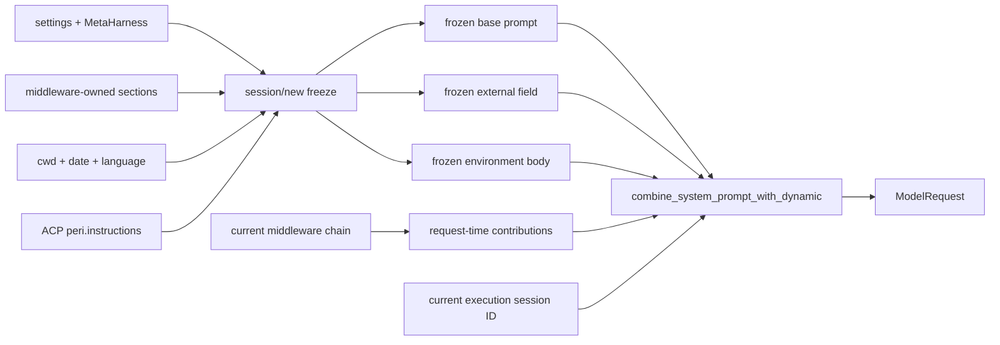

# System Prompt 构建系统设计

> 状态：现行设计
>
> 冻结、能力闭包与缓存边界的强制不变量分别见 ARC-FROZEN-001、
> ARC-CAPABILITY-CLOSURE-001 与 ARC-SERIAL-001；自定义覆盖机制见
> [MetaHarness 设计](meta-harness.md)。

## 1. 设计边界

System Prompt 由内部冻结 base、可选的会话级外部系统指令，以及每次模型请求读取的
middleware contribution、最终环境块组成。各自保留独立来源；外部指令与 contribution 不得作为
普通消息写入 Transcript。

- base prompt 在 `session/new` 时随日期、运行环境快照（platform / OS 版本 /
  是否 Git 仓库）、项目指引、skill 摘要与 MetaHarness 状态一起冻结和持久化；
  load、resume、fork 与 SubAgent 复用同一 owner snapshot；旧快照缺少结构化
  运行环境值时按 unavailable 显式标记，不重探本地值冒充；
- middleware contribution 由当前 session 的同一条生产链提供，在 `before_agent`
  完成能力目录准备后，于构造 `ModelRequest` 时同步读取；
- 外部系统通过 ACP `session/new` 的 `_meta["peri.instructions"]` 添加会话级扩展。
  它不改变工具、审批或能力关闭事实；正文独立于内部渲染产物冻结并持久化；
- contribution 只能追加到冻结 base 之后，不能重写缓存前缀，也不能绕过当前
  session-local capability policy；
- 主会话的组合 System Prompt 不进入 Transcript，Compact 与 rewind 不修改冻结字段；
  子 Agent 的内部身份可留在其 own history，模型投影会吸收该历史副本。

## 2. 所有权与段落来源

基础段、语言、审批、提问、Skills、SubAgent 等提示词分别由对应 middleware 持有。
middleware 缺席时，其工具、hook 和段落必须同时消失；不能保留“能力可用”的静态
说明。槽位、段落 ID、zone 与 order 声明在 `peri-acp-types/src/meta_harness/owners.rs`。正文由 `peri-middlewares` 的持有者构造。内核只依赖 `PromptSection`、中间件接口及公共类型。ACP 渲染器校验声明和覆盖，按位置确定性输出。

| 内容 | 来源与生效条件 |
| --- | --- |
| 基础行为、身份、persona、环境 | DefaultSystemPrompt 的冻结声明。基本工程行为独立于具体工具。shell 操作细节随 Bash 的工具描述交付。 |
| 语言 | LangMiddleware 使用已冻结的语言输入。 |
| 审批与提问 | Permission 持有审批模式和绑定来源的规则；HumanInTheLoop 持有提问工具及用法。交互 workflow 的审批段要求 broker 和 permission mode 同时在场。 |
| 委派 | SubAgent 持有目录绑定、单层委派与调度说明。建链前或覆盖中使用目录占位符也需要这个绑定。 |
| 技能 | Skills 根据实际绑定交付完整、仅发现、仅加载或空段。目录摘要也按有效绑定裁剪。显式技能预载由 SkillPreload 独立持有。 |
| 项目说明、署名、工具目录 | 已装配的 owner 提供逐请求贡献，读取当前会话的投影。 |
| 外部指令 | 宿主准入后单独冻结。工具、审批和执行资格由运行时授权。 |

主、子与 workflow 根据同一冻结策略调用这些 owner 的 section 构造器；子 Agent（含 `fork` 类型）按执行面能力投影重建子身份，普通 ACP `session/fork` 直接复用 source snapshot 的冻结字节，不重渲染。默认主链已有的 section ID 和覆盖键继续可用。某段不适用于派生执行面时，覆盖不会为它创建新段。技能能力部分开放时，交付该子集的内置指引，避免全能力覆盖扩大声明。

子 Agent 新建时把实际技能权限写进已有身份消息的可选字段。恢复取历史权限与当前允许工具的交集。缺少该字段的历史身份不能证明当时拥有哪些技能工具，因而移除可识别的技能段并保留其他获准工作。带权限记录的自定义段落按同一冻结 cwd、日期与模板规则渲染。无法唯一定位身份中的目标段落时显式拒绝恢复，避免向模型交付无法核实的身份。

## 3. 构建与冻结

冻结 snapshot 是 write-once owner state。legacy thread 缺 snapshot 时只能按
ARC-FROZEN-001 的 CAS 回填路径恢复；未知版本、损坏数据或存储错误必须 fail closed。
fork 继承 source snapshot 的精确字节，不能以当前磁盘内容重新生成。

外部正文仅在新会话准入：缺席或空字符串为无扩展；非字符串、超过 64 KiB 或包含
`SYSTEM_PROMPT_DYNAMIC_BOUNDARY` 完整控制字须以 invalid-params 拒绝，不能创建
可用 thread。接受后按字面值冻结，花括号、标签、空白与换行不作模板、导入或段落
解析。V2 及后续 frozen snapshot 显式保存 `external_instructions` 字段（可为 `null`，缺失
视为损坏）；冷 load/resume、普通 fork 与子 Agent 从同一份 owner snapshot 继承，
不从现有 prompt 文本反解析。

交互式 TUI 是该字段的生产者：`peri-tui/src/acp_client/client/session/transition.rs`
的 `new_session_under_gate` 仅在 `ClientProjectionMode::Interactive` 时把
`peri-tui/prompts/tui.md`（`TUI_SESSION_INSTRUCTIONS`）写入 `session/new` 的
`_meta["peri.instructions"]`，因此正文随首次准入冻结一次，重试路径同样携带。
`-p/--print`（Headless）与 `acp` 子命令不注入；`session/load` 不补注入，恢复会话
沿用服务端已冻结的旧值。正文只覆盖 TUI 的 Markdown、Mermaid 与 GenUI 围栏约定，
不改变上述准入规则（仍须为字符串、≤64 KiB、不含保留控制字）。

模型请求的唯一组合顺序是：**内部静态段 → 唯一缓存分界 → 内部动态段 → 外部
指令段 → 逐请求 contribution → env**。外部段的固定标签保护正文边缘空白；正文在
provider JSON 的 system text 中作为连续子串恰好出现一次，transport 控制字不进
wire。内部模板为空、没有 contribution 时，也须在外部段之前生成分界。主 Agent
override、子 Agent 和 workflow 各自按能力投影内部身份，随后由模型桥接层附加
同一外部字段；子身份持久历史只存内部身份，Compact/继承历史不复制外部正文。

env 正文由 `DefaultSystemPromptMiddleware` 的 `env` 段声明，经 `PromptTemplate::render_environment` 独立冻结到 V3 的 `environment_prompt` 字段（必需，可为 `null`），支持 `.peri/meta/env.md` 覆盖。关闭持有者时环境段也消失。模型桥接层在最后包装 `<env>` 并加入当前执行 session ID；主会话、普通 fork、子 Agent、workflow 均使用各自身份，不能把父 ID 冻结进正文。cwd、日期、平台等继续消费 owner 快照。同配置会话的环境差异只影响末尾，不打断此前的公共前缀；这不保证 provider 实际缓存命中。旧 V1/V2 主会话保留原正文、不提取或搬移旧 env；重渲染 override、子 Agent 和 workflow 时，仅从冻结 cwd、日期、运行环境与段落覆盖准备独立 env。`legacy_embedded_environment` 区分旧内嵌布局与 V3 显式空值；旧主会话重存保留旧来源，派生子会话使用独立 env。V1 含不可分离外部指令仍拒绝派生，不生成环境回退。

V1 冻结快照没有独立来源字段。普通主 Agent 保留旧 prompt 原字节；若其中有
`<agent_instructions>` 开始标记，需要重渲染的 override、子 Agent 或 workflow
明确拒绝并要求新会话。该标记之后若含保留缓存控制字，主 Agent 也须在 provider
前拒绝，防止 adapter 移除正文。V1 标记不能用来恢复可信外部字段；V1 无标记
仍按历史主 Agent 语义运行。

request-time contribution provider 返回 owned `String`，不得持锁跨越模型 await。空
contribution 必须保持 base prompt 字节不变。贡献顺序按 production chain 顺序，任何
依赖 `HashMap` 迭代生成 prompt 的实现都违反 ARC-SERIAL-001。收集器
（`MiddlewareChain::collect_prompt_contributions`）是分隔符与准入校验的唯一权威：
非空贡献以空行连接，含 reserved boundary token 的贡献返回带来源的错误，调用方
不补分隔符、不手工复制组合算法、不静默剥离内容。

## 4. 缓存边界 transport

`peri_model::prompt_cache::SYSTEM_PROMPT_DYNAMIC_BOUNDARY` 是跨 `String` handoff 保留
cached/uncached seam 的唯一控制字。`combine_system_prompt_with_dynamic` 将 request-time
contribution 放在边界之后；provider 在构造 wire request 前必须消费控制字，wire 上
不得泄漏。

- `Cached` 段只接收静态正文，动态正文类型与未转义模板占位符都在构造期显式失败；段落
  id 与 `(zone, order)` 必须唯一，冲突在构造期显式失败并指出来源；
- MetaHarness 段落覆盖在冻结准入点校验（单段 / 总字节预算、reserved 控制字、
  未知 `{{name}}` 占位符、空覆盖）：非法覆盖拒绝应用并保留内置段，结构化诊断
  按段落 + 错误类别记录；旧 snapshot 正文不自动改写，重渲染时同样按“拒绝应用、
  保留内置”降级；字面花括号用 `\{{` / `\}}` 转义；
- 支持显式 cache breakpoint 的 adapter 只在恰有一个控制字时拆分静态/动态 system
  block；重复控制字全部剥离并对显式缓存 fail closed；
- 不支持显式 breakpoint 的 adapter 只做字节守恒剥离，不宣称控制 provider 的隐式
  缓存；
- 无控制字输入是否采用 legacy fallback，由具体 adapter 契约决定。

Anthropic 当前使用显式 system block cache seam；OpenAI-compatible 保留 system 字节
顺序并剥离控制字。详细 provider 行为见 [Model Adapter 设计](model-adapters.md)。

## 5. 能力关闭与安全边界

关闭能力必须覆盖 direct tools、deferred index/resolver、slash route、ACP/TUI 投影、
prompt/examples 以及 SubAgent/Workflow 继承，不能只删除提示词。审批与提问是两项独立
能力：`PermissionMiddleware` 持有审批语义，`HumanInTheLoopMiddleware` 持有
`AskUserQuestion`；关闭其中一项不得改变另一项。

覆盖安全相关段落是显式的强能力，但不能改变运行时授权事实。模型文本中的
“always/never”不能替代 policy、HITL、tool view 或 transport 的代码级检查。

## 6. 验证

- `cargo test -p peri-acp --test prompt_cache_boundary`
- `cargo test -p peri-acp --lib prompt`
- `cargo test -p peri-model --lib -- system_cache`
- `cargo test -p peri-middlewares --lib assembly_test`
- `cargo test -p peri-middlewares --lib frozen_claude_md`

变更段落所有权或关闭面时，还要运行 capability presence/absence 矩阵，并按
DOC-UPDATE-001 同步对应标准与模块路由。
