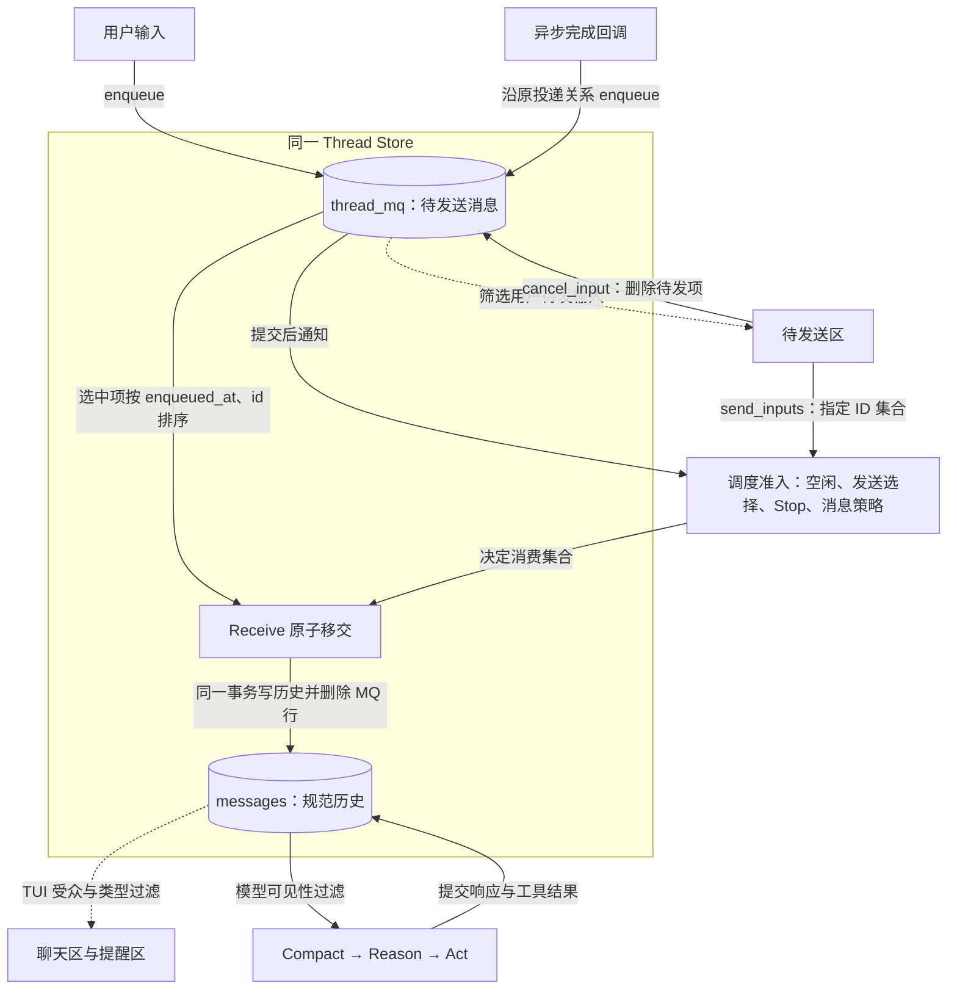

# Thread MQ：统一持久收件箱与 Rust 操作接口

- 状态：**已批准目标设计**。
- 范围：主、子与 Workflow Agent 的待发送消息、用户待发操作、异步回调接纳、Receive 移交和区域投影。
- 本文是 MQ 重构的单一设计权威；实现状态以代码和契约测试为准。
- MQ 重构先行；Session 活跃意图、Agent task 执行恢复和 context 占用等 durable 主题随后独立设计。本文不承诺已完成执行恢复。

## 1. 边界与不变量

1. 每个 thread 有自己的逻辑 MQ，存储与该 thread 的 `messages` 位于同一 Thread Store。
2. MQ 只保存尚未移交的消息。成功移交或用户取消后，物理删除对应行，不保存终态、撤回墓碑或消费留档。
3. 用户待发输入、异步结果及其他入站消息使用同一个 MQ 事实源。接口、过滤视图与内存缓存不再各持一份待发状态。
4. 异步完成回调先接纳到目标 MQ，不能直接写 `messages`。Receive 是这些入站消息进入历史的唯一消费入口。
5. Receive 在同一事务中写入 `messages` 并删除 MQ 行。事务成功后才发布交付事件、返回发送成功和更新内存 Transcript。
6. 消费排序使用服务端入队时间，时间相同以消息 ID 稳定排序；不保存 `seq` 或放行顺序号。
7. 展示、模型可见性与唤醒分别判定。统一存储不授权全量展示，也不授权全量注入模型。
8. 所有业务操作经过统一 Rust 接口；业务方不能直接操作数据库，也不能自行组合独立的插入历史与删除 MQ 操作。
9. 保留既有父子关系、任务归属与实际回调投递关系。正常路径目标不能从历史父链重新猜测，也不能失败后改投 root；恢复沿 `session-durability.md` §1/§5.3 读取现有 thread config 中的实际收件人；不可确定时失败而不是猜测。
10. 恢复读取当前事实，不回放旧发送、取消、工具调用或外部副作用。

MQ 行的存在只表示尚未移交；行消失不代表模型已经处理该消息。已进入历史的结果保护及当前 Loop 处理语义继续由执行层负责，其跨重启恢复属于后续 durable 主题。

## 2. 数据流



图中的写入、查询和删除均由 Rust 操作接口完成。图不授予 TUI 数据库访问权；TUI 的操作继续经 ACP。

## 3. SQLite 数据结构

只新增 `thread_mq` 业务表；复用已有 `threads`、`messages` 与 Store 生命周期。MQ 不增加线程级序号字段、命令回执表、outbox、处理账本或 UI 区域副本。

```sql
CREATE TABLE thread_mq (
    id             TEXT NOT NULL PRIMARY KEY,
    thread_id      TEXT NOT NULL
        REFERENCES threads(id) ON DELETE CASCADE,
    enqueued_at    TEXT NOT NULL,

    kind           TEXT NOT NULL
        CHECK (kind IN ('prompt', 'defer', 'info')),
    source         TEXT NOT NULL,
    policy_json    TEXT NOT NULL
        CHECK (json_valid(policy_json)),
    payload_json   TEXT NOT NULL
        CHECK (json_valid(payload_json)),
    original_draft TEXT
);

CREATE INDEX idx_thread_mq_time
ON thread_mq(thread_id, enqueued_at, id);
```

| 字段 | 数据契约 |
| --- | --- |
| `id` | 沿用稳定 `MessageId`；MQ 与最终 own history 使用同一 ID。生产数据使用现有 ID 类型，不新增 MQ 身份。 |
| `thread_id` | MQ 接收目标。由已绑定 thread 的服务实例填写，不接受客户端任意覆盖目标。 |
| `enqueued_at` | 服务端接纳时生成的 UTC 时间；统一固定格式 `YYYY-MM-DDTHH:MM:SS.ffffffZ`。重试、查询、发送和恢复不得改写。 |
| `kind` | 现有 `MessageKind`：`prompt`、`defer`、`info`；不能单靠该展示标签决定执行。 |
| `source` | 现有 `MessageSource` 的序列化值，由可信生产入口确认。 |
| `policy_json` | 现有类型化消息策略，包括处理要求、激活方式、模型可见性和必要的执行绑定。 |
| `payload_json` | 完整 typed payload，复用现有 `PersistedPayload` 信封和多模态内容；SystemReminder 保留自身受众、等级及投递策略。 |
| `original_draft` | 用户输入的原始编辑器文本；附件保存在 typed payload 中。其他来源为 `NULL`。 |

Rust 边界验证 ID、类型、策略、信封版本与内容一致性；SQL 的 JSON 检查不代替领域校验。反序列化普通文本或外部 JSON 不建立可信提醒身份，仍复用现有可信生产与恢复边界。

表中不保存 `released`、`ack_when`、`covered_response_id`、`canonical_committed`、`auto_activation_blocked`、`Claimed`、`InFlight`、运行 ticket、通知版本或队列快照。运行期调度状态由执行层持有；其持久恢复不在本主题中追加字段。

`payload_json` 始终非空。消息进入 `messages` 后，整条 MQ 行删除，不以空正文或历史引用的形式继续占据 MQ。

### 3.1 实际字段示例

以下 ID 是便于阅读的 SQL 仿真值；生产入口继续校验现有 UUID 类型。示例没有额外的持久状态列。

| id | thread_id | enqueued_at | kind | source | original_draft |
| --- | --- | --- | --- | --- | --- |
| m01 | main | 2026-11-01T10:00:00.100000Z | prompt | user_input | 检查测试失败原因 |
| m02 | main | 2026-11-01T10:00:01.200000Z | prompt | user_input | 先检查编译错误 |
| m03 | main | 2026-11-01T10:00:02.300000Z | defer | sub_agent_complete | NULL |
| m04 | child-a | 2026-11-01T10:00:03.400000Z | defer | shell_complete | NULL |
| m05 | main | 2026-11-01T10:00:04.500000Z | info | system_injected | NULL |

`m02.policy_json`：

```json
{"requirement":"required","activation":{"kind":"ensure_processing"},"model_visible":true}
```

`m02.payload_json`：

```json
{"version":1,"type":"message","message":{"role":"user","id":"m02","content":"先检查编译错误"}}
```

`m05.policy_json`：

```json
{"requirement":"optional","activation":{"kind":"passive"},"model_visible":false}
```

`m05.payload_json`：

```json
{"version":1,"type":"system_reminder","id":"m05","reminder":{"version":1,"category":"lifecycle","source":"system_injected","kind":"workspace_notice","severity":"info","delivery":"configurable","audiences":["tui"],"body":"工作区配置已变化。","summary":null,"metadata":{}}}
```

### 3.2 排序与选择

```sql
SELECT id, kind, source, policy_json, payload_json, original_draft
FROM thread_mq
WHERE thread_id = ?
ORDER BY enqueued_at, id;
```

这是线程内只读排序，不是无条件的消费 SQL。Receive 只消费获得当前执行准入的集合。

- 普通用户输入在运行忙碌时留在 MQ，不打断模型或工具。空闲调度按入队时间选择队首一条。
- 单发只携带指定 ID；全发携带点击时固定的 ID 集合，后到输入不得加入。
- 单发 B 可以越过未选中的 A。一个选中批次内部仍按 `enqueued_at, id` 排序，不使用请求参数顺序重排。
- 多个显式发送请求由现有运行协调串行准入；选择集合只在内存中存在，不写入命令表或放行字段。
- 异步结果与通知按类型化策略选择，不能因为 Receive 已开始就把其他用户待发输入一并排空。

### 3.3 同一组数据的移交与取消

以上述数据为起点，依次单发 `m02` 并完成 Receive、取消 `m01`、Receive 接收 `m03`。
此时 `SELECT id, thread_id, enqueued_at FROM thread_mq ORDER BY enqueued_at, id` 返回：

| id | thread_id | enqueued_at |
| --- | --- | --- |
| m04 | child-a | 2026-11-01T10:00:03.400000Z |
| m05 | main | 2026-11-01T10:00:04.500000Z |

在初始历史为空的该仿真中，`SELECT message_id, thread_id FROM messages ORDER BY rowid` 返回：

| message_id | thread_id |
| --- | --- |
| m02 | main |
| m03 | main |

`m01` 不在两张表中；`m02`、`m03` 只在历史中。`m04` 不能被 main 的 Receive 消费，
`m05` 保留 UI-only／Passive 策略，不因 MQ 非空而启动模型。MQ 与历史不同时保留同一待发副本。

## 4. Rust 唯一操作接口

每个 `ThreadMq` 实例绑定一个 thread。业务接口位于 `peri-agent::session`；共享 DTO 与策略复用 `peri-acp-types`。存储操作通过现有 `SessionResources` 行为门面进入同一 Store；`ThreadStore` 迁移桥按需要适配，不另建独立数据库或平行存储权威。

```rust
#[async_trait::async_trait]
pub trait ThreadMq: Send + Sync {
    fn thread_id(&self) -> &ThreadId;

    async fn enqueue(
        &self,
        input: MqInput,
    ) -> Result<EnqueueOutcome, MqError>;

    async fn query(
        &self,
        view: MqView,
    ) -> Result<Vec<MqEntry>, MqError>;

    async fn cancel_input(
        &self,
        id: MessageId,
    ) -> Result<CancelOutcome, MqError>;

    async fn send_inputs(
        &self,
        ids: Vec<MessageId>,
    ) -> Result<SendOutcome, MqError>;

    async fn receive(
        &self,
        permit: ReceivePermit,
    ) -> Result<ReceivedBatch, MqError>;

    async fn wait_for_work(&self) -> Result<(), MqError>;
}

pub enum MqInput {
    Message(NewMqMessage),
    LocalTaskCompletion(LocalTaskCompletion),
}
```

这是业务契约签名；具体类型定义和模块拆分服从下面的语义，不以未定义类型绕过事务、路由或调用权限。

| 类型 | 必须表达的内容 |
| --- | --- |
| `NewMqMessage` | 稳定 ID、kind、source、typed policy、typed payload、可选原稿；不允许调用方指定 MQ 目标或入队时间。 |
| `MqEntry` | 表中事实的领域类型，不泄漏 SQLite Row、连接或事务对象。 |
| `MqView` | 有限的用途化查询，例如用户待发投影、受控诊断；统一执行作用域和受众过滤，不能传入任意 SQL。 |
| `ReceivePermit` | Loop 或同 thread 生命周期 owner 私有创建的运行期能力，区分模型执行与非模型结算，绑定消费选择和相应准入；不可由 ACP 或回调伪造，不序列化。 |
| `ReceivedBatch` | 已提交的消息及本次消费处置；携带当前 Loop 所需策略信息，供内存安装和事件发布，不建立第二份持久状态。 |
| `LocalTaskCompletion` | 原本地任务结算身份、需要持久化的终态变更和待投递结果；原投递绑定由既有宿主确认。 |

### 4.1 调用点与可见性

| 调用方 | 允许入口 |
| --- | --- |
| TUI → ACP | `enqueue`、`query`、`send_inputs`、`cancel_input` |
| 子 Agent、Shell、Cron、Channel 等生产者 | 通过已有绑定 handle 调用 `enqueue` |
| Agent Loop 的 Receive | 使用私有 `ReceivePermit` 调用 `receive` |
| 同 thread 生命周期 owner | 使用非模型结算 permit 调用同一 `receive`，不获得模型运行资格 |
| 空闲调度 | `wait_for_work`，醒来后重新核对准入与实际 MQ |
| SQLite／远端存储 adapter | 内部原子存储操作，不向业务方暴露 SQL |

现有 `MessageQueue`、`SessionInbox` 与 `InboxHandle` 收敛到同一服务。调用方不能继续通过 `queue()` 获得可变队列操作能力；业务面不再暴露破坏性 `drain_all`、`drain_batch`、`clear` 或任意删除入口。

生产侧句柄只给出入队、只读查询与发送选择，Receive 与清空只出现在生命周期 owner 视图上。持有 `MessageQueue` 的 owner 仍可显式取得 owner 视图，这是刻意的升级路径，不承诺编译期隔离。

`UserInputMailbox` 的待发事实与相关操作归入该接口；可以保留协议适配与只读内存投影缓存，但不得另存**持久**待发集合：缓存以 MQ 为权威，由显式 refresh 对账，查询失败不删除记录（见 `user-input-queue.md`）。`AsyncResultMailbox` 的异步入队入口同样调用此接口。结果入历史后的当前运行期保护不随本重构删除，也不通过保留 MQ 行实现；其 durable 设计另行进行。

### 4.2 返回结果与失败

- `EnqueueOutcome` 区分新接纳、已在 MQ、已在历史。新接纳只有持久提交成功才能返回。
- `CancelOutcome` 区分本次取消并返回原稿、已在历史、当前不存在。当前不存在不能伪造为历史上的“已取消”。
- `SendOutcome` 按固定 ID 集合报告已移交、已在历史或当前缺失；不能把调度请求已收到当作发送成功。
- 无法查询历史、因而无法判定是否已移交时报告未知。调用方必须保留该条待发事实并用同一 ID 重试，不得据此删除输入或宣称已发送。
- `MqError` 保留身份冲突、非法消息、作用域或执行失效、Store 故障、不支持原子能力、提交结果未知等可区分错误。
- 提交结果未知时，用同一稳定 ID 查询现有事实。不能换 ID 重新提交，不能把未知返回为成功。
- Receive 的原子移交（§5.4）不支持时必须明确返回不支持，不能回退为两次独立写入；§5.2 的终态与关闭结算遵守同一要求。

## 5. 操作与事务

### 5.1 入队

`enqueue` 在统一入口验证来源、目标绑定、消息身份与策略，生成服务端入队时间，并在事务中检查现有 MQ／历史事实后写入。工作意图维护与接纳的提交边界按后端能力分档，见 §5.2。

- 同一 ID 已在 MQ：内容、原稿、策略和归属相同则复用接纳结果；若本条策略要求提升工作意图，复用仍须完成该提升，失败不返回成功；冲突则拒绝，不能覆盖旧行。
- 同一 ID 已在对应 own history：返回已移交事实，不再创建新消息或新处理轮次。该结果不是对请求中替换正文的接纳。
- ID 已归属其他 thread：报身份冲突，不改路由。
- 事务提交后才发送内存通知。通知只提示重查，不能作为消费资格或消息存在性的唯一依据。
- `wait_for_work` 在注册通知与检查事实之间避免丢唤醒，并复核 Stop、执行绑定和消息策略；Info／UI-only 通知不能自行制造模型调用。

主、子会话各持自己的目标 handle。配置的完成回调具有既有优先级；显式 resume 使用本次调用已绑定的回调。正常路径不能从 `threads.parent_thread_id` 重新推导收件人。恢复从现有 `threads.config.completion_target` 读取本次绑定的收件人；目标缺失或不在同一根范围时失败，不回退历史父或 root，不新增绑定表。

### 5.2 本地任务完成与外围回调

本地子 Agent（含 sync 转后台）的终态变更、工作意图收尾与目标 MQ 接纳由同一业务操作表达。具备批/事务能力的后端必须在同一事务或托管批内提交：

- 本机 SQLite：`BEGIN IMMEDIATE` 完成终态、`work_state`、结果插入与接收方意图提升；结果插入和终态更新都要求 child 仍为 `active`，终态因此只写一次。
- 远端存储：`finalize_child_terminal` 与 `settle_terminal_without_result` 各为一次 `commit_effects` 托管批；`Inserted` 的接纳与工作意图提升同批，`Existing` 在 `same_payload` 确认后单独提升，失败返回可重试错误。

关闭结算 `settle_retained_mq` 在本机 SQLite 使用单事务，远端使用单个托管批，写提醒与删除 MQ 水位共同提交、共同回滚。未实现原子行为的 adapter 返回 `Unsupported`，默认实现不写部分事实。后端矩阵以 `session-durability.md` §5.3 为权威。

`LocalTaskCompletion` 用于表达这个组合；不能先保存 Done，再独立入队。任务结果身份与幂等归类继续遵守 §4.2/§5.4。未来增加任务恢复状态时，其终态也必须参与同一提交边界，但本主题不创建任务恢复表。

外围 Shell／MCP 的生命周期仍由外围持有。Peri 等待 MQ 接纳提交，再确认外围结果接收；不把本地事务宣称为跨 MCP 的事务，也不持久化进程句柄。

已有异步 `TaskTerminalDelivery::deliver` 路径应等待实际提交；同步回调不能启动 detached 写入后提前返回成功。失败时仍由既有生产者保留原结果和原目标重试。

### 5.3 发送选择

`send_inputs` 只提交运行期发送选择，复用现有显式 Steer 中断及收尾规则。它等待 Receive 的移交结果，不写 `released`、命令回执或恢复阶段。

`Unknown` 或无法确认的发送错误保留 `Dispatching`，不重置成 `Queued`；显式重试使用同一消息 ID 查询／发送。收尾仅在确认 MQ 行仍存在时回收，历史查询未知或 MQ 缺失都不能证明未发送。

事务提交前，消息仍属于 MQ；发送接口不能报告已交付。若此时进程退出，消息仍待发送，旧选择请求不自动重放。重连通过当前 MQ 和正常历史对账。

模型调用、中断收尾、审批与 MCP 访问均在数据库事务外完成。消费时重新检查执行资格和消息是否仍存在，不能持有数据库事务等待这些操作。

### 5.4 Receive 原子移交

1. 在现有会话操作串行化和 Transcript writer 顺序中取得当前 Receive 资格，等待必要的 writer barrier。
2. 在短事务内重新读取允许消费的 MQ 行，按 `enqueued_at, id` 排序；不能依赖事务外旧快照直接删除。
3. 正常消息使用原 ID 追加 `messages`，同步维护现有标题、计数、历史索引等存储不变量，再删除对应 MQ 行。
4. 已在历史的相同身份不重复追加。失效 run 绑定按既有 Suppressed 语义处理；不写历史、不作用于新执行，删除已失效的待发项并给出运行期处置结果。
5. 提交成功后，返回已提交 batch。Transcript 只 mirror 已提交内容，不能再次触发同一条数据库 append。
6. 按提交顺序发布交付事件；随后才进入 Compact／Reason／Act。事件丢失依赖 MQ／历史重新查询，不新增持久“客户端已收到”记录。

空 keepgoing 和其他既有控制信号不制造空用户历史行；其消费遵循现有控制语义，不能把 schema 的 `NOT NULL` 载荷要求误读为空气泡要求。

SQL 形态为同一 `BEGIN ... COMMIT` 内的受控 `INSERT messages ...` 与 `DELETE thread_mq ...`。数据库负责全有或全无；业务方不能先执行破坏性内存出队，再异步补历史。

### 5.5 取消、取回与生命周期

- `cancel_input` 只操作本 thread 当前仍在 MQ 的用户输入，在事务中读取完整输入并删除行。提交后可以返回该原稿，但数据库不留撤回副本。
- 取消与 Receive 通过同一操作协调和数据库事务裁决。取消先提交则 Receive 不得再使用旧快照；Receive 先提交则取消返回已在历史，不能回删历史冒充取消。
- 取回响应丢失后，服务端没有被删除原稿或旧裁决。客户端在操作确认前保留其已有原稿，不能要求服务端恢复不存在的回执。
- 用户 Stop 与取消一条待发消息不同：Stop 走已有执行控制，保留 MQ；后到结果不能解除 Stop。Stop 等运行意图的跨重启持久恢复在后续 durable 主题中设计。
- 停驻 child 关闭时，生命周期 owner 使用非模型结算 permit，经同一 Receive 原子移交。终态沿原 delivery ID 写入 child 历史，其他未处理输入沿既有 `child_retained_input_unprocessed` 规则处置；失败保留 MQ 并返回 Incomplete，不能直接清空 MQ 或误报 Closed。
- 关闭结算开始前，生命周期 owner 先关闭该 thread 的入队闸门，并等待已通过闸门的写入结束；此后 `enqueue`/`enqueue_batch` 返回明确的关闭错误，不写 MQ。闸门是进程内门面状态（clone 共享），不落存储、不改变既有行；同一 thread 的新绑定（resume / 新 owner）重新开放。关闭结算自身的提醒写入与删除经 `settle_retained_mq`，不经过闸门，不能被自身拒绝。
- thread 删除及 rewind 按现有作用域与生命周期规则清理。需要删除 MQ 时必须经内部类型化 Store 操作，并与关联历史变化统一协调；不能另开业务 SQL 入口。
- 显式删除的历史不通过 MQ 留档恢复，也不承诺对已被明确删除的所有旧 ID 永久去重。

## 6. 区域投影与 Agent Loop

| 消费面 | 数据来源 | 规则 |
| --- | --- | --- |
| 待发送区 | `ThreadMq::query` | 当前 thread 的待发用户输入；不列出所有回调和内部提醒。 |
| 聊天区 | 已提交历史及其事件投影 | 仅已交付用户消息与符合 UI 规则的输出；待发输入不提前生成聊天气泡。 |
| 提醒区 | canonical reminder 的 TUI 投影 | 按受众、delivery、类别和展示偏好过滤；保留既有折叠与来源标注。 |
| 任务区 | 原 Task 状态入口 | 展示真实任务事实，不把 MQ 入队或出队解释成任务运行状态。 |
| 诊断 | 受控诊断投影 | 不自动进入模型或聊天区，不因展示而消费消息。 |
| 模型请求 | Receive 后的有效历史投影 | 复用可信内容、模型受众、执行绑定与 Compact 规则，不读取全量 MQ 直接拼 prompt。 |

`ReminderSeverity`、`ReminderDelivery`、受众和 `MessagePolicy` 各自负责原有含义。`Info` 可能对模型可见而不主动唤醒；`Required` 只在声明受众内生效，不能绕过目标 thread 或给外部正文提升指令权限。

UI 隐藏、UI 已展示、MQ 行已删除，都不是有效模型响应已处理结果的证据。当前结果保护、响应确认与 Compact 行为必须保留；移交后的执行恢复另行设计，不能在本主题中用隐藏 MQ 行替代。

## 7. 恢复边界

打开 thread 后，从 `thread_mq` 恢复尚未移交的数据和待发投影，重建运行期接口、通知与索引。读取 MQ 本身不授权恢复旧执行；是否允许运行仍由会话执行准入决定。

| 中断位置 | 已持久事实 | 恢复时的 MQ 行为 |
| --- | --- | --- |
| 入队提交前 | 未接纳 | 不报告持久成功；通过稳定 ID 对账。 |
| 入队提交后、通知或回执前 | MQ 行存在 | 可查询、可继续投递；不依赖旧通知。 |
| 发送选择后、Receive 提交前 | MQ 行仍存在 | 恢复为待发送；不重放旧发送命令。 |
| Receive 提交结果未确认时退出 | 可能整体提交或整体回滚 | 按稳定 ID 核对 MQ／历史；不出现半移交，不重放旧发送命令。 |
| Receive 提交后、事件发布前 | 历史存在，MQ 行不存在 | 从历史恢复展示，不重新入队。 |
| 取消提交后、响应前 | MQ 行不存在 | 查询返回当前缺失；不伪造撤回回执或保留原稿副本。 |

生命周期 generation、内存发送请求和运行 ticket 不能作为持久消息身份。重连可以查询稳定 ID；失效生命周期的未执行变更不得自动进入新执行。

进入根会话时，遗留 `Active` 且工作意图为 `idle`/`stopped`、本进程无实例、close 已结清的非根 child 按 sync 中断收敛（`session-durability.md` §5.5）：只写终态，不续跑、不注入提醒、不产生结果。恢复启动早失败只撤销进程内准入，提醒仍留在 MQ，由下一次显式进入重新采纳；启动不自动重试。

后续 durable 主题单独覆盖：Session 活跃意图、正在工作的异步 Agent、任务与原投递绑定、context 展示快照，以及按直接 owner 查询外围存活 Shell 后注入 reminder。外围进程与 MCP 运行态不恢复，不补播停机期间事件，不重放未知工具副作用。

## 8. 验收契约

以下是验收要求，不表示生产实现已经通过。

| 场景 | 必须满足 |
| --- | --- |
| 入队后重开数据库 | 数据、入队时间、原稿、附件、目标 thread 与策略一致。 |
| 单发／全发／空闲调度 | B 可单独越过未选中的 A；全发不包含后到输入；空闲按队首逐条处理。 |
| 时间相同 | 使用现有消息 ID 稳定排序，不引入序号或修改入队时间。 |
| 忙碌时普通输入 | 留在 MQ，不打断当前模型或工具，不在下一次 Receive 被无条件排空。 |
| 回调接纳失败 | 不提前确认完成投递；保留原结果和原目标重试。 |
| 本地终态组合 | 有事务/托管批能力的后端共同提交或共同回滚；未实现原子结算的后端返回 `Unsupported`，不执行部分写入。 |
| 恢复启动早失败 | 撤销进程内准入，MQ 提醒保留；下一次显式进入重新采纳，不自动重试。 |
| 进入时遗留 Active | 非根、非 working、非活实例、close 已结清的 `idle`/`stopped` child 收敛为 `Error`/`Cancelled`，不续跑、不注入提醒。 |
| 原投递关系 | 配置回调优先、嵌套子 Agent、同根 resume 和失败重试均保持现有目标，不回退 root；恢复读取 `threads.config.completion_target` 指定的实际收件人，目标缺失或跨根时明确失败。 |
| 停驻 child 关闭 | 不调用模型；终态与未处理输入按原规则结算；事务失败不丢 MQ、不误报 Closed。 |
| 关闭结算迟到入队 | 关闸后 `enqueue`/`enqueue_batch` 明确拒绝且不写行；已在途写入先结束；关闭前接纳的行按结算规则处理，结束后不留下无人消费的 MQ 行。 |
| 重复通知 | 稳定 ID 不重复写入历史、不制造新的工作；冲突身份显式报错。 |
| 取消与 Receive 竞争 | 只有一个结果成立；不能删掉未入历史消息后报告已发送。 |
| Receive 提交前进程退出 | 重新打开真实 SQLite 文件后，MQ 行存在且对应历史不存在。 |
| Receive 提交后、确认前退出 | 历史存在且 MQ 行不存在，不重复投递。 |
| 不同展示区域 | 待发、聊天、任务、提醒与诊断按各自规则筛选；live 与加载使用一致语义。 |
| 模型与唤醒 | UI-only 不进入模型；Passive 不自行唤醒；旧 run 控制不作用于新 run；Stop 不被新回调解除。 |
| Transcript 集成 | writer 顺序、稳定 ID、用户气泡与回答顺序正确，已提交消息不再次 append。 |
| 当前结果处理 | MQ 移交后仍保留现有未处理结果保护与 Compact 语义，不以出队冒充处理完成。 |
| 接口封装 | ACP、producer、Receive 均经统一接口；不能绕回裸队列、独立 SQL 或假原子写入。 |
| 不支持／未知提交 | 明确暴露原错误与不确定性，不静默降级内存，不换身份自动重发。 |

## 9. 相关权威文档

- [用户待发送队列](user-input-queue.md)：交互、原稿与事件投影。
- [RCRA 消息、执行与历史加载](rcra-message-activation.md)：当前执行与模型消费。
- [会话消息与 Transcript](message-transcript.md)：历史、writer、Compact 与 rewind。
- [Session 异步任务](session-async-tasks.md)：任务归属、原回调与结算。
- [System Reminder](system-reminder.md)：可信信封、受众和出口过滤。
- [跨模块架构契约](../standards/architecture-contracts.md)：跨层约束。
