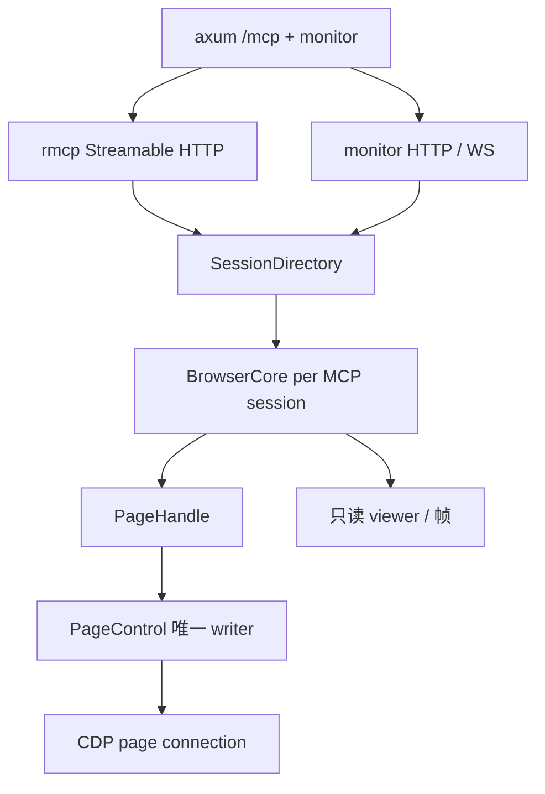

# peri-browser-gateway

本机浏览器服务的唯一 owner：一个 loopback listener 同时提供 MCP Streamable HTTP（`/mcp`）与人工监控页面。每个 MCP 会话拥有独立的 `BrowserCore`（端点、页面、活动页、快照），页面写入经唯一 `PageControl` writer；人可在 monitor 里接管同一页面。

`mcp-packages/peri-browser` 的 stdio 服务已退役，本 crate 是运行时契约的唯一来源。工具面、Kitesurf 隔离模型与历史引擎证据仍保留在 [peri-browser README](../peri-browser/README.md) 供迁移对照。

## 快速开始

```bash
cargo build -p peri-browser-gateway
./target/debug/peri-browser-gateway --bind 127.0.0.1:7391
```

- MCP：`http://127.0.0.1:7391/mcp`
- 监控首页：`http://127.0.0.1:7391/`（列出 Live 会话）
- 单会话页：`http://127.0.0.1:7391/s/{token}/`，WS 为 `/s/{token}/ws`
- 健康检查：`/healthz`

Peri 侧配置（HTTP MCP，宿主不含任何浏览器协商代码）：

```json
{
  "mcpServers": {
    "peri-browser": {
      "type": "http",
      "url": "http://127.0.0.1:7391/mcp"
    }
  }
}
```

## 架构



- `src/mcp_http.rs`：`GatewaySessions` 实现 rmcp `SessionManager`。`initialize` 成功且记录仍可提交时才发布 `Live`；请求经 `BoundBrowserSession` extension 取得本会话许可。未绑定、伪造标记或 `Closing` 的 `tools/*`、`skills/*`、`resources/*` 一律被拒。
- `src/session.rs`：`Initializing → Live → Closing → Settled`，同步封闭准入，有限等待在途任务结算；关闭超时可见，不伪装成功。
- `src/core/`、`src/page/`、`src/cdp/`：端点与标签、页面元数据/快照/诊断、唯一 attach/lease/串行写、CDP 连接与导航。
- `src/stream.rs` 只用只读 viewer；monitor 不能借帧通道获得写权限。

## MCP 面

工具名与参数 schema 保持不变：

| 分类 | 工具 |
| --- | --- |
| 会话 | `browser_status`、`browser_connect`、`yield_page`、`request_human`、`request_authorization` |
| 页面 | `list_pages`、`select_page`、`new_page`、`navigate_page`、`close_page` |
| 读取 | `take_snapshot`、`take_screenshot`、`evaluate_script` |
| 交互 | `click`、`fill`、`hover`、`press_key`、`wait_for` |
| 诊断 | `list_console_messages`、`list_network_requests`、`get_network_request` |

- `browser_status` 是唯一状态来源：端点、安装/监听建议、`nextSteps`、页面与 owner、是否让出、monitor 状态。
- `browser_connect` 是唯一连接入口，只接受环回 HTTP/WS；未连接时其余工具返回 `not_connected`。
- 技能随包暴露：`skills/list`、`skills/get`、`resources/read`（`skill://peri-browser/...`），size 与 digest 来自同一打包字节。
- `discover`（`server/discover`）返回关联 id 的 JSON-RPC `METHOD_NOT_FOUND`，Peri 的 Auto 协商据此回退到 legacy `initialize`，不靠超时或空 404。

## 会话生命周期

| 事件 | 契约 |
| --- | --- |
| `initialize` | 成功后分配独立 `BrowserCore`、域 UUID 与 monitor token；端点与页面为空，必须显式 `browser_connect`。 |
| 单个 HTTP/SSE 断开 | 仍 Live 的 `Mcp-Session-Id` 可继续使用；GET + `Last-Event-ID` 在 SDK 缓存窗口内可恢复。 |
| `DELETE` / 传输 EOF / 过期 | 幂等关闭：先封闭准入，再结算请求、handoff、viewer、页面连接；旧 ID 之后返回 404。 |
| 空闲过期 | 单一 SDK keep-alive 时钟，默认不小于 360 秒，并覆盖最长业务预算；ping 与 15 秒页面 idle 不续期。 |
| 网关重启 | 旧 ID/token 与页面不继承；新会话为空，target 留在 Kitesurf。 |

不承诺跨进程恢复或 exactly-once；已发给 CDP 的写不回滚。

## 人工接管与监控

- Agent 在途复合操作期间 monitor 显示 pending；过期输入不执行。
- `request_human` 阻塞当前调用，返回人的结果或 `no_human`；人持有 writer 期间 agent 写返回 busy。
- `yield_page`、`request_human`、静置让出与 monitor `Release` 都经同一 `PageControl`；任何时刻只有一个 writable 页面连接。
- 外部 DevTools 抢占由引擎返回 WebSocket `409`；网关识别为 `AnotherController` 并保持页面与 viewer 可用。

## 权限与暴露边界

- 监听地址只接受 `127.0.0.1` 或 `[::1]`；非环回绑定在启动时拒绝。没有 bearer/token 鉴权层，本机回环就是边界。
- Host/Origin 校验：`Host` 必须匹配监听端口与环回地址；非 `/mcp` 路由要求同源 `Origin`。
- monitor token = `base64url(sha256(secret ++ sessionId))[..22]`，只对当前 Live 记录有效；未知或过期 token 返回 404。token 出现在 monitor URL 中，不要把该端口转发到共享网络。
- `RUST_LOG` 只调整网关自身诊断级别；依赖的 HTTP/WS/CDP 原始请求与 header 不进入日志。

## 配置

CLI 参数优先于同名环境变量；超时值范围 `1..=86400000` 毫秒，非法值拒绝启动。

| 参数 | 环境变量 | 默认 | 说明 |
| --- | --- | --- | --- |
| `--bind IP:PORT` | `PERI_BROWSER_MONITOR_BIND` | `127.0.0.1:7391` | 唯一 listener；端口 `0` 交给 OS。 |
| `--cdp-url URL` | `KITESURF_CDP_URL` | `http://127.0.0.1:18971` | `browser_status` 的建议地址；不自动连接、不预绑定。 |
| `--secret VALUE` | `PERI_BROWSER_GATEWAY_SECRET` | 每进程随机 | monitor token 派生输入；推荐环境变量，不留 secret 文件。 |
| `--idle-yield-ms MS` | `PERI_BROWSER_IDLE_YIELD_MS` | 15000 | Agent 静置让出。 |
| `--yield-timeout-ms MS` | `PERI_BROWSER_YIELD_TIMEOUT_MS` | 60000 | `yield_page` 绝对预算。 |
| `--request-human-timeout-ms MS` | `PERI_BROWSER_REQUEST_HUMAN_TIMEOUT_MS` | 300000 | `request_human` 服务上限。 |

其余会话/页面/安装相关变量（`PERI_BROWSER_OWNER`、`PERI_BROWSER_SESSION_NAME`、`KITESURF_INSTALL_DIR`、`PERI_BROWSER_PROVISION_LOCK*`、`PERI_BROWSER_CONNECT_TIMEOUT_MS`、`PERI_BROWSER_PAGE_WAIT_MS`、`PERI_BROWSER_RECLAIM_WAIT_MS`、`PERI_BROWSER_LOCK_STALE_MS`）见 [环境变量表](../../docs/standards/environment-variables.md#browser-gateway)。旧 `PERI_BROWSER_GATEWAY_SOCK`、`PERI_BROWSER_HTTP_ADDR` 与自动拉起网关不再生效。

## 引导（onboarding）

`browser_status` 在无引擎时也能启动：返回安装检测、建议端点、监听状态与可执行的 `nextSteps`（安装 → 启动 → `browser_connect`）。网关不运行安装器、不拉起 Kitesurf、不在启动时探测或绑定端点；推荐的 `--cdp-url` 只是提示，实际连接由会话显式建立。

## 从 peri-browser 迁移

1. 删除 MCP 配置里的 stdio `peri-browser` 条目，改为上面的 `type: http` + `url`。
2. 删除 `PERI_BROWSER_GATEWAY_SOCK`、`PERI_BROWSER_HTTP_ADDR` 等旧开关；网关不再通过 UDS 注册或转发。
3. 旧 `peri-browser` 二进制与 crate 已移除；需要同时保留新旧两套时，旧版请从历史提交自行构建，本仓库不再提供兼容层。
4. 同一个 Kitesurf 引擎可服务多个独立 MCP 会话；每个会话各自 `browser_connect`，不会共享页面或活动页。

## 验证

```bash
./scripts/cargo-rmcp-patched.sh test --offline --locked -p peri-browser-gateway
./scripts/cargo-rmcp-patched.sh clippy --offline --locked -p peri-browser-gateway --all-targets -- -D warnings
cargo fmt -p peri-browser-gateway -- --check
bash scripts/check-layer-imports.sh
```

`tests/mcp_http.rs` 用真实 listener 与 Peri 等价 Auto 客户端覆盖协商、绑定、隔离、handoff、shutdown 与 onboarding；fixture 以第二 writer 的 HTTP 409 和共享 targetId 模拟真实引擎边界。本次验收证据与未运行项见 [验收记录](../../docs/verification/peri-browser-gateway-mcp.md)。

## 非目标

远程访问与鉴权、跨进程状态恢复、多 profile、现代 stateless 工具调用、自动安装/启动引擎、旧 UDS/stdio 兼容，以及依赖宿主侧 MCP 适配层的浏览器逻辑。
