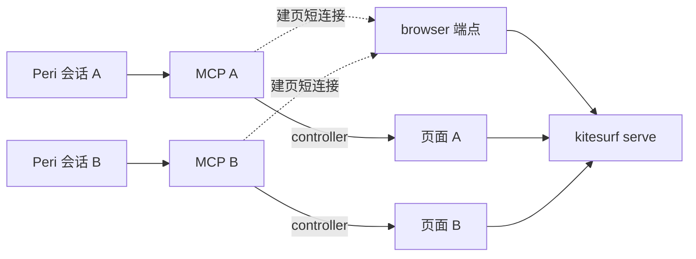
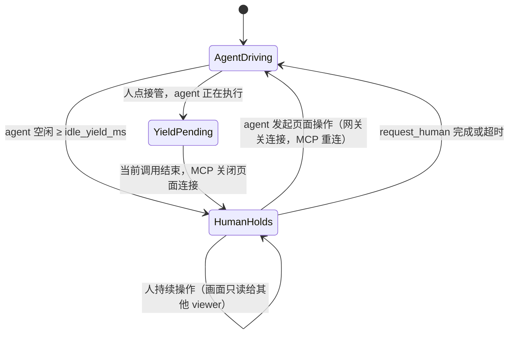
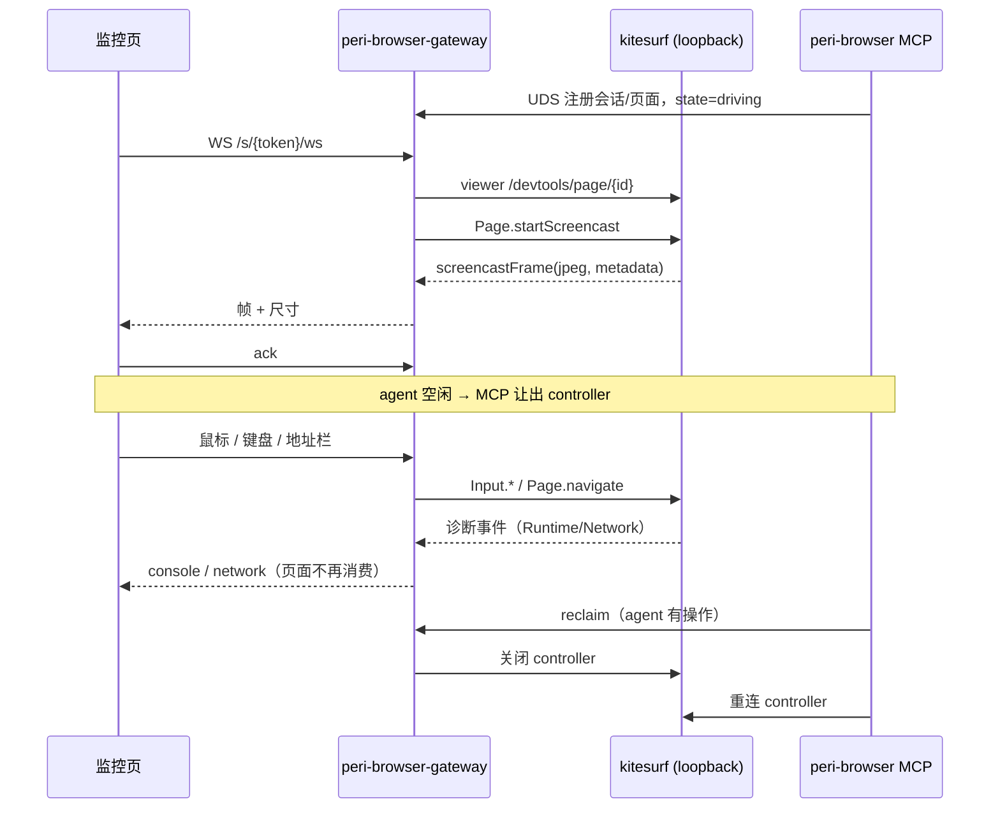

# peri-browser MCP

把 Kitesurf 作为 Peri 的浏览器后端：`kitesurf` 外部二进制提供浏览器，`peri-browser` 负责 CDP 到 MCP 的转换，`peri-browser-gateway` 提供人看的监控页。MCP server 已实现，CDP 层内联在 `peri-browser`；网关是独立二进制，§10 中标注“计划”的网关变量尚未实现。

## 1. 目标

- 单机一个 Kitesurf 实例承载多个 Peri 会话：每个 top-level 页面独占一个 page session（一条 `/devtools/page/{targetId}` 连接）；会话按需持有一个或多个页面连接，页面级隔离，互不共享控制面。
- 对 Peri 暴露与 `chrome-devtools-mcp` 接近的工具面，模型可直接用熟悉的页面操作。
- 建页/关页通过 `/devtools/browser` 端点的短连接完成，用机器本地锁串行化；页面操作不经过这个连接。
- 人类可接管实例的浏览器控制面；需要介入具体页面时，agent 让出页面连接，人连上后再交还。
- 人可以在浏览器里看和操作页面：agent 空闲时直接接管输入，agent 开始干活时立即收回，画面继续只读（§6）。
- agent 可以主动请求人：`request_human` 让监控页弹横幅并阻塞等待，人完成后工具带着结果返回（§6）。
- 监控页的整体交互面（标签条、缩略图、地址栏、状态、DevTools 交还、交接横幅）按 live view 的水平做，不是只给一张截图。
- 需要独立登录态时，另起实例（独立 profile、独立端口）。

## 2. 非目标

- 不实现浏览器内核，不修改 Kitesurf。
- 不在一个 profile 内做账号隔离：同一实例的所有 page session 共享 cookie 与同源 localStorage。
- 不做 per-page `Fetch` 拦截：0.5.3 在 page 连接上拒绝 `Fetch.*`。
- 不把 CDP 端点直接暴露到网络；跨机访问只经过带鉴权的网关，网关不转发实例级方法（§6）。
- 不把监控端口做成 CDP 端点：网关只服务监控页，第三方工具接入不在本轮。
- 不内嵌 Chrome DevTools frontend：官方前端没有可离线嵌入的构建产物（npm 包只有 TS 源码，Chrome.app 不带解包前端），硬接等于自造第二条权限链。需要官方 DevTools 时走“交还页面 + `devtools://` 地址”（§6.3），监控页不再内置面板。
- 不做同一页面上的双写：人为可写时 agent 让出，反之亦然；不合并两方输入。
- 不承诺无锁并发建页：Browser 端点同一时刻只有一个 controller。
- 不做 page 级抢占式 takeover：0.5.3 没有这个机制；接管一律走“让出—换连接”。

## 3. Kitesurf 的隔离模型（0.5.3 实测）

macOS arm64，release tarball `kitesurf-0.5.3-darwin-arm64.tar.gz`（sha256 `6942287…0080c2`），单实例、临时 profile；主流程 54 项检查通过，多 tab、console/network、关闭 target 另做补充验证。交付前的 live 检查在 0.5.4 上复跑建页、导航与 `fill`，未发现与本节矩阵冲突的行为：

| 场景 | 实际结果 |
| --- | --- |
| 多条 `/devtools/page/{targetId}` 连接 | 允许，各自 controller，可同时操作不同页面 |
| 同一 target 第二个 controller | HTTP 409：`Another controller owns this page session` |
| page 连接与实例 controller | 互不影响；`/session.controller` 始终是 Browser 端点的 owner |
| 跨会话 attach | 拒绝：`Target belongs to another page session` |
| `Target.getTargets` / 事件 | 按 page session 过滤；Browser 端点保留全量 |
| `/json/list?page={targetId}` | 只列该页面的 target；参数是过滤，不是鉴权 |
| 实例级方法 | page 连接拒绝：`This method is not available on a page-session connection` |
| `Fetch.*`、`Target.setAutoAttach`、`Page.addScriptToEvaluateOnNewDocument` | 同上拒绝 |
| 建 target | 只能经 `/devtools/browser`；page 连接拒绝 `Target.createTarget` |
| 建页者断开 | 已有 page session 继续工作；新的 page controller 仍可连上原页面 |
| page controller 断开 | 另一 controller 可接管同一页面，页面状态保留 |
| 一条 page 连接接管第二个独立 tab | 拒绝：`Target is not part of this page session` |
| page 连接关闭其他 target | 同上拒绝 |
| page 连接关闭自己的 target | target 关闭，连接以 `1008 Target expired` 断开，命令无回复 |
| Browser 端点关闭被 page session 持有的 target | 成功；对应页面连接随即断开（1008） |
| console / network | page controller 可用：收到 `Runtime.consoleAPICalled` 与 `Network.*` 事件 |
| profile | 所有 page session 共用；cookie / 同源 localStorage 互通 |
| viewer（页面端点） | 可读 DOM、可截图；`Runtime.evaluate` 拒绝：`Viewer connection cannot control the browser` |
| viewer 与 controller 并存 | 页面被 agent 持有时 viewer 仍可 attach；截图与 `Page.startScreencast` 均可用（帧需 `screencastFrameAck`），`Input.*`、`Page.navigate`、`Runtime.evaluate` 均拒绝 |
| 多个 viewer | 可同时 attach 同一页面，互不影响 |
| viewer 读取面 | `DOM.getDocument` / `DOM.getOuterHTML` / `DOM.querySelector`、截图、screencast 均可用；`Runtime.enable`、`Network.enable` 拒绝 |
| controller 换人 | 原 controller 断开后，另一 owner 以 controller 连上同一页面，页面与 JS 状态保留；viewer 挂着不阻塞 |
| 远端 viewer 画面 | JPEG q55、900×600 上限，静止页约 33–38 KB/帧 |
| 人类 `control --takeover` | 只 fence Browser controller；page session 不受影响 |
| takeover 后 Browser 端点 | 原 owner 重连 409；human 可连；owner 粘性 |
| 导航耗时 | 约 1–4 s（example.org / example.net） |
| 内存 | 单实例承载两个 page session：`kitesurf` 约 210 MB + `workerd` 约 178 MB ≈ 388 MB |

注意事项：

- 一个 page 连接只控制一个 top-level target；多个独立 tab 需要多条页面连接，不能靠一条连接接管。opener 链上的 frame/popup 仍由父页连接 attach。
- 页面连接收到 `1008 Target expired` 表示 target 已关闭或失效；pending 调用必须立即失败，不要重放写命令。
- `Page.navigate` 偶尔会在首个导航上阻塞（URL 已提交、title 仍空）；MCP 不应只等 `Page.loadEventFired`，应轮询 `document.readyState`。
- 页面 target 属于 opener 链：frame/popup 由父页所属的 page session 通过 `Target.attachToTarget` 接管；不属于任何会话的 target 一律拒绝。
- 没有 HTTP 建页入口（`/json/new` 不存在）。
- 不支持嵌套 session：先 `Target.attachToBrowserTarget`、再对页面 `Target.attachToTarget` 的写法，0.5.3 会把 `Target.attachedToTarget` 广播到根连接，Playwright 一类客户端按“同一 target 二次 attach”判重并崩溃（BetterWright 2.9.1 实测）。网关与 MCP 都只用“一条连接对一个 top-level 页面”，不依赖嵌套 session。

## 4. 拓扑（单机 / 单实例 / 多页面会话）

- 会话 ↔ page session：一条页面连接只控制一个 top-level target；会话需要多个 tab 时，为每个 tab 建一条页面连接。
- 建页/关页：短连接 `ws://…/devtools/browser?owner=peri-browser`，在机器锁内创建或关闭 target，完成后立即断开。
- 为什么需要锁：Browser 端点同一时刻只接受一个 controller，第二个连接直接 409（`Another controller owns the browser; explicitly take control`）。多会话并发建页只能串行化；文件锁只覆盖建/关 target 的短连接，不覆盖页面操作，也不引入常驻建页服务。
- 实例 controller 只做开通与关闭页面，不转发页面命令，也不参与页面读写。
- 需要独立账号的会话：指向另一个实例（不同端口与 profile），不共享 profile。
- 监控网关（§6）以 viewer 身份挂在同样的页面端点上，不参与本节的所有权。

## 5. 所有权与人类介入

| 能力 | page controller | Browser controller | viewer |
| --- | --- | --- | --- |
| 页面导航、点击、输入、evaluate | 自己的页面 | 否（需 attach） | 否 |
| 读页面（DOM/HTML、截图、screencast） | 自己的页面 | 是 | 是 |
| 建页 | 否 | 是 | 否 |
| 关闭 target | 仅自己的，且连接以 1008 断开、无回复 | 是（返回成功） | 否 |
| 同一页面并发控制 | 仅一个 | — | 多个只读 |

规则：

- 每个页面只有一个 writer，就是它的 page controller；MCP 不把 viewer 伪装成可写。
- viewer 可读 DOM/HTML、截图与 screencast（帧必须 ack）；不能 enable `Runtime`/`Network`，所以拿不到 console/network。
- 人类接管实例控制面：`kitesurf control --owner human --takeover`，只影响建页/关页与实例级命令；已有页面继续工作。
- 人类接管后，MCP 的建页连接会被拒绝（409；已打开的连接收到 `Control has changed; reconnect and observe before acting`），已有页面不受影响；人类交还或反向 takeover 后才能继续建页。
- 页面级介入没有 takeover：agent 先关闭自己的页面连接（target 保留），人类用 DevTools 或 CDP 连上；人类离开后 agent 再连回并重新观察。MCP 用 `yield_page` 暴露这个动作。
- 人类也可以用 Browser 端点直接关闭某个页面（实测成功，页面连接随即断开），但这会销毁页面状态；需要保留状态时用让出。
- Browser owner 是粘性的：MCP 使用固定 owner 名；被接管后不能自行抢回。
- 远端接管与本地接管是同一条协议：先让 agent `yield_page`，再建立新的页面连接；区别只是连接来自网关（§6），不引入第二种所有权。
- agent 空闲时把 controller 让给网关，人不必先点“接管”就能输入；agent 下一次页面操作立即收回（§6.2）。这是同一条让出协议的空闲版本，不是第二种所有权。

## 6. 监控网关

目标：在普通浏览器里看和操作页面，agent 保有随时收回的能力。看与控分开，任何时刻一个页面只有一个 writer；整页交互面按 live view 的水平搬运（§6.3）。

### 6.1 进程与端口

- 独立二进制 `peri-browser-gateway`（Rust），不嵌在每个 MCP 里：端口稳定、跨会话复用、可单独重启。
- 固定监听 `127.0.0.1:7391`，所有 Peri 会话共用一个端口，按路径分：
  - `/` — 在线会话列表（会话名、页面数、agent 状态、带 token 的链接）；
  - `/s/{token}/` — 某个会话的监控页（单 html，§6.8）；
  - `/s/{token}/ws` — 画面与输入的同一条 WebSocket。
- MCP 通过 UDS（`peri-browser-gateway.sock`）注册会话与页面，上报 `driving` / `idle` / `waiting-for-human`；网关不主动扫描 `/json/list` 猜所有权。
- 没有网关时 MCP 照常工作，`browser_status` 标记 `monitor: unavailable`；网关重启后 MCP 重新注册，token 由会话 id 与网关 secret 派生，URL 不变。
- 网关自己连 CDP 当 viewer，只读由 Kitesurf 强制；不让 MCP 代传画面，否则“只读”退化成前端自觉。两边各自持有页面连接、screencast 与坐标/按键映射（MCP 侧是 `peri-browser` 内联的 `cdp` 模块，网关侧是它自己的同名模块），不新增第三个共享 crate。

### 6.2 所有权状态机

- `AgentDriving`：MCP 持 controller；监控页是 viewer，只读。
- `HumanHolds`：MCP 关闭页面连接（target 保留），网关持 controller；人可点击、输入、导航；监控页不再内置诊断面板，需要时把页面交还给官方 DevTools。
- 空闲让出是自动的：一次工具调用结束后 `idle_yield_ms`（默认 15 s）内没有新调用，MCP 让出，人不用先点“接管”。页面状态与 JS 上下文不变。
- agent 收回是立即的：`HumanHolds` 期间 agent 发起页面操作，MCP 向网关发 `reclaim`；网关关闭 controller（页面上显示“agent 已收回，继续只读”），MCP 重连，最多等 `reclaim_wait_ms`（默认 2 s）。
- 手动接管（agent 正在执行）：MCP 先完成当前调用再让出；超过 `yield_timeout_ms` 返回 `yield_pending`，监控页显示等待。
- 切换是换连接，不是共享连接；不存在两方同时写入的窗口。

### 6.3 交互面（全量搬运）

| 界面能力 | 实现 | 证据 |
| --- | --- | --- |
| 画面 | 网关在 viewer 连接上 `Page.startScreencast`；一个页面一路，扇出给所有 viewer | 已实测 |
| 标签条 | 会话页面列表来自 MCP 注册；切页 = 换 viewer 连接，不改变所有权 | 设计 |
| 缩略图 | 非活动标签 `Page.captureScreenshot` 抓一次，5 s 过期，切页时刷新 | 截图已实测，刷新策略未实测 |
| 地址栏 / 前进后退 | agent 持有时经 MCP 工具执行；人持有时由网关在 controller 上 `Page.navigate`、`Page.getNavigationHistory` + `Page.navigateToHistoryEntry` | 待实测 |
| 新标签 / 关标签 | 一律经 MCP 建页短连接（机器锁 + Browser 端点）；网关只发请求，不碰建页 | 建页已实测 |
| agent 状态 pill | MCP 上报 `driving` / `idle` / `waiting-for-human` | 设计 |
| 诊断缓冲 | 人持 controller 时 `Runtime.enable` + `Network.enable`，网关环形缓冲最近 200 条；监控页不展示，诊断交给官方 DevTools | controller 可见已实测 |
| 官方 DevTools | 菜单“交给 Chrome DevTools”发 `{t:"devtools"}`：网关关闭自己的 controller，返回 `devtools://devtools/bundled/inspector.html?ws=<实例端点>/devtools/page/<id>`；用户在 Chrome 地址栏打开，官方前端独占该页 | 已实测：Elements 显示真实 DOM、Console/Sources 可用 |
| 交接横幅 | `request_human`：显示 agent 的请求，人点“我来”进入 `HumanHolds`，点“完成”交还 | 设计 |
| 只读标记 | viewer 连接，`Input.*` 由 Kitesurf 拒绝 | 已实测 |

`request_human` 的语义：工具调用阻塞，网关把请求显示在监控页；人接受后进入 `HumanHolds`，完成后工具返回人操作后的 `url`/`title` 与一张截图；无人响应超过 `request_human_timeout_ms` 返回 `no_human`。等待期间该会话的其他页面工具返回 `waiting_for_human`，不排队堆积。

官方 DevTools 的边界：Kitesurf 每个页面只接受一个 controller，所以交付是“让出”而不是“并存”——网关关闭页面连接后监控页变成只读，DevTools 窗口关掉、人重新接管后才回到网关。交付本身不产生错误提示：agent 持有页面时网关没有 controller 可关，页面连接本来就是 agent 的。已知代价：官方前端挂上后会高频空转发 `CSS.takeComputedStyleUpdates`（Kitesurf 侧问题，#529），Elements 面板明显变慢。

### 6.4 帧策略

- 一个页面一路 screencast，由网关开在 viewer 连接上，扇出给 N 个 viewer；慢客户端丢帧，只保留最新一帧。
- JPEG `quality` 默认 70；`maxWidth/maxHeight` 取最大 viewer 的画布尺寸（CSS px × dpr，上限 1600×1000），小画布客户端缩放显示。
- 逐帧 `Page.screencastFrameAck`；ack 后若又来了新帧，直接丢弃旧的。
- 页面静止时没有帧（screencast 随页面 damaged 产生）；监控页隐藏（`document.hidden`）时 `Page.stopScreencast`，回到前台再启动。
- 重连先渲染缓存的最后一帧，等新帧替换，不闪白屏。
- 非活动标签不持续串流；标签条缩略图按需抓取。

### 6.5 数据通路（webpage → gateway → CDP → browser）

- 帧：`Page.startScreencast`（viewer 可用）。`format=jpeg`、`quality` 70、尺寸跟随客户端；逐帧 ack，慢客户端只保留最新帧。无 viewer 时 `Page.stopScreencast`，避免空转编码。
- 坐标：`Page.getLayoutMetrics`（viewer 可用）给视口，`screencastFrame.metadata` 给 `deviceWidth`/`deviceHeight`/`pageScaleFactor`/`scrollOffset*`；按比例把画布坐标换回 CSS 像素。首帧后要用一次真实点击校准，不能只看比例。
- 键盘：`Input.dispatchKeyEvent`（带 modifiers）覆盖快捷键；普通文本与粘贴走 `Input.insertText`。
- 只读时输入一律拒绝，UI 明确标注；不要在前端偷偷排队等接管。
- 控制面输入已实测（Kitesurf 0.5.3）：controller 连接上 `Input.dispatchMouseEvent`、`Input.dispatchKeyEvent`、`Input.insertText`、`Page.navigate`、`Page.getNavigationHistory`/`Page.navigateToHistoryEntry` 全部生效；同一组方法在 viewer 连接上一律 `CDP -32000: Viewer connection cannot control the browser`。页面 controller 是排他的：已有 controller 在位时，第二条 controller 连接收到 `409 Another controller owns this page session`，所以让出必须是"先关连接、再 `YieldOk`"，网关不能抢在 MCP 断连之前 attach。`Page.startScreencast` 在两类连接上都可用，网关固定只用 viewer 起流。

投影的是**页面视口**，不是整个浏览器：标签栏、地址栏、下载条、原生文件选择器、打印对话框、权限弹窗都不在 screencast 里。标签切换靠画出来的标签条换连接；文件选择器与 JS 对话框需要单独处理（`Page.fileChooserOpened`、`Page.javascriptDialogOpening`），不在本轮。

跨机时网关仍是唯一对外的面：默认只监听 loopback，远端通过 SSH 隧道或 Tailscale 到 `7391`；要直接暴露，前面加 TLS 反代。旧方案里“SSH 隧道 + 远端 DevTools 直连”不作为产品路径：零网关代码，但要求远端有 Chrome、要手工配置，且没有只读角色。

### 6.6 掉线与失败

- viewer 掉线：不影响页面与其他 viewer。
- `HumanHolds` 期间人掉线：网关立即关闭 controller，MCP 下次操作直接重连，不必等 60 s。
- 网关崩溃：MCP 重连后重新注册；页面所有权回到 agent，人的输入随网关消失。
- MCP 崩溃：target 保留；网关显示“agent 已断开”，允许人接管（Browser 端点不受影响）。
- token 失效：一律 404，不区分“不存在”与“无权限”，避免探测。

### 6.7 鉴权与暴露

- 每会话一枚 token，放在路径里，等价于密码；不进日志，页面加 `Referrer-Policy: no-referrer`。
- 默认只听 `127.0.0.1`；绑非环回必须显式配置并打印告警。
- 画面本身是敏感信息（密码、验证码、页面里的 cookie 内容）。token 泄漏等于画面泄漏，与直连 CDP 同级。
- 只读 token 不能通过任何参数提升为 controller；接管是连接切换，不是权限提升。

### 6.8 前端

- 单个 `monitor.html`：内联 CSS/JS，无构建、无依赖，`include_str!` 进网关二进制。
- 组成：canvas、标签条与缩略图、地址栏与前进后退、agent 状态 pill、DevTools 交还菜单、交接横幅。
- DevTools 按钮是菜单：交给 Chrome 官方 DevTools（显示 `devtools://` 地址与复制按钮）；Esc 与点击空白处关闭。
- 地址栏、后退键跟随页面驱动的导航：`Page.frameNavigated` 滞后 6–15 s（Kitesurf 侧问题 #527），因此以 `/json/list` 轮询先发现新 URL，再回读确认；按 §6.3。
- 画面用 `<canvas>`，按 ack 节奏更新；输入事件按 §6.4 的坐标映射发出。

## 7. 工具面（参考 chrome-devtools-mcp）

| 分类 | 工具 |
| --- | --- |
| 会话 | `browser_status`、`yield_page`、`request_human`、`request_authorization` |
| 页面 | `list_pages`、`select_page`、`new_page`、`navigate_page`、`close_page` |
| 读取 | `take_snapshot`、`take_screenshot`、`evaluate_script` |
| 交互 | `click`、`fill`、`hover`、`press_key`、`wait_for` |
| 诊断 | `list_console_messages`、`list_network_requests`、`get_network_request` |

实现约定：

- `list_pages` 只返回本会话拥有的 target；`select_page` 只在本会话的连接之间切换。
- `new_page` 走建页短连接创建 target，再建立新的页面连接；`close_page` 经建页连接 `Target.closeTarget`（返回 `{success:true}`），同时关闭本地页面连接。不要在页面连接上发 `Target.closeTarget`：target 关闭后连接以 `1008 Target expired` 断开，命令没有回复。
- 从 DOM snapshot 生成 uid，MCP 内部维护 uid → backendNodeId 映射，交互工具只接受最新 snapshot 的 uid。
- 页面命令直接发在页面连接上，由 Kitesurf 注入该页面的 primary session；不要复用 Browser 连接做页面操作。
- `browser_status` 返回：实例端点、page target、controller/所有权状态、是否被 fence、是否已让出页面、监控 URL（或 `monitor: unavailable`）、agent 状态。
- `request_human` 阻塞当前工具调用，返回人的操作结果或 `no_human`；不改变页面所有权（人持有期间 agent 不写）。
- 错误映射：`Another controller owns this page session`、`Target belongs to another page session`、`This method is not available on a page-session connection`、`Control has changed`、viewer 拒绝、`page_busy_by_human`、`yield_pending`、25 s egress timeout 都转成稳定错误码。
- console/network 诊断对 page controller 可用（已实测 `Runtime.consoleAPICalled` 与 `Network.*`）；viewer 可读 DOM 与画面，但不能 `Runtime.enable`/`Network.enable`，因此 console/network 只在人持 controller 时由网关采集；监控页不再内置面板，诊断交给官方 DevTools。

技能与传输：

- 通过 SEP-2640（`io.modelcontextprotocol/skills`）暴露随包技能：`skills/list`、`skills/get` 与 `resources/read`（`skill://peri-browser/<skill>/SKILL.md`）；digest 为 `sha256:` 形式，size 与文件字节一致。
- 默认 stdio；`--http <addr>` 启用 MCP Streamable HTTP，技能随同一服务器暴露，不另起端点。
- `request_authorization` 只校验并返回授权 URL（`status: user_confirmation_required`、`url`、`message`、`instruction`），不导航页面、不依赖浏览器连接；模型随后调用既有 `AskUserQuestion` 把 URL 展示给用户，服务端不验证用户回答。

## 8. 生命周期

- 实例：默认每机一个，由宿主启动并以 `KITESURF_CDP_URL` 注入；MCP 只连接，不拉起共享实例。
- 实例未启动：`browser_status` 返回未连接，并提示宿主的启动命令；MCP 不代为拉起。
- 网关：独立进程，宿主按需启动；不在时监控不可用，MCP 功能不受影响。
- 页面：会话首次调用浏览器工具时创建 target 并连接；会话结束关闭页面连接，target 按需保留或关闭。
- 页面失效：连接收到 `1008 Target expired`（target 被关闭）时，立即失败所有 pending 调用并丢弃该页面；不重放写操作。
- 空闲让出：工具调用结束后 `idle_yield_ms` 无新调用，MCP 关闭页面连接，网关接管；页面状态保留。
- agent 收回：`HumanHolds` 期间 agent 发起操作，MCP 请求 reclaim，最多等 `reclaim_wait_ms`；网关不可达时直接重连并返回 `page_busy_by_human`。
- 手动接管：`yield_page` 关闭页面连接后按 `yield_timeout_ms` 轮询重连；人未占用则收回，仍被占用则返回 `yield_timeout` 并保持让出。
- `request_human`：阻塞到人完成或 `request_human_timeout_ms` 超时；超时返回 `no_human`，不自动接管。
- 远端观看：viewer 连接不改变页面所有权；viewer 掉线只影响画面，不影响页面与其他 viewer。
- MCP 重启：按 target id 重连自己的页面；若被其他 controller 占用，报告 `page_owned_elsewhere`，不抢。
- 建页锁：机器本地文件锁包住“连接 Browser → 建/关 target → 断开”，带超时与 stale 检测。
- 人类接管实例控制面：建页路径暂停，页面路径继续；交还后 MCP 重新连接 Browser 端点。
- 引擎崩溃：本实例所有页面失效；MCP 不重放写操作，要求重新观察。实例之间互不影响。

## 9. 资源

- 单实例两个页面会话实测 ≈ 388 MB；每多一个 page session 的增量未测。
- 页面会话共享浏览器进程，页面数量增加的成本主要在渲染与内存，不在进程数。
- 需要账号隔离时按实例扩展；每个实例约 0.4 GB 量级，必须按需启用并可回收。
- 单机 1000 agent 同时持有浏览器不在目标内。
- screencast 每帧约 33–38 KB（JPEG q55，900×600 上限，静止页）；持续动画页面的带宽与 CPU 成本未测。一个页面只编码一路，viewer 数只影响扇出，不影响编码成本；网关按“保最新、可丢帧”限流，而不是排队。
- 缩略图是截图而非串流，成本按切页频率计；多标签同时显示时限制刷新频率。

## 10. 配置

| 变量 | 默认 | 说明 |
| --- | --- | --- |
| `KITESURF_CDP_URL` | 无（必须注入） | 共享实例的 CDP 端点 |
| `PERI_BROWSER_CDP_URL` | 无 | 直接运行时覆盖 `KITESURF_CDP_URL`；空值忽略 |
| `PERI_BROWSER_OWNER` | `peri-browser` | Browser 端点 owner；同一实例的所有会话共用 |
| `PERI_BROWSER_SESSION_NAME` | 同 `PERI_BROWSER_OWNER` | 网关注册与监控使用的会话标签 |
| `PERI_BROWSER_PROVISION_LOCK` | 运行目录下 `kitesurf-provision.lock` | 建页短连接的互斥锁 |
| `PERI_BROWSER_PROVISION_LOCK_WAIT_MS` | 10000 | 等待建页锁的上限 |
| `PERI_BROWSER_LOCK_STALE_MS` | 30000 | 建页锁的 stale 判定年龄 |
| `PERI_BROWSER_CONNECT_TIMEOUT_MS` | 5000 | 页面与建页连接超时 |
| `PERI_BROWSER_PAGE_WAIT_MS` | 30000 | 等待页面进入 `complete` 的上限 |
| `PERI_BROWSER_IDLE_YIELD_MS` | 15000 | agent 空闲多久自动让出 controller |
| `PERI_BROWSER_RECLAIM_WAIT_MS` | 2000 | agent 发起操作时等待网关交还的上限 |
| `PERI_BROWSER_YIELD_TIMEOUT_MS` | 60000 | 手动接管等待让出的上限 |
| `PERI_BROWSER_REQUEST_HUMAN_TIMEOUT_MS` | 300000 | `request_human` 等人响应的上限 |
| `PERI_BROWSER_HTTP_ADDR` | 无 | 未传 `--http` 时的 Streamable HTTP 监听地址 |
| `PERI_BROWSER_GATEWAY_BIN` | `peri-browser-gateway`（PATH） | 宿主拉起网关的命令 |
| `PERI_BROWSER_GATEWAY_SOCK` | 运行目录 `peri-browser-gateway.sock` | MCP ↔ 网关 |
| `PERI_BROWSER_GATEWAY_SECRET` | 运行目录下随机生成 | token 派生；重启保持 URL 不变 |
| `PERI_BROWSER_MONITOR_BIND` | `127.0.0.1:7391` | 网关固定监听地址；非环回必须显式设置 |
| `PERI_BROWSER_MONITOR_TOKEN_TTL_MS` | `0` | `0` = 随会话生命周期；否则到期 404 |
| `PERI_BROWSER_MONITOR_MAX_VIEWERS` | 8 | 单页面并发 viewer 上限 |
| `PERI_BROWSER_FRAME_QUALITY` | 70 | screencast JPEG 质量 |
| `PERI_BROWSER_FRAME_MAX_WIDTH` | 1600 | 帧宽上限，跟随最大 viewer |
| `PERI_BROWSER_MONITOR_TLS_CERT` / `_KEY` | 无 | 网关自己终止 TLS 时使用；否则由反代终止 |

状态：`PERI_BROWSER_GATEWAY_BIN`、`PERI_BROWSER_MONITOR_TOKEN_TTL_MS`、`PERI_BROWSER_MONITOR_MAX_VIEWERS`、`PERI_BROWSER_FRAME_QUALITY`、`PERI_BROWSER_FRAME_MAX_WIDTH`、`PERI_BROWSER_MONITOR_TLS_CERT`/`_KEY` 是网关后续计划项，当前两个 crate 均未读取；其余表项已由所属进程读取（网关项由 `peri-browser-gateway` 读取，MCP 项由 `peri-browser` 读取）。

传输：默认 stdio；`--http <addr>` 切换为 MCP Streamable HTTP，技能与工具在同一服务器暴露。`KITESURF_CDP_URL` 缺席时 `browser_status` 报告未连接，浏览器工具返回可操作的启动提示，进程不退出。

## 11. 实施顺序

实现语言：Rust，与 `mcp-packages/*` 其余包一致；网关是独立二进制，CDP 层内联在 `peri-browser`，本分支不新增共享 crate。

1. **页面会话骨架**：页面连接、`browser_status`、`list_pages`、`select_page`、`navigate_page`、`take_snapshot`、`take_screenshot`。
2. **核心交互**：uid 映射、`click`/`fill`/`press_key`、`evaluate_script`、`wait_for`。
3. **建页路径**：机器锁、Browser 短连接、`new_page`/`close_page`。
4. **让出与收回**：`yield_page`、空闲让出、reclaim、fenced 状态、重新观察。
5. **网关骨架**：独立二进制、UDS 注册、固定端口、单 html 监控页（画面、标签条、缩略图、地址栏）。
6. **人机交接**：`request_human`、诊断缓冲、断线恢复、多 viewer 扇出与丢帧。
7. **加固**：egress timeout 与 403 页识别、导航卡顿的 readyState 兜底、真实实例测试覆盖。

## 12. 待确认

1. `new_page` 是否对模型开放：多 tab 会带来多条页面连接与资源开销；另一种做法是宿主预建页面，模型只 `select_page`。
2. `close_page` 是否需要二次确认：关闭会销毁页面状态，且被关闭的页面无法恢复。
3. 建页锁保持本机文件锁，还是宿主已有统一建页服务时改为指向它；两种都不改变“建页必须经 Browser 端点”的事实。
4. token 分发：现在是会话 URL 直出（loopback 才安全），是否要一次性 code 或复用宿主登录态。
5. 输入保真度：IME 组合输入、拖拽、远端文件上传（要先把文件送到本机再 `DOM.setFileInputFiles`）是否在本轮范围内。
6. 强制收回宽限：agent 遇到人正在操作时立即收回（当前设计），还是给人 N 秒缓冲再断开。
7. 缩略图刷新频率与多标签开销：5 s 过期是否合适，还是只在切页时抓。
8. 跨机部署形态：只支持 SSH 隧道/Tailscale，还是网关内置 TLS 与反代配置。
