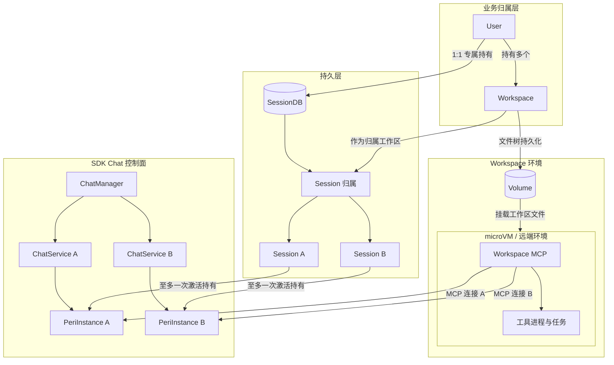

# User、Workspace、SessionDB、Workspace 环境与 Chat 运行实例

> 状态：SDK、Peri 与使用方共同组成的目标部署模型，不是 SDK 的实现清单。一个 User 对应一个
> SessionDB 是使用方的业务与部署约束；Peri 持久化的 Workspace / Session 身份遵循
> [存储 v2 设计](../../docs/design/storage-v2-machine-workspace-session.md) 与
> [架构契约](../../docs/standards/architecture-contracts.md)。当前 SDK 接口见
> [SDK README](README.md)，结构见 [Peri SDK Chat](../../docs/design/peri-sdk-chat.md)。

**责任边界：使用方部署 Workspace 环境，Peri 实现 Agent 核心、Session Store 与 Workspace MCP，
TypeScript SDK 负责 Chat 句柄、动作、运行装配与只读展示。** 图中的组件同处一张部署图，不表示
它们都由 SDK 实现。

## 分层关系

业务归属只有 User 持有 Workspace。Workspace 与 Session 的归属关系由 Peri 的 SessionDB 规则管理：
Session 记录引用 Workspace ID，数据库保存并查询该关系；Workspace 不在业务层“包含”Session。每个
User 持有一个专属 SessionDB，每个 SessionDB 只归属一个 User；多个属于同一 User 的环境可以连接该库。
Peri Store 不记录或校验 User ID，使用方负责将 User、专属数据库和 Workspace 绑定并执行访问授权，
不能由数据库地址、Session ID 或 Workspace 路径推断。

Session 在未运行时可以没有运行实例；运行时**至多由一个 `PeriInstance` 持有**。关闭或替换实例不删除
Session。读取历史可以有多个 `ChatView`/`ChatReplica` 观察者，但观察不构成持有或执行资格。

## 身份与生命周期

| 对象 | 身份和职责 | 生命周期 |
| --- | --- | --- |
| User | 使用方业务层的主体；专属持有一个 SessionDB，可拥有多个 Workspace。 | 独立于运行实例；由使用方识别并授权。 |
| Workspace | 业务上归属 User 的一份文件树；Peri Store 以 `WorkspaceId` 标识，并记录其 Machine 环境。 | 文件树和持久登记可跨运行实例存在。 |
| SessionDB | Peri 的持久化后端，可为本地 SQLite 或 Turso；管理 Workspace 与 Session 的归属关系，以及消息和执行数据。 | 独立于 PeriInstance。`ChatDatabase` 是 SDK 的只读目录接口，`TursoStorage` 直接实现它；写入由 Peri 完成。 |
| Workspace 环境 | 使用方部署的 Volume、microVM/远端环境与其中的 Workspace MCP。 | 独立于 Chat 运行，可跨多个 Session 使用；由使用方负责启动、挂载、监控与回收。 |
| Session | `SessionId` 是持久身份；读取历史与取得执行资格是不同操作。 | 可在运行实例退出后按 ID 加载；同一时刻至多由一个 PeriInstance 持有并执行。 |
| Chat 句柄 | `ChatService.id`；由 `ChatManager.createChat` 同步登记，绑定后可指向一个 Session。 | 进程内对象；关闭确认后移除，不持久化，不能冒充 Session 身份。 |
| ChatService | 单 Chat 的绑定状态机、动作分派、事实日志与载荷读取。 | 由 Manager 拥有；`closeChat`/`shutdown` 释放。 |
| PeriInstance | 一次激活的 ACP Session/运行后端装配；持有当前绑定并输出事实。 | 绑定换代或关闭时释放；不是公开门面。 |
| ChatView / ChatReplica | 服务端事实到 Yjs 的投影与浏览器只读副本。 | View 由 Chat 所有者释放；Replica 由浏览器释放；断开不停止执行。 |
| Workspace MCP | Peri 实现的文件、终端、技能等工具与资源服务；使用方部署在 Workspace 环境中，SDK 示例也可连接普通子进程。 | 可以独立于某次 Chat 运行。 |

`ChatManager` 的共享依赖（agentConfig 纯配置快照、数据库/目录、SessionOwnership、runtime 配置）由外部注入；
外部服务实例默认借用。每个 Chat 独立持有当前绑定、加载状态、输入回执、交互、历史进度、MCP 桥接与
运行后端所有权。`ChatView` 独立持有 Yjs 文档、投影接入、逻辑同步连接与发送队列。

## 实现责任

| 责任方 | 提供什么 |
| --- | --- |
| 使用方的业务服务与部署平台 | User 身份和授权；User 与 SessionDB 的 1:1 配置；Workspace 归属；Volume、microVM/远端环境、挂载、网络与生命周期；部署 Workspace MCP。 |
| 使用方的路由层 | 同一 Session 单实例绑定：串行化 acquire，换绑前 drain 旧实例或清除旧记录，崩溃后清理 `clearSessionOwnership`；KV 故障 fail closed。SDK 的 acquire 是读后写、非原子，路由层不得依赖 KV 记录提供互斥。 |
| Peri | SessionDB 的 Workspace / Session 归属、消息和执行数据；Agent 执行核心；Workspace MCP 服务程序、工具与任务语义。 |
| TypeScript SDK | `ChatManager`/`ChatService`/`ChatUserAction`/`ChatView`/`ChatReplica`、SessionOwnership 记录与顺序冲突检测（公开面仅 `KvStorage`/`clearSessionOwnership`）、WASM ACP 运行后端装配、`TursoStorage` 直接实现 `ChatDatabase` 目录读取、载荷与同步契约。 |

因此，审查 SDK 是否符合本图时，microVM、Volume、User 鉴权和专属数据库配置应检查**接入边界是否
可由使用方提供**，不能把它们列为 SDK 尚未实现的功能。Peri 的 Store 和 Workspace MCP 规则也应在
Peri 层验证。

### Workspace 环境内部边界

| 组件 | 职责 | 生命周期 |
| --- | --- | --- |
| Volume | 保存 Workspace 文件树；挂载到微环境，供 MCP 工具读写。它与 SessionDB 分开：代码和文件在 Volume，会话与归属事实在 SessionDB。 | 随 Workspace 持续存在；运行实例重建不删除文件。 |
| 微环境 | 为 Workspace MCP 和其启动的工具进程提供隔离运行环境；挂载对应 Volume。 | 可重建，重建后重新挂载 Volume 并启动 MCP；不拥有 Session 历史。 |
| Workspace MCP | 固定服务一个 Workspace 根，暴露文件、终端和资源能力，并管理其工具任务。 | 可服务多个 Chat 的独立 MCP 连接；不随某个 Chat 关闭。 |
| 工具进程与任务 | 由 Workspace MCP 在微环境中启动和管理，作用于已挂载的文件树。 | 归 Workspace MCP 管理，不能把 Chat 断开等同于任务结束。 |

使用方可在 Workspace 环境中部署 Peri Workspace MCP；SDK 的 `ChatSessionInit.mcpServers` 接收其地址，并把
它作为每个 Session 的 MCP 声明。每个 PeriInstance 自行建立连接；共享的是服务端和固定的 Workspace 根，
不是同一个 MCP client 连接或一个可被请求切换的工作区。Chat 也可用自身的 `mcpServers` 增加其他 MCP
服务；不能覆盖 `workspace` 名称。

## 所有权与限制

1. **身份分离**：`SessionId` 是持久身份；`ChatService.id` 不是持久身份，不能写进 Store 或用于跨进程
   恢复。公开聊天 ID 继续使用真实 ACP Session ID。
2. **单执行者**：SessionOwnership 由使用方注入的 3 方法存储端口记录。SDK 不做 TTL、续租或原子 CAS；
   acquire 是读后写、非原子，KV 记录是绑定标记/防御路由 bug，不是互斥原语。同一 Session 的单实例绑定由
   路由层串行化，同一 Manager 内两个 Chat 句柄由 `LocalSessionIndex` 同步互斥。
   错误映射：加载路径冲突 409 `binding_conflict`、KV 读/写失败 500 `claim_failed`；新会话 claim 阶段失败
   500 `session_creation_failed`（stage `claim`）；没有 ownership 专用 503。
   崩溃遗留记录必须由路由层调用 `clearSessionOwnership` 清理；只在旧实例已停止或已被 fence 后调用。
   ownership 的公开面只有 `KvStorage` 与 `clearSessionOwnership`；协调器 `SessionOwnership`
   与 `KvSessionOwnership` 是内部实现。
3. **共享 MCP 地址 ≠ 共享 client**：地址与服务端实例可共享；client、声明路由、审批状态按会话隔离。
   SDK 不启动或销毁外部 Workspace 环境。
4. **DB 连接共享 ≠ TS 对象进 Rust Store**：PeriInstance 的存储配置沿用原有部署配置；SDK 不把 TS
   对象直接传进 Rust Store。
5. **运行后端回收与句柄身份分开**：当前只做手动 `closeChat`/`shutdown`，不启用自动 idle 回收。活动运行、
   未处理输入、待决交互、未确认清理不可被回收。
6. **单进程 CF 部署**：CF 默认 `createStorage()`（unstorage memory driver），不能宣称多实例接管；
   需要多实例时由部署提供共享 storage，并在路由层完成串行化与崩溃清理。
7. **WASM 目标不等于 hosted 验收**：WASM 部署是已实现路径；普通浏览器或托管 Workers 的生产部署未验收。
