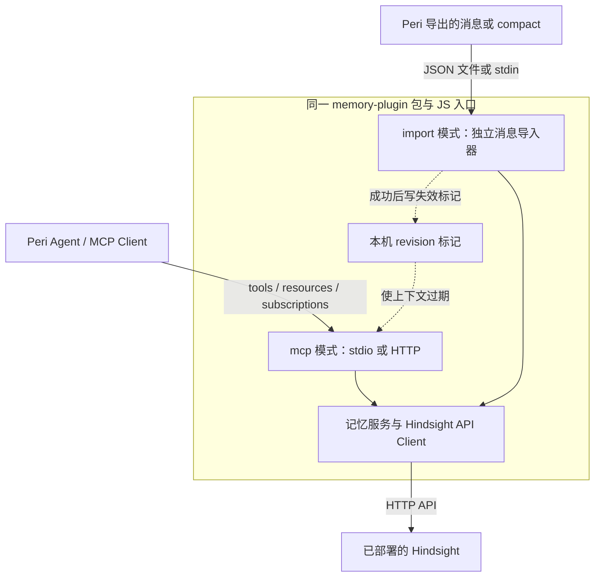
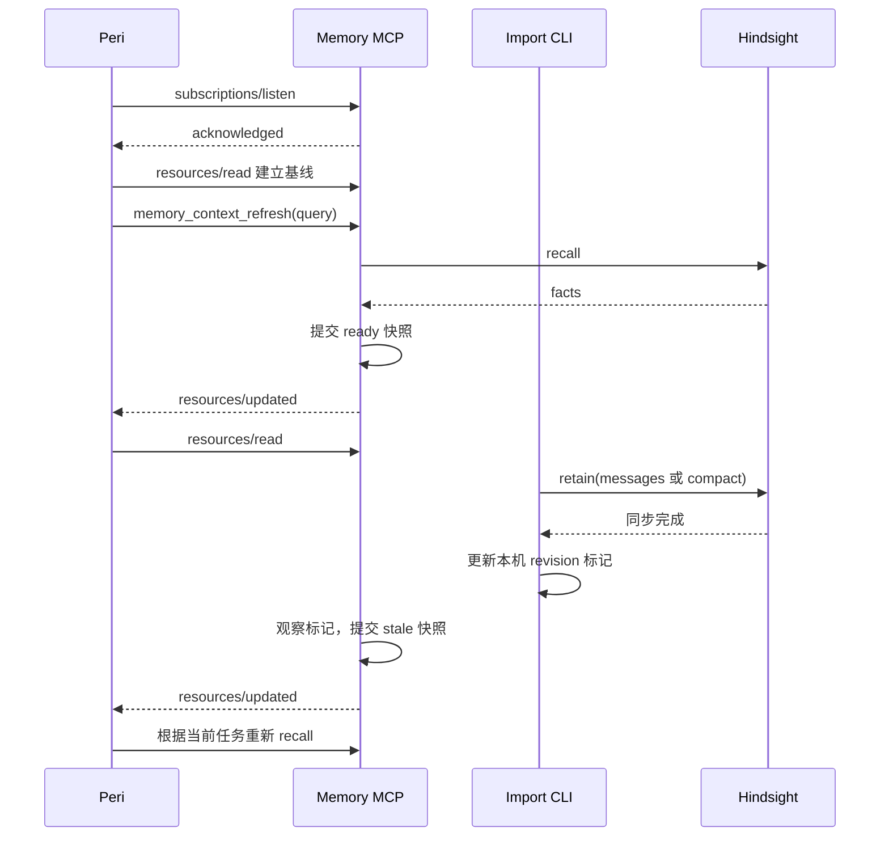

# Peri Memory MCP：Hindsight 后端与独立消息导入器

版本：0.1.0 · 日期：2026-11-16 · 交接对象：Peri 维护员2

代码基线：Peri `79e7d3ebc95eee30be153ea6b22ebb8ee01ae478`。包目录：`npm-packages/memory-plugin`。本文件描述本包已经实现的行为，并单独标明宿主集成和真实部署验收边界。

## 1. 目标与已确定的边界

以用户已经部署的 Hindsight 为唯一长期记忆后端。新增一个独立 npm 包 `@peri/memory-plugin`，二进制名 `memory-plugin`，入口只有 `dist/index.js`。

| 启动方式 | 职责 | 使用的外部接口 |
| --- | --- | --- |
| `memory-plugin mcp` | 默认 stdio，提供记忆检索、反思、上下文资源与订阅 | MCP 2026-07-28；Hindsight recall / reflect |
| `memory-plugin mcp --transport http` | 同一记忆面，使用 mcp-use HTTP server | MCP 2026-07-28；Hindsight recall / reflect |
| `memory-plugin import --file ...` | 独立消息导入器，可读取 JSON 文件或 stdin | Hindsight retain；不经过 MCP |

约束：

1. 不新增 Peri `MemoryMiddleware`，不拦截或改写 Agent 的消息执行链。
2. 不把消息导入实现成 MCP tool；模型面没有 retain、导入、建 bank、清空或删除工具。
3. 不引入 Langfuse、不部署第二套 Hindsight、不改 Peri 数据库表结构。
4. Hindsight API 地址、凭据和 bank 由部署环境指定；包不生成凭据、不扫描其他服务的配置。
5. 工作记忆仍由 Peri transcript / compact 管理；此包提供跨会话长期记忆。compact 可以作为带来源标记的输入，不把摘要当作无损历史。
6. 每个 MCP 实例绑定一个 `(agentId, sessionId, bankId)`。不同 Agent 必须绑定不同的 bank；同一 Agent 的多个 Session 可共享 bank，但必须各自启动 MCP 实例，避免上下文快照串会话。

## 2. 架构



导入器与 MCP 进程不互相调用。它们共享的是 API 客户端代码和配置约定。跨进程只有一个不含消息正文的本机失效标记；Hindsight 始终保存长期记忆事实。

## 3. mcp-use 与 stdio 的真实接口

本次核对的 `mcp-use@2.12.4` 使用根导出 `import { MCPServer } from 'mcp-use'`。它提供 Fetch / HTTP 服务端；官方迁移文档明确说明 stdio serving 没有原生 v2 迁移入口。旧示例中的 `mcp-use/server` 不在该版本 exports 中。

因此采用两层适配：

| 适配面 | 实现 | 说明 |
| --- | --- | --- |
| HTTP server | `mcp-use@2.12.4` 的 `MCPServer`、`mcp-use/node` | 注册标准工具与资源，提供 `/mcp` |
| stdio | `@modelcontextprotocol/server@2.3.1` 的 `serveStdio` | 使用与 mcp-use 相同的 SDK 版本；无需启动隐藏 HTTP 服务 |
| 领域逻辑 | `MemoryService`、`HindsightClient`、`prepareImport/importRecords` | 两种 MCP transport 共享实现 |
| 包导出 | 根入口、`./server`、`./stdio` 均指向 `dist/index.js` | 导出 `createMemoryServer`、`startHttp`、`startStdio`、导入器函数 |

框架通过动态 import 加载；仅执行 import CLI 时不加载 MCP server 或 mcp-use。依赖仍属于同一 npm 包，不是零依赖脚本。mcp-use 自身带来的 CLI / Inspector 依赖会参与 npm 安装，但本包不开放 Inspector 路由，也不启动它们。

包在加载 mcp-use 前强制设置其官方开关 `MCP_USE_ANONYMIZED_TELEMETRY=false`，同时关闭框架请求日志。默认不向第三方发送用量遥测。

## 4. MCP 工具

通用检索参数：

```json
{
  "query": "当前任务需要回忆的问题",
  "budget": "mid",
  "maxTokens": 2048,
  "tags": ["project:peri"]
}
```

`query` 必填，1..8192 字符；`budget` 为 low/mid/high，默认 mid；`maxTokens` 为 128..8192，最终不超过部署配置；`tags` 至多 32 个，每个至多 256 字符。未知字段被拒绝，调用者不能通过 `bankId`、`agentId` 或 URL 参数切换身份。

| 工具 | 输入 | 结果和副作用 |
| --- | --- | --- |
| `memory_recall` | 通用检索参数 | 返回事实及来源字段；不改变上下文资源 |
| `memory_reflect` | 通用检索参数 | Hindsight LLM 综合回答及 `based_on`；仅显式调用，不定时自动反思 |
| `memory_context_refresh` | 通用检索参数 | recall 后原子替换本进程上下文快照，返回 URI、instanceId、revision；不 retain |
| `memory_status` | `{}` | 读取身份绑定、上下文状态、协议版本；不联网，不声称 Hindsight 健康 |

成功结果同时提供 MCP `content` 和 `structuredContent`。业务失败返回 `isError: true` 及稳定错误码，不用空 memories 冒充成功。schema / 资源不存在等协议错误交给 SDK 处理。

`memory_recall` / `memory_reflect` 声明 readOnlyHint；`memory_context_refresh` 因改变本地资源状态声明非只读。没有导入源消息的工具。

## 5. MCPP Resource Channel 与 0728

采用 MCPP 的 **Resource-only 出站 / State Channel** 模式。这里只实现记忆业务的状态资源和普通查询工具，不实现通用 ChannelManager、Event Log、CommandChannel.receive 或持久化 command ledger，不宣称完整 Channel SDK 一致性认证。

| 资源 URI | 内容 | 订阅 | durability |
| --- | --- | --- | --- |
| `memory://context` | 当前任务的有界记忆快照 | 支持 | process-local |
| `memory://status` | 当前实例绑定与状态 | 支持 | process-local |

快照形态：

```json
{
  "schemaVersion": 1,
  "instanceId": "每次实例启动生成的 UUID",
  "revision": 3,
  "agentId": "peri-agent-example",
  "sessionId": "session-example",
  "bankId": "已有的 Agent 独立 bank",
  "status": "ready",
  "generatedAt": "2026-11-16T00:00:00.000Z",
  "memories": [],
  "truncated": false
}
```

状态为 `empty`、`ready`、`stale` 或 `error`。`ready + memories: []` 才表示成功召回后没有匹配；失败时显示 error。实例重启会改变 instanceId，revision 不跨重启承诺单调；客户端以 `(instanceId, revision)` 判断版本。

协议约定：

1. `server/discover` 使用 MCP 2026-07-28。两种 transport 均拒绝旧版 initialize 协议；不伪造现代协议 capability。
2. 客户端调用 `subscriptions/listen`，过滤器为 `resourceSubscriptions: ["memory://context"]`。未知 URI 在确认前拒绝。
3. SDK 负责先 acknowledged，再发送携带 `io.modelcontextprotocol/subscriptionId` 的通知。
4. 状态先提交，再发标准 `notifications/resources/updated`；通知只携带 URI 等协议字段，不携带记忆正文，不作为消费确认。
5. 客户端在订阅确认后立即 `resources/read` 建立基线。收到通知、连接重建或重新订阅时回读；不能依靠通知补全历史。
6. 不增加私有 JSON-RPC 方法、私有 Channel capability、自定义 channel notification、Mcp-Session-Id 或 Last-Event-ID 恢复机制。
7. 应用侧通知只有一个在途任务和一个 dirty bit，合并连续状态失效；不积累正文队列。stdio 最多 8 个订阅。SDK 负责传输订阅的取消与路由。
8. `memory_context_refresh` 是普通工具，不承诺 CommandChannel 的 commandId 去重、跨重启幂等或 exactly-once。重复调用可能再次消耗 recall 成本。



## 6. 跨进程失效与并发

默认标记位置：

```text
~/.local/state/peri-memory/<sha256(baseUrl,bankId,agentId)>/revision
```

`MEMORY_STATE_DIR` 可替换父目录。MCP 和导入器须使用相同配置，并运行在能访问同一目录的环境中。标记只含随机版本号，不保存消息、凭据或记忆；写入采用临时文件 + rename，目录 mode 0700、文件 mode 0600。

MCP 每秒检查标记，变化后清空旧快照并置为 stale。此过程不自动反复调用 Hindsight，不自动开新 Agent turn。宿主根据当前任务决定何时 refresh。跨机器写入、第三方直接写 Hindsight、Hindsight 后台 observation 合并不会产生此本机标记；这些变化通过显式 refresh 或下次会话的 bootstrap 获取。不能宣称该标记是后端全局 change feed。

并发 refresh 使用 generation 和 AbortController：新查询取消旧查询，迟到结果不能覆盖新任务上下文。导入导致失效时也取消当前 refresh。每个客户端最多同时执行 4 个 Hindsight 请求，超额返回 BUSY，不建立无界请求队列。

Hindsight 外部事实持续存在；MCP 快照只是可重建投影。实例关闭时释放轮询、监听器和请求；stdio stdin EOF 会终止服务。

## 7. 独立消息导入器

输入使用 UTF-8 JSON envelope，示例见 `examples/messages.json`。`--file -` 从 stdin 读取同样的 JSON；本版本不接受 JSONL，也不直接读取 Peri 数据库。

```json
{
  "schemaVersion": 1,
  "agentId": "peri-agent-example",
  "sessionId": "session-example",
  "records": [
    {
      "id": "turn-001",
      "kind": "messages",
      "timestamp": "2026-11-16T00:00:00Z",
      "messages": [{"role":"user","content":"已确认的消息内容"}],
      "tags": ["project:peri"]
    },
    {
      "id": "compact-001",
      "kind": "compact",
      "timestamp": "2026-11-16T00:10:00Z",
      "content": "本次压缩形成的摘要",
      "tags": ["project:peri"]
    }
  ]
}
```

输入约束和处理：

- 文件最多 8 MiB，1..1000 条 record；每条规范化 content 最多 64 KB。先验证整个文件，再执行任何写入。
- `id` 是会话内稳定的记录 ID，不是数组序号；同一批次禁止重复。每个增量 turn 或 compact 版本使用自己的 ID。
- messages role 接受 user / assistant / tool；不接受 system。导出方负责选择可保留的记录，排除凭据、系统提示词、隐藏推理和不该长期保存的附件正文。
- 消息以 role 标签拼成 content；compact 标为 `source_kind=compact`，明确是摘要来源。
- 记录携带真实时间戳，不把导入时间伪装成发生时间。agentId/sessionId 必须与当前进程的固定绑定一致。

确定性 document ID：

```text
document_id = "peri-" + SHA256(JSON.stringify([agentId, sessionId, record.id]))
```

一个 record 对应一个 Hindsight document。每次 retain 发送完整的这一 record，不按消息片段分多次写同一个 document，也不把整个 session 当作每次增量的 document ID。

Hindsight 对同 document_id 的 retain 是替换/upsert：重跑同一输入不会故意创建新 document；若修改同一 ID 的内容，会替换该 document 下旧内容。它不等于零成本去重，也不等于 exactly-once；禁止不同写入者并发修改相同 record ID。删除源记录不会自动删除后端记忆，本包没有删除接口。

本版本逐 record、顺序、同步 retain（`async: false`）。仅在响应同时满足 success=true、目标 bank 正确、items_count=1、async=false 后输出 retained receipt，并写本机失效标记。异步 accepted、超时、连接断开都不当作完成。

部分失败会非零退出；stdout 已输出的 receipt 表示已确认的 record，尚未确认的结果可能未知。上游负责保留原始输入和决定重跑，不在导入器内部自动重放写请求。标记写入失败会明确报告“retain 已完成，但失效通知失败”，此时可显式 refresh，不应误报数据未写入。

`--dry-run` 只输出 documentId/sourceHash 和数量，不调用 Hindsight，也不写 marker。

## 8. Hindsight API 映射

| 本包行为 | 后端请求 | 关键字段 |
| --- | --- | --- |
| recall / context refresh | `POST /v1/default/banks/{bank_id}/memories/recall` | query、budget、max_tokens；有 tags 时使用 all_strict |
| reflect | `POST /v1/default/banks/{bank_id}/reflect` | query、budget、max_tokens、include.facts |
| import | `POST /v1/default/banks/{bank_id}/memories` | items 单 record、async=false；item 含 content、document_id、timestamp、context、tags、metadata |

`HINDSIGHT_BASE_URL` 是部署根地址，可含反向代理路径前缀，不能包含 userinfo、query 或 fragment。不要把它配置到 `/mcp` 或已包含 `/v1/default/banks/...` 的地址。

本包复用现有 bank，不主动创建、删除、清空或更改 bank 配置。跨 Agent 隔离需要部署方真实保证 bank 独立及凭据权限；工具参数拒绝切 bank，不能替代后端鉴权。

客户端使用 Node/Bun 原生 fetch，不依赖 Hindsight SDK、Langfuse 或模型 SDK。HTTP 重定向被拒绝，避免凭据转发到其他目标。错误只返回状态码和归类，不返回后端原始错误正文、API key 或输入内容。

默认请求超时 120 秒；取消会传递到 fetch。后端响应最多 2 MiB。recall 最多提供 50 条、事实总 JSON 最多 48 KB，并显式标记 truncated；超长 reflect+evidence 超过 64 KB 时返回错误。token 上限只约束响应请求预算，不保证 reflect 的后台总 token 花费。

## 9. 部署配置

| 环境变量 | 必填/默认 | 用途 |
| --- | --- | --- |
| HINDSIGHT_BASE_URL | 必填 | 用户现有 Hindsight 部署根地址 |
| HINDSIGHT_BANK_ID | 必填 | 已准备的 Agent 独立 bank |
| HINDSIGHT_API_KEY | 按后端要求 | Bearer 凭据；只通过环境传入 |
| MEMORY_AGENT_ID | 必填 | 稳定 Agent 身份 |
| MEMORY_SESSION_ID | 必填 | 此 MCP / 导入批次所属 Session |
| MEMORY_STATE_DIR | `~/.local/state/peri-memory` | 本机失效标记父目录 |
| MEMORY_TIMEOUT_MS | 120000 | 100..600000 毫秒 |
| MEMORY_MAX_TOKENS | 2048 | 128..8192 的服务器上限 |
| MEMORY_POLL_MS | 1000 | 100..60000 毫秒，仅轮询本机 marker |
| MEMORY_BOOTSTRAP_QUERY | 不设置 | MCP 启动时可选的一次 recall 查询；结果发布到资源 |
| MEMORY_ALLOW_HTTP | 不设置 | 仅设为 1 时允许非 loopback 明文 HTTP Hindsight |
| MEMORY_MCP_TOKEN | HTTP 模式必填 | 至少 32 字符，与 Hindsight key 分离 |

stdio 使用宿主对子进程的配置和管道作为信任边界。HTTP 模式仅监听 `127.0.0.1`，只提供 `/mcp`，每次请求验证 bearer，拒绝浏览器 Origin；不开放 Inspector、静态文件或管理 API。HTTP 实例只服务同一绑定 Agent/Session 的受信本机客户端，不是公共多租户服务。对外远程发布需另做鉴权部署设计。

## 10. Peri 接入

配置例子见 `examples/peri.mcp.json`。为每个 Agent/Session 启动一个实例，部署方填入真实 bank 和现有后端地址；示例值不能直接当生产凭据使用。

```json
{
  "mcpServers": {
    "memory": {
      "command": "node",
      "args": ["/absolute/path/peri/npm-packages/memory-plugin/dist/index.js", "mcp"],
      "env": {
        "HINDSIGHT_BASE_URL": "https://your-existing-hindsight.example",
        "HINDSIGHT_BANK_ID": "existing-agent-bank",
        "MEMORY_AGENT_ID": "peri-agent-example",
        "MEMORY_SESSION_ID": "session-example"
      },
      "subscriptions": {"resources": ["memory://context"]}
    }
  }
}
```

凭据通过宿主环境或部署配置传入，不提交到仓库。本包不假定 Peri 支持特定 `${ENV}` 插值语法。

Peri 基线的通用订阅路径 `peri-middlewares/src/mcp/client/subscription/subscription_events.rs` 对普通资源只发送“资源已更新，请查看并处理”的提醒；当前专门自动回读正文的是 workspace git 资源。因此本次可用闭环是：工具调用 / 可选 bootstrap → 更新提醒 → Agent 读取 memory://context；不是已经自动注入正文的宿主闭环。

维护员接入要求：

1. 使用现有 MCP 配置、发现、ToolSearch、resource read 和订阅能力，不增加 MemoryMiddleware。
2. 用户/Agent 决定保存的消息或 compact 通过独立 CLI 导入。可先由显式命令/任务调用；自动导出的触发策略属于宿主产品决策，不在本包内偷偷接入执行链。
3. 初始化需要记忆时使用 MEMORY_BOOTSTRAP_QUERY，或由 Agent 调用 memory_context_refresh。不要在每次资源通知后无条件再次 refresh，造成反馈循环。
4. 如果后续要求自动正文注入，应在通用资源消费机制中定义 schema 校验、来源隔离、预算、版本去重和用户策略。记忆属于低信任参考资料，不提升为 system instruction，也不替代用户授权。
5. 在用户的真实部署环境完成连通性验收后再启用。此交付没有读取现有后端凭据，也没有向用户的 Hindsight 写入测试消息。

## 11. 构建与分发

```bash
cd npm-packages/memory-plugin
npm ci
npm run check
npm test
npm pack
```

`npm pack` 生成 `peri-memory-plugin-0.1.0.tgz`。包包含一个构建后的 JS 入口、README、设计文档与示例；依赖由包管理器安装。dist 不入 Git，不嵌入 Peri Rust 二进制，不改 Peri 主程序发布流程。Node 最低版本由 mcp-use 约束为 22.22.2。

发布方把 tarball 上传到固定版本的 HTTPS 地址后：

```bash
# npx：显式包名与 bin，避免 URL 的可执行名推断差异
npx -y --package=https://downloads.example/v0.1.0/peri-memory-plugin-0.1.0.tgz \
  memory-plugin mcp

# bunx：同一包，强制 Bun 运行时
bunx --bun --package \
  '@peri/memory-plugin@https://downloads.example/v0.1.0/peri-memory-plugin-0.1.0.tgz' \
  memory-plugin mcp

# 导入只更换子命令
bunx --bun --package \
  '@peri/memory-plugin@https://downloads.example/v0.1.0/peri-memory-plugin-0.1.0.tgz' \
  memory-plugin import --file messages.json
```

URL 为占位示例，不代表已经发布。npx/bunx 负责代码下载缓存，不缓存用户记忆。固定版本 URL 应不可变；升级使用新 URL。已缓存并准备只使用本地安装时，bunx 可加 `--no-install`。若部署环境使用 npm 12 并限制远程来源，需要在 npx 命令加其支持的 `--allow-remote=all`；不要把该参数无条件传给旧版 npm。

长期记忆数据、包下载缓存、本机失效 marker、MCP 上下文快照是四类不同状态。删除代码缓存不删除 Hindsight 记忆，MCP 进程重启不恢复旧快照。

## 12. 验收与交接

验收分层，结果见同包 `VALIDATION.md` 与交付包 `validation.log`：

| 层次 | 验证内容 |
| --- | --- |
| 编译 | TypeScript 类型检查；单 JS 构建；npm pack 内容检查 |
| 后端适配 | 本地 HTTP 契约替身检查真实 URL/body/header、同步 retain 响应、错误、超时和取消 |
| 进程边界 | 真 stdio 子进程 + 独立 import 子进程 + 同目录 marker 失效 |
| MCP 协议 | 官方客户端固定 0728；discover、tools、resources、订阅 ID、取消、重订阅、EOF |
| HTTP server | 真 mcp-use handler；bearer/Origin/路径限制；订阅与 reflect |
| 分发 | tarball 安装后的 npx/bunx 入口与缓存复用 |
| 真实部署 | 由维护员在用户现有 Hindsight 环境执行；本交付不冒称已验证模型提取、检索质量、后端版本或生产网络 |

交接包应包含本文件、完整源码、可应用补丁、npm tarball、验证记录、SHA-256 摘要。维护员2负责在最新 main 上应用、填入部署环境变量、执行真实 Hindsight 冒烟测试并提交 PR；不直接发布 npm、不直接合并主线。

## 13. 依据与版本

- [Peri 基线](https://github.com/KonghaYao/peri/tree/79e7d3ebc95eee30be153ea6b22ebb8ee01ae478)：`examples/mcp-use-showcase`、`docs/reference/mcp-ecosystem.md`、通用订阅分派实现。
- [MCPP Channel](https://github.com/KonghaYao/mcpp/blob/665142f83601c492fa7465afe66726bf97672405/MCPP/11-mcp-channel.md)：Resource-only 出站、通知作为失效信号、Host 消费策略。
- [MCPP Channel SDK](https://github.com/KonghaYao/mcpp/blob/665142f83601c492fa7465afe66726bf97672405/MCPP/12-channel-sdk.md)：ResourceChannel 与 CommandChannel 是独立层次；本包没有宣称实现后者。
- [mcp-use v2 migration](https://github.com/mcp-use/mcp-use/blob/546081e8242da1e066417cfec7f8816bb018a14d/docs/typescript/server/migration.mdx)：HTTP 服务端接口及 stdio 限制。
- [官方 SDK stdio](https://ts.sdk.modelcontextprotocol.io/v2/serving/stdio)：serveStdio、stdout 约束、EOF 和关闭。
- [Hindsight OpenAPI](https://github.com/vectorize-io/hindsight/blob/5318be8ea572aa00ceae636c71c1d8d334f805b6/hindsight-docs/static/openapi.json)：retain / recall / reflect 请求与响应。
- [Hindsight retain](https://hindsight.vectorize.io/1.1/developer/api/retain)、[recall](https://hindsight.vectorize.io/1.1/developer/api/recall)、[reflect](https://hindsight.vectorize.io/1.1/developer/api/reflect)。用户部署版本可能不同，以真实环境验收结果为准。
