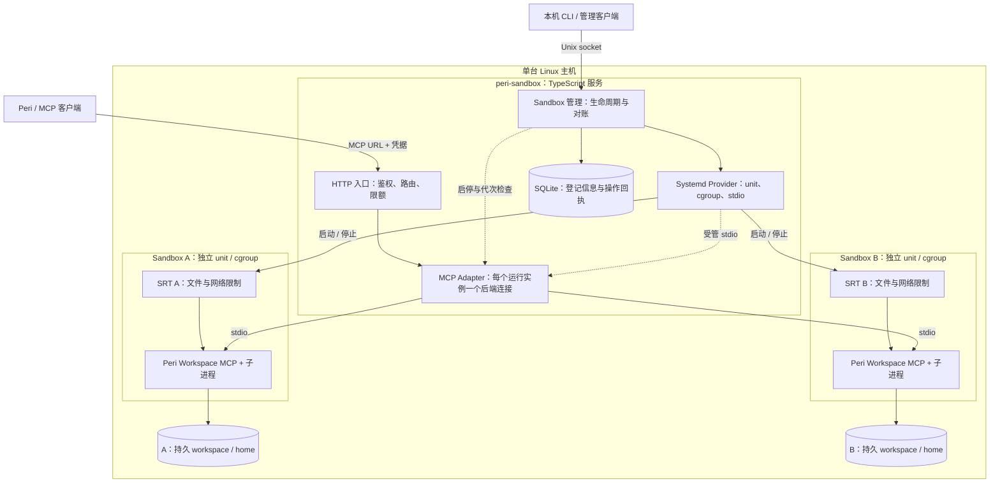
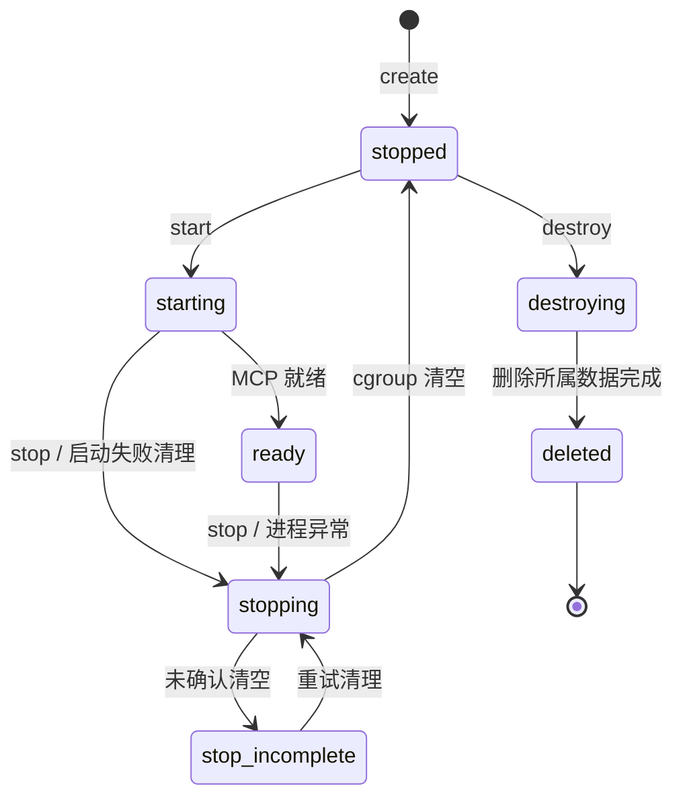

# peri-sandbox：单机多 Sandbox 设计与开发交接

> 状态：设计稿 v0.1；实现与隔离 VM 的部分真实验收结果见 `COMPATIBILITY.md`。该文档保留完整的 A01–A18 完成标准，未验证条目不能视为通过。
> 设计日期：2026-10-26。项目名暂定 `peri-sandbox`。
> 本文可直接交给开发 agent，目标是交付一个独立、可运行的 TypeScript 项目。

## 1. 要实现的东西

把一台 Linux 主机变成多个可管理的 Sandbox。每个 Sandbox 拥有独立的工作目录、隔离策略、运行进程和稳定 MCP URL。

**后续实现补充（macOS 开发预览）：** macOS 可用 `peri-sandbox up` 在本机自动初始化和运行 SRT + Peri，并沿用管理 socket 与 HTTP MCP 接口；它使用受验证的本地进程组清理，不提供本设计中依赖 systemd/cgroup 的进程、内存或 CPU 硬限制，也未取得 A01–A18 的 Linux 验收结论。macOS 的验证范围和限制见 `COMPATIBILITY.md`；以下架构及验收条款仍专指 Linux 部署。

上层创建并启动 Sandbox 后，把 URL 交给 Peri 或其他符合本文协议范围的 MCP 客户端。Agent 的推理计算留在外部；文件操作、命令执行和工具后台任务在 Sandbox 内进行。

**资源交付面是一条 MCP URL。** 创建、启动、停止、销毁属于本项目的管理面；连接凭据通过部署配置提供，不把秘密塞进 URL。

本项目先把这个闭环做好，不承接此前讨论的整个平台控制面。

| 已确定的决策 | 本项目约定 |
| --- | --- |
| 项目形态 | 独立仓库；Node.js + TypeScript；服务、管理 CLI、管理客户端库同仓库 |
| 部署形态 | 单机、多 Sandbox；Linux 为首版验收平台 |
| 隔离实现 | Anthropic SRT，单个 Sandbox 单独启动一份 SRT CLI |
| 工具后端 | `peri mcp-start workspace --stdio` |
| 管理状态 | 本机 SQLite；不保存 Agent 会话历史 |
| 持久数据 | 每 Sandbox 独立 workspace 与 home；停止后保留 |
| 执行生命周期 | systemd user transient service + cgroup v2；每次运行一个 unit |
| MCP 入口 | TS 服务提供 HTTP；内部以 stdio 连接受 SRT 隔离的 Peri |
| MCP 版本 | 首版固定 2026-07-28；不提供 legacy initialize/session 兼容 |
| 调用方范围 | 一个受信使用方域；允许同域多个连接和并发请求 |
| 生命周期恢复 | 恢复登记信息与文件；中断的进程、工具调用、后台任务不续跑 |

**明确不做：** Actor / Rivet、分布式调度、节点迁移、Agent 控制面、Session Store 分库、多租户身份平台、计费、快照服务、任意 MCP 服务聚合、浏览器管理界面。项目也不依赖尚未合并的 Peri Chat SDK。

## 2. 系统边界与架构



图中的 SRT 是启动与隔离边界，stdio 实际由 Provider 接管并交给 Adapter。管理服务自身运行在 Sandbox 外部。

这里没有独立的全局“MCP 资源网关平台”。HTTP 入口只是这个 Sandbox 产品的必要交付接口，负责把稳定 URL 定位到当前运行实例。它不决定 Agent、Session 或组织的数据归属。

### 三类状态必须分开

| 状态 | 保存位置 | stop/start 后 |
| --- | --- | --- |
| Sandbox 身份、策略、期望状态、URL 映射 | SQLite | 保留 |
| 用户文件、Git 仓库、用户 home | Sandbox 专属目录 | 保留 |
| MCP 连接、shell 进程、后台任务注册表、在途请求 | 当前运行实例内存 | 丢失，不承诺恢复 |

“持久 Sandbox”在首版指身份与文件持久。它不表示进程永不退出，也不表示后台任务可跨重启恢复。

## 3. 为什么这样接 SRT 与 Peri

Peri 已有可独立启动的 Workspace MCP 服务：

```bash
peri mcp-start workspace --stdio --workspace /absolute/existing/workspace
```

工作目录必须已存在。`--workspace` 决定工作位置，本身不构成操作系统隔离；真正的访问限制由 SRT 策略施加。[S2]

SRT 外层调用形态：

```bash
srt --settings /absolute/control/policy.json -- peri mcp-start workspace --stdio --workspace /absolute/existing/workspace
```

这些命令展示实际参数关系。实现必须用绝对可执行文件路径和 argv 数组启动，不能把用户输入拼成 shell 字符串。

**首版采用 stdio，而不把 Peri HTTP 端口直接发布到宿主。** 当前 SRT Linux 实现会隔离网络 namespace，Sandbox 内部 localhost 与宿主 localhost 不是同一个网络空间；SRT 的网络代理负责出站过滤，不是 MCP 入站代理。[S1]

SRT SDK 的 manager 存在进程级共享状态。为避免不同 Sandbox 的配置和代理相互影响，首版通过独立 SRT CLI 进程建立隔离边界，不在一个 TS 进程中反复初始化多个 manager。[S1]

## 4. 用户使用方式

下面的 CLI 和 TS API 是本项目要实现的接口，不表示这些命令或包已经发布。

部署者先安装经验证的 Peri/SRT 运行时、配置专用系统用户与服务，再执行：

```bash
peri-sandbox doctor --config /srv/peri/control/config.json
systemctl --user start peri-sandbox-api.service
```

部署文档提供 `peri-sandbox-api.service`，其 ExecStart 为 `peri-sandbox serve --config /srv/peri/control/config.json`。首版统一由该 unit 托管，避免前台进程与子 unit 的 BindsTo 不匹配；开发测试也通过该服务或专用的测试 supervisor unit 运行，不静默移除保护。

另一终端通过本地管理 socket 操作：

```bash
peri-sandbox create --name demo --profile workspace-default --request-id demo-create-001
peri-sandbox start sbx_01
peri-sandbox inspect sbx_01
peri-sandbox stop sbx_01
peri-sandbox start sbx_01
peri-sandbox destroy sbx_01 --delete-data
```

`sbx_01` 是示例，实际使用 create 返回的不可变 ID。

start 成功返回的资源形式：

```json
{
  "id": "sbx_01",
  "state": "ready",
  "generation": "run_7a...",
  "mcpUrl": "http://127.0.0.1:8787/sandboxes/sbx_01/mcp"
}
```

相同 Sandbox 重启后路径不变。URL 中没有临时端口、PID、generation 或 token。部署更换域名会改变 URL 的 origin；稳定性以配置的 `publicBaseUrl` 不变为前提。

MCP 客户端在连接配置中提供 `Authorization: Bearer ...`。上层业务只需保存 Sandbox 的资源 URL；认证材料由其 MCP 连接配置统一管理。首版不承诺任意客户端“只粘贴裸 URL”就能完成认证。

管理客户端的预期用法：

```ts
import { connectSandboxControl } from "peri-sandbox";

const control = connectSandboxControl({
  socketPath: "/srv/peri/control/control.sock",
});

const sandbox = await control.create(
  { name: "demo", profile: "workspace-default" },
  { requestId: "demo-create-001" },
);
const running = await control.start(sandbox.id, { requestId: "demo-start-001" });

console.log(running.mcpUrl);
await control.stop(sandbox.id, { requestId: "demo-stop-001" }); // 文件保留
```

管理客户端只通过受保护的 Unix socket 调用唯一 daemon，不能自行打开 SQLite 或启动第二套管理逻辑。

最小部署配置需要明确以下字段；具体 JSON schema 由项目实现并在启动时严格校验：

| 配置 | 约定 |
| --- | --- |
| controlRoot / sandboxesRoot | 独立绝对目录，不能互相嵌套或落入任何 workspace |
| listen / publicBaseUrl | 监听地址与对外 URL origin；两者可因 TLS 反向代理而不同 |
| auth.tokenFile | 受保护的部署级 Bearer 凭据文件 |
| http.allowedHosts / allowedOrigins | 明确允许值；无 Origin 的非浏览器 MCP 请求仍按认证规则处理 |
| runtime.periPath / periSha256 | 受信的 Peri 绝对可执行文件路径与散列；SRT 由锁定的 npm 依赖加载，doctor 检查其 CLI 和 seccomp helper |
| provider.apiUnit / unitPrefix | API unit 与本实例拥有的 Sandbox unit 前缀；只能由部署配置指定 |
| limits | 主机 Sandbox 总数、请求/输出/日志上限、启动与停止超时 |
| profiles | 命名 profile；允许的网络域名、运行时只读路径、CPU/内存/进程限额 |

profile 解析后的策略规范化快照与内容摘要在 create 时保存，start 记录实际应用的摘要；不能只保存一个会变化的 profile 名。首版不提供运行中修改策略。管理员修改模板仅影响新建实例，避免同一 Sandbox 重启后悄悄获得更大权限。

## 5. 管理 API 与模块

### 对外管理 API

```ts
type SandboxState =
  | "stopped" | "starting" | "ready" | "stopping"
  | "failed" | "stop_incomplete" | "destroying" | "deleted";

interface SandboxRecord {
  id: string;
  name?: string;
  profile: string;
  state: SandboxState;
  desiredState: "stopped" | "running" | "deleted";
  generation?: string;
  mcpUrl: string;
  lastError?: { code: string; message: string };
  createdAt: string;
  updatedAt: string;
}

interface SandboxControl {
  create(
    spec: { name?: string; profile: string },
    options: { requestId: string },
  ): Promise<SandboxRecord>;
  start(id: string, options: { requestId: string }): Promise<SandboxRecord>;
  stop(id: string, options: { requestId: string }): Promise<SandboxRecord>;
  destroy(
    id: string,
    options: { requestId: string; deleteData: true },
  ): Promise<SandboxRecord>;
  inspect(id: string): Promise<SandboxRecord>;
  list(): Promise<SandboxRecord[]>;
}
```

- create 生成 ID、登记记录和专属目录，初始 stopped；不自动启动。
- profile 只能引用部署者预定义的受信模板，调用者不能提交任意宿主路径、程序、环境变量或 SRT 参数。
- start 等待 MCP 就绪再返回 ready；对已 ready 的实例重复调用不生成新进程。
- stop 幂等，保留记录、目录和 URL。
- restart 由 stop + start 组合；stop 未确认完成时禁止继续。
- destroy 必须显式 `deleteData: true`，先停止并确认进程清理，再删除所属目录，留下 tombstone。
- deleted ID 不复用；inspect 可返回 deleted，list 默认不列 tombstone，URL 返回 410。
- 所有变更操作要求 requestId；CLI 未显式给出时生成并输出，网络失败后可用同一个 ID 重试。新的一次业务意图必须使用新 ID。

### 代码职责建议

| 模块 | 职责 |
| --- | --- |
| `src/server/service.ts` | 唯一 daemon、HTTP 入口、进程锁、启动恢复 |
| `src/control/` | 管理客户端与操作、SQLite 登记/回执、共享请求/错误类型 |
| `src/runtime/provider.ts`、`src/runtime/doctor.ts` | unit/cgroup 生命周期、环境自检、原始 stdio、真实清理确认 |
| `src/runtime/mac-provider.ts`、`src/runtime/mac-config.ts` | macOS 预览：自动私有配置、进程组生命周期与本机环境检查；不等价于 Linux cgroup |
| `src/runtime/policy.ts` | 受信 profile 到 SRT 配置、路径与环境验证 |
| `src/runtime/backend.ts`、`src/runtime/diagnostics.ts` | 每代 MCP 后端、Tasks 适配、有界诊断日志 |
| `scripts/patch-sdk.mjs`、`tests/wire.test.ts` | 固定 SDK 版本的 Tasks 兼容补丁与 wire fixtures |
| `src/cli.ts`、`src/index.ts` | 命令入口与外部包 API |
| `tests/`、`examples/` | 模拟状态测试、真实集成测试、部署及接入示例 |

这些是同一项目内的模块，不必拆成多个发布包或微服务。

Provider 只需要 `start / stop / inspect / listOwned` 四个能力；start 返回该 generation 的可识别运行句柄与 stdio streams。MCP Adapter 不拼 systemd 命令，Provider 不理解工具业务。

## 6. 生命周期、一致性与故障恢复



图只描述主要转换。`failed` 用于已经确认无存活执行进程的启动失败或异常退出；若清理未确认，应为 `stop_incomplete`，不能用 failed 隐藏一个仍在运行的写者。failed 可再次 start 或 destroy；destroying 删除失败保留该状态并允许重试。

必须成立的约束：

1. **同一个 Sandbox 的 workspace 同时最多有一个运行代次可以写入。**
2. 每次 start 生成新的 generation，unit 名包含 sandboxId 与 generation。任何 ready、exit、超时回调先核对 generation，过时代次不能修改新状态。
3. 仅控制决策按 Sandbox 串行提交；启动/清理 I/O 和等待 Ready 在锁外进行，结果携 generation 回来提交。并发 start 合并为同一次启动，stop 可撤销未完成的 start，destroy 禁止后续 start。被 stop/destroy 撤销的 start 返回 startup_cancelled，不返回看似成功的 stopped 记录。
4. 先持久化创建/启动意图，再执行宿主动作，最后登记观察结果；最终状态提交成功才发布 Ready。安全停机例外见数据库故障规则，不因落盘失败而阻止停止。崩溃后的恢复依据记录与实际 unit 状态对账。
5. 停止先关闭该实例的新请求入口，再停止 unit，确认 unit inactive 且对应 cgroup 无残留，最后发布 stopped。
6. 不能只凭 PID 识别进程，也不能在“发出 SIGTERM”之后立即宣称停止完成。

整个 state root 只允许一个 daemon。启动时持有 OS advisory lock（例如 flock），锁随进程退出释放；不能用单纯的 PID 文件充当互斥锁。

### 服务重启

先锁住 state root，并对数据库与自身拥有的 unit 分别核查；数据库打不开也不能跳过安全清理。停止旧代次、取消其排队启动 job，确认无活动 job 且 cgroup 无残留。清理完成前不开放该 Sandbox 的执行路由，也不创建新写者。

旧 stdio 连接不能可靠重新接管，首版不做“认领存活 Peri 并继续用”。恢复完成后把历史运行实例落到 stopped 或 failed，并将非删除中的 desiredState 归为 stopped；需要上层重新 start。不自动恢复历史 running 的进程，不自动重放工具调用。

未完成的管理操作必须留下可解释结果。所有变更操作的 requestId、操作类型、目标与规范化参数摘要存入回执表：同 ID/同输入返回原操作回执，进行中则等待同一操作；不同输入返回冲突。旧回执代表当时的结果，当前状态另用 inspect 查询。

例如 start 成功但响应丢失、随后该 Sandbox 已 stop，迟到的相同 requestId 重试只返回原回执，不能再次启动。create 崩溃恢复应完成或清理其已登记目录，不能创建孤儿目录后另分配 ID。中断且无法确认完成的操作记录 interrupted，不重新执行。首版不自动清理操作回执；后续若增加保留期，必须另定义过期重试契约。

### 数据库最小范围

| 表 | 必需信息 |
| --- | --- |
| sandboxes | ID、名称、profile 与策略版本、受管路径、期望/观察状态、generation、unit 名、最近错误、时间、tombstone |
| operation_receipts | requestId、操作类型、输入摘要、Sandbox ID、进行中/完成/失败/中断、结果摘要 |
| schema_migrations | 本项目 schema 版本 |

数据库放在本地受支持文件系统，采用 WAL、synchronous=FULL、事务、外键和有界 busy timeout。路径由 ID 与配置根目录推导并校验，不能相信数据库里的任意字符串就是可删除路径。SQLite 不存工具全文、文件内容、聊天记录或后台任务状态副本。

SQLite 出现 FULL、IOERR、CORRUPT 等故障时停止接纳管理变更和新的 MCP 执行，但仍应利用内存句柄与可信 unit 标识停止已有运行实例。停机清理不能以“先成功写数据库”为前提；无法落盘的清理结果写入有界诊断日志，待恢复后对账，不返回虚假的成功回执。数据库不可用时禁止删除持久数据，不创建空库覆盖故障状态，也不能误将未知 units 认定为已清理。

## 7. MCP 交付协议：必须真正打通的部分

### 两侧固定 modern MCP

外部 HTTP 与内部 stdio 都使用 **2026-07-28**。这一版本没有旧版 initialize/session 生命周期：通过 `server/discover` 发现，并在请求中携带规定的元数据。[S3]

一个 Sandbox 只有一个常驻 Peri 后端连接，但可以处理多个 HTTP 请求。**不实现“第二个 HTTP 会话拒绝”的锁。** Sandbox 是资源归属边界，HTTP 连接不是资源所有者。

首版面向使用该协议版本的 Peri 客户端；其他客户端需符合相同协议与能力范围。旧客户端应收到清晰的版本不支持错误，不能静默切换为另一套生命周期。

### Adapter 的实现选择

以官方 MCP TS SDK 为基础：HTTP `createMcpHandler`、后端 `Client`，加 Supervisor 自有的 stdio Transport，以及**明确维护的 Tasks 兼容模块/补丁**。不要重新手写完整 HTTP MCP 协议。

- HTTP handler 使用 modern-only 配置，例如 `legacy: "reject"`。
- 每次 HTTP 请求可以产生前端 Server，Sandbox 的后端 Client 必须由实例上下文长期持有，不能在 handler factory 中重新启动。
- 后端显式 pin 2026-07-28；禁用 `inputRequired.autoFulfill`，不允许隐式重试有副作用调用。
- 不直接采用会启动额外协商探测进程的默认 stdio 启动路径。自有 Transport 由 Provider 提供唯一的进程与管道，在同一个后端完成 discovery/协商。[S3]
- backend close 只属于 stop、失败清理等生命周期操作。HTTP 请求结束不能关闭共享 backend。
- stdout 只放 MCP JSON-RPC；SRT、launcher、Peri 的诊断输出进入 stderr，并持续排空。

**Ready 条件：** unit/进程存活、同一个 Peri 后端完成 modern 协商、`tools/list` 成功、所需工具与扩展能力核查通过。只出现 PID、端口监听或一次 discover 响应，都不能证明已经 ready。

### 能力范围

| 能力 | 首版要求 |
| --- | --- |
| server/discover | 前端生成真实能力；不无条件照抄后端 |
| tools/list、tools/call | 支持 Peri Workspace 工具；保持参数和结果语义 |
| Tasks 创建 | 保留 `resultType: "task"` 和任务句柄 |
| tasks/get | 支持查询状态，并从完成返回中的 result 获取工具结果 |
| tasks/cancel | 支持请求取消；调用方继续 get 确认终态 |
| tasks/update | 保持 Peri 当前确认/no-op 语义；校验任务存在性与 owner，不承诺写入 shell stdin |
| progress / 请求取消 | 正确映射到对应在途请求 |
| Tasks taskIds 订阅 | 首版不支持；采用 get 轮询，不宣告订阅能力 |
| sampling、elicitation、roots、input_required 往返 | 首版不支持、不宣告 |
| resources/prompts 等其他能力 | 首版不宣告；只有显式实现和验收后才能增加 |

Peri 当前没有 `tasks/list` 和 `tasks/result`；禁止生成这些并不存在的接口。Tasks 的完成结果从 `tasks/get` 返回。[S4]

后端声明 Tasks 不代表外部调用者也支持 Tasks。首版要求 Bash 与 tasks/get、tasks/update、tasks/cancel 请求声明 `io.modelcontextprotocol/tasks` 能力；缺失时在转发前返回明确的能力不支持错误。文件工具不额外要求 Tasks。任务 status=completed 仅表示执行已终结；shell 非零退出可通过 result.isError 与 structuredContent 表达，Adapter 不得误改成命令成功。

### 已发现的兼容缺口，不能跳过

源码核查时，TS SDK 2.4.0 的 modern codec 只接受 complete / input_required，拒绝 Peri Tasks 使用的 `resultType: "task"`。仅调整业务 schema 或调用 `Client.request` 不能绕过该检查。[S5]

**开发范围必须包含双向 Tasks 兼容：** 后端解码、内部类型/处理链、前端编码与能力声明。不能只修改一个判断而让其他层丢字段，也不能把 task 伪装成已完成结果。

选择与固定 SDK 版本绑定的可审查补丁或局部扩展，纳入仓库、锁文件与回归测试；不要运行时 monkey-patch，不接受未经测试的依赖自动升级。补丁是否足够局部，要以实现和 wire 测试证明，本文不预设工作量。

必须用真实 Peri 创建后台 Bash 任务，经外部 HTTP 获取句柄、查询结果和取消任务，完成闭环；另验证 tasks/update 的当前确认/no-op 行为。当前 Peri Workspace 的 update 不消费输入，因此首版不宣称交互输入已生效。[S4] **这项不通过就不能宣称项目可交付。** 不能通过隐藏 Tasks 声明绕过，因为 Peri 仍可能将超时命令转为后台任务。

### 请求语义与中断

- 两侧 JSON-RPC ID 分别分配，关联键包含 generation、每个 HTTP exchange 的独立 ID 和外部请求 ID；不同连接可使用相同 JSON-RPC ID，不能用它作共享 Map 的唯一键。
- progress 重新映射到外部 progressToken；取消映射到实际后端请求。
- 某个 HTTP SSE 请求关闭应取消对应在途请求，但不能停止整个 Sandbox。
- 已返回任务句柄的后台任务独立于原 HTTP 连接；重新连接可用同一 taskId 轮询，直到该 generation 停止。
- 未完成调用遇到后端退出，应返回中断/结果未知；不能报告“未执行”或自动重试。
- 外部调用可能已经产生文件改动，但响应尚未送达。首版不保证 exactly-once；有副作用调用的重试决策由上层承担。
- 对外 taskId 是绑定 Sandbox 与 generation 的不透明句柄。同一代同一后端 ID 始终映射到相同外部句柄。Adapter 为任务创建/get 等结果中的结构化 taskId 与后端 ID 做双向转换，保留有界映射；任务相关结构化业务元数据也保持一致，不能只改最外层字段。只转换明确的任务 ID 字段，不对日志、输出或路径做全局文本替换，peri/taskOwner 保持不变。停止该代次后旧句柄明确失效；其 get/update/cancel 必须在入口拒绝，绝不触达新代次任务。不伪造任务完成或迁移。
- 仅保留必要业务元数据；协议版本、能力、请求关联元数据由 Adapter 按各侧协议生成和校验。客户端提供的 owner 字段不能充当授权依据。
- 不支持的后端反向交互或结果类型应明确失败，不挂起等待永远不会出现的响应。

### Peri 元数据边界

`_meta` 不是认证信息，处理它之前先验证 HTTP 凭据。首版允许受信调用域声明任务 owner；owner 只是域内分组，不提供恶意调用方之间的会话级授权隔离。[S4]

| 字段 | Adapter 规则 |
| --- | --- |
| 协议版本、clientInfo、clientCapabilities | 前端校验，后端按适配器实际能力重建；禁止外部覆盖 |
| `peri/taskOwner` | 认证后逐请求保留；有值时验证为非空字符串、UTF-8 长度不超过 512 字节；创建/get/update/cancel 使用相同值 |
| progressToken | 分别分配并映射，不直接复制 |
| 结果中的 task_id、执行证据、输出引用等业务元数据 | 在大小限制内保留，不批量清空 |
| 未实现的请求扩展字段 | 不直接传入后端；按明确 allowlist 处理，必要时返回不支持 |
| Authorization、Cookie、密钥 | 不进入 `_meta`、工具参数或子进程环境 |

Peri 将缺失或 null owner 解释为 generic 模式，该模式不提供 owner 隔离。协议允许这种模式，但无效 owner 必须拒绝，不能“清理字段”后降级成 generic。不能从工具参数推导 owner，也不能用每次变化的 HTTP 请求 ID 替换它；重连不能改变同一任务的 owner。

后端 SDK 可能接受显式 metadata 覆盖自动生成的协议字段，因此禁止直接传 `{ ...externalMeta }`；必须逐字段构造。

## 8. 文件、网络与宿主资源

### 路径布局

| 路径示例 | 用途与权限 |
| --- | --- |
| `/opt/peri-runtime/` | 受信 Peri、Node、SRT 与 vendor helpers；Sandbox 只读，负载不可修改 |
| `/srv/peri/control/` | SQLite、配置、凭据、生成的策略；Sandbox 不可读写 |
| `/srv/peri/sandboxes/<id>/workspace/` | 持久工作目录，仅本 Sandbox 可读写 |
| `/srv/peri/sandboxes/<id>/home/` | 持久 HOME 与 XDG 子目录，仅本 Sandbox 可读写 |
| unit 私有 `/tmp` | 临时目录；停止后不保证保留 |

ID 由服务生成并限制字符集；name 不参与路径拼接。创建、递归删除、恢复扫描都要检查规范化路径、所属根目录和 symlink。destroy 只删除该 ID 的受管目录，不提供任意路径删除能力。

### SRT 策略生成

SRT 默认允许读取宿主文件；只配置 allowWrite 不足以隔离不同 Workspace。Linux profile 必须从 `denyRead: ["/"]` 开始，再显式开放必要运行时与该 Sandbox 目录。[S1]

以下是**需要在目标发行版实测的模板**，不是已验证的通用配置：

```json
{
  "filesystem": {
    "denyRead": ["/"],
    "allowRead": [
      "/usr", "/bin", "/sbin", "/lib", "/lib64", "/opt/peri-runtime",
      "/etc/ld.so.cache", "/etc/nsswitch.conf", "/etc/resolv.conf",
      "/etc/hosts", "/etc/ssl/certs", "/etc/localtime",
      "/srv/peri/sandboxes/SANDBOX_ID/workspace",
      "/srv/peri/sandboxes/SANDBOX_ID/home",
      "/tmp"
    ],
    "allowWrite": [
      "/srv/peri/sandboxes/SANDBOX_ID/workspace",
      "/srv/peri/sandboxes/SANDBOX_ID/home",
      "/tmp/claude"
    ],
    "denyWrite": []
  },
  "network": {
    "allowedDomains": [],
    "deniedDomains": [],
    "strictAllowlist": true,
    "allowAllUnixSockets": false
  }
}
```

生成器只加入存在且确有需要的运行时路径，并验证链接目标。不要整体开放 /etc、/home、/run/user 或 /srv/peri；不要使用启动时展开的 glob 来隔离未来新建的兄弟目录。

网络默认拒绝出站，由 profile 放行明确域名。禁止全放行 Unix sockets、允许弱隔离等“修复启动问题”的降级。SRT 域名策略不等于完整企业网络防护，不能承诺它自动解决所有 DNS、代理或内网访问风险。

SRT 对 /dev、/proc、/sys 有特殊处理；这里共享宿主内核，不能宣称等价于 VM。若未来目标是敌对租户强隔离，应重新评估执行 provider；不以一份 profile 作为强隔离已经完成的证据。

### 临时目录与环境

SRT 隐式允许 /tmp/claude 写入，并根据 CLAUDE_CODE_TMPDIR / CLAUDE_TMPDIR 重写子进程 TMPDIR。[S1]

因此每个 unit 必须有真实生效的 `PrivateTmp=yes`。launcher 在该私有 namespace 内建立 /tmp/claude；SRT 外层 TMPDIR=/tmp，CLAUDE_CODE_TMPDIR=/tmp/claude。不得让多个 Sandbox 实际共享宿主 /tmp/claude。

环境从空 allowlist 构造：仅传必要 PATH、专属 HOME/XDG、locale 和明确的运行参数。不得继承管理 token、SSH_AUTH_SOCK、DBUS_SESSION_BUS_ADDRESS、NODE_OPTIONS、BASH_ENV、LD_PRELOAD 或任意宿主代理变量。不要使用 `{ ...process.env }` 传给负载。

清空环境要发生在实际 Sandbox unit 的受信 launcher 内，例如使用 env -i 重建环境；仅清空 systemd-run 调用者环境或使用 --setenv 并不等价。Provider 自身保留连接 user manager 所需配置。除约定 stdio 外，不继承 systemd bus、管理 socket、数据库和进程锁的 FD；XDG_RUNTIME_DIR 若需要，使用 Sandbox 专属目录，不能指向宿主 user runtime。

### Systemd Provider

使用专用非 root 用户及其 systemd user manager。部署步骤明确配置 lingering、cgroup v2 controller 可用性、user namespace 等前提；请求处理中不运行 sudo。

| 属性 | 要求 |
| --- | --- |
| unit 身份 | sandboxId + generation；记录完整 unit 名 |
| Type / Restart | exec / no；禁止后端自主重启，外部依赖触发的 job 仍需对账 |
| KillMode | control-group |
| 退出策略 | SIGTERM，10 秒默认宽限，再 SIGKILL |
| PrivateTmp | yes，必须真实验证 |
| API 依赖 | BindsTo 与 After 指向 peri-sandbox-api.service |
| 资源限制 | MemoryMax、TasksMax、CPUQuota；启动前确认实际 controller 生效 |
| stdio | 原始 pipe，禁止 PTY；可用 systemd-run --user --pipe --quiet 或等价 D-Bus 实现 |

BindsTo 是异常退出的辅助保护，不替代启动对账。Restart=no 也不等于完全没有外部 start job；API 显式 restart 等依赖传播必须纳入验证和恢复清理。不得把可写 cgroup delegation 或 systemd user bus 暴露给负载。

SRT 当前在某些 seccomp helper 缺失路径只警告后继续运行；`allowAllUnixSockets: false` 本身不能证明限制生效。doctor 必须检查 apply-seccomp 等 helper 可执行、可加载，识别降级警告，并用真实 AF_UNIX 探针验证预期阻断；否则返回 unsupported_environment，禁止启动。

首版强制有内存、进程数和 CPU 上限。磁盘不宣称已有每 Sandbox 硬配额：使用独立数据分区/部署配额、宿主剩余空间水位拒绝新启动、日志限额；若要求硬磁盘配额，必须单独实现并验证文件系统配额，不能用定时目录计数冒充硬限制。

## 9. 鉴权、容量与可观察性

首版是单一受信调用域，部署级 Bearer token 可以访问其 Sandbox 集合；不是多租户 ACL。若不同调用者不能互相信任，需要独立部署，或另行实现经验证的按 Sandbox 授权。

- 管理 socket 权限 0600，仅服务账户/获授权本地管理者可访问；无公网管理 REST。
- MCP 默认监听 loopback，仍启用 Bearer 认证。
- 远程部署必须经 TLS 入口，并配置允许的 Host/Origin；未配置认证时拒绝启动。
- 鉴权先于 Sandbox 存在性探测与后端访问；token 不进入子进程、日志、URL。
- 密钥文件由部署管理；不在首版实现 OAuth 平台。

下面是可配置的**初始防护值，不是性能承诺**：

| 项目 | 初始值 / 行为 |
| --- | --- |
| 每 Sandbox 在途工具调用 | 8；超过直接拒绝，不建无界等待队列 |
| 每 Sandbox 控制/任务查询预留 | 4；避免长 Bash 占满后无法取消任务 |
| 单请求体 | 1 MiB，转发前检查 |
| 单完整 stdio 消息 | 8 MiB；解析器在拼完整行前也要限制缓冲 |
| 单客户端输出缓冲 | 8 MiB；超限断开对应请求，结果可能未知 |
| 启动超时 | 30 秒可配置；超时进入完整清理流程 |
| stop 宽限 | 10 秒可配置；未清空时为 stop_incomplete |
| 诊断日志 | 每 Sandbox 有界轮转，默认 10 MiB × 3 |
| 主机 Sandbox 总数 | 部署配置显式上限；按内存预算与实测调整 |

工具与查询共用受限总流量预算，但保留任务取消/查询通道。stdio 写入等待 drain；stderr 持续读取。过大结果不截断成假成功 JSON；已执行调用只能明确报错或结果未知。

记录 sandboxId、generation、请求关联 ID、方法、耗时、结果类别、退出原因和清理结果。默认不记录 token、工具参数全文、文件内容或 shell 输出全文。

管理错误至少包括：unsupported_environment、startup_failed、startup_cancelled、interrupted、not_running、stop_incomplete、conflict、limit_exceeded、deleted。HTTP/MCP 错误使用对应协议语义，不把管理错误字符串随意当 JSON-RPC 标准错误码。

Peri 的已完成任务记录会保留到当前 generation 结束，目前没有 TTL 清理。首版增加可配置的每代 Bash 调用准入总额（初始 10,000，属于防护值）：所有 Bash 调用在转发前原子计数，保守计入可能超时转后台的前台命令。达到阈值后拒绝新的 Bash 调用，已有任务仍可 get/update/cancel，文件工具继续可用。任务 ID 映射使用同一预算；不得通过自动重启规避阈值。操作者确认现有任务结束后，可显式 stop/start 开启新代次。验收还须测量累计任务记录的实际内存占用，不能承诺无限期运行内存恒定。

## 10. 验收矩阵

“通过”必须有命令、环境版本、结果和必要日志。单元测试通过不能替代真实隔离与互操作测试；没有运行条件的项目必须标为未验证。

| 编号 | 验收场景 | 通过条件 |
| --- | --- | --- |
| A01 | 创建、启动、真实 MCP 调用 | Peri 客户端发现 URL，经 HTTP 调用 Write/Read/Bash |
| A02 | 单次启动的进程数量 | 只有一个受管 SRT/Peri 后端；无额外协商探测兄弟实例 |
| A03 | 停止、再次启动 | URL 与文件保留；generation 改变；旧句柄 get/update/cancel 不触达新代次 |
| A04 | 双 Sandbox 文件隔离 | A 不能读写 B 的 workspace/home，含 symlink、相对路径、新建 sibling |
| A05 | 控制面与临时目录隔离 | 读不到控制配置/token/user bus；A/B 的 /tmp/claude 互不可见 |
| A06 | 网络策略 | 默认出站失败；明确放行的 HTTPS 成功；Unix socket 不被全放行 |
| A07 | 宿主限额 | 真实触发内存、进程数、CPU 限制；限制作用于整个进程树 |
| A08 | Tasks 完整闭环 | 原生 task 返回穿过两侧 codec；正常/非零退出结果保真；update 确认/no-op；未知/跨 owner 拒绝；cancel 确认终态且 shell 实际退出 |
| A09 | 断连与任务持有 | 获得 taskId 后断开，再连接可查询同代任务；断连不停止 Sandbox |
| A10 | 并发请求关联 | 两连接使用相同外部 ID，取消/progress 不串请求；查询/取消不被长命令饿死 |
| A11 | 生命周期竞态 | 并发 start/stop/destroy、启动超时、旧回调到达时均无重复写者 |
| A12 | 进程树清理 | shell 子孙、setsid/double-fork、API/SRT/Peri 被杀后，清理可确认 cgroup 为空 |
| A13 | 清理失败 | 模拟无法清空，保持 stop_incomplete；禁止新写者及目录删除 |
| A14 | 服务重启与操作幂等 | 测真实 systemctl restart、旧 unit start job、晚到 start 重试、DB 打不开/写回失败/磁盘满；安全清理不被 DB 阻断，无自动重放 |
| A15 | 鉴权与协议边界 | 未授权先拒绝；legacy 明确不支持；无 Tasks 能力的 Bash 请求转发前拒绝；不宣告未实现能力 |
| A16 | 缓冲与日志 | 大请求、无换行超长 stdout、慢客户端、stderr 洪泛均有界；每代 Bash 达配额后仍能查/取消已有任务 |
| A17 | 安全销毁 | 只删除所属目录；deleted ID 不复用；路径穿越与 symlink 不能越界 |
| A18 | 环境前提不满足 | PrivateTmp/userns/cgroup/隔离依赖失败则拒绝启动，无静默弱化 |

测试分三层：状态机与恢复的故障注入测试；固定版本协议 wire fixtures；Linux 真实 SRT + Peri + HTTP 客户端端到端测试。只有第三层可以支持“该部署环境验证通过”的结论。

## 11. 开发交付物与完成标准

开发 agent 应交付：

1. 独立 TypeScript 项目、锁文件、构建/类型检查命令、管理 CLI 与客户端库。
2. 上述六个管理操作、SQLite 迁移、恢复对账、真实 Systemd Provider。
3. SRT profile 生成与 doctor；不支持的宿主条件给出可操作错误。
4. MCP HTTP↔stdio Adapter 与版本固定的 Tasks 兼容实现；包含补丁说明和 wire fixtures。
5. 一份 systemd 部署示例、一份本机使用示例、一份 Peri 客户端连接示例。
6. 验收矩阵结果；清楚区分 mock 通过、真实通过、未运行和失败。
7. README 写清数据保留、后台任务寿命、认证、升级依赖和卸载/清理方法。

实现顺序按依赖关系推进：先证明真实 SRT→Peri stdio 与 Tasks HTTP 桥接可用，再补齐管理持久化、生命周期并发、故障恢复和完整验收。这是验证架构的依赖顺序，不是排期。

不接受以 echo MCP、假 SRT、内存 Map 或 PID kill 替代真实交付。可以用这些做局部测试，但最终示例和端到端测试必须走真正执行链。

### 可直接发送给开发 agent 的任务

```text
请依据本设计文档创建独立的 peri-sandbox 项目，使用 TypeScript 实现单机多 Sandbox。

范围固定：
- Linux + systemd user service/cgroup v2。
- 每个 Sandbox 一个独立 SRT CLI，内部运行真实 peri mcp-start workspace --stdio。
- 持久 workspace/home，稳定 MCP URL。
- SQLite 管理登记；本地 Unix socket 管理面；HTTP MCP 使用部署配置的 Bearer 认证。
- 实现 create/start/stop/destroy/inspect/list；进程清理未确认时禁止新写者。
- 外部和内部 MCP 固定 2026-07-28，不加入旧版 session 锁。
- 实现并验证 Tasks 创建/get/update/cancel；处理文档指出的 TS SDK codec 缺口。
- 不引入 Actor/Rivet、集群、Agent/Session 控制、Chat SDK 或独立全局资源网关。

先核对文档列出的固定源码和实际安装版本，建立锁文件与兼容版本清单。
首先用真实 Peri 客户端完成 HTTP→stdio→SRT→Peri 的 Write/Read/Bash 与 Tasks 闭环；
然后完成生命周期、持久化、故障恢复、资源限制与隔离验收。
如果当前依赖与文档不一致，记录具体差异并修正实现/文档，不靠删除必要验收来绕过。

最终交付代码、README、部署和使用示例、自动化测试、验收结果。
不得把模拟测试结果表述成真实隔离验证；不得声称未测试的跨版本兼容。
本任务不包含公网部署或给现有平台接入生产流量。
```

## 12. 源码依据、版本与剩余风险

以下是本设计核查的源码快照，**不是已经安装和联调成功的发行版组合**。源码 package.json 版本不自动等于 npm 当前可安装版本；实现者必须记录最终安装制品、hash 和锁文件。Peri 使用的 rmcp 还包含其补丁，不能只替换为同号上游依赖。

| 组件 | 核查版本 / SHA |
| --- | --- |
| Anthropic sandbox-runtime | 源码 package 0.0.81；98a4016d27609ed34dd1fb43d23ed6efb6eeeb77 |
| Peri | dcd4d116a12dacdc8db41ec5d1387c6bbe874fdd |
| MCP TypeScript SDK | 源码 packages 2.4.0；951fe5603a7ec0b2dcb6a0b95d92cd86f93ad9e5 |
| rmcp 上游参考 | 3.5.1；79437f291b2c44053d00dcd5db969fd0cca7c887；另核对 Peri 补丁 |

SRT 源码要求 Node >=22.12.0。最终选择的 Node、Linux/systemd、文件系统、SRT/Peri/SDK 组合应写入仓库的兼容清单；首版不顺带承诺 macOS/Windows 部署。

主要依据：

- **[S1] SRT：** [README](https://github.com/anthropics/sandbox-runtime/blob/98a4016d27609ed34dd1fb43d23ed6efb6eeeb77/README.md)、[manager 与隐式策略](https://github.com/anthropics/sandbox-runtime/blob/98a4016d27609ed34dd1fb43d23ed6efb6eeeb77/src/sandbox/sandbox-manager.ts)、[临时目录处理](https://github.com/anthropics/sandbox-runtime/blob/98a4016d27609ed34dd1fb43d23ed6efb6eeeb77/src/sandbox/sandbox-utils.ts)、[Linux 实现](https://github.com/anthropics/sandbox-runtime/blob/98a4016d27609ed34dd1fb43d23ed6efb6eeeb77/src/sandbox/linux-sandbox-utils.ts)、[根目录拒读测试](https://github.com/anthropics/sandbox-runtime/blob/98a4016d27609ed34dd1fb43d23ed6efb6eeeb77/test/sandbox/allow-read.test.ts)。
- **[S2] Peri 启动：** [CLI](https://github.com/KonghaYao/peri/blob/dcd4d116a12dacdc8db41ec5d1387c6bbe874fdd/peri-tui/src/cli_mcp_start.rs)、[独立 MCP 服务](https://github.com/KonghaYao/peri/blob/dcd4d116a12dacdc8db41ec5d1387c6bbe874fdd/mcp-packages/common/src/standalone.rs)。
- **[S3] MCP 生命周期与传输：** [TS 协议版本说明](https://github.com/modelcontextprotocol/typescript-sdk/blob/951fe5603a7ec0b2dcb6a0b95d92cd86f93ad9e5/docs/protocol-versions.md)、[HTTP handler](https://github.com/modelcontextprotocol/typescript-sdk/blob/951fe5603a7ec0b2dcb6a0b95d92cd86f93ad9e5/packages/server/src/server/createMcpHandler.ts)、[Peri 客户端](https://github.com/KonghaYao/peri/blob/dcd4d116a12dacdc8db41ec5d1387c6bbe874fdd/peri-middlewares/src/mcp/client/transport.rs)、[rmcp 服务分流](https://github.com/modelcontextprotocol/rust-sdk/blob/79437f291b2c44053d00dcd5db969fd0cca7c887/crates/rmcp/src/service/server.rs)。
- **[S4] Tasks：** [Peri Workspace](https://github.com/KonghaYao/peri/blob/dcd4d116a12dacdc8db41ec5d1387c6bbe874fdd/mcp-packages/workspace/src/workspace.rs)、[任务操作与 update 当前语义](https://github.com/KonghaYao/peri/blob/dcd4d116a12dacdc8db41ec5d1387c6bbe874fdd/mcp-packages/workspace/src/shell_tasks.rs)、[owner 解析与 generic 模式](https://github.com/KonghaYao/peri/blob/dcd4d116a12dacdc8db41ec5d1387c6bbe874fdd/peri-mcp-core/src/task_owner.rs)、[rmcp Tasks 模型](https://github.com/modelcontextprotocol/rust-sdk/blob/79437f291b2c44053d00dcd5db969fd0cca7c887/crates/rmcp/src/model/task.rs)。
- **[S5] TS 兼容缺口：** [modern codec](https://github.com/modelcontextprotocol/typescript-sdk/blob/951fe5603a7ec0b2dcb6a0b95d92cd86f93ad9e5/packages/core-internal/src/wire/rev2026-07-28/codec.ts)、[请求与取消处理](https://github.com/modelcontextprotocol/typescript-sdk/blob/951fe5603a7ec0b2dcb6a0b95d92cd86f93ad9e5/packages/core-internal/src/shared/protocol.ts)。
- **[S6] 宿主进程管理：** [systemd-run](https://www.freedesktop.org/software/systemd/man/latest/systemd-run.html)、[systemd.exec](https://www.freedesktop.org/software/systemd/man/latest/systemd.exec.html)、[systemd.kill](https://www.freedesktop.org/software/systemd/man/latest/systemd.kill.html)、[systemd.unit](https://www.freedesktop.org/software/systemd/man/latest/systemd.unit.html)。

生产前最需要证明的是：Tasks 双向兼容、PrivateTmp 与根目录拒读在目标主机真实有效、异常退出后 cgroup 清理可靠。单机仍是故障域，SQLite 与工作目录仍需部署者备份；跨机器高可用与恢复不属于首版承诺。
