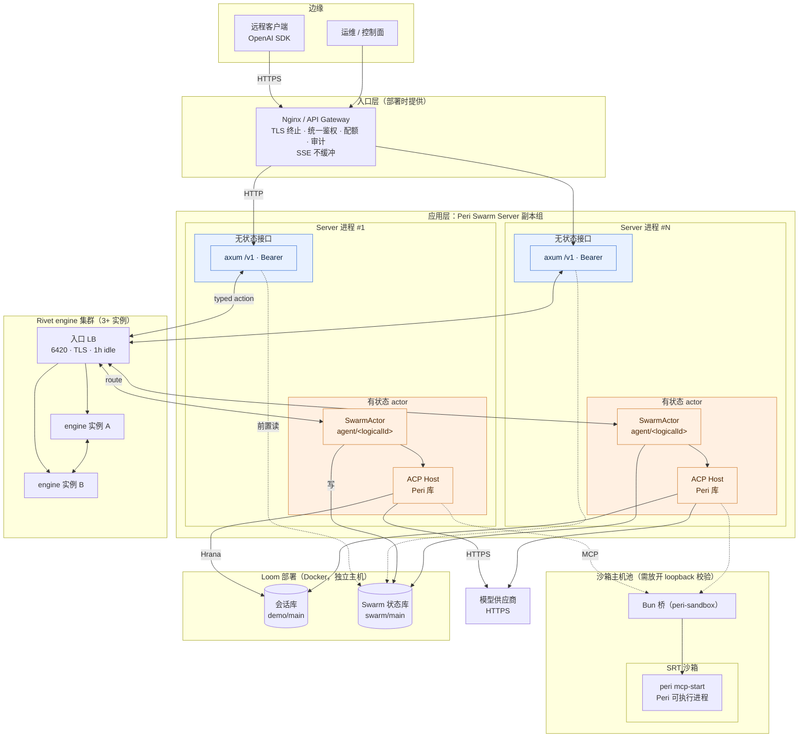
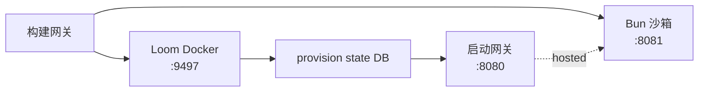
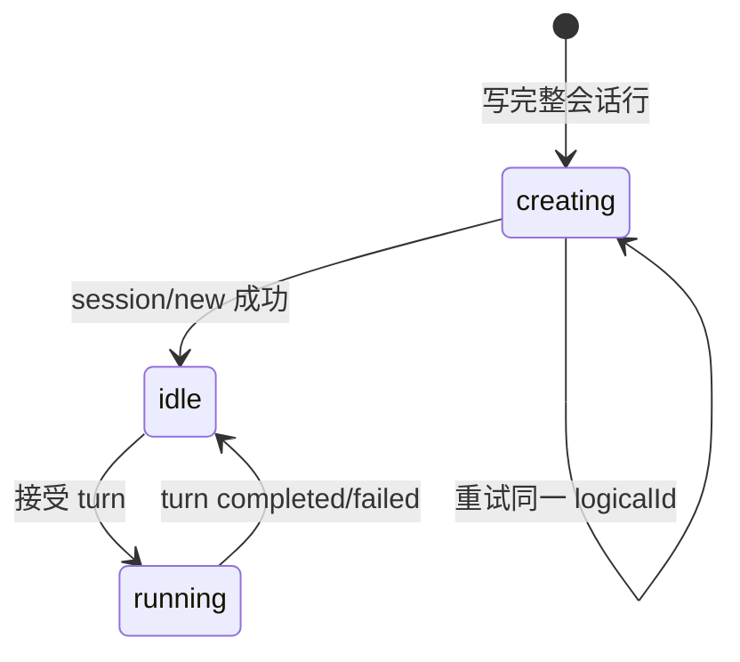

# peri-swarm

本地单机 Agent 网关：HTTP 面 → Rivet actor → 进程内 Peri ACP Host → 远程 workspace
MCP（Bun 托管的沙箱）→ 两个 Loom 逻辑库。设计边界见
[Peri Swarm 本地开发宿主](../docs/design/peri-swarm.md)，验收证据见
[本地开发链路验收](../docs/verification/peri-swarm-local-dev.md)。

本文是本地操作手册，不是运行时权威：字段与错误码以 `src/` 与契约测试为准。

## 生产部署拓扑（目标）

下图是生产目标形态，不是当前实现。下文把 `peri-swarm` 进程称为 Peri Swarm Server
（操作章节沿用「网关」旧称）。仓库内没有对应的编排或验收记录，设计文档把跨机
调度、生产 TLS、多租户与跨实例接管列为非目标。带前置标注的节点，今天在代码中不存在
或不可配置；差距见下表。



### 网络分段

- 公网只暴露入口层；Peri Swarm Server、Rivet engine、Loom 全部在私网，客户端不直连
  `8080`。
- 入口层只做南北向 HTTP；`agent/<logicalId>` 的 actor 分配由 Rivet engine 负责，
  Ingress 不需要粘滞会话。
- 会话库与状态库由两个 locator 分别指向，由 Server 侧直连 Loom，可以落在不同实例，
  但都必须可写；沙箱不连接 Loom。

### 进程内分层

同一份 `peri-swarm` 二进制里逻辑上分成两部分；当前没有 API-only / actor-only 的 role
开关，每个副本同时承担两者。

| 维度 | 无状态接口 | 有状态 actor |
| --- | --- | --- |
| 入口 | axum `/v1`、Bearer、body limit | `SwarmActor` action、`GET /events` |
| 职责 | 校验、公开契约投影、SSE 包装 | 会话执行、进程内 ACP Host、事件序列 |
| 内存状态 | 无会话状态；只有 client 与 store 句柄 | live ACP Host、事件广播、会话视图 |
| 持久状态 | 少量前置读（`rootSessionId`、404） | 以 Loom 为准写行、items、绑定 |
| 多副本 | 任意副本处理任意请求 | 一个 `agent/<logicalId>` 同一时刻只在一个副本 |
| 转发 | 经 Rivet client 发 typed action | 由 engine 定位；副本间不直连 |
| 失败/重建 | 副本可随时替换 | 只读恢复 + `session/load`；在途 turn 502 |
| 扩缩容 | 加副本即可 | 由 engine 放置；保留 spare capacity |

请求路径：无状态层解析 → typed action → engine → 承载 actor 的副本；actor 的 `on_start`
只恢复只读视图。沙箱侧的 `peri mcp-start` 是独立 Peri 进程，属 workspace MCP，不算
这两层。

### 组件分离条件

| 组件 | 生产位置 | 落地前置（当前差距） |
| --- | --- | --- |
| 传统 Gateway（Nginx 等） | 独立边缘层 | 不需要自研；受 `PERI_SWARM_BIND` loopback 限制，需放开校验或由同机代理转发 |
| Peri Swarm Server（`peri-swarm`） | 可替换副本组（每副本同时是 Rivet node） | 当前仅单实例；多个 Server 共享同一 engine 与 pool 时才看到同一批 actor；在途 turn 的跨实例接管是设计非目标 |
| Rivet engine | 3+ 实例 + LB（独立主机组） | endpoint/token/namespace/pool 是 `const`；`EngineSpawnMode::Always` 会拉起本机 engine；客户端只接受 `http`，未暴露 TLS/CA 配置 |
| `peri-sandbox` | 沙箱主机池 | `validate_bun_url` 只接受 loopback `http`；远程需 HTTPS 与主机认证 |
| Loom | 独立 Docker 主机 | locator 已接受 `http(s)`；存储 SDK 无法注入 CA，跨机需私网明文 + 网络隔离，或前置终止 TLS 的代理 |
| 模型供应商 | 公网 | 无 |

### Rivet engine 怎么部署？

这里的 engine 是 Rivet 的 control plane（本地 3.1.1，`:6420`），不是 Peri 进程或 ACP
Host。Peri 侧的运行单元是 actor 实例：`peri-swarm` 的 `SwarmActor`（key
`agent/<logicalId>`）与 `@peri-code/rivet` 的 `PeriChatActor`。control plane 选择承载
actor 的 node、按需唤醒，并把 HTTP/WebSocket 请求转发给该 node；actor 逻辑跑在连到
同一 control plane 的 Server 进程里。node 不需要公网地址或 actor 入站端口。

官方生产形态不是「一台 engine」，而是 3+ 个 engine 实例 + 前置 LB（6420/TLS/1h idle），
每个实例独立块盘并共享启用 versioning 的 bucket；单机只适合开发。所有 Server 副本必须
使用同一 endpoint、namespace 与 pool，并先创建 pool。endpoint 填**集群入口 LB** 地址，
不填单个实例；客户端不做集群发现。依据：
[Architecture](https://rivet.dev/docs/architecture)、[Nodes](https://rivet.dev/docs/nodes)、
[Control plane production checklist](https://rivet.dev/docs/deploy/self-host/control-plane/production-checklist)。

control plane 是 Rivet 官方组件，Peri 不实现也不设计其内部：本地由 `rivetkit` 下载到
`~/.rivetkit/engine/v3` 并按需拉起，生产直接部署官方 `rivetdev/engine`。Peri 只负责
配置面与部署编排（LB、TLS、namespace/pool、凭据、bucket 与磁盘）。

当前代码把 engine 钉在 Server 主机上，外置需要三处改动：

1. 配置外置：endpoint、token、namespace、pool 从 `const` 改为配置项；token 只按变量名
   引用，当前固定为 `default`，不能作为生产凭据。
2. 关闭本地拉起：默认 `EngineSpawnMode::Always`，Server 启动即拉起本地 engine；外置
   必须改为 `never`。
3. 连接安全：当前客户端只接受 `http`，官方生产要求 6420 前置 TLS 与 1h idle；M1 只支持
   私网明文，TLS 属后续工作。

仅把 engine 搬到另一台机器，不会自动获得生产调度能力。Rivet 已负责 node 放置、唤醒与
15s 重调度；Peri 侧仍不承诺在途 turn 接管：设计把跨机调度、租约/fencing 与跨实例接管
列为非目标，`running` 行在重建 actor 上返回 502。扩副本前先固定部署边界。

### 入口层（Ingress）

入口层用现成的传统 Gateway（Nginx、Envoy、云 API Gateway）即可，不需要 Peri 自研：
它只做 TLS 终止、统一鉴权、配额与审计。Peri Swarm Server 是 Agents API 的应用层
服务（`/v1`、Bearer、SSE），本身没有这些能力。要求：

- 入口只做 HTTP 负载；副本之间没有点对点 actor 连接（node 不开放 actor 入站端口），
  action 由 engine 转发到承载 actor 的副本，按 `logicalId` 路由，不依赖粘滞会话。
- 关闭响应缓冲，SSE 逐帧透传；读超时大于 `PERI_SWARM_SSE_HEARTBEAT_MS` 的心跳间隔。
- 入口完成 TLS 与统一鉴权；Server 的 Bearer 作为第二道，两处凭据独立轮换。
- 入口到副本走私网；健康检查用 `GET /healthz`（无鉴权）。

在放开 `PERI_SWARM_BIND` 之前，入口只能与 Server 同机或共享网络命名空间。

## 前置

- macOS（SRT 走 `sandbox-exec`）或带 `systemd-run --user` 的 Linux；非 root。
- Docker（Loom 容器）；镜像可从 `ghcr.io` 拉取或本机已缓存。
- Rust（仓库补丁脚本）、Bun >= 1.4、Node >= 22.12、Python 3（provision 脚本）。
- 沙箱内运行的 Peri 二进制：`./scripts/cargo-rmcp-patched.sh build --locked -p peri-tui --bin peri`（产物 `<repo>/target/debug/peri`）。
- 本机 8080 若被占用，同时改 `PERI_SWARM_BIND` 和 SDK 的 `baseURL`；不要只改一处。

## 构建

Rust 二进制必须经补丁脚本构建；直接 `cargo run -p peri-swarm` 会在依赖解析阶段失败。

```bash
./scripts/cargo-rmcp-patched.sh build --locked -p peri-swarm

# openai_hosted 会话还需要
./scripts/cargo-rmcp-patched.sh build --locked -p peri-tui --bin peri
```

## 环境变量（网关）

`src/main.rs` 只走 `BootstrapConfig::from_env`（`src/bootstrap.rs`）。下表是该入口实际
读取的变量；缺必填项直接启动失败，不回退本地 SQLite。

| 变量 | 必填 | 模块（读取 → 使用） | 说明 |
| --- | --- | --- | --- |
| `PERI_SWARM_API_KEY` | 是 | `src/bootstrap.rs` → `src/config.rs::DeploymentApiKey`；`src/http/auth.rs` 校验 | 部署 Bearer；空值拒绝；不打印 |
| `PERI_SWARM_BIND` | 否 | `src/bootstrap.rs`（`src/main.rs` 入口） | 默认 `127.0.0.1:8080`，只接受 loopback |
| `PERI_SWARM_SESSION_STORE` | 是 | `src/bootstrap.rs` → `src/actor/runtime.rs::SessionStoreDeployment` | Peri 会话库 locator |
| `PERI_SWARM_STATE_STORE` | 是 | `src/bootstrap.rs` → `src/store/turso.rs::SwarmStateStore` | Swarm 状态库；必须与会话库不同 |
| `PERI_SWARM_STORE_ENGINE` | 否 | `src/bootstrap.rs` → `src/actor/runtime.rs::SessionStoreDeployment` | 默认 `turso`；只影响会话库 |
| `PERI_SWARM_STORE_TOKEN_ENV` | 是 | `src/bootstrap.rs` 校验变量名；`src/actor/runtime.rs` / `src/store/turso.rs` 按名取 token | **变量名**，不是 token 值 |
| `PERI_SWARM_MACHINE_ID` | 是 | `src/bootstrap.rs` → `src/actor/service.rs::ActorServiceConfig`；`RemoteWorkspaceEnvironment` | 稳定机器 UUID |
| `PERI_SWARM_WORKSPACE_ROOT` | 是 | `src/bootstrap.rs`；`src/domain/workspace.rs::resolve_cwd`（`src/http/handlers.rs` 调用）；`src/actor/runtime.rs` | 绝对、规范化目录；macOS 用 `/private/tmp` |
| `PERI_SWARM_MODEL` | 否 | `src/bootstrap.rs` → `src/actor/service.rs::ActorServiceConfig.model` | 部署级默认模型 |
| `PERI_SWARM_SETTINGS_JSON` | 否 | `src/bootstrap.rs` 校验 JSON → `src/actor/service.rs::ActorServiceConfig.settings_json`；`src/actor/runtime.rs` | providers/profiles 与 `config.active_alias` |
| `PERI_SWARM_BUN_BASE_URL` | 否 | `src/bootstrap.rs` → `SandboxClientConfig`；`src/sandbox/client.rs` | Bun 桥正式地址 |
| `PERI_SWARM_BUN_URL` | 否 | `src/bootstrap.rs` → `SandboxClientConfig`；`src/sandbox/client.rs` | 别名；与上一项同时设置时上一项优先 |
| `PERI_SWARM_BUN_TOKEN` | 否 | `src/bootstrap.rs` → `SandboxClientConfig.token`；`src/sandbox/client.rs` | Bun 外层 Bearer 值 |
| `PERI_SWARM_BUN_BEARER_ENV` | 否 | `src/bootstrap.rs` 校验变量名并取值 → `SandboxClientConfig.token`；`src/sandbox/client.rs` 使用 | 变量名；与 `PERI_SWARM_BUN_TOKEN` 互斥 |
| `PERI_SWARM_SSE_HEARTBEAT_MS` | 否 | `src/config.rs::parse_sse_heartbeat`（bootstrap 调用）→ `src/http/handlers.rs` / `src/http/sse.rs` | `1..=600000`，默认 `15000`；非法值启动失败 |

- `PERI_SWARM_STORE_TOKEN_ENV` 的取值必须是环境变量名；被命名变量必须非空。
  启动示例里的 `PERI_SWARM_STORE_TOKEN` 只是这个名字的示例，读取点是
  `src/actor/runtime.rs` 与 `src/store/turso.rs`。
- 未配置 `PERI_SWARM_BUN_BASE_URL`/`PERI_SWARM_BUN_URL` 时，
  `environment.type=openai_hosted` 在创建会话时显式失败；`type=none` 不受影响。
- `src/config.rs` 另有 `PERI_SWARM_STORE_LOCATOR`、`PERI_SWARM_STORE_CREDENTIAL_ENV`、
  `PERI_SWARM_MODEL_CREDENTIAL_ENV`，只用于 `SwarmConfig::from_env` 的独立调用/测试；
  网关进程入口不读它们。
- `PERI_SWARM_LOOM_LOCATOR` 只由 `peri-swarm/tests/loom_store_test.rs` 使用，不是网关
  变量；会话库用 `PERI_SWARM_SESSION_STORE`。
- Bun 侧完整变量清单见
  [peri-sandbox README](../npm-packages/peri-sandbox/README.md#本地-swarm-服务devswarm)。

相邻进程变量（不是 `peri-swarm` 读取）：

| 变量 | 读取方 | 用途 |
| --- | --- | --- |
| `PERI_HRANA_EXPERIMENTAL` | Loom 镜像内的 `dev.py` | 启用本地 Hrana |
| `RIVETKIT_ENGINE_AUTO_DOWNLOAD` | `rivetkit` engine spawn | 首次按需拉起 6420 |
| `PERI_PATH` | `peri-sandbox` | 沙箱内 Peri 二进制 |
| `PERI_SWARM_IDLE_MS` | `peri-sandbox` | 空闲回收，`0` 关闭 |

## 启动顺序



### 1. Loom（Docker）

Loom 有 Docker 镜像，不需要源码构建。上游 `compose.yaml` 是 S3/TLS 生产模板；本地
HTTP 开发直接用镜像里的 `dev.py` 入口，如下。无 TLS 本地模式只允许 loopback 监听，
因此容器使用 host network；桥接网络 + `-p` 配 `0.0.0.0` 会被平台拒绝。

```bash
# 本次验证的 v1.1.24 digest；部署时换成你审阅过的 digest
PERI_LOOM_IMAGE='ghcr.io/konghayao/peri-loom@sha256:aa72d8742e6162c11de539eb7e99d8a0934f5d14cd8f2d80b017c2fdd7ae53f1'

docker volume create peri-loom-data
docker run -d --name peri-loom \
  --network host \
  -e PERI_HRANA_EXPERIMENTAL=1 \
  -v peri-loom-data:/data/peri \
  "$PERI_LOOM_IMAGE" \
  --run-dir /data/peri --backend local \
  --listen 127.0.0.1:9497 --no-build
```

如果 9497 被占用，改 `--listen`，并同步改网关的两个 store locator；`connection.json`
的 endpoint 会跟随 `--listen` 变化。

就绪日志：

```text
{"ready": true, "service": "local-project", "address": "http://127.0.0.1:9497", ...}
```

用 `docker logs --tail 20 peri-loom` 查看。Loom 没有 `/healthz`，不要用 HTTP 探针判断
就绪。`dev.py` 会种出 Peri 会话库 `local_default/demo/main`。把连接文件复制到宿主机
（含密钥，权限 0600）：

```bash
mkdir -p /private/tmp/peri-loom-run
chmod 700 /private/tmp/peri-loom-run
docker cp peri-loom:/data/peri/connection.json /private/tmp/peri-loom-run/connection.json
chmod 600 /private/tmp/peri-loom-run/connection.json
```

macOS 的 `/tmp` 是符号链接，统一用 `/private/tmp`。如果 Docker Desktop 不支持 host
network，请在 Linux 主机或 OrbStack 上运行 Loom。

### 2. Swarm 状态库

```bash
python3 peri-swarm/scripts/provision_state_db.py \
  --connection-file /private/tmp/peri-loom-run/connection.json
```

脚本创建 `local_default/swarm/main` 并探测 Hrana；同一 `request_id` 幂等。它只从
`connection.json` 读取密钥，不打印、不落盘；成功后打印
`PERI_SWARM_SESSION_STORE`、`PERI_SWARM_STATE_STORE` 和 token 变量提示。

### 3. Rivet

本地 engine 为 Rivet 3.1.1，endpoint 固定 `http://127.0.0.1:6420`。首次运行设置
`RIVETKIT_ENGINE_AUTO_DOWNLOAD=1`，网关会按需拉起（`~/.rivetkit/engine/v3`）；预装
engine 时无需额外步骤。engine 是 Rivet 官方组件，不归 Peri 代码所有。
**6420 是共享 engine 进程，不归网关所有**：网关停止后它可能继续运行。确认占用用
`lsof -nP -iTCP:6420 -sTCP:LISTEN`，再用 `ps -p <pid> -o pid,command` 核对；不要为
释放端口杀无关进程。

### 4. 网关

```bash
TOKEN=$(python3 -c "import json;print(json.load(open('/private/tmp/peri-loom-run/connection.json'))['project_api_key'])")

export PERI_SWARM_BIND=127.0.0.1:8080
export PERI_SWARM_API_KEY='<gateway-bearer-key>'
export PERI_SWARM_SESSION_STORE='http://127.0.0.1:9497/db/local_default/demo/main/'
export PERI_SWARM_STATE_STORE='http://127.0.0.1:9497/db/local_default/swarm/main/'
export PERI_SWARM_STORE_ENGINE=turso
export PERI_SWARM_STORE_TOKEN_ENV=PERI_SWARM_STORE_TOKEN
export PERI_SWARM_STORE_TOKEN="$TOKEN"
export PERI_SWARM_MACHINE_ID='<持久化 UUID>'

mkdir -p /private/tmp/peri-swarm-workspace
export PERI_SWARM_WORKSPACE_ROOT=/private/tmp/peri-swarm-workspace

# 真实模型才需要
# export PERI_SWARM_MODEL='<model>'
# export PERI_SWARM_SETTINGS_JSON='<providers/profiles JSON>'

export RIVETKIT_ENGINE_AUTO_DOWNLOAD=1
./target/debug/peri-swarm
```

`PERI_SWARM_MACHINE_ID` 只生成一次并持久化；不要每次重启变化。健康检查：

```bash
curl -fsS http://127.0.0.1:8080/healthz
# {"status":"ok"}
```

### 5. Bun 沙箱（仅 hosted）

`openai_hosted` 会话必需；`type=none` 不需要。

```bash
cd /Users/mino/code/peri/npm-packages/peri-sandbox
bun install

PERI_PATH=/Users/mino/code/peri/target/debug/peri \
PERI_SWARM_BUN_TOKEN='<bun-token>' \
bun run dev:swarm
```

网关启动时追加：

```bash
export PERI_SWARM_BUN_URL=http://127.0.0.1:8081
export PERI_SWARM_BUN_TOKEN='<与 Bun 相同的 token>'
```

默认监听 `127.0.0.1:8081`，沙箱根默认 `~/.peri-swarm/sandboxes`，空闲回收默认 30 分钟
（`PERI_SWARM_IDLE_MS=0` 关闭）。需要固定 settings 时用
`bun run src/cli.ts init --settings ...`，详见
[peri-sandbox README](../npm-packages/peri-sandbox/README.md#本地-swarm-服务devswarm)。
网关可以先于 Bun 启动；Bun 就绪前创建 hosted 会话会得到 `502 upstream_unavailable`。

## 官方 SDK 差异

普通 SDK 初始化按官方文档；把 `baseURL` 指到 `http://127.0.0.1:8080/v1`，`apiKey` 用
`PERI_SWARM_API_KEY`。下表只列差异。

| 差异 | 网关行为 | 调用方处理 |
| --- | --- | --- |
| 批量事件 | `sessions.events.create({events:[...]})` 返回 `400 unknown_field` | 用同一 client 的 `client.post` 单条提交 |
| 未知字段 | 未知 query/body 字段返回 `400 unknown_field` | 只发文档字段；不要带官方 SDK 的额外参数 |
| 状态字段 | 没有 `AgentSession.status`，只有 `state` | 读 `state`；不要用依赖 `status` 的 `sessions.stream()` |
| SSE 参数 | `events.stream(id, {after})` 的第二实参被当作 RequestOptions，`after` 丢失 | 必须 `events.stream(id, { after }, {})` |
| 分页 | `CursorPage` 自动翻页不适用；items 是事件帧 | 显式读 `body.items`；TS 中 `body` 需要 cast |
| items 形状 | 事件级帧，不是高层 message/run item | 按 `payload.messageId` / `toolCallId` 聚合 |
| `POST /events` | 同步：202 返回时本轮已进入终态 | 先开 SSE 再 POST；不要 POST 后开流补看本轮 |
| SSE 空流 | `after` 到末尾后不关闭，只发心跳 | 客户端超时、`AbortController`/`{ signal }`，或改用 `items.list` |
| 回放 | 只有 item 帧，没有 turn 帧 | 以目标 assistant 的 `payload.complete === true` 终止 |
| 游标 | `after`/`afterSeq`；`Last-Event-ID` 等价；`cursor` 参数不支持 | 直接 HTTP 时用 header；SDK 用三实参 `events.stream` |
| hosted 投影 | `sandbox.state` 恒 `null`，`runId` 不回填 | 需要实时状态时查 Bun `GET /v1/sandboxes/{logicalEnvId}` |
| `environment.type=none` | `id` 等于 logicalId，不是 sandbox id，且无 `sandbox` 字段 | 不要把它当 sandbox id |
| `sessions.stream` / `items.data` / `has_more` | 未做兼容层 | 用 `events.stream` / `body.items` / `body.hasMore` |

```js
// 单条输入：不要用 sessions.events.create
const ack = await client.post(`/agents/sessions/${id}/events`, {
  body: { inputId: crypto.randomUUID(), kind: 'user', mode: 'turn', text: 'follow up' },
});

// 实时：必须三个实参；两实参时 { after } 会被当作 RequestOptions
const live = await client.beta.agents.sessions.events.stream(id, { after: tail }, {});

// items：显式翻页；TS 中 body 是 protected
const page = await client.beta.agents.sessions.items.list(id, { order: 'asc', after, limit: 50 });
const body = /** @type {any} */ (page).body;
```

### SSE 语义

| 场景 | 帧 | 终止 |
| --- | --- | --- |
| 实时（先开流，再 POST） | `item`（用户输入先于 `turn.started`）+ `turn`（`started` → `completed` \| `failed`），可能有 `gap` | `turn.state === 'completed' \| 'failed'` |
| 回放（`after` 小于末尾） | 只有 `item`（+ 心跳），没有 `turn` 帧 | 目标 assistant 的 `payload.complete === true` |
| `after` 等于/超过末尾 | 只有心跳 | 不会自行关闭；用客户端超时、`AbortController` 或 `items.list` |
| 心跳 | `{ "lastItemSeq": N }` | 无 `seq`、无 `state`；不是本流已投递的位置 |

- 实时帧序不是「先 `turn.started`」：用户输入 item 先到；不要收到 `turn.started` 就清空
  已到达的帧。
- `POST /events` 是同步语义：202 时本轮可能已完成；要观察本轮，先开流再 POST。不要用
  `ack.lastItemSeq` 开流补看本轮。
- `after` 只补 `seq > after` 的 item；`after=0` 回放全部。`Last-Event-ID` 与
  `after`/`afterSeq` 等价，同时给出必须一致，否则 `400 conflicting_cursor`。
- 直接 HTTP 必须按流读取 `response.body`，不要 `res.json()`/`res.text()`；item 帧的
  `id:` 就是 seq。turn 与 gap 帧不带 `id:`，不推进 `Last-Event-ID`。
- 心跳间隔由 `PERI_SWARM_SSE_HEARTBEAT_MS` 决定（默认 15s，最短 1ms）；空流是否收到
  心跳取决于网关进程配置。

### items 帧

| 帧 | payload | 聚合与终止 |
| --- | --- | --- |
| 用户输入 | `{ role: 'user', text, inputId }` | 单帧，无 `delta`/`complete`；不参与 assistant 聚合 |
| assistant delta | `{ role: 'assistant', messageId, text, delta: true }` | 按 `messageId` 聚合 |
| assistant complete | `{ role: 'assistant', messageId, text, complete: true }` | 最终文本以该帧为准 |
| `tool_call` / `tool_update` | `{ toolCallId, title, status, input?/body? }` | 按 `toolCallId` 聚合；可能先到无 input 的帧 |
| `tool_result` | `{ toolCallId, status, title?, output? }` | 终态；文件内容不在 `output` |

- item 的 `id` 与 `itemId` 同值；同一 assistant 消息的 delta/complete 共享 id，不能按 id
  去重。
- `nextCursor` 是最后一帧的 seq，下一页传给 `after`；传 `cursor` 会得到
  `400 invalid_query`；`order=desc` 时 `after` 表示「更旧于该 seq」。
- `POST /events` 的用户输入 item 是 `kind=message`，没有 `kind=user`；同一
  `Idempotency-Key`/`inputId` 重试返回 `existing`，不重复追加。

### hosted 投影

| 字段/行为 | 网关投影 | 判断方式 |
| --- | --- | --- |
| `environment.type=none` | `id` 等于 logicalId；没有 `sandbox` 字段 | 不要当 sandbox id |
| `environment.type=openai_hosted` | `environment.id` 等于 `sandbox.logicalEnvId` | 用它复用逻辑环境 |
| `sandbox.state` | 恒 `null` | 查 Bun `GET /v1/sandboxes/{logicalEnvId}` |
| `sandbox.runId` | 预留时为 `null`，真实运行后不回填 | 查 Bun 的 `runId`/`state` |
| `cwd` | 网关会话工作目录 | 工具在 `sandbox.workspacePath` 下执行 |
| `tool_result.output` | 只有退出摘要，没有文件内容 | 读 workspace 或 Bun 状态接口 |

`swarm_bindings` 是绑定权威，Bun 侧 `bindings.json` 只是派生缓存；恢复时先读 Loom
绑定，缺失即失败，`sandboxId`/`workspacePath` 变化按 `sandbox_binding_changed` 拒绝。

### 创建中断与恢复



- `state=creating` 不是终态；用同一 `logicalId` 重试 create 完成核对。
- 恢复先 `session/load`；只有 Peri 会话确实不存在时才用**同一个** root id 建会话；
  `session/new` 返回 `-32010` 时再 attach。绝不重新生成 root id。
- 恢复成功返回 `created=false`；初始输入至多执行一次。两条恢复路径都失败返回
  `502 upstream_unavailable`（`details.operation=create_recovery_failed`），行保留
  `creating`。
- `GET`/`items` 只读投影，不驱动恢复；`POST /events` 的首次输入只走 `ensure_live`，
  不会补做创建恢复。

## 已知限制

- 模型侧没有内置真实供应商；本地验收使用确定性 stub。真实模型需要
  `PERI_SWARM_SETTINGS_JSON` 中的 provider/profile 配置。
- 只杀 Rust 宿主的 reattach 已实现且验证；未完成 turn（行状态 `running`）不会
  `session/resume`，返回 `502 session_resume_required`。
- 后台任务引用（MCP `resultType:"task"`）尚未进入空闲回收判定；长任务期间可能被
  回收，需要重新 ensure。
- `sandbox.state` 在会话投影中固定为 `null`，`sandbox.runId` 不会在沙箱真实运行后
  回填；实时状态以 Bun 为准。
- `peri-swarm` 只绑定 loopback + 单 Bearer；自身不做 TLS，入口依赖外部 Nginx/Gateway。
  当前单实例；Rivet engine 与 Bun bridge 必须同机；Loom 远端未验收。多租户、跨机
  调度、1000 Agent 规模、Linux SRT 与真实第三方 MCP 未验收。
