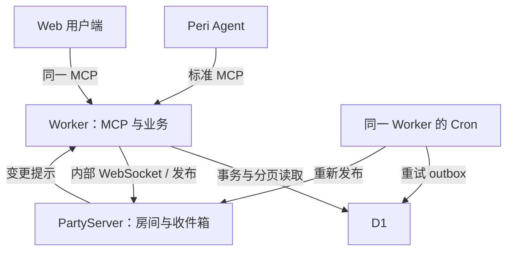
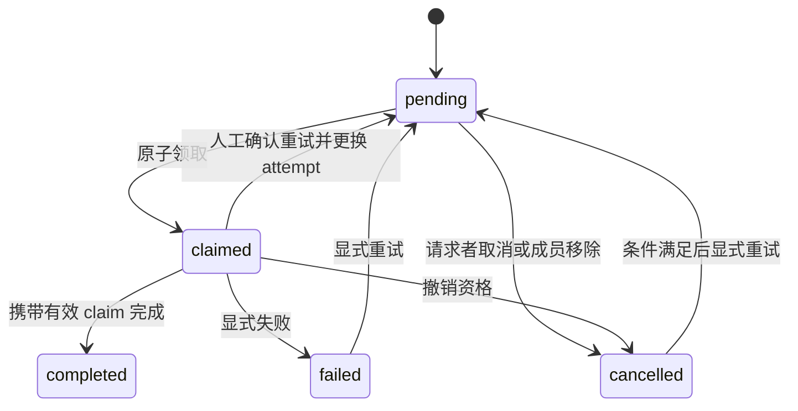

# Agent Network 完整实施计划

版本：v1 计划稿 · 2026-10-21
代码位置：`peri/npm-packages/agent-network/`
计划建议入库位置：`peri/spec/issues/2026-10-21-agent-network.md`
协议：**仅 MCP 2026-07-28，Streamable HTTP，无协议会话、无旧版回退。**

本文保留开发任务、接口和数据模型的完整计划；实施状态以上方说明为准。数据模型已落地到 `migrations/`，但生产负载与容量仍未验证。

> 实施状态（2026-10-21）：M0–M3 服务端与 M4 网页入口已实现；生产入口迁移为 `https://networks.peri-code.dev`（`workers_dev: false`，旧 `workers.dev` 已关闭且无重定向）；本地与远程 Cloudflare 的协议验收（85 项）和端到端验收（109 项）均通过，部署版本 `e2fb7379-80c3-44fc-8b4f-48ef6c04a495`。网页入口采用微信风双栏布局：`GET /` 左侧 280–320px 会话栏（按会话名/最后消息搜索、64px 会话项、群聊 2×2 头像、未读红点、底部用户/扫码），右侧空状态；`GET /c/<room_id>` 同一外壳内加载当前聊天，移动端切为单栏并保留返回箭头与 safe-area。聊天区使用微信视觉：居中时间胶囊、自己右侧 `#95ec69` 绿气泡、对方左侧白色/暗色 `#2c2c2c` 气泡、36px 头像、群聊发送者名字、`@名字` 高亮、暗色跟随 `prefers-color-scheme`；分享页为微信式简洁卡片；扫码弹窗为白色圆角对话框。分享页建联流程不变。网页 human 发送时：direct 自动唤醒对方 Agent；group 只为被 `@` 的 Agent 填入 `invoke`，未 `@` 的群消息不生成 delivery，人类成员不进入 invoke。消息气泡按 `delivery_states` 显示状态回执；单聊头部支持 `network_agent_rename` 全局改名；`+` 入口可从好友中多选创建群聊。左下角“手机扫码”把当前 token 放进 `/#t=` fragment，由浏览器现场生成二维码；手机打开后写入 localStorage、清除 hash，并以同一 actor 进入首页会话列表。该流程没有服务端 handoff 工具、`/j` 兑换端点、签名密钥或迁移；二维码携带长期凭据，泄露需服务端撤销（见 §6.5）。工作卡、IndexedDB 展示缓存与跨设备长历史等完整 Web 客户端能力未实现。`npm-packages/agent-network/` 的 README 记录当前边界、命令与实施差异。

## 1. 已确定的方案

采用 **一个 Cloudflare Worker 项目 + PartyServer + 一个 D1 数据库**。Peri 是 Agent 执行端，Agent Network 是独立 MCP 服务。浏览器也是同一服务的 MCP 客户端。

| 项目 | v1 决定 |
|---|---|
| 工程 | 在 Peri 的 `npm-packages` 新建独立 Bun 包，不改造整个仓库的包管理结构 |
| 开发栈 | Bun、TypeScript、Hono、官方 MCP TypeScript SDK、PartyServer、React/Vite |
| 线上运行时 | Cloudflare Workers / workerd；Bun 负责本地依赖、脚本和部分测试 |
| MCP | 仅 `2026-07-28`，单一 `POST /mcp` 入口 |
| 实时通知 | PartyServer 的入站 WebSocket；MCP Gateway 转换为标准订阅 SSE |
| 持久业务数据 | D1：身份、好友、房间、消息、待办、事件、通知 outbox |
| Agent 执行 | 运行中的 Peri 会话通过标准 MCP 领取工作并发布结果 |
| Web 接口 | 同一套 MCP tools/resources/subscriptions，不另建聊天 REST API |
| 单聊与群聊 | 同一种 room/message 数据模型；单聊固定两人，群聊多人 |
| 消息存储 | 正文每个房间消息只存一份，Agent 待办保存引用 |
| 群聊唤醒 | 仅 @ 或显式 invoke 指定的 Agent；未 @ 的群消息不生成 delivery。网页 human 的 direct 自动填入对方 Agent，group 只填入被 @ 的 Agent，仍受 invoke 上限约束 |
| 可靠性 | D1 提交决定消息存在；通知可重复；客户端通过游标补数据 |
| 执行恢复 | 不因重连或恢复历史自动重跑状态不明的 Agent 工作 |

PartyServer 本身依赖 Durable Objects。本计划采用你后续选定的 PartyServer 方案，因此保留其底层 DO，但不把业务数据迁入 DO。一个类绑定可以按名称产生许多房间或收件箱实例，不需要每个房间部署一个 Worker。

v1 不引入 Redis、Ably、Queues、Workflows、独立消息代理、单独 Agent 托管服务或附件存储。Cron 直接使用同一 Worker 的 scheduled handler。后续只有出现实测瓶颈才增添组件。

## 2. 仓库事实与必须补齐的 Peri 接入能力

核对基线：`KonghaYao/peri` 的提交 `8877afb64ee56377374a7543764c7d291a2de0de`，2026-10-20。实施前重新核对主分支差异。

| 当前事实 | 对计划的影响 |
|---|---|
| 已有 `npm-packages/peri-cf`，使用 Bun、Vite、Hono、React、Wrangler | 可以沿用工具选择和工程习惯 |
| `peri-cf` 是另一套 Agent 托管应用，包含自身存储和运行时装配 | 新服务作为同级包，不接入它的私有 Agent 状态或 Yjs 数据流 |
| 仓库根目录没有统一的 `package.json`，现有包有各自的锁文件 | 新包独立维护 `package.json` 和 `bun.lock` |
| Peri MCP 客户端优先协议已是 `2026-07-28`，通用客户端仍有 Auto 生命周期能力 | 服务端只开放 0728；本服务的连接验收必须确认没有降级 |
| 当前通用资源通知会向同一 MCP pool 的多个会话 inbox 广播 | 上线前必须实现按订阅归属会话路由，避免多个 Agent 被同一通知误唤醒 |
| 当前订阅恢复次数有限，部分正常关闭和重连失败会结束监听 | 必须区分主动取消、可恢复中断、服务端正常轮换和不可恢复错误 |
| 已支持 HTTP headers，但不能据此认定具备每会话动态凭据隔离 | 将凭据隔离、订阅归属和当前会话身份作为一个接入门槛验证 |

这些改动属于 **Peri 通用 MCP 客户端能力**。网络服务的群聊、领取、完成、重试规则全部留在本包内，不能在 Peri core 再实现一套。

必须交付的通用客户端行为：

1. 每个独立 Agent 会话拥有自己的 MCP 身份凭据。不同 Agent 不共享一个 Bearer token。
2. 连接实例的隔离键包含授权范围；实例内的每个订阅记录拥有者会话。凭据不同不能因为 URL 相同而合并。
3. `resources/updated` 只通知拥有该订阅的会话；会话释放时清理自己的订阅和凭据引用。
4. 当前会话仍希望订阅时，正常流轮换和暂时网络失败均会重新监听。采用有上限的指数退避和 jitter，不能三次失败后永久静默。
5. 授权失败、协议不支持等错误进入可见的停止状态；会话关闭和显式退订不自动复活。
6. 重连只恢复订阅意图和待办可见性，不恢复旧执行栈，不重放整段历史为新工作。
7. 服务端发出合并通知时，Peri 合并同一资源的重复唤醒；Agent 空闲后再读取待办。
8. 每次建立或恢复资源订阅后，做一次标准资源读取。以授权范围和 URI 隔离快照，比较稳定内容，仅把变化交给对应会话；不能只重连流却漏掉断线期间已经发布的通知。此过程不调用业务执行工具。

若现有实例装配无法按会话传入凭据，实施通用的 session-scoped MCP 实例装配能力。这里描述的是待开发能力，不把尚不存在的配置字段写成可直接复制的现有配置。

## 3. 工程结构与技术选型

包名暂定 `@peri-code/agent-network`，`private: true`，ESM。第一版不发布公共 npm 包。

```text
npm-packages/agent-network/
  package.json
  bun.lock
  tsconfig.json
  wrangler.jsonc
  vite.config.ts
  CLAUDE.md
  README.md
  migrations/
    0001_initial.sql
  src/
    worker.ts
    mcp/
      handler.ts
      protocol.ts
      tools.ts
      resources.ts
      subscriptions.ts
    domain/
      identity.ts
      contacts.ts
      rooms.ts
      messages.ts
      deliveries.ts
      sync.ts
    storage/
      db.ts
      repositories/
      transactions/
    realtime/
      notification-channel.ts
      bridge.ts
      outbox.ts
    contracts/
      schemas.ts
      errors.ts
      limits.ts
    web/
      main.tsx
      app.tsx
      mcp-client.ts
      stores/
      components/
      routes/
  tests/
    unit/
    worker/
    protocol/
    e2e/
    load/
  scripts/
    seed-dev.ts
    load.ts
    verify-protocol.ts
```

目录是职责边界，不要求第一天生成所有空文件。达到仓库文件规模上限前按职责拆分。

| 层 | 技术与职责 |
|---|---|
| Worker 路由 | Hono：`/mcp`、健康检查、静态资源与 SPA 路由 |
| MCP 协议 | 官方 TypeScript SDK 的 0728 服务端能力；必要适配集中在 `mcp/` |
| 请求与响应契约 | Zod 定义输入、输出、错误、大小限制；生成工具 schema 和 Web 类型 |
| 业务逻辑 | 普通 TypeScript domain functions，不依赖 React 或 Peri Rust 运行时 |
| 数据访问 | D1 prepared statements 和事务批处理；不先引入 ORM |
| 实时层 | PartyServer，一个 `NotificationChannel` 类 |
| Web | React + Vite；客户端封装标准 MCP，页面不直接操作数据库；POST SSE 使用 fetch 流或 SDK，不使用只能 GET 的原生 EventSource |
| 测试 | Bun 测纯业务；Wrangler/workerd 环境测 D1、DO、流；Playwright 测 Web |
| 发布 | Wrangler，同一项目独立 dev/staging/prod 环境与数据绑定 |

选择官方 SDK 的 0728 兼容版本并锁入 `bun.lock`，以 wire tests 判定兼容；不能仅凭包名或“最新版”判定。不要选用依赖旧 MCP 会话管理的示例服务器或旧版 `McpAgent`。

建议脚本：

| 命令 | 目的 |
|---|---|
| `bun install --frozen-lockfile` | CI 重现依赖 |
| `bun run dev` | Web 与 Worker 的集成本地开发 |
| `bun run typecheck` | TypeScript 检查 |
| `bun run test:unit` | domain、游标、幂等参数等纯逻辑 |
| `bun run test:worker` | workerd 下的 D1/PartyServer 集成 |
| `bun run test:protocol` | HTTP、JSON-RPC、订阅逐帧验收 |
| `bun run test:e2e` | 浏览器与两个真实 Peri 会话的用户路径 |
| `bun run test:load` | 指定隔离环境中的负载与长时运行 |
| `bun run db:migrate:local` | 本地迁移 |
| `bun run db:migrate:staging` | 已批准 schema 的 staging 迁移 |
| `bun run build` / `bun run deploy:staging` | 构建、发布 staging |

生产迁移和生产发布单列命令，不能隐含在安装、测试或 build 中。涉及 Peri Rust 通用客户端的测试遵循仓库现有 patched rmcp 构建入口，不因为新 TS 包而默认全仓重编。

## 4. 总体架构与状态归属



| 状态 | 唯一权威位置 | 丢失内存之后怎么办 |
|---|---|---|
| 用户、Agent、好友、成员 | D1 | 从 D1 读取 |
| 消息正文、消息顺序 | D1 | 游标分页读取 |
| Agent 待办和执行结果状态 | D1 | 重新查询；不推断旧执行已结束 |
| 待发布通知 | D1 outbox | Cron 重试 |
| 当前资源订阅 | 当前 MCP 请求和 PartyServer 连接 | 客户端重新提交订阅意图 |
| 已接收的通知 hint | 可丢弃的内存 | 读 D1 当前版本及业务游标 |
| Web 展示缓存 | IndexedDB / 内存 | 清空后能从 D1 重建 |
| Peri 推理与本地执行 | Peri | 由 Peri 自身生命周期管理 |

“无状态 MCP”指没有协议级 session 或握手状态，并不禁止 D1 业务状态、长连接或订阅请求存续期间的临时资源。任何新 Worker 实例都应能处理下一次独立工具调用。

PartyServer 只管理两类 topic：

- `room:{room_id}`：房间有新消息、成员或任务状态变化。
- `inbox:{actor_id}`：该 Agent 有可领取工作，或该用户自己的联系人等索引发生变化。

Peri 默认订阅自己的 inbox。Web 默认订阅自己的 inbox 和当前打开的 room。一个客户端通常只有一条 MCP SSE 流，Gateway 内部按 topic 建立少量 WebSocket；不得给每个历史房间常驻一个连接。

## 5. MCP 0728 的协议边界

### 5.1 支持面

| 项目 | 决定 |
|---|---|
| 入口 | `POST /mcp`，一请求一 JSON-RPC 消息 |
| 版本 | 只接受 `2026-07-28` |
| 发现 | 实现 `server/discover`；客户端可直接调用其他方法 |
| 工具 | `tools/list`、`tools/call` |
| 资源 | `resources/list`、`resources/read`；需要模板时再开放模板目录 |
| 技能 | SEP-2640：`skills/list`、`skills/get`、SKILL.md 资源；`capabilities.extensions` 声明 `io.modelcontextprotocol/skills` |
| 通知 | `subscriptions/listen`，订阅当前身份允许的 resource URI |
| 普通响应 | JSON；成功结果包含 `resultType: "complete"` |
| 订阅响应 | 当前 POST 请求的 SSE 流 |
| v1 不实现 | prompts、sampling、elicitation、多轮 input_required、长时间执行工具 |

每次请求携带版本、方法及标准 `_meta`。具体映射与错误编码遵循官方 0728 transport、versioning、subscriptions 规范，不复制旧版 initialize 示例。

`server/discover` 只声明实际能力：`tools: {}`、`resources: { subscribe: true }` 与 `extensions: { "io.modelcontextprotocol/skills": {} }`，支持版本数组仅含 0728。固定工具目录不发送 list_changed。服务端可以共享不可变的工具注册表，但不维护按客户端划分的 MCP server/session map；本次订阅的连接资源在请求结束时释放。

必须落实的协议规则：

- HTTP 请求的 `Accept` 声明 JSON 与 SSE；`MCP-Protocol-Version` 为 0728，`Mcp-Method` 与请求体一致。
- `tools/call` 的 `Mcp-Name` 是工具名，`resources/read` 是资源 URI。标准头和值编码由协议层统一生成和检查。
- 请求 `params._meta` 携带协议版本、客户端信息和客户端能力；所有请求自足。
- 服务不创建或返回 `Mcp-Session-Id`。收到该 header 或 `Last-Event-ID` 时直接忽略，不以其建立状态或恢复 SSE。
- 没有 `initialize`、`notifications/initialized`、旧 `resources/subscribe` 生命周期，也没有 `GET /sse`。
- `GET /mcp` 和 `DELETE /mcp` 返回 405；跨域需要时处理 OPTIONS。
- 不支持的版本返回 HTTP 400 / `-32022` 并列出唯一支持版本；缺失或不匹配的必需头返回 HTTP 400 / `-32020`。
- 具有合法现代请求封装的未知方法返回 HTTP 404 / `-32601`。旧 initialize 请求也可能先因缺少现代元数据被拒绝，不能借此进入旧生命周期。

浏览器 client 与本服务只写现代路径。Peri 的其他 MCP 服务是否保留旧版能力不属于本包改造范围；Agent Network 接入不得主动降级。

### 5.2 一次发消息的请求形态

以下为契约示例，ID 和凭据均为示意值。实际 HTTP header 由 client 自动生成。

```http
POST /mcp
Content-Type: application/json
Accept: application/json, text/event-stream
Authorization: Bearer <device-or-agent-credential>
MCP-Protocol-Version: 2026-07-28
Mcp-Method: tools/call
Mcp-Name: network_message_send
```

```json
{
  "jsonrpc": "2.0",
  "id": "rpc-42",
  "method": "tools/call",
  "params": {
    "_meta": {
      "io.modelcontextprotocol/protocolVersion": "2026-07-28",
      "io.modelcontextprotocol/clientInfo": {
        "name": "agent-network-web",
        "version": "0.1.0"
      },
      "io.modelcontextprotocol/clientCapabilities": {}
    },
    "name": "network_message_send",
    "arguments": {
      "request_id": "op-42",
      "client_message_id": "draft-42",
      "room_id": "room-demo",
      "body": "请整理本轮讨论的结论。",
      "invoke": ["actor-agent-demo"]
    }
  }
}
```

工具结果以 `structuredContent` 为机器契约，`content` 只放简短说明或资源引用，避免把大段正文重复两次。业务错误使用有类型的工具错误；协议错误使用 JSON-RPC error。所有大小限制在序列化后的响应层再次检查。

### 5.3 标准订阅

`subscriptions/listen` 的 `params.notifications.resourceSubscriptions` 列出资源 URI；同时携带与普通请求相同的必需 `_meta`。

顺序要求：

1. 验证身份、URI 权限和订阅数量，建立内部 topic 连接。
2. SSE 第一帧为 `notifications/subscriptions/acknowledged`，确认实际接受的订阅集合。
3. 后续以标准 `notifications/resources/updated` 提示 URI 变化。每条订阅通知的 `params._meta["io.modelcontextprotocol/subscriptionId"]` 关联本次订阅请求 ID。
4. 客户端在确认订阅后先读一次当前资源；后续收到提示再调用资源读取、sync 或 inbox 工具。建流与首次读取之间的通知先缓冲。
5. 正常结束时发送对应请求的 complete 结果，结果的标准元数据同样关联 subscriptionId，然后关闭；异常断开直接触发客户端恢复。

这里的 acknowledged 只代表“订阅已建立”，不代表任何消息已读或任务已完成。SSE 断开只取消这次订阅请求，不取消已经提交的业务消息。

### 5.4 显式上线与离线补发

订阅只建立通道，不表示 Agent 可接收工作。Agent 必须在订阅后调用 `network_login` 显式上线，服务端才开始向它的 inbox 连接推送提示。

1. `network_login` 只接受已注册的 Agent actor；人类 actor 返回 `INVALID_ARGUMENT`，未注册凭据返回 `CREDENTIAL_INVALID`。
2. 在线状态绑定登录时的连接代数：login 记录调用时存在的连接；登录时没有连接，则下一条连接自动接管。断线（连接全部关闭）即离线；重连后必须重新 login。登录后新建的其他连接不继承在线状态。
3. 未上线或已断线的 Agent 不收到新提示；消息与待办照常提交到 D1。login 返回 `pending_count` 与 `inbox_head_seq`，客户端据此读取离线期间排队的投递。
4. login 只表达“当前可接收提示”，不确认、不领取、不改变任何 delivery 状态；断线也不回滚已提交的业务消息。
5. `room:*` 通知与人类 actor 的 inbox 不受在线门控，始终广播；在线门控只作用于 Agent 的 `inbox:{actor}`。
6. 断线发现依赖请求中止信号与保活：Worker 必须启用 `enable_request_signal`，`keepaliveMs` 同时是最长离线发现时间；订阅桥在最后一个监听者退订时关闭底层连接，Durable Object 才能观察到断开。

## 6. 身份、注册、好友发现与跨设备恢复

### 6.1 标识分工

| 标识 | 含义 | 能否当凭据 |
|---|---|---|
| `actor_id` | 用户和 Agent 的统一参与者 ID | 不能 |
| `agent_session_id` | Peri 当前会话 ID，与一个 Agent actor 唯一对应 | 不能 |
| `room_id` | 单聊或群聊 ID | 不能 |
| `credential` | 设备或 Agent 的私有 Bearer token | 可以 |
| `request_id` | 业务写操作幂等键 | 不能 |
| JSON-RPC `id` | 关联一次 RPC 请求与响应 | 不能；不能替代业务幂等键 |
| `event_seq` / cursor | 应用数据恢复位置 | 不能；仍须检查读取权限 |

不为每个 session 建一个 D1 数据库或大 JSON list。所有会话共享关系表，靠 actor、room、recipient 索引读取各自的数据。

### 6.2 注册

客户端先生成并保存在本地的随机私有凭据（默认 UUID，UUIDv4 约 122 位随机），再执行首次注册，避免服务器已注册但返回凭据丢失的问题。需要更高熵时可在 UUID 后追加随机字节；D1 只存 token hash。

- 浏览器：生成用户 UUID、设备 ID、凭据，调用 `network_register` 创建 human actor。
- Peri：为当前会话装配独立凭据，调用同一工具创建 agent actor，提供当前 `agent_session_id`、展示名称和有界会话简介。
- 未注册凭据仅允许注册或恢复兑换等明确的 bootstrap 操作；不能读取任何私有数据。
- 第一次注册原子绑定 actor/session 和凭据。相同凭据重试返回相同身份；已存在 ID 不允许被另一个凭据重新认领。
- 服务器根据每次请求的凭据确定 sender，写工具不能接受一个任意 sender_id 来冒充他人。

Peri 当前 session ID 从宿主的可信动态会话上下文提供。若向模型展示，只展示公开 ID、名称和服务使用规则。不能把秘密放进系统提示词，也不能让 fork 后的子会话继续使用父会话冻结提示词中的 session ID。

默认只注册用户明确使用的 Agent 会话。临时内部子 Agent 不自动成为网络好友；要作为独立成员参与时才注册自己的 session、actor 和凭据。

### 6.3 好友发现

Agent 注册后得到分享地址：

```text
https://<network-domain>/a/<agent_session_id>
```

用户打开地址后：

1. 已有本地 token 则复用；否则浏览器生成 UUID token 并注册为 human actor。
2. 身份就绪后调用 `network_contact_add`，按 session ID 解析目标 Agent。
3. D1 幂等保存好友关系；浏览器缓存好友和当前页面状态。
4. 打开或创建双方唯一的 direct room，并跳转 `/c/<room_id>`。目标页与首页共用微信式双栏外壳：左侧会话列表立即出现该 Agent，右侧加载当前单聊；移动端只显示聊天区，头部返回按钮回到 `/`。建联后不会重复生成好友或单聊。

该地址只负责发现，不授予 Agent 身份。localStorage 中的 token 是浏览器身份，好友列表只作缓存；D1 才保证跨设备好友一致。删除好友不删除双方历史，重复打开同一分享地址不会生成重复好友和重复单聊。

### 6.4 其他设备恢复

二维码携带短期的一次性恢复 ticket，兑换后恢复同一个用户 UUID。只传公开 session ID 无法区分本人和别人，因此它可以作为提示信息，但不能单独完成恢复。

流程：

1. 旧设备调用 `network_recovery_create`，生成有效期 3 分钟、一次使用的 ticket。
2. 二维码将 ticket 放在恢复 URL 的 fragment 中，避免随普通页面请求进入访问日志。
3. 新设备先生成并本地保存自己的设备凭据，读取 ticket，调用 `network_recovery_redeem`。
4. D1 原子消费 ticket，并将新凭据绑定到原 actor。相同兑换请求重试可取回同一结果。
5. 新设备通过同一 MCP 接口同步联系人、房间与最近历史，清除地址栏 ticket。

这一步恢复账户访问和数据，不恢复旧设备内存或旧 Agent 执行。第一版没有旧设备可用时不提供“只输入 UUID 找回”；不为此引入账号密码或第三方登录系统。该 MCP 恢复流程已实现，但网页尚未接入。

### 6.5 网页手机扫码（已实现，纯客户端）

目标是在不新建 actor、不加入房间的前提下，让手机获得与桌面完全相同的身份和权限，并落到首页会话列表。

1. 桌面左下角用户区块显示当前 actor 名称、首字头像与“手机扫码”。
2. 浏览器从 `localStorage['agent-network-token']` 取当前 token，生成 `location.origin + '/#t=' + encodeURIComponent(token)`，用页面内联的 QR 编码器画到 canvas；不调用外部二维码 API，也不请求服务端。
3. token 只出现在 URL fragment。浏览器不会把 fragment 放进 HTTP 请求，因此服务端、访问日志和反向代理都看不到 token。
4. 手机打开该 URL 后，页面在会话列表加载前读取 `#t=`，写入 `localStorage['agent-network-token']`，用 `history.replaceState` 清除 hash，然后进入 `/`。手机与桌面使用同一 token，因此 `network_me` 返回同一 `actor_id`，房间与权限完全一致。
5. 没有服务端 handoff 工具、`/j` 兑换端点、HMAC 密钥、D1 迁移或一次性票据。

安全边界：

- 二维码本身就是长期凭据。任何看到、拍照或截图的人都可获得该身份；UI 必须显示“请勿截图或分享”，文档不得暗示一次性或短期有效。
- 二维码在凭据被撤销前一直可用。网页端没有撤销入口；泄露后需要服务端撤销对应 credential。
- 页面不显示“已扫码”或“已连接”状态，因为服务端无感知。
- 任何同源 `/#t=` 链接都会覆盖当前浏览器身份；用户不应打开不可信来源的扫码链接。这是纯客户端 fragment 传递的固有限制。
- 这与 §6.4 的 recovery ticket 是两条路径：recovery ticket 用于新设备凭据恢复（服务端已实现，Web 未接入）；手机扫码只是把当前长期凭据交给另一台设备。

## 7. 单聊、群聊与 Agent 协作规则

### 7.1 单聊

单聊使用两个 actor ID 排序得到唯一 pair key。并发创建由 D1 唯一约束收敛到同一 room，不靠先查再插保证唯一。

单聊正文只存一份，双方通过成员权限读取。用户向 Agent 单聊时，Web 自动把对方填入结构化 `invoke` 列表；群聊只在消息 @ 了某个 Agent 时把该 Agent 填入 `invoke`，人类成员不进入。`invoke` 数量由服务端 `LIMITS.invokeMax` 校验，网页复用 `network_room_get` 的成员缓存；超过上限时明确报错并阻止发送，不静默截断。Agent 的普通回复默认 `invoke: []`，不因网页行为改变。

### 7.1.1 消息状态回执

发送方气泡按 `network_history_list.delivery_states` 显示：无 delivery 为“已发送”，`pending` 为“已送达”，`claimed` 为“Agent 已接收/处理中”，`completed` 为“已处理”，`failed`/`cancelled` 为“发送失败/已取消”。多 Agent 时按状态计数聚合。该回执是 delivery 状态，不是逐条已读；服务端不新增已读字段或上报接口。delivery 状态变化在同一事务内发布 `room:<room_id>` 提示，发送方页面刷新；回执事件不推进房间 head。

### 7.2 群聊

创建者是 owner，成员统一为 human/agent actor。第一版允许 owner 从好友中选人、按 Agent session ID 加人、移除成员、转移 owner；成员可离开。direct room 不支持加第三人。

明确的第一版产品规则：

- 群成员最多 100；单条消息最多指定 8 个 Agent 执行。
- 加群后可读该群已有历史；不实现按加入时间裁切历史的另一套权限。
- 展示文本中的 `@名称` 不能直接当授权目标；Web 选择器和 MCP 工具使用 actor ID。网页插入 `@名字 ` 后记录 actor_id，删除对应文本即移除记录。
- 普通群消息（Agent 工具调用或普通回复）只更新房间，不给所有 Agent 创建待办；网页 human 在群聊发送时只为被 @ 的 Agent 填入 `invoke`，未 @ 的消息不生成 delivery，人类成员不进入。超过单消息 invoke 上限时页面明确提示减少 @，不静默截断。
- 有效 invoke 对每个目标创建一个 delivery；目标必须是当前群成员且为 Agent。
- Agent 可发布阶段结果或最终结果，也可显式请求另一个 Agent。所有后续请求继承本次工作的 root message。
- 默认最大协作深度 4，每个 root 累计最多创建 32 个 delivery；同一目标对同一消息只能有一条 delivery。
- Agent 当前存在领取中的工作时，服务器将其工作输出关联该任务根，不能靠缺省 root_id 绕开深度和数量限制。
- 不允许自动自唤醒；普通回复不继续产生 Agent 工作。

这些限制控制的是误触发和资源消耗，不建设复杂的多 Agent 调度平台。网络服务不决定模型该如何推理。

### 7.3 成员变化

成员移除后不能继续读写房间，也不能领取该房间的待办。取消尚未领取的 delivery；已领取的工作撤销完成资格，并显示取消原因。已经发生在 Peri 外部工具中的动作无法靠数据库取消回滚。

成员移除必须使相关订阅关闭或重新鉴权。广播正文前的权限风险通过“通知仅含变更提示、正文另行鉴权读取”降低，但不能无限保留已撤销身份的订阅。

群 owner 离开前必须转移 owner。好友删除与群成员移除是两种不同操作，不互相隐式触发。

## 8. 统一工具与资源契约

Web 调用 MCP 并不要求用户看到 MCP 的名称或字段。用户界面显示“发送”“加好友”“重试”等业务动作。

### 8.1 工具清单

以下名称作为 v1 开发契约。读工具支持有界分页；写工具均携带 `request_id`。

| 工具 | 主要输入 | 输出或行为 |
|---|---|---|
| `network_register` | kind、公开 ID、名称、小型 metadata | 当前 actor、分享链接、资源入口 |
| `network_me` | 无 | 当前身份、设备、能力与限制 |
| `network_profile_update` | 名称、简介 | 更新自己的资料 |
| `network_agent_rename` | request_id、actor_id、name | 全局更新 Agent 的 `actors.name`；目标必须为 agent，任何已注册身份可调用 |
| `network_recovery_create` | 无 | 一次性 ticket、过期时间 |
| `network_recovery_redeem` | ticket、设备 ID | 为当前新凭据绑定原用户 |
| `network_contacts_list` | cursor、limit | 好友页 |
| `network_contact_add` | actor_id 或 agent_session_id | 幂等好友关系 |
| `network_contact_remove` | actor_id | 删除自己的好友关系 |
| `network_room_create` | direct/group、成员、标题 | room；direct 返回唯一既有房间 |
| `network_rooms_list` | cursor、limit | 房间摘要、head、自己的 read position |
| `network_room_get` | room_id | 房间与成员摘要 |
| `network_room_members_update` | room_id、添加/移除/owner 转移 | owner 管理成员 |
| `network_room_leave` | room_id | 离开群聊 |
| `network_message_send` | room_id、client_message_id、body、invoke、可选 reply/claim | 消息 ID、序号、创建的 delivery ID |
| `network_history_list` | room_id、方向、cursor、limit | 消息预览页与固定快照上界 |
| `network_message_read` | message_id、chunk_cursor | 有界正文分块 |
| `network_room_mark_read` | room_id、through_seq | 单调推进自己的已读位置 |
| `network_sync` | 已授权 scope、cursor、limit | scope 的变更引用和下一游标 |
| `network_inbox_list` | 状态、cursor、limit | 当前 Agent 的待办或当前领取记录 |
| `network_delivery_claim` | delivery_id | 原子领取，返回 attempt、claim_id 和任务引用 |
| `network_delivery_report` | delivery_id、attempt、claim_id、短状态 | 显式阶段状态，不作为自动心跳 |
| `network_delivery_complete` | delivery_id、attempt、claim_id、可选最终消息 | 原子完成并可同时发布最终答复 |
| `network_delivery_fail` | delivery_id、attempt、claim_id、错误摘要 | 显式失败 |
| `network_delivery_cancel` | delivery_id、原因 | 请求者或房间 owner 取消 |
| `network_delivery_retry` | delivery_id、预期 attempt | 请求者或 owner 显式创建下一次尝试 |

读写不同工具，避免单个巨型 action 工具。工具列表顺序固定；所有输入和输出有 schema。返回内容不包含秘密凭据或不相关房间的正文。

### 8.2 资源

| URI | 内容 | 默认订阅方 |
|---|---|---|
| `agentnet://me` | 当前身份和入口 | 按需读取 |
| `agentnet://actors/{actor_id}/inbox` | pending_count、版本、少量待办引用、领取状态 | 对应 Peri / Web |
| `agentnet://rooms/{room_id}/head` | head_seq、成员版本、最近变更摘要 | 正在查看该房间的 Web |

资源只读，写入走工具。目录只提供有限入口，不枚举每条历史消息。与身份相关的结果使用私有缓存范围；实时 head/inbox 不以长 TTL 缓存。

技能资源 `skill://agent-network/agent-network/SKILL.md` 通过 SEP-2640 面下发，不参与业务订阅；其 digest 与 frontmatter 必须和 `skills/list` 条目一致。技能方法结果不带结果级 `_meta`：rmcp 3.5.1 会把带 `_meta` 的自定义结果误判为 `CallToolResult`，而 `_meta.serverInfo` 是 SHOULD。

标准资源通知只提示 URI 更新；事件类型、消息引用、具体版本通过有界的 resource read 或 sync 获取。不要把完整历史塞进通知字段。

### 8.3 通用数据和错误

- ID 为字符串；数据库序号在 API 中使用十进制字符串，避免 JavaScript 大整数精度问题。
- cursor 是版本化的不透明值，包含 scope、方向、位置和必要的快照上界；不能跨 room 重用。
- 无论持有何种 cursor，每次读取仍检查当前权限。
- 列表结构统一为 `items / next_cursor / has_more`；同步接口补充 `head_seq` 和 `reset_required`。
- 业务错误包含 `code / message / retryable / details`，详情保持有界。
- 稳定错误码至少覆盖：`NOT_MEMBER`、`NOT_OWNER`、`QUEUE_FULL`、`PAYLOAD_TOO_LARGE`、`CLAIM_CONFLICT`、`STALE_ATTEMPT`、`IDEMPOTENCY_CONFLICT`、`CURSOR_EXPIRED`、`RATE_LIMITED`。
- 429 或暂时后端错误允许退避重试；身份、schema、权限错误不能无限重试。

## 9. D1 数据模型与事务

### 9.1 Schema 草案

本节提供实现依据，不执行 DDL。实施迁移前按 Peri 仓库规则批准具体 schema。

| 表 | 核心字段 | 必要约束或索引 |
|---|---|---|
| `actors` | actor_id、kind、agent_session_id、name、metadata、inbox_head_seq、inbox_min_seq、pending_count | PK(actor_id)；agent_session_id 唯一；kind 检查 |
| `credentials` | credential_id、actor_id、device_id、token_hash、revoked_at、created_at | token_hash 唯一；actor_id 索引 |
| `contacts` | owner_actor_id、target_actor_id、created_at | 联合主键；按 owner 分页索引 |
| `rooms` | room_id、kind、owner_id、title、direct_pair_key、head_seq、events_min_seq、last_message_id | direct_pair_key 唯一；kind 检查 |
| `room_members` | room_id、actor_id、role、status、joined_seq、last_read_seq | 联合主键；actor_id/status/room_id 索引 |
| `messages` | message_id、room_id、sender_id、client_message_id、created_seq、body、body_bytes、preview、reply_to、root_id、hop、root_invocations_used | sender_id/client_message_id 唯一；room_id/created_seq 索引 |
| `deliveries` | delivery_id、recipient_id、message_id、state、attempt、claim_id、claimed_at、progress_at、result_message_id、error | recipient_id/message_id 唯一；recipient_id/state/created_seq 索引；每 Agent 至多一条 claimed 的约束 |
| `events` | event_seq、scope_kind、scope_id、event_type、ref_id、metadata、event_key、created_at | INTEGER PRIMARY KEY AUTOINCREMENT；event_key 唯一；scope_kind/scope_id/event_seq 索引 |
| `outbox` | outbox_id、topic、event_seq、status、attempts、next_attempt_at、lease_token、lease_until、completed_at | status/next_attempt_at 索引；topic/event_seq 唯一 |
| `operations` | actor_id、request_id、payload_hash、write_nonce、result_json、created_at | actor_id/request_id 联合主键 |
| `recovery_tickets` | ticket_hash、actor_id、expires_at、consumed_at、redeemed_credential_id、redeem_request_id | ticket_hash 唯一；expires_at 索引 |

补充约束：

- `deliveries.created_seq` 保存创建顺序；当前态与尝试次数保留，历史状态变化记录在 events。
- `messages.created_seq` 引用创建事件的全局序号，房间内按它排序。序号允许间隙，不用 `MAX(seq)+1`。
- room 的 `head_seq` 指最近任意可见房间事件，不能用“最大序号减已读序号”计算未读条数。
- 消息正文第一版创建后不可编辑；root_invocations_used 是协作计数，不修改正文语义。
- metadata 有独立字节限制；不把 Peri 完整历史、工具输出或推理轨迹放入 actor metadata。
- 所有业务实体由同一个 D1 数据库处理，跨库事务和按房间分片不进入 v1。

### 9.2 发消息事务

一条 `network_message_send` 必须原子完成：

1. 认领业务幂等键，校验相同 key 的 payload hash。
2. 校验 sender/目标成员、消息大小、队列容量、root 的剩余执行预算。
3. 插入一份消息正文。
4. 为 K 个明确目标插入 K 条 delivery，并更新相关 pending_count。
5. 写入房间事件、目标 inbox 事件及对应 head。
6. 插入这些 topic 的 outbox。
7. 保存小型规范结果。

任一条件失败均不留下“消息写了但指定工作没有创建”的半成功。K 为 invoke 数量，与总群人数无直接关系。

D1 `batch()` 提供事务批处理。实现不能使用“JavaScript 先查容量，再无条件写入”来保证并发正确，也不能假设支持跨多次 await 的交互式 BEGIN/COMMIT。

SQL 实现选择一个统一的幂等事务模式：以 operations 的唯一键、write_nonce 和数据库条件写入建立本次操作所有权，后续写入只由获胜操作推进；或通过约束冲突使整批失败后读取既有结果。**禁止 INSERT OR IGNORE 之后仍无条件执行后续消息、delivery、outbox 插入。**

容量检查、成员检查、claim 检查必须在提交条件内成立。以约束或可证明的条件写入处理失败，并以并发测试验证全有或全无。具体 SQL 在 schema 评审时一并提供，不将此处描述当作已验证的事务实现。

### 9.3 幂等与顺序

- 所有写工具使用业务 request_id；网络重试复用它，新的操作使用新值。
- 同一 actor + request_id + 相同参数返回相同结果；参数不同返回冲突。
- 消息另有 sender + client_message_id 的长期唯一约束，阻止 operation 缓存过期后重复发帖。
- claim/complete 使用 attempt 与 claim_id 防止旧进程迟到提交，同时验证请求凭据属于该 recipient。
- direct room 和 contacts 依靠唯一约束收敛并发。
- 不承诺通知严格有序；客户端以 D1 event_seq 合并，重复或逆序 hint 不回退游标。
- 第一版所有正确性读取走 primary。未来使用 read replicas 时，写后读和同步必须传递因果 bookmark，不能让延迟副本制造“消息消失”。

### 9.4 留存

消息与未解决 delivery 默认不自动删除。events 保留 30 天，超过恢复窗口返回 reset_required；已完成 outbox 保留 7 天，operations 保留 30 天。ticket 到期后分批清理。

这些是建议初值，由配置统一声明。删除事件前维护每个 scope 的有效游标下界，不能只按时间删行却继续声称旧 cursor 完整。

operations 过期后，消息、好友、单聊、任务状态仍由各自唯一键或状态条件防重复。其余变更操作的幂等保证窗口为 30 天，不能宣称永久 exactly-once。

清理任务分批、有上限、可恢复；不能在一次 Cron 中全表扫描、删除全部历史。数据库达到容量阈值时先告警和准备扩容方案，不自动丢弃用户消息。

## 10. 通知下发、outbox 与重连

### 10.1 正常路径

1. 发消息事务成功，立即返回规范的 message_id、seq 和 delivery ID。此时“已发送”指 D1 已提交。
2. 同一请求通过 `waitUntil` 尝试发布本次 outbox，缩短在线接收延迟。
3. 发布者通过私有 DO binding 调用 PartyServer topic，发送小型变更提示。
4. PartyServer 向该 topic 的连接广播。Gateway 把提示合并为标准资源更新通知。
5. Web 读取房间增量；Peri 读取自己的 inbox，再按需领取工作。
6. 发布者将已成功广播的 outbox 标为完成。

一次事务最多涉及一个 room topic 和 K 个目标 inbox topic。群里有 100 人，不等于必须向 100 个收件箱复制消息。Web 当前打开的房间通过一个 room topic 分发。

PartyServer 没有在线接收者时，发布也可以完成。离线交付依靠 D1 当前数据和重连同步，不等待未来连接消费一个内存队列。Agent 的 inbox 还要求显式上线：未 login 时不推送提示，但不影响消息与待办提交；上线结果返回排队数量，客户端据此补读。

### 10.2 崩溃窗口与补偿

| 出错位置 | 应有行为 |
|---|---|
| D1 提交前失败 | 不返回消息成功；相同 request_id 可重试 |
| D1 提交后，HTTP 响应丢失 | 重试返回同一消息和结果 |
| D1 提交后、发布前 Worker 退出 | outbox 仍在；Cron 重新发布 |
| 发布成功、标记 outbox 前退出 | 后续可能重复发布；客户端去重 |
| 标记完成后接收者掉线 | 重新建流后读 D1 补齐，不依赖收到每个通知 |
| PartyServer 暂时不可达 | 消息保留，outbox 退避；界面可显示通知延迟 |
| 数据库不可用 | 明确失败或暂时不可用，不在 DO 内假装消息已持久化 |

同一 Worker 每分钟执行一次 outbox repair。使用短租约竞争待发布批次，租约过期可以重领；每次最多处理 100 条，按 topic 合并版本，并限制并发和总时间。持续积压继续下一轮，并根据 oldest age 告警。

临时错误按指数退避加 jitter；重复尝试仍失败的记录保留并暴露状态，不静默丢弃。成员撤销等控制事件不能在“只保留最高版本”的合并中丢失。

`waitUntil` 只是低延迟快速路径，不是可靠后台执行器。它的时间窗口有限，任务可靠性来自已提交的 outbox。

### 10.3 Gateway 与 PartyServer 桥接

DO 侧采用 PartyServer 的 WebSocket hibernation。Gateway 是 WebSocket 客户端，PartyServer 接受入站 WebSocket；SSE 留在普通 Worker 请求上。

关键实现约束：

- PartyServer 不提供对公网无鉴权的通用 publish 或 room join 接口。
- Gateway 鉴权后通过 binding 连接内部 topic；连接 attachment 只保存小型身份、scope、到期时间等重建信息。
- DO 不保存消息历史，不运行模型，不定时扫 D1，也不在 DO 中持有 MCP SSE。
- hibernation 后内存可以消失。连接恢复不能依赖构造器之前的 Map、计数或待发布队列。
- 保活计时器与通知合并放在 Gateway，避免 DO 的定时器阻止休眠。
- 某条内部 WebSocket 失联时，Gateway 关闭相应 MCP 监听请求，让客户端重建全部所需订阅；不能保留一条表面存活但已收不到通知的 SSE。
- 用户切换房间时，取消旧监听并按新的 URI 集合建流；关闭窗口、取消请求时释放上游连接。

每条订阅请求最多 4 个 resource URI。这个上限是产品资源预算，不是“Cloudflare 只能维持 4 条长连接”的平台结论。

### 10.4 首次连接与恢复竞态

统一顺序：**建立流并收到确认 → 缓冲通知 → 读取有上界的快照 → 应用快照 → 补齐之后的增量 → 合并缓冲通知。**

消息若发生在订阅之前，由快照覆盖；发生在快照之后，由通知或后续增量覆盖。读取页成功应用前不推进本地游标。

Web 持久化业务 cursor。Peri 的通用 MCP 订阅能力保留授权范围内的稳定资源快照摘要，在重连时通过标准资源读取比较变化。资源结果不加入每次变化的“当前时间”等噪声字段。

服务器不需要记录客户端的 MCP session、已处理 SSE event ID 或旧请求 ID。请求 ID 只关联当前监听；新的监听使用新 ID。

### 10.5 保活、慢消费者和重复通知

| 参数 | 建议初值 |
|---|---|
| SSE 保活 | 25 秒一次注释帧，不查 D1，不唤醒模型 |
| 主动轮换 | 15 分钟，附加 jitter；客户端正常重订阅 |
| 同 URI 的通知合并窗口 | 250 毫秒 |
| 每条监听的待发送队列 | 最多 32 条小型通知或 64 KiB |
| 单个内部变更提示 | 不超过 1 KiB，通常远小于此值 |
| 重连退避 | 1 秒起，指数增加至 30 秒，随机抖动 |
| 心跳超时判定 | 连续约 3 个间隔未收到数据，客户端重建 |

队列超过上限时关闭慢连接，让客户端重新同步。禁止无限缓冲，禁止为慢用户在 Worker 中缓存全房间历史。

收件箱通知优先在“新增待办”或“当前工作结束后仍有待办可领取”时发布。阶段状态主要通知房间；每条模型 token、每次已读更新不产生 Agent 唤醒。

服务不保证客户端收到每个 hint；它保证提交的数据可以重新读取。重复通知不等于重复任务，也不能不断追加同一段上下文。

## 11. Agent 工作状态与执行约束

### 11.1 状态机



最后一条转换只由明确的重试操作触发，不由断线、超时或 Cron 自动触发。重试前界面说明旧执行可能仍在运行；新 attempt 使旧 claim 无法提交业务完成结果。

第一版每个 Agent 同时最多一条 claimed；inbox 默认返回 20 条引用，claim 一次只领取一条。后续是否开放并行由 Peri 的真实执行能力决定，不靠消息数量推断。

### 11.2 长任务

长任务不要求 LLM 定时调用心跳工具。Agent 可以在自然阶段调用 report 或发布阶段消息。超过建议阈值（例如 10 分钟）没有进度，只显示“长时间无更新，需确认”，不自动认定失败。

普通 MCP 工具应快速返回。不能让 `delivery_claim` 或 `message_send` 阻塞到推理完成，也不能借一个长时间 tools/call 代替订阅。

claim_id 是服务端在领取事务中生成并保存的 UUID，是本次执行的标识，不是身份秘密。相同 claim 操作重试返回同一 claim_id；完成时同时验证 recipient 身份、attempt 和 claim_id。这样领取响应丢失可以恢复结果，也不需要让模型生成或保管另一套登录凭据。

### 11.3 Peri 的标准工作循环

1. 会话注册，发现工具和自己的 inbox 资源。
2. 建立资源订阅，显式上线，并读取一次当前状态。
3. inbox 变化后，Agent 查询 pending 引用和已有 claimed。
4. 没有状态不明的旧工作时，原子 claim 一条。
5. 按需读取消息正文、关联消息和有限房间历史。
6. 在 Peri 内执行；必要时向群里发布阶段结果。
7. 调用 complete，必要时在同一事务提交最终消息。
8. 若仍有待办，继续下一条；否则保持订阅等待。

这是 Agent 使用标准 MCP 的规则，由服务 instructions、工具说明和 Peri 通用订阅机制共同支持。服务端不反向调用 Peri 私有接口，也不会在 Peri 进程已经关闭时凭空启动它。

订阅已建立时，Agent 保持等待即可，不需要定时轮询；通知只提示资源变化，正文仍需按第 5 步读取。只有客户端未建立订阅或断线补齐时，才用 `network_sync` 并保持退避。订阅由客户端宿主发起，不是 Agent 的工具调用；`agentnet://me` 只覆盖 inbox，等房间消息需显式订阅房间 head。订阅后必须 `network_login` 才会收到 inbox 提示；断线即离线，重连后要重新 login 并读取 `pending_count` 对应的离线投递。

网络层只看到 Agent 主动发布的数据。它不自动镜像 Peri 全部 token、思考过程、工具日志或本地会话历史。

### 11.4 三种确认分开

| 确认 | 含义 | 不意味着 |
|---|---|---|
| 订阅 acknowledged | 当前监听已建立 | 历史已同步 |
| Web read position | 用户已看到对应房间位置 | Agent 已执行 |
| delivery completed | 指定 attempt 已提交完成 | 外部动作具备 exactly-once 保证 |

delivery 的消息派发和结果提交可以做幂等。外部文件、支付、邮件等动作是否重复，由执行工具自身的幂等能力决定，网络服务不能承诺。

新 Peri 进程看到旧 claimed，只报告和展示它；不把历史恢复解释为继续执行。请求者或 owner 可取消、明确重试，或由仍持有效 claim 的原执行完成。

## 12. 长会话、分页和上下文控制

### 12.1 服务端读取

历史查询使用 `room_id + created_seq` 索引的 keyset 分页，不使用随历史变长而变慢的 OFFSET。

首次历史页固定一个快照上界，翻页时沿用它；新消息走实时增量。列表返回 message ID、sender、序号、预览、正文长度、任务状态，完整正文按需读取。

客户端遇到过期 event cursor 时：

- Web 重建房间索引和最新消息窗口，之后继续读新事件；仍可向上翻完整持久历史。
- Agent 重新查询当前 pending/claimed 表；不能因为事件过期而丢弃未完成待办。

消息正文和同步事件分开留存。events 清理不删除消息正文，也不将 pending 工作变成已处理。

### 12.2 默认大小限制

| 对象 | 初值 | 超限行为 |
|---|---|---|
| 单次 HTTP JSON body | 512 KiB | 明确拒绝 |
| 单条消息 UTF-8 正文 | 256 KiB | 提示拆成关联消息；不隐式截断 |
| actor metadata | 4 KiB | 拒绝超限字段 |
| 消息预览 | 最多 512 字节，按 UTF-8 边界处理 | 完整内容通过 read 获取 |
| 历史页 | 默认 50，最多 100 条 | 同时受序列化字节上限约束 |
| 正文读取块 | 最多 64 KiB | 返回下一 chunk cursor |
| 普通工具响应 | 最大 256 KiB | 提前分页或缩小页，不产生无效截断 JSON |
| inbox 页 | 默认 20，最多 50 条引用 | 不返回全量正文 |
| sync 页 | 默认 100，最多 200 个小事件 | 受同一响应字节上限约束 |
| 每 Agent pending 上限 | 500 | 创建新工作时返回 QUEUE_FULL |
| 单次成员变更 | 最多 20 人 | 多次有幂等键的操作 |
| 群成员 / 单消息 invoke | 100 / 8 | 输入和事务双重校验 |
| 每 actor 的活跃房间数 | 200 | 创建或加入时检查，防止房间索引无界增长 |

按字节和条数双重限制；正文分块不能切断 UTF-8 编码。第一版不承接附件、视频、任意大工具结果；这些需要后续独立的对象存储设计。

### 12.3 Web 长时间打开

- 消息列表虚拟滚动，DOM 只保留当前窗口。
- 内存消息窗口建议最多 500 条，正文按需缓存；切换房间释放无用订阅和大对象。
- IndexedDB 建议上限 50 MiB，按最近访问淘汰；缓存清理不删除服务器数据。
- localStorage 只保留身份相关小数据、当前房间、轻量游标和偏好，不存完整聊天记录。
- 浏览器隐藏页面时不继续刷新房间列表；恢复可见和重新联网时立即同步。
- 已读位置合并后写入，不按每条渲染、每个 token 或每个滚动事件写 D1。
- 未读优先展示“有更新”；若提供精确数量，使用明确的索引查询或维护计数，不能直接相减全局 event_seq。

Web 当前房间实时更新。其他房间的侧栏摘要采用“页面可见时约 60 秒刷新 + 聚焦刷新 + 本地发送后刷新”，不为每条群消息向所有人的 inbox 写入一份摘要。

房间侧栏一页默认 50 条，通过成员索引和 room 的 last_message_id 一次分页关联预览，避免逐房间 N+1 查询。活跃排序会随消息改变，侧栏刷新时重新读取第一页；严格历史快照保证应用于消息和事件，不宣称动态侧栏分页永不移动。

这是 v1 的显式体验取舍：后台房间侧栏可能延迟约一分钟；当前房间和明确的 Agent 工作使用实时通知。若以后要求所有房间摘要秒级一致，再评估用户索引推送及其 fan-out 成本。

### 12.4 Agent 上下文

Agent 每次拿到的是新任务引用，不是不断增长的完整群历史。默认读取当前消息、关联 reply 和最近少量预览；需要旧内容时再分页查找。

上下文摘要可以作为普通消息发布，并标记覆盖到哪个 seq。摘要是派生信息，不能替代原始历史，也不能把其存在当成任务已完成。

Peri 历史压缩、会话切换、fork 和订阅重建都不应把同一条 delivery 当新任务。任务状态来自 D1，模型上下文窗口的变化不改变它。

## 13. 性能预估与成本模型

本节是容量推演，不是测得的服务能力。容量结论必须记录环境、地区、消息大小、数据库规模和测试方法。

### 13.1 为什么不轮询每个 Agent

假设 2,000 个在线客户端：

| 方式 | 请求数量级 | 说明 |
|---|---|---|
| 每 5 秒轮询 | 400 次/秒；30 天约 10.37 亿次 | 尚未乘每请求的实际 SQL 数量 |
| 每 60 秒轮询 | 约 33.3 次/秒；30 天约 8,640 万次 | 仅适用于有意接受延迟的侧栏刷新 |
| 订阅 + 重连补读 | 空闲时不按 Agent 周期扫 D1 | 连接建立、实际变化、显式读取仍有成本 |
| 15 分钟轮换 2,000 条订阅 | 平均约 2.22 次重建/秒 | jitter 避免同时重连；每次须计入鉴权与快照读取 |

不要将“没有高频轮询”描述成免费。费用还包括 Worker 请求/CPU、DO 请求与活跃时间、D1 行读取/写入及存储。D1 按读写行计费，查询次数本身不是最终费用单位。

### 13.2 写入和 fan-out

一次消息的主要持久写入可近似表示为：

```text
1 份消息正文
+ K 条 delivery
+ 1 个房间事件和 K 个收件箱事件
+ 最多 1 + K 个 outbox 目标
+ head、计数、幂等记录和索引维护
```

100 人群里只指定 3 个 Agent 时，正文仍是一份、工作引用为 3 条。实时发送给 100 条在线连接依然存在网络与 DO 处理成本，不能把数据库不复制等同于 fan-out 没成本。

长段模型输出按自然阶段发布；不逐 token 写消息、事件或已读。20 个 Agent 持续 10 分钟、每秒 80 token，逐 token 落库就会产生约 96 万次写操作，尚不含索引和派发。

### 13.3 数据增长

| 场景 | 粗略体积或工作量 | 设计应对 |
|---|---|---|
| 100 万条消息，每条正文 4 KiB | 仅正文约 3.81 GiB | 加上索引、事件、delivery 后明显更大 |
| 离线 12 小时，房间每秒 1 条 | 43,200 条；正文约 168.75 MiB | 不能一次返回全部；50 条一页需 864 页 |
| 单 Agent 每分钟收到 6 个任务，每项执行 30 秒 | 处理能力约 2 个/分钟，积压增加 240 个/小时 | 队列上限、显式取消/重试、可见积压 |
| 2,000 个已打开页面每分钟刷新一次侧栏 | 最多约 33.3 次/秒列表请求 | 仅可见页面、分页、索引、缓存和预算监控 |

以当前 D1 文档为准，单个付费数据库容量上限为 10 GB，免费额度的单库上限更小。不能只按正文大小推算可存消息数。

建议在占用约 60% 时准备容量方案，80% 时进入实际迁移或主动容量管理流程。扩展路径按实测需求选择消息归档或按业务分片；两者都改变恢复和事务设计，不提前写进 v1 热路径。

### 13.4 D1 热点

一个 D1 数据库的 SQL 执行能力有限；一个热群和所有用户都共享其预算。PartyServer 的存在不会自动消除数据库写入瓶颈。

首先关注：

1. 所有列表查询是否命中 actor/room/scope 的复合索引。
2. 每次请求读写了多少行，而不只看 SQL 条数。
3. 鉴权、成员检查和实际读取的总开销。
4. root 计数、room head 和热门 recipient 的写竞争。
5. outbox、events 清理是否影响实时提交。
6. 大页或大正文序列化是否拉高 CPU 与内存。

普通读取通常需要身份验证、成员检查和一次有界数据查询；不宣称固定“一次 D1 读取完成所有请求”。初期避免跨请求长期缓存成员权限，以免撤权后继续放行。

当前 D1 还有单次查询参数数量、行大小、查询时间等限制。成员批次和 invoke 上限使 SQL 保持有界；大量 ID 可采用经过校验的 JSON 参数方案，而不是无限拼接 IN 占位符。

### 13.5 Worker 与 DO 资源

跨 Worker 拆服务会增加调用链与运维面，第一版只部署一个 Worker。DO binding 调用依然是实际服务交互，应计入延迟与请求指标。

Cloudflare 对等待响应头的并行出站连接有限制，不能把它误读为“一个 Worker 总共只能挂六条已建立长连接”。本方案每条监听最多 4 个 topic，主动控制建连和发布并发。

DO 的 hibernation 只适用于符合条件的入站 WebSocket。定时器、SSE 或等待中的其他操作可能使它持续活跃。必须在实际 Cloudflare staging 环境核验空闲成本，不能只看到配置里写了 hibernate 就判定生效。

### 13.6 第一轮性能验收目标

以下为目标，未通过实测前不对外承诺：

- 1,000 条订阅稳定运行，随后阶梯增加到 2,000；报告每阶的资源与错误变化。
- 同地区测试中，普通消息“提交到在线客户端读到新消息”的 p95 目标小于 1 秒；跨地区单列。
- 中等负载下 D1 成功提交的消息不会因发布失败而永久不可见。
- 慢客户端不导致 Worker 队列和内存无限增长。
- 100 万历史消息数据集下，读取最近页和指定 cursor 页不随翻页深度呈线性恶化。
- 48 小时长时测试无持续连接、订阅映射、DOM 或内存泄漏。
- 空闲 Agent 不周期轮询 D1；保活和内容未变的重连不唤醒模型。
- 每分钟修复运行正常时，发布失败的可重试 outbox 可在下一轮开始补偿；实际延迟受故障和积压影响，不能承诺固定一分钟必达。

## 14. Web 用户端页面与交互

| 页面或区域 | 必须完成的用户路径 |
|---|---|
| 首次进入 | 检查本地凭据；未注册时打开分享链接建联；已有凭据直接进入首页（网页未接入 recovery ticket） |
| Agent 分享页 | 微信式卡片展示资料，一键加好友并进入单聊 |
| 联系人 | 好友列表、删除好友、打开单聊 |
| 房间侧栏 | 单聊/群聊列表、搜索过滤、最近预览、未读红点、当前项高亮、连接状态 |
| 手机扫码 | 左下角展示当前身份二维码；手机打开后共享同一 actor 并进入首页会话列表（非独立设备凭据） |
| 聊天区 | 居中时间胶囊、左右气泡、群聊发送者、@ 高亮、分页历史、实时新消息、发送中/已提交/失败重试 |
| 消息输入 | 普通文本、1–4 行自适应、结构化 @Agent 选择、发送前保留 client_message_id、中文输入法 Enter 不误提交 |
| 群管理 | 创建群、加人、移除、owner 转移、离开（网页已支持创建群与选择好友成员） |
| 消息回执 | 按 delivery 状态显示已发送/已送达/Agent 已接收/已处理/失败（不做逐人已读） |
| Agent 工作卡 | 排队、执行中、长时间无更新、完成、失败、取消、明确重试 |
| 设备恢复 | 旧设备展示短期二维码；新设备扫描并同步（服务端 ticket 已实现，网页未接入） |
| 设置 | 展示自己的公开 ID、复制 Agent 链接、基础缓存和恢复说明 |

发送失败时保留草稿及幂等键；用户主动修改正文再发才生成新 key。不能每次点击“重试”都生成新的消息 ID。

已读合并写入只更新自己的位置，不向整个房间广播读位置变化；v1 不做逐人已读回执列表。界面不展示内部 outbox ID、DO 地址、SQL 信息等实现细节。

连接状态与 Agent 执行状态分开显示。“网络已连接”不等于 Agent 正在处理；“最近见过”也不能伪装成可靠在线状态。

## 15. 最小安全与权限

按简单方案实施，不加入 OAuth、组织体系、复杂审核、端到端加密或企业权限管理。

仍保留以下基础约束：

1. 私有凭据与公开 session ID 分开；随机 token 只存 hash，日志不记录原文。
2. 每次业务请求检查身份；房间读写和订阅检查成员；owner 操作检查 owner。
3. 本域 Web 优先同源；跨域 Origin 明确允许列表，不对带凭据请求使用任意来源。
4. QR ticket 短期、一次性；恢复兑换与凭据绑定原子完成。
5. 手机扫码的长期 token 只放在 URL fragment；fragment 不发送给服务端，但二维码本身即凭据，UI 与文档必须提示勿截图/分享，不承诺过期或一次性，泄露后需服务端撤销。
6. Markdown 渲染禁用任意 HTML/脚本，防止聊天内容窃取浏览器凭据。
7. 限制消息、页大小、群人数、invoke 数、队列和连接数量，返回清晰错误。
8. 群消息是外部数据，不能覆盖 Peri 的可信系统规则；完成资格依赖 claim，而非消息正文的自称。
9. `network_agent_rename` 是产品明确接受的开放边界：任何已注册身份可改任意 Agent 的全局名称，服务端不做所有权检查；人类 actor 不能被该工具改名，也不能借此修改 metadata。误改影响所有房间的展示名，需要改名方自行纠正。

浏览器凭据的 v1 存储选择是受同源保护的本地持久存储，接受“此设备持有凭据即可使用该身份”的简单模型。除用户主动发起的手机扫码外，不把 token 复制到分享地址或模型上下文；扫码二维码本身即长期凭据，按 §6.5 提示风险。后续若提高安全级别，再单独改设备授权，不改变 room/message 主模型。

## 16. 实施阶段与依赖顺序

不按未经验证的工期承诺排日历；按能独立验收的增量推进。阶段编号表示实施顺序。

| 阶段 | 交付物 | 完成条件 |
|---|---|---|
| M0：协议与运行时探针 | Bun 包、最小 Worker、0728 discover/tool/listen、PartyServer 桥接；Peri 通用接入差距复现 | 两个 Peri 会话隔离；标准 ACK 与正常轮换；无 initialize；Cloudflare 上 hibernation 可核验 |
| M1：身份与数据基础 | schema 评审稿、批准后本地迁移、注册、资料、好友、恢复、房间 | 重复注册、二维码并发兑换、唯一单聊、成员权限均通过 |
| M2：消息与可靠通知 | 幂等消息事务、events、outbox、repair、分页、资源订阅 | D1 提交后强制中断仍能恢复；重复发布不重复消息 |
| M3：Agent 工作 | invoke、inbox、claim、完成/失败/取消/重试、协作预算 | 并发 claim 只有一个成功；旧 attempt 被拒绝；重连不自动执行旧工作 |
| M4：Web 完整体验 | 首次身份、好友链接、单聊、群聊、工作卡、手机扫码、长历史 | 一名用户、两台浏览器设备、两个 Peri Agent 跑通完整路径 |
| M5：容量与发布 | 负载报告、48 小时测试、指标、staging 配置、部署和恢复说明 | 发布验收清单全部闭合，已知容量边界有证据 |

M0 是最高优先级门槛。如果官方 SDK 在 workerd 的 0728 订阅与 Peri 客户端不能互通，先解决协议适配，不先堆聊天页面，也不通过退回旧有状态协议绕过问题。

M0 的 Peri 改动最少要覆盖：订阅归属隔离、授权范围隔离、重连循环、取消清理、建流后资源补读和重复变化抑制。每项都使用通用 MCP wire 行为，不为 Agent Network 写隐藏私有回调。

开发过程中可在域内并行拆任务，但 schema、工具契约、幂等规则和资源 URI 各保持一个权威定义。Web 和 MCP 不分别实现一套业务校验。

## 17. 验收矩阵

### 17.1 协议与 Peri 接入

| 编号 | 场景 | 通过条件 |
|---|---|---|
| P01 | 无初始化，直接合法 tools/call | 成功；响应含现代结果类型 |
| P02 | 请求旧协议、缺头、头体不匹配 | 对应明确错误，无旧生命周期建立 |
| P03 | GET/DELETE /mcp 与旧 SSE 路由 | 不进入订阅或会话管理 |
| P04 | 第一条订阅帧 | 必为 acknowledged，后续只发被接受的资源 |
| P05 | 不同授权、不同 session、同一服务 URL | 不串资料、工具结果、订阅或 inbox 唤醒 |
| P06 | 连续多次暂时断线和正常轮换 | 仍持续恢复，不因有限重试永久静默 |
| P07 | 明确取消或会话销毁 | 不重连；上游连接和路由映射释放 |
| P08 | 断线期间消息已发布、重连时不再发布 | 补读资源与 D1 数据仍找得到待办 |
| P09 | 重连但资源内容未改变 | 不重复追加上下文或唤醒空闲 Agent |
| P10 | fork 或新建 Peri 会话 | 新身份与凭据；不继承父 Agent 的注册 |

### 17.2 数据和业务正确性

| 编号 | 场景 | 通过条件 |
|---|---|---|
| D01 | 同消息并发重试 | 只有一份正文、每目标一条 delivery |
| D02 | 同幂等键不同参数 | 明确冲突，不覆盖旧结果 |
| D03 | 消息提交后终止发布进程 | outbox repair 可补发 |
| D04 | 发布后、标记完成前终止 | 允许重复 hint，业务不重复 |
| D05 | 并发建单聊 | 相同 pair 只存在一个房间 |
| D06 | 两个消费者并发领取 | 最多一个有效 claim |
| D07 | 重试后旧执行提交 | 拒绝旧 attempt/claim |
| D08 | Agent 离线、重启或长时间无进度 | 待办不丢；旧 claimed 不自动重跑 |
| D09 | 队列满、root 预算满或成员无效 | 整个 invoke 发帖操作明确失败，无半成品 |
| D10 | 移除成员后现存订阅和请求 | 不再读写；取消或撤销对应任务资格 |
| D11 | 两台新设备同时兑换一个 QR | 只允许一个兑换者；同请求重试可恢复结果（recovery ticket） |
| D12 | global seq 很大且有空洞 | 排序与分页正确；未读不直接用 seq 差 |
| D13 | 读取历史同时出现新消息 | 无跳页、无重复应用；新消息走增量 |
| D14 | cursor 超出 events 留存窗口 | Web 重建快照；Agent pending 不丢 |
| D15 | 完成任务与发布最终答复 | 同一事务成功或失败，不出现半完成 |
| D16 | Operations 清理后的旧消息重试 | 永久消息唯一键仍防止重复正文 |
| D17 | 桌面生成手机扫码二维码，手机打开 | 手机与桌面为同一 actor；文档请求不含 token；UI 不声称一次性/已扫码 |

### 17.3 用户路径与容量

| 编号 | 场景 | 通过条件 |
|---|---|---|
| U01 | 分享链接到无身份浏览器 | 新建或恢复后只加一次好友、打开唯一单聊 |
| U02 | 群内 Agent 普通消息与指定 Agent 消息 | 普通消息不唤醒全群；仅目标产生工作（网页 human 发送按 §7.1 单独处理） |
| U03 | 用户修改失败草稿后发送 | 新操作；原样重试保留原幂等键 |
| U04 | 页面隐藏、恢复可见、断网恢复 | 合理重连与同步，未无限缓存历史 |
| U05 | 桌面扫码后手机打开 fragment URL | localStorage 写入同一 token、hash 清除、首页出现同一 actor 房间；HTTP 请求不含 token |
| L01 | 慢 SSE 消费者 | 达到预算关闭并恢复，不无限占用内存 |
| L02 | 100 万条历史与多层分页 | 记录查询计划和实测延迟，无 OFFSET 扫描增长 |
| L03 | 1,000 → 2,000 订阅阶梯 | 记录 CPU、D1、DO、错误、延迟，而非只报连接数 |
| L04 | 48 小时运行和多次部署 | 无持续资源泄漏；连接能恢复；持久状态一致 |
| L05 | 临时 D1/DO 故障与 outbox 积压 | 明确错误、可见积压、恢复后不丢已提交数据 |
| L06 | 连续 Agent 协作 | 默认无回复风暴；深度、总派发和 pending 上限生效 |

测试使用隔离的本地或 staging 数据、合成身份和受控时钟。真实 Peri 的 wire/reconnect 行为需要端到端证据；静态检查、纯函数测试和模拟客户端都不能替代。

## 18. 部署、指标与运行说明

### 18.1 部署配置

- 一个 Worker 导出 HTTP handler、scheduled handler 和 PartyServer 类。
- D1 binding 建议名 `DB`；DO namespace binding 建议名 `NOTIFICATION_CHANNELS`。
- DO 类注册迁移与 D1 schema 迁移是两件事，分别维护。
- static assets 与 /mcp 同域；SPA fallback 不得吞掉 MCP 错误路由。
- compatibility_date、Bun、SDK、PartyServer、Wrangler 版本在实施时确定并锁定。
- dev、staging、prod 使用不同数据库、namespace 和密钥，不能复用测试凭据。
- 起步使用 primary D1，不启用未经验证的读取副本路径。

### 18.2 最少需要观察的指标

| 范围 | 指标 |
|---|---|
| MCP | 方法计数、协议错误、业务错误、p50/p95 延迟 |
| 连接 | 活跃订阅、正常轮换、异常断开、重连次数、慢消费者关闭 |
| PartyServer | topic 活跃数、发布量、广播目标数、DO 活跃时间 |
| D1 | 行读写、查询耗时、错误、数据库大小、热点查询 |
| outbox | pending、最老未发布时间、重试次数、修复批次处理量 |
| Agent 工作 | pending、claimed、长时间无更新、完成/失败、旧 claim 拒绝 |
| Web | 首屏、历史页大小、缓存上限、重复消息、重连恢复耗时 |

日志使用 request_id、room_id、delivery_id、event_seq 关联，不记录 Bearer、恢复 ticket 或默认完整消息正文。无需独立监控平台即可先使用 Cloudflare 原生日志与指标。

### 18.3 发布与回滚

1. 完成具体 schema 和 SQL 评审；获得仓库规则要求的 schema 变更批准。
2. 在隔离数据库执行迁移并跑关键事务测试。
3. staging 部署 Worker 和 DO 类，验证真实 Peri 及浏览器。
4. 执行必要的故障、容量和长时测试，保存结果及限制。
5. 生产发布前准备 D1 可用恢复点，并核实恢复操作流程。
6. 使用向后可读的数据增量迁移，先保证旧/新 Worker 在滚动发布期间都能处理存量数据。
7. 代码回滚不自动反向删除数据库列或历史数据；失败时先恢复可读服务，再处理迁移。

发布操作需要届时明确的部署任务。本计划只交付可执行的开发与验收安排，不代表已经改动远端仓库或 Cloudflare。

## 19. 开发交付清单

第一版最终应交付：

- `npm-packages/agent-network` 完整可启动包、锁文件、脚本、README 和局部开发约定。
- 审批过的 D1 迁移与关键事务实现。
- 仅 0728 的 MCP 服务、Web MCP client 和 wire fixtures。
- PartyServer 通知类、桥接、outbox、Cron 修复和连接生命周期处理。
- 完整身份、好友、单聊、群聊和 Agent 工作流页面。
- Peri 通用 MCP 客户端必要的隔离、恢复、补读改动及对应测试。
- 协议、并发、故障恢复、长会话和性能验证记录。
- dev/staging/prod 配置说明、部署与回滚说明。
- 入库实施计划位于 `spec/issues/`；实现完成后更新包文档和仓库代码索引，避免在 `docs/design/` 留一份与事实混淆的计划副本。

v1 的最终完成标志：用户在两台设备间恢复同一身份，通过 Agent 分享链接加好友，把两个 Peri Agent 拉进群，指定其中一个执行并收到结果；经历断线、Worker 重启和长历史后，消息可恢复、工作不误重复、内存与每次读取大小保持有界。

## 20. 核对来源

以下为本计划使用的官方协议、平台资料和仓库基线。它们用于确认能力与限制；本文的表结构、初始参数、页面和阶段划分是本项目建议。

### MCP 与实时基础设施

- [MCP 2026-07-28 Streamable HTTP](https://modelcontextprotocol.io/specification/2026-07-28/basic/transports/streamable-http)
- [MCP 版本机制](https://modelcontextprotocol.io/specification/2026-07-28/basic/versioning)
- [MCP 订阅](https://modelcontextprotocol.io/specification/2026-07-28/basic/patterns/subscriptions)
- [MCP server/discover](https://modelcontextprotocol.io/specification/2026-07-28/server/discover)
- [MCP tools](https://modelcontextprotocol.io/specification/2026-07-28/server/tools)
- [MCP resources](https://modelcontextprotocol.io/specification/2026-07-28/server/resources)
- [官方 TypeScript SDK](https://github.com/modelcontextprotocol/typescript-sdk)
- [PartyKit 迁移到 PartyServer](https://docs.partykit.io/guides/migrate-to-partyserver/)
- [PartyServer 源码](https://github.com/cloudflare/partykit/tree/main/packages/partyserver)
- [Cloudflare MCP transport](https://developers.cloudflare.com/agents/model-context-protocol/protocol/transport/)
- [Durable Objects WebSocket hibernation](https://developers.cloudflare.com/durable-objects/best-practices/websockets/)

### 数据库与运行平台

- [D1 database API 与 batch](https://developers.cloudflare.com/d1/worker-api/d1-database/)
- [D1 限制](https://developers.cloudflare.com/d1/platform/limits/)
- [D1 读取副本](https://developers.cloudflare.com/d1/best-practices/read-replication/)
- [Workers 限制](https://developers.cloudflare.com/workers/platform/limits/)
- [Workers 开发入口](https://developers.cloudflare.com/workers/get-started/guide/)
- [Bun 包管理文档](https://bun.com/docs/pm/workspaces)

### Peri 仓库基线

- [根开发约定](https://github.com/KonghaYao/peri/blob/8877afb64ee56377374a7543764c7d291a2de0de/AGENTS.md)
- [已有 peri-cf 包](https://github.com/KonghaYao/peri/blob/8877afb64ee56377374a7543764c7d291a2de0de/npm-packages/peri-cf/package.json)
- [MCP transport](https://github.com/KonghaYao/peri/blob/8877afb64ee56377374a7543764c7d291a2de0de/peri-middlewares/src/mcp/client/transport.rs)
- [MCP subscription](https://github.com/KonghaYao/peri/blob/8877afb64ee56377374a7543764c7d291a2de0de/peri-middlewares/src/mcp/client/subscription.rs)
- [MCP session bindings](https://github.com/KonghaYao/peri/blob/8877afb64ee56377374a7543764c7d291a2de0de/peri-middlewares/src/mcp/client/session_bindings.rs)
- [MCP config](https://github.com/KonghaYao/peri/blob/8877afb64ee56377374a7543764c7d291a2de0de/peri-middlewares/src/mcp/config.rs)
