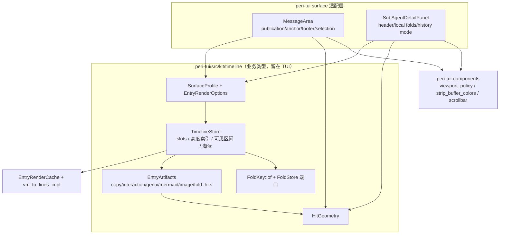

# P2：SubAgent 详情面板与主时间线 Chat 渲染同构指南（提案）

**状态**：提案（待产品/架构批准）。批准前按 `docs/design/README.md` 不进入 `docs/design/`。
**优先级**：P2。其中「GenUI 可点但无响应」「Mermaid 查看图无响应」属用户可见死交互，可单列 P1 小修。
**类型**：TUI 渲染同构 / 共享组件边界 / 迁移设计。
**创建日期**：2026-11-25。
**来源**：用户 2026-11-25 WeBots 反馈「subagent 面板里的 Chat 渲染和主线程不一样」；explorer 只读调查 + plan 设计。
**基线**：`origin/main` @ `941c062dc`。文中 `file:line` 只作基线定位，升格为 `docs/design/` 时须改为路径/符号。
**关联**：GitHub issue 报告（创建后回填）。
**本阶段交付**：调查 + 设计；不改代码。

## 1. 目标

用户要求两处 Chat 渲染同构，并尽量抽象为共享组件。本指南给出可验收的目标形态：

> **同构 = 同一 entry 渲染器 + 同一渲染槽内核 + 同一视口策略 + 同一命中语义；surface 只允许在显式白名单内不同。**

- 主时间线是基准面；SubAgent 详情面板是第二个 `SurfaceProfile`，不是复制品。
- 白名单外任何差异都视为缺陷；新增单侧能力必须同时新增白名单条目与理由，并由测试锁死。
- 先收敛重复实现，再谈新增能力；不为了「看起来一样」改变产品语义。

### 非目标

- 不改 ACP wire、事件归属、Agent 执行、持久化与模型行为。
- 不做面板形态改造（浮动/覆盖、居中带、composer 可见性）；这些属于 `tui-chat-workbench.md` 的既有目标，另立 issue。
- 不为统一而扭曲语义：面板只读、本地 fold、预览有界等有意差异保留。
- 不引入运行时开关或双写；不复制设计叙述到 `docs/code-index/`。

## 2. 现状：共享到哪、分叉在哪

### 2.1 已真实共享

| 层 | 共享内容 | 证据（基线） |
| --- | --- | --- |
| entry 渲染器 | 唯一 `vm_to_lines_impl` | `peri-tui/src/kit/message_area/render/renderer.rs:326` |
| entry 缓存 | `EntryRenderCache` + `EntrySurface::{Message,Detail}` | `peri-tui/src/kit/entry_render_cache.rs:17,67,147,185` |
| 水平网格 | `GridSpec` / `ZoneTransition` | `peri-tui/src/kit/message_area/render/grid.rs:62,75,111` |
| 换行/高度 | `WrappedLineInfo` / `build_wrap_map` | `peri-tui/src/kit/message_area/selection.rs:22,31,75` |
| Markdown | `peri-tui-components::markdown` | `peri-tui/src/kit/markdown/mod.rs:6` |
| 工具卡 | `build_tool_card` / `render_tool_card_lines` | `peri-tui/src/kit/acp_types/tool_card.rs:26`；`render/tool_card.rs:32` |
| 滚动条/滚轮 | `VerticalBar` / `register_virtual_panel_scroll` | `peri-tui/src/kit/panels/panel_scroll.rs:161` |

### 2.2 分叉：复制了「时间线外壳」

1. **两个入口壳**：`vm_to_lines_cached_with_layout_gated`（`renderer.rs:303`）与 `_scheduled`（`:258`），只差 3 个布尔与 `frame`。
2. **两套槽缓存**：`VmCacheSlot` + `Transcript`（`vm_cache_slot.rs:109`、`transcript.rs:131`）与 `DetailSlot` + `DetailRenderCache`（`panels/subagent_detail_cache/detail_render_cache.rs:44`），各自维护 hash、wrap、高度、折叠、淘汰。
3. **两套 fold 键**：`entry_nav.rs:46`（含 SubAgent/Interaction）与 `detail_render_cache.rs:481,491`（含 Group/Reminder，缺 SubAgent/Interaction）。
4. **两套视口策略**：`auto_follow.rs` + `viewport_anchor.rs` 与面板 `:419,446`；面板无分页/锚点/新内容指示。
5. **两套命中/事件层**：主区 `hits.rs`/`handlers.rs`/`genui_action.rs`/`selection.rs`；面板局部 handler。面板丢弃 `EntryRenderCache` 已产出的 copy/interaction/genui/mermaid/image/fold 副产物。
6. **两套组扫描/组构造**：`panels/agent.rs:486` 与面板 `:511,549`；`SubAgentAccumulator::view_model`（`acp_types/tool_card.rs:307`）与 `find_live_detail_subagent`。
7. **两条数据装配线**：sync 子 `CurrentTurn` 投影与 bg `live_projection`；预览常量不同（`acp_types/subagent_preview.rs:5-10` 与 `bg_task_live_preview.rs:7-13`）。
8. **两套组头**：主区压缩组头有状态符号与失败原因（`render/group.rs:63-80,168-201`）；面板身份头（`:310-330`）二者皆无。
9. **NO_COLOR 只有主区剥离**（`message_area.rs:911-917`），面板与其它面板仍带色。

### 2.3 面板当前的显式参数

`surface=Detail`、`render_copy_button=false`、`schedule_mermaid=false`、`inline_pixels=false`、`frame=None`、`ZoneTransition::None`、`grid.indent=0`（`entry_render_cache.rs:158-165,196-203`；`detail_render_cache.rs:75-77,131,154`；面板 `:289-291`）。

这些字面量就是「偏差白名单」的事实来源；目标是收敛为一个 `SurfaceProfile`，并用测试锁定。

## 3. 目标架构

### 3.1 分层与归属



| 能力 | 归属 | 理由 |
| --- | --- | --- |
| `TimelineStore` / `EntryArtifacts` / `FoldKey::of` / `HitGeometry` | `peri-tui/src/kit/timeline/` | 依赖 `TuiRenderUnit`、`FoldKey` 等应用类型；`TUI-COMPONENT-001` 禁止组件依赖应用 crate |
| `viewport_policy`（clamp/follow/page/新内容判定） | `peri-tui-components` | 纯算术、无业务语义 |
| `strip_buffer_colors` | `peri-tui-components::style` | 已有单点，明确「宿主决定应用时机」 |
| Surface 适配（消息区/面板外壳、动作） | 现有组件 | 延续 `tui-panel-architecture.md` 的「公共组件只表达交互意图」 |

**明确不做**：不抽「详情外壳」。只抽取已证实重复的槽/高度/折叠键/命中几何。

### 3.2 关键接口（建议，非现状）

```rust
// peri-tui/src/kit/timeline/
enum MermaidMode { Peek, Schedule }
enum ImageMode { TextOnly, Inline }
enum GridIndentPolicy { Derived, BaselineOnly }
enum FoldScope { Snapshot, Local }
enum InitialOffset { FollowTail, RunningTailElseHead }

struct SurfaceProfile {
    surface: EntrySurface,
    mermaid: MermaidMode,
    image: ImageMode,
    md_copy: bool,
    grid_indent: GridIndentPolicy,
    fold_scope: FoldScope,
    initial_offset: InitialOffset,
    bottom_padding: usize,
}

struct EntryRenderOptions {
    surface: EntrySurface,
    transition: ZoneTransition, // 内核按相邻 entry 派生，不进 profile
    frame: Option<u64>,
    mermaid: MermaidMode,
    image: ImageMode,
    md_copy: bool,
}

struct EntryArtifacts {
    copy_button: Option<CopyButtonInfo>,
    interaction: Option<InteractionLayout>,
    image_lines: Vec<ImageLineInfo>,
    genui_buttons: Vec<GenUiButtonInfo>,
    mermaid_fences: Vec<FenceSpan>,
    fold_hits: Arc<Vec<(usize, FoldKey)>>,
}

struct TimelineStore { /* slots, visual prefix, residency, budget */ }

trait FoldStore {
    fn get(&self, key: &FoldKey) -> Option<FoldState>;
    fn set(&mut self, key: FoldKey, state: FoldState) -> bool;
}
```

`indent` 归 `GridSpec`/`SurfaceProfile`，不塞进渲染选项；`transition` 是 slot 属性，由内核派生（复用 `transcript.rs:96-117` 的 `zone_transition`）。`EntrySurface` 继续作为缓存身份的一部分，不能从缓存键删除。

### 3.3 主题/能力注入（`RenderEnv`）

现状渲染器直接读 `THEME_ATOM`、`PALETTE_ATOM`、`ACTIVE_SESSION_ID`、`TERMINAL_CAPS`。目标由 surface 每帧构造一次只读 `RenderEnv { theme, palette, caps, session_id, language }` 并显式传参：

- 同一帧内快照一致，避免多次 atom 读取漂移；
- 内核可测试、未来下沉组件库不需要改语义；
- render body 仍不写 atom，满足 `TUI-RENDER-001`。

### 3.4 副产物与命中

- `RenderOutput` 由 7 元组改为 `{ lines, artifacts }`，由 `TimelineStore` 保存。
- `HitGeometry` 从槽位 + artifacts + 视口生成**同一套**命中（copy/interaction/genui/mermaid/image/fold 头），携带 `(source_epoch, slot, vm_hash, logical_row, col_range)`；动作仍由各 surface 执行。
- 不变量：`md_copy=true ⇒ 消费 copy_button`；`mermaid=Schedule ⇒ 调度并注册入口命中`；`image=Inline ⇒ 有 draw hook`。禁止「渲染了可点击外观但无人消费」。

### 3.5 时钟与数据装配

- 100ms ticker 谓词扩展为 `is_loading || (panel 打开且选中组 running)`；写入在后台 ticker，不在 render body。
- 单一 `TuiSubAgentGroup` 构造器与单一 `SubAgentLocator`（instance_id 优先、agent_id 回退）。
- 预览边界集中为语义单点，**数值先保持**；改数值需批准。
- 两条事件管线保留（生命周期不同），通过只读适配统一为 `im::Vector<TuiRenderUnit> + revision + 标题`。

## 4. 保留的有意差异（定稿候选）

| 差异 | 理由 |
| --- | --- |
| 面板外框/标题/身份头/`h` 历史提示 | 详情 surface 需要身份与入口 |
| 全宽、不进居中带 | 现状产品选择（见开放问题 Q10） |
| 本地 fold、退出即清 | canonical 内容只读，面板可临时展开 |
| running→尾 / completed→头 | 打开时的阅读位置语义 |
| 预览有界（数值现状） | 内存策略 |
| 不提供 user 气泡/divider/todo 摘要 | 子 turn 数据模型不含这些段 |
| 不渲染 md 复制按钮（暂定） | 与选区能力绑定，待批准 |

**待收敛（不是定稿）**：md 复制/选区、内联图片、mermaid/GenUI 死交互、组头状态/失败原因、composer 可见性（登记为上位目标未落地）。

## 5. 分阶段迁移与验收

| 阶段 | 目标 | 验收 | 风险/回滚 |
| --- | --- | --- | --- |
| 0 基线复现 | 真实终端记录主区/面板同一条目差异 | 截图/日志；确认 §6 用户可见项 | 只读 |
| A1 参数集中 | `EntryRenderOptions` + `SurfaceProfile` | 两入口壳合一；偏差白名单测试 | 低 |
| A2 NO_COLOR 单点 | 根级 post-draw 整帧剥离 | 全界面无色；主区不回退 | 中低 |
| A3 `RenderEnv` | 移除渲染器 ambient atom 读取 | 不同 env 产出不同样式；无行为变化 | 机械面广 |
| B fold 单点 | `FoldKey::of`/状态机唯一 | 10 个变体键一致；面板补 SubAgent/Interaction | 低 |
| C1 `TimelineStore`（主区先行） | 抽槽向量/前缀/预算/artifacts，行为不变 | 全量 `peri-tui --lib`、`updated_slots` 不退化 | 高，独立 PR |
| C2 面板切内核 + 主时间线布局 | 删 `indent=0`，共享 transition | 80 列 indent=2、台阶行、首帧几何正确 | 可见变化，需批准 |
| D 共享视口 | `viewport_policy` + 面板 ViewportState | 纯函数单测；主区锚点/滚动回归 | 中 |
| E 数据装配同构 | 单构造器/定位器；预览语义单点 | 组构造/定位一致性测试；数值不变 | 中 |
| F1–F4 富内容/命中 | mermaid、GenUI、copy、image | 死交互消失；命中几何测试 | 中 |
| G 收敛与文档 | 删旧壳、修 code-index、升格设计 | 静态验收清单全过 | 低 |

**MVI（最小可见改进，不碰主区）**：A1 + A2 + B + 组头状态/失败原因 + 死交互修复 + 面板几何来源修正。

## 6. 需裁决项

| # | 问题 | 建议 | 状态 |
| --- | --- | --- | --- |
| Q1 | 面板采用主时间线口径（indent/台阶/transition） | 采用 | **需产品批准**（可见变化） |
| Q2 | 分组/divider/todo/AskUser 是否进子时间轴 | 均不新增；身份头显示有界任务摘要 | 可直接决定 |
| Q3 | 复制/选区范围 | 目标与主区一致；先修「面板可选择」失实注释 | 需批准排期 |
| Q4 | mermaid/图片/GenUI 目标级别 | 死交互必修；内联图片需批准 | 部分可直接决定 |
| Q5 | NO_COLOR 统一位置 | 根级单点 | 可直接决定 |
| Q6 | bg/sync 预览策略 | 语义集中、数值保持 | 集中可决定；改数值需批准 |
| Q7 | bg 独跑动画时钟 | 扩展 100ms 谓词 | 可直接决定 |
| Q8 | 共享内核位置 | 内核留 `peri-tui`；纯算术下沉 components | 可直接决定 |
| Q9 | 面板尺寸来源 | 改 `MsgAreaTracker` 模式 + 单点 `content_area` | 可直接决定 |
| Q10 | 面板是否进居中带 | 保持现状、范围外 | 需批准登记 |
| Q11 | 组头状态/失败原因 | 身份头加状态符号 + 失败原因 | 可直接决定 |
| Q12 | 嵌套 subagent 打开 | 面板内导航栈（Esc 弹栈） | 需架构批准 |
| Q13 | fold 作用域 | 主区全局、面板本地；只统一键/状态机 | 可直接决定 |

## 7. 与既有设计的关系

- `tui-chat-workbench.md`（已批准目标，上位）：不降低其 Inspector/composer/fold 目标；本指南只补 surface profile。
- `tui-panel-architecture.md`（已批准目标，部分落地）：延续绘制/命中共源、一个面板一套路径、公共组件只提取真实重复。
- `tui-subagent-activity.md`（现行设计）：§9 要求「完整嵌套 transcript + entry 按主时间线口径」，现状已满足；Q1 若批准需在该节补面板形态。
- `tui-streaming-markdown-performance.md`（现行设计）：共享缓存、预算、lazy projection、slot index 契约不变。
- `tui-acp-data-flow.md`：只消费投影，不建旁路。

## 8. 验收标准

**静态**

- [ ] 两个入口壳归零（`vm_to_lines_cached_with_layout_(gated|scheduled)` 无引用）。
- [ ] `profile_deviation_whitelist` 通过，且与本指南偏差表逐项一致。
- [ ] `fold_key_parity_all_variants` 通过（10 个 `TuiRenderUnit` 变体）。
- [ ] `zone_transition`/`viewport_policy`/`FoldKey::of` 各仅一份实现。
- [ ] NO_COLOR 缓冲区测试覆盖面板区域。
- [ ] `TimelineStore` 保留 publication 后缀与 `SlotIndex`，`updated_slots` 不退化。
- [ ] code-index 路径修正、模块注释与实现一致。

**真实终端手测**

- [ ] `NO_COLOR=1` 全界面无色、选区仍可辨。
- [ ] bg 独跑（主回合结束后仍在运行）面板 spinner 持续动。
- [ ] resize 时面板阅读位置与主区语义一致。
- [ ] 面板 Mermaid/GenUI/复制（若批准）实际可用。
- [ ] 窄终端（<60 列）布局与 60/100 列断点无裁剪。

## 9. 风险与未验证项

- 本提案基于静态代码核对，未做真实终端像素级对照；用户可见项在阶段 0 复现后再定级。
- `C1` 触达主路径（主区 transcript），必须独立 PR 并跑全量 `peri-tui --lib`；性能计数（`PERI_RENDER_TIMING`）作为验收。
- `STD-SIZE-001`：`message_area.rs`、`renderer.rs` 已接近 1000 行，阶段 D 前先按职责拆分。
- 面板首帧 `use_previous_size()` 返回默认 Rect，当前按 2 列准备；Q9 修复前不要以首帧截图下结论（`[待实测]`）。
- 「bg 独跑动画停更」是基于 `entry.rs` 心跳条件与 bg 事件不改 `phase` 的推断，需复现确认。
